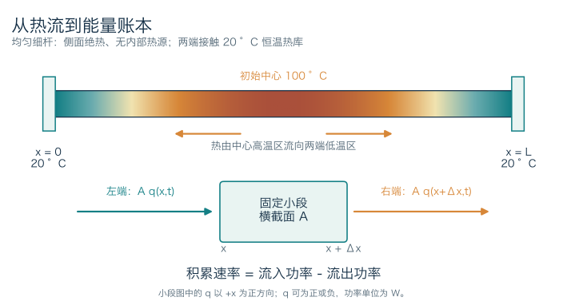
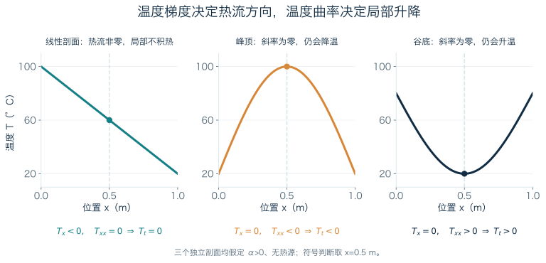
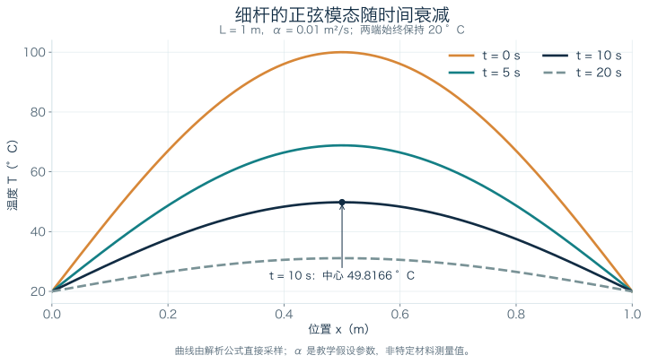
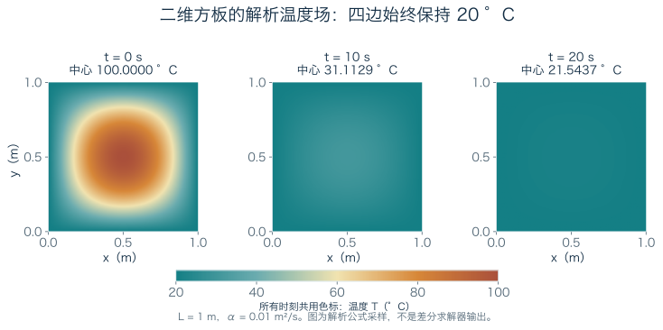

# 第九讲：热传导方程与数值求解思路

**从热流与能量守恒出发，为数值模拟建立可验证的数学问题**

第八讲用邻居交换完成了排序。进入热传导问题后，我们首先要弄清楚：温度是什么量，为什么会改变，模型需要哪些条件，以及怎样判断计算结果是否正确。收到邻居的数据以后采用什么更新规则，需要由这些问题决定。

本讲以一维细杆建立模型，再扩展到二维平板；通过一个可以直接检验的解析解观察温度随时间的变化，并形成数值求解的总体思路。配套程序计算解析公式的采样值，供后续差分求解器作参考。第十讲将推导差分格式并实现串行求解，第十一讲再组织 MPI 域分解与边界交换。

## 一、我们要求的是一个温度场

### 1.1 一根中间热、两端冷的细杆

考虑长为 L 的细杆，假设每个横截面内的温度近似一致。侧面绝热，热量只沿杆的长度方向传递；两端与恒温装置接触，温度保持为 20 °C。开始时中部较热，中心达到 100 °C。

我们希望知道任意位置、任意后续时刻的温度，记为：

$$
T=T(x,t),\qquad 0\le x\le L,\quad t\ge0.
$$

`x` 是位置，单位 m；`t` 是物理时间，单位 s；`T` 是温度。T 的未知对象是一整个函数，而不是一个数。这里的物理时间与程序运行耗时是两种不同的量。

固定 t，把温度随 x 的变化画成曲线，得到**某一时刻的温度分布**；固定 x，观察 T 随 t 的变化，得到**某个位置的温度历史**。二维时写成 `T(x,y,t)`，每个时刻是一张温度场。

### 1.2 三个导数分别回答什么问题？

| 量 | 意义 | 单位 |
|---|---|---|
| `T(x,t)` | 当前位置、当前时刻有多热 | °C 或 K |
| `∂T/∂t`，简记 `T_t` | 固定位置的温度升降速度 | K/s |
| `∂T/∂x`，简记 `T_x` | 固定时刻沿杆的温度变化率，即温度梯度 | K/m |
| `∂²T/∂x²`，简记 `T_xx` | 温度曲线斜率沿位置怎样变化，反映温度曲线的局部弯曲趋势 | K/m² |

偏导符号 `∂` 提醒我们：对一个变量求导时，其他自变量保持不变。温差 1 °C 与温差 1 K 的数值相同；本讲以摄氏温度显示结果，以 K 表示温差的单位。线性热传导模型中的温度导数不受温标零点平移影响。

## 二、先描述热流，再计算温度变化

### 2.1 傅里叶定律：温度梯度决定热流方向

规定沿 x 增大的方向为正方向。热流密度 q 是单位面积、单位时间通过的热量：

$$
q(x,t)=-k\frac{\partial T}{\partial x}(x,t).
$$

这是傅里叶热传导定律。k 为导热系数，单位 `W/(m·K)`；q 的单位为 `W/m²`。截面积为 A 时，通过截面的热流率为 Aq，单位 W。

若温度沿 x 增大的方向下降，即 `T_x<0`，则 q>0，热量流向右侧；若 `T_x>0`，则 q<0，热量流向左侧。负号体现热量沿温度降低的方向传递。

**q 与 Aq 要区分。**前者是每单位面积的热流密度，后者才是通过整个截面的热流率。

### 2.2 一小段杆的能量账本

假设材料密度 ρ、比热容 c、导热系数 k，以及截面积 A 均为常数，杆内没有热源。对 `[x,x+Δx]` 这一小段，选择固定参考温度 `T_ref`，其相对热能为：

$$
E(t)=\rho c A\int_x^{x+\Delta x}
\bigl(T(\xi,t)-T_{\mathrm{ref}}\bigr)\,\mathrm d\xi.
$$

其中 ρ 的单位为 `kg/m³`，c 的单位为 `J/(kg·K)`，所以 E 的单位为 J。参考温度只确定能量零点，不改变能量随时间的变化率。



能量守恒要求：

$$
\underbrace{\frac{\mathrm dE}{\mathrm dt}}_{\text{积累率}}
=\underbrace{Aq(x,t)}_{\text{从左端流入}}
-\underbrace{Aq(x+\Delta x,t)}_{\text{从右端流出}}.
$$

这个式子使用有符号的 q。即使某个截面的实际热流朝左，符号也会自动给出正确的流入或流出贡献。

### 2.3 从控制体得到热传导方程

将能量表达式代入、约去 A，再除以 Δx：

$$
\rho c\frac{1}{\Delta x}\int_x^{x+\Delta x}T_t(\xi,t)\,\mathrm d\xi
=-\frac{q(x+\Delta x,t)-q(x,t)}{\Delta x}.
$$

令 `Δx→0`，在温度与热流足够光滑的地方得到：

$$
\rho c T_t=-q_x.
$$

将 `q=-kT_x` 代入，并使用 k 为常数的假设：

$$
\boxed{\quad T_t=\alpha T_{xx},\qquad
\alpha=\frac{k}{\rho c}>0.\quad}
$$

α 称为**热扩散率**，单位为 `m²/s`。导热系数 k 描述给定温度梯度产生多大热流；热扩散率 α 同时考虑导热能力与单位体积的储热能力，决定这个模型中温度场变化的速度。

单位检查可以帮助发现漏掉系数的错误：

$$
[\alpha T_{xx}]
=\frac{\mathrm m^2}{\mathrm s}\frac{\mathrm K}{\mathrm m^2}
=\frac{\mathrm K}{\mathrm s}=[T_t].
$$

若材料参数随位置变化，守恒形式中应保留 `∂x(k∂xT)`，不能直接把变量 k 从导数里提出。本讲后续算例采用均匀常系数模型。

## 三、曲线很陡，是否就一定升温？

热流由一阶导数决定，局部温度变化由热流的净流入决定。对于常系数方程，这个净效应体现在二阶导数中：

| 局部形状 | `T_xx` | `T_t=αT_xx` 的含义 |
|---|---:|---|
| 向上弯曲，局部像谷底 | >0 | 此处升温 |
| 向下弯曲，局部像山顶 | <0 | 此处降温 |
| 局部为直线 | =0 | 该瞬间此处温度不变 |



一个有用的例子是两端保持不同恒温的杆：

$$
T_s(x)=100-80\frac{x}{L}.
$$

此时 `T_x=-80/L`，热流一直从左向右；但 `T_xx=0`，任何小段流入和流出的热量相等，所以 `T_t=0`。这叫**稳态**。稳态意味着温度不随时间改变，可以伴随持续的热流。

“局部温度高”也不能单独决定该点的升降；还要看周围温度如何分布，以及有无热源和边界供热。本节判断基于无源的常系数热方程。

## 四、一个完整的问题还需要初始条件和边界条件

### 4.1 方程、初值、边界，三者缺一不可

热方程规定内部温度怎样变化。要确定具体解，还需说明开始时的温度分布，以及边界如何与外界交换热量。

$$
\begin{cases}
T_t=\alpha T_{xx},&0<x<L,\ t>0,\\
T(x,0)=f(x),&0\le x\le L,\\
T(0,t)=T_L(t),\quad T(L,t)=T_R(t),&t\ge0.
\end{cases}
$$

初始条件给出 `t=0` 时整根杆的状态；边界条件给出端点在后续时刻的行为。对本讲采用的光滑算例，初值在端点处与边界温度一致，避免在起始角点引入突变。

### 4.2 固定温度与绝热是不同的边界条件

| 边界类型 | 数学描述 | 物理意义 |
|---|---|---|
| Dirichlet，给定温度 | `T=T_b` | 边界温度由外界维持，允许热量流过边界 |
| Neumann，给定法向导数或热流 | `q_n=-k∂T/∂n` 给定 | 指定穿过边界的热流密度 |
| 绝热，零通量的 Neumann 条件 | `q_n=0`，故 `∂T/∂n=0` | 没有热量穿过该边界 |

`n` 表示边界的外法向方向。一维杆的左端外法向朝负 x，右端外法向朝正 x；使用有符号通量时要说明方向。

**把端点保持在 20 °C 并不表示端点绝热。**恒温装置可吸收或提供热量以维持端点温度。对于中部较热、两端保持 20 °C 的杆，杆内热量可以通过两端流向外界。杆本身是可以与外界交换能量的系统，其热能减少与能量守恒并不矛盾；减少的部分通过边界传给了外界。

若杆的侧面和两端都绝热、又没有热源，杆整体的热能保持不变；内部温度仍可以重新分布。固定冷端与全绝热端点会产生不同的长期状态，不能混用其结论。

## 五、先构造一个可以检验的解析基准

### 5.1 明确全部参数

选取下面的教学问题：

| 参数或条件 | 数值或表达式 |
|---|---|
| 杆长 L | 1 m |
| 热扩散率 α | 0.01 m²/s |
| 两端温度 | 恒定 20 °C |
| 初始温度 | `20+80sin(πx/L)` °C |
| 温度超出边界值的最大初始幅度 | 80 K |

L 与 α 是**为观察方便选取的教学参数**，不代表某种真实材料的测量值。初始温度在两端为 20 °C，中心为 100 °C，与边界条件相容。

令 `θ=T−20`，温度偏差满足相同的热方程，边界为零。尝试把空间形状和时间变化分开：

$$
\theta(x,t)=a(t)\sin\frac{\pi x}{L}.
$$

空间上求两次导数：

$$
\theta_{xx}=-\left(\frac{\pi}{L}\right)^2
a(t)\sin\frac{\pi x}{L}.
$$

代入方程，得到幅度满足的常微分方程：

$$
a'(t)=-\alpha\left(\frac{\pi}{L}\right)^2a(t),\qquad a(0)=80.
$$

因此，完整解析解为：

$$
\boxed{\ T(x,t)=20+80\exp\left[-\alpha
\left(\frac{\pi}{L}\right)^2t\right]\sin\frac{\pi x}{L}.\ }
$$

这是一个特定的正弦模态解，不表示任意初值都有同样的单项公式。更一般的初值可需要多个模态，复杂几何、材料或源项又会带来其他困难。

### 5.2 如何确认它确实解决了原问题？

检验一个候选解，需要同时检查：

1. **方程：**时间求导和空间求两次导数后，满足 `T_t=αT_xx`。
2. **边界：**`sin(0)=sin(π)=0`，两端始终为 20 °C。
3. **初值：**t=0 时指数因子为 1，恢复指定的初始曲线。

只满足偏微分方程而不满足初边值条件，仍然不是这个具体问题的解。例如恒定温度 20 °C 满足方程和边界，却没有满足本例中部较热的初值。

### 5.3 观察四个时刻



图由解析公式采样绘制，不是差分求解器的输出。所有曲线的两端固定在 20 °C，中间高出的部分逐渐减小。中心 `x=L/2` 的正弦因子为 1：

| 物理时间 t / s | 中心温度 / °C |
|---:|---:|
| 0 | 100.0000 |
| 5 | 68.8398 |
| 10 | 49.8166 |
| 20 | 31.1129 |

在本例中，`T−20` 随时间按指数衰减。后续数值程序与这个解比较时，必须使用相同的 L、α、初值、边界和物理时刻。

## 六、温度变化有多快？

把衰减因子写成 `exp(−t/τ)`：

$$
\tau=\frac{L^2}{\alpha\pi^2}\approx10.1321\ \mathrm s.
$$

τ 是本例第一正弦模态的 e 折衰减时间：经过 τ，**超出 20 °C 的部分**变成原来的 `1/e`。这不是摄氏温度数值本身乘以 `1/e`。中心此时约为 `20+80/e≈49.4304` °C。

从公式直接看出：

- α 加倍、L 不变，τ 减半；同样物理时刻，温度偏差衰减更多。
- L 加倍、α 不变，τ 变为原来的 4 倍。比较时保持相同的归一化位置 `x/L`，以及相同的初始温度形状。
- t=τ 与 t=10 s 很接近，但不是同一时刻，所以两者的中心温度略有差异。

这个尺度关系帮助我们选择值得观察的物理时间。它还不能替代后续数值格式对时间步长的稳定性与精度要求。

## 七、扩展到二维：一张温度场怎样变化？

### 7.1 多了一个空间方向

对平面内导热、厚度方向温度近似一致且不与外界换热的均匀薄板，常系数无源模型为：

$$
T_t=\alpha\left(T_{xx}+T_{yy}\right)
=\alpha\nabla^2T.
$$

`∇²` 称为拉普拉斯算子，在直角坐标中就是各空间方向二阶偏导的和。三维再增加 `T_zz`。本讲二维模型中，薄板表面不额外散热，热量可以在 x、y 两个方向传递，并通过给定边界与外界交换。

一个完整的二维问题仍需指定整个区域的初始温度、区域边界上的条件，以及材料参数。

### 7.2 四边固定温度的正方形基准

取 `0≤x≤L, 0≤y≤L`，四边保持 20 °C，初始场为：

$$
T(x,y,0)=20+80\sin\frac{\pi x}{L}\sin\frac{\pi y}{L}.
$$

相应解析解为：

$$
\boxed{\ T(x,y,t)=20+80\exp\left[-2\alpha
\left(\frac{\pi}{L}\right)^2t\right]
\sin\frac{\pi x}{L}\sin\frac{\pi y}{L}.\ }
$$

x、y 方向分别求两次导数，各贡献一个 `−(π/L)²`，所以时间指数中出现系数 2。对这个特定模态和相同 L、α，二维幅度衰减时间为一维的一半：`τ₂=L²/(2απ²)`。



图中 t=0、10、20 s 使用相同的 20–100 °C 色标，便于比较绝对温度。L=1 m、α=0.01 m²/s 时：

| t / s | 板中心温度 / °C |
|---:|---:|
| 0 | 100.0000 |
| 10 | 31.1129 |
| 20 | 21.5437 |

“二维衰减更快”这里特指上述可分离模态、同样 L 与 α 及固定边界的比较；不能把系数 2 推广成任意几何或任意初值下的固定倍数。

## 八、为什么还需要数值算法？

### 8.1 解析基准容易检验，一般问题未必容易求公式

本讲选取简单区域、常材料参数、固定边界和一个正弦模态，是为了得到可直接检验的解。实际问题可能有复杂形状、空间变化的材料、热源或随时间变化的边界，通常需要更一般的数值方法。

数值求解要把连续问题转成有限个可计算的未知量，并建立这些未知量之间的更新或方程关系。后续采用有限差分：在空间选取位置，以邻近位置的温度差近似导数；在时间上从已知状态逐步推进。

### 8.2 数值求解的整体流程

```text
指定区域、材料、初值、边界和目标物理时间
                  ↓
选择空间近似与时间推进方法
                  ↓
设置初始温度，施加相应边界条件
                  ↓
从当前状态计算下一时刻的近似状态，并按边界条件处理边界
                  ↓
到达目标时刻后，输出并与参考结果比较
```

下一时刻的温度变化必须来自方程描述的热流与积累，不能把“邻居平均一下”当作没有依据的程序规则。差分公式、网格与步长的关系将在下一讲推导。

### 8.3 显式与隐式，先分清求解方式

| 思路 | 下一时刻的未知量怎样得到？ | 需要关注什么？ |
|---|---|---|
| 显式时间推进 | 从已经知道的当前状态直接计算新状态 | 更新关系、步长限制和误差；本地依赖容易识别 |
| 隐式时间推进 | 新状态的多个未知量同时出现在方程中，需要求解相应方程组 | 方程组求解的成本，以及具体格式的精度和稳定性 |

显式或隐式不是 MPI 接口的分类。先选择并验证数学算法，才能确定并行时要交换什么数据。隐式方法也不表示任意时间步长都足够准确；稳定与精度需要分别判断。

### 8.4 数值计算至少需要回答三个问题

- **误差：**在相同位置、相同物理时刻，近似温度与参考温度差多少？
- **稳定性：**输入和计算中的微小扰动会不会被算法不合理地放大？
- **收敛性：**按格式要求细化空间与时间后，近似解是否趋近连续问题的解？

例如可在采样位置上定义最大绝对误差：

$$
E_\infty=\max_i\left|U_i-T(x_i,t)\right|.
$$

二维相应使用 `max_{i,j}|U_{i,j}−T(x_i,y_j,t)|`。这里 U 表示未来数值求解器给出的近似值。单个网格上的误差较小，不等于已经验证收敛阶；也不能用“没有崩溃”代替正确性检验。

## 九、配套程序：产生解析参考值

### 9.1 它计算什么？

示例位于 [09_heat_reference](../../../examples/mpi/09_heat_reference/README.md)。它直接调用正弦和指数函数计算一维或二维解析温度，再输出 CSV（逗号分隔值）文件。

程序不从 t=0 逐步推进到给定时刻，输出位置的数量只是采样密度；它没有有限差分的空间截断误差或时间步长误差。浮点函数计算与输出舍入仍会带来数值舍入误差。这个基准将帮助后续求解器检验数学问题是否实现正确。

`HeatModel` 保存维数、L、α 和衰减时间 τ。先用 `heat_model_init` 成功初始化模型，再用下面这个完整求值函数计算温度；头文件和参数解析位于配套源码。

```c
double heat_temperature(const HeatModel *model, double x, double y, double time)
{
    if (model == NULL || !isfinite(time) || time < 0.0 ||
        !isfinite(x) || x < 0.0 || x > model->length ||
        (model->dimensions == 2 && (!isfinite(y) || y < 0.0 || y > model->length))) {
        return NAN;
    }
    if (x == 0.0 || x == model->length ||
        (model->dimensions == 2 && (y == 0.0 || y == model->length))) {
        return HEAT_BACKGROUND_C;
    }
    const double pi = acos(-1.0);
    double shape = sin(pi * (x / model->length));
    if (model->dimensions == 2) {
        shape *= sin(pi * (y / model->length));
    }
    return HEAT_BACKGROUND_C + HEAT_AMPLITUDE_K * exp(-time / model->tau) * shape;
}
```

开头检查坐标和时间是否合法；端点或板边界直接返回 20 °C，明确表达给定温度条件，也避免依赖浮点 `sin(π)` 恰好为零。`shape` 计算正弦空间形状，二维再乘 y 方向的正弦；`exp(-time/model->tau)` 给出该时刻的幅度。

函数本身没有时间循环。一次求值只需要模型、位置和目标时刻，不需要前一时刻的温度。`acos(-1.0)` 用 C 标准数学函数获得 π，数学函数通过 `<math.h>` 声明。完整程序、模型初始化与测试见 [源码详解](../../../examples/mpi/09_heat_reference/程序详解.md)。


### 9.2 用熟悉的 CMake 流程构建

从课程仓库根目录开始：

```bash
cd examples/mpi/09_heat_reference
mkdir build
cd build
cmake ..
make
ctest
```

已有 `build` 时直接进入。该参考程序不使用 MPI，直接运行可执行文件即可。修改源码后，在同一个 `build` 内重新 `make`，再运行程序与测试。构建说明和新增代码详解见 [程序详解](../../../examples/mpi/09_heat_reference/程序详解.md)。

### 9.3 输出与查看 CSV

```bash
./heat_reference line 0 > line-t0.csv
./heat_reference line 10 > line-t10.csv
./heat_reference plate 10 > plate-t10.csv
head line-t10.csv
```

`line` 表示一维杆，`plate` 表示二维正方形；紧随其后的数是物理时间，单位 s。默认 L=1 m、α=0.01 m²/s。标准输出保存纯 CSV，标准错误输出显示参数与中心温度摘要，所以重定向后仍能在终端看到摘要。

一维 CSV 的表头为 `x_m,T_C`，含 11 个位置；二维表头为 `x_m,y_m,T_C`，含 `11×11` 个位置。它们包含边界与中心。默认一维 t=10 s 的中心温度应约为 49.8166 °C；二维同一时刻应约为 31.1129 °C。

程序还可依次指定 α 和 L：

```bash
./heat_reference line 10 0.02 1 > line-alpha2.csv
./heat_reference line 10 0.01 2 > line-length2.csv
```

输入需满足非负时间、正的 α 与 L，并处于程序支持的有限数值范围。非法输入应报错并返回非零状态。详细规则、数据列和测试内容见实验 README。

### 9.4 从 CSV 画出温度场

先保留三个时刻的数据，再把它们画在一起。以下命令继续在 **`examples/mpi/09_heat_reference/build`** 中执行；如果刚打开终端，从仓库根目录先执行 `cd examples/mpi/09_heat_reference/build`。

```bash
for t in 0 10 20; do
  ./heat_reference line "$t" > "line-t${t}.csv"
  ./heat_reference plate "$t" > "plate-t${t}.csv"
done
python3 ../../plot_heat.py line-t0.csv line-t10.csv line-t20.csv -o rod.png
python3 ../../plot_heat.py plate-t0.csv plate-t10.csv plate-t20.csv -o plate.png
```

课程容器提供 Python、NumPy 和 Matplotlib。`../../plot_heat.py` 是仓库中统一的绘图脚本：从当前 `build` 向上两层，就到 `examples/mpi`。它根据 CSV 表头判断是一维曲线还是二维温度场；`-o` 指定输出图片文件。PNG 保存在当前 `build`，在 VS Code 左侧文件浏览器展开该目录，点击 `rod.png` 或 `plate.png` 即可预览，不需要在容器里弹出绘图窗口。把输出扩展名改为 `.pdf` 或 `.svg`，还可得到矢量图。


一维图的横轴为位置 x（m），纵轴为温度（°C）；图例中的文件名标明时刻。圆点是程序实际输出的 11 个位置，连线帮助观察曲线形状。两端保持 20 °C，中部逐渐降温。这里的 0、10、20 是**物理时间（秒）**，与生成图片或运行程序花了多久无关。


二维图的两个坐标轴都是空间位置（m），温度改由颜色表示。三个面板共用固定的 **20–100 °C 色标**，因此同一种颜色始终代表同一温度，可以直接观察高温区减弱。若每张图都把各自最大值映射成最亮颜色，降温过程会被掩盖。

本例二维 CSV 只有 `11×11` 个采样位置，脚本按相邻节点中点划分色块；这些方块是数据的显示方式，不代表这里已经运行有限差分算法。三幅图仍是解析公式在不同时间的采样。下一讲产生数值解后，才能在相同位置和时刻画出数值解相对于解析解的误差。

## 十、概念辨析与参考答案

### 10.1 温度梯度很大，是否代表此处一定升温？

**答案：**不能这样判断。梯度决定热流方向和大小；局部升降取决于净热流，在本讲模型中由 `αT_xx` 决定。线性稳态有非零梯度与持续热流，但 `T_t=0`。

### 10.2 固定为 20 °C 的边界是否就是绝热边界？

**答案：**不是。固定温度允许通过热交换维持温度；绝热要求零法向热流。两者约束不同。

### 10.3 满足热传导方程的函数，是否必然是本例的解？

**答案：**还必须满足本例初始条件和边界条件。恒定 20 °C 满足方程和边界，却不满足中部初始 100 °C 的条件。

### 10.4 中心温度在 t=τ 时，是否为 `100/e` °C？

**答案：**不是。按指数衰减的是相对于 20 °C 的温度偏差，所以中心温度为 `20+80/e≈49.4304` °C。

### 10.5 把解析公式的采样点加密，是否在验证差分法收敛？

**答案：**没有。直接代公式在更多位置求值，只改变输出采样密度。检验差分法收敛，需要真正运行不同离散参数的数值求解器，在相同物理时刻比较误差。

## 十一、上机练习与参考答案

### 练习一：先预测中心温度，再运行

预测 t=0 与 t=10 s 时一维和二维中心温度的大小关系。按第九节命令构建并运行原程序，查看摘要与 CSV，再执行 `ctest`。

**参考答案：**t=0 时两者中心均为 100 °C；t=10 s 时一维约 49.8166 °C，二维约 31.1129 °C。这个二维模态的两个方向分别贡献扩散项，指数衰减率是对应一维模态的两倍。

### 练习二：改变材料参数与长度

先由 τ 的公式预测：α 加倍、L 加倍分别会怎样改变衰减时间？然后比较：

```bash
./heat_reference line 10 > original.csv
./heat_reference line 10 0.02 1 > alpha2.csv
./heat_reference line 10 0.01 2 > length2.csv
```

**参考答案：**α 加倍使 τ 减半，中心在 t=10 s 时约为 31.1129 °C；L 加倍使 τ 变为 4 倍，中心约为 82.5075 °C。长度改变后，应比较各自中心 `x=L/2` 或相同 `x/L` 的位置，而不是任意相同的 x。

### 练习三：边界和初值，怎样分别检查？

在 `line-t0.csv` 中找两端与中心；在 `line-t10.csv` 中再次找两端。再说明为什么“所有值都输出为 20”会错误地通过一部分检查。

**参考答案：**t=0 时两端为 20 °C、中心为 100 °C；t=10 s 时两端仍为 20 °C。全输出 20 能通过固定边界检查，也满足一个常值热方程解，但没有恢复正确初始曲线和内部温度。测试需要分开覆盖初值、边界与内部参考值。

### 练习四：t=10 s 的温度是否需要先算 t=9 s？

定位程序中的指数与正弦计算，说明参考程序为何可直接请求 t=10 s；再与第八节中的数值时间推进流程比较。

**参考答案：**解析公式已给出任意时刻的温度，直接代入 t 即可；它没有使用 t=9 s 的计算结果。后续差分求解器将从给定初始状态按选定步长推进，需要保存当前与下一时刻的近似状态。两种程序执行的数据依赖不同。

## 十二、下一步怎样走向并行计算？

先把数学模型与初边值条件写完整，再推导离散算法、实现并验证串行基线，随后才划分计算域。网格点需要哪些邻近值，由离散公式决定；若某些值属于其他 rank，就要通过通信取得它们的本地副本。

这种邻居通信沿用上一讲对缓冲区和匹配的理解。热传导的更新来自热方程及其数值算法，保持各进程负责的空间子域；温度数据的处理规则与奇偶排序中的 min/max 比较不同。

解析基准适合检验简单算例，串行与 MPI 版本还应在相同网格、步长、初值和边界下进行对照。物理时间 t、程序运行耗时与通信耗时也需要分别记录和解释。

## 参考文献与图示来源

资料核对日期：2026-10-27。正文中的 L、α、初值和温度表为课程自定算例；解析公式由本讲代入检验，图像按公式采样绘制。

1. M. J. Hancock，MIT 18.303，*The 1-D Heat Equation*，2006，[原课程讲义](https://www.ocw.mit.edu/courses/18-303-linear-partial-differential-equations-fall-2006/d11b374a85c3fde55ec971fe587f8a50_heateqni.pdf)，§1.1–1.2、第 1–3 页；§2.3、第 7 页；§6.1、第 24 页：能量守恒与傅里叶定律、热扩散率、初边值条件、正弦模态及稳态分解。
2. Stanford Math 220B，[Heat Equation](https://web.stanford.edu/class/math220b/handouts/heateqn.pdf)，§2.1–2.2、第 1–5 页：多维守恒形式、常系数热方程与边界问题。本讲二维正弦乘积解通过分方向求导直接检验。
3. B. Poonen，MIT，*18.03 Lecture Notes, Spring 2025*，[§29 Heat equation](https://math.mit.edu/~poonen/03/notes.pdf)，§29.1、Remark 29.2；§29.4、Remark 29.8：曲率与局部升降温，以及给定温度、给定导数条件的区别。
4. G. Strang，*The Heat Equation and Convection-Diffusion*，[§5.4 原课程材料](https://ocw.mit.edu/courses/18-086-mathematical-methods-for-engineers-ii-spring-2006/5db29e69494eb09a26f7224d43adc6f6_am54.pdf)，2006：指数模态、固定温度与绝热边界、显式与隐式求解思路。材料中的数学耗散量与杆的实际热能需按各自定义区分。
5. J. Demmel，UC Berkeley CS267，*Lecture 13: Sources of Parallelism and Locality in Simulation (continued)*，1996-02-27，[原课程讲义](https://people.eecs.berkeley.edu/~demmel/cs267/lecture17/lecture17.html)：连续场到离散未知量、显式时间推进、隐式线性方程组和二维局部数据依赖。URL 中的 lecture17 是文件路径，课程页面标题为 Lecture 13。
6. GoogleTest，[Primer](https://google.github.io/googletest/primer.html)：测试组织和数值断言；本讲函数、参考值及初边值检查由课程代码实现。
7. CMake 3.31，[ctest(1)](https://cmake.org/cmake/help/v3.31/manual/ctest.1.html)：运行已配置的测试及失败输出；构建步骤沿用前讲。
8. Matplotlib，[pyplot.savefig](https://matplotlib.org/stable/api/_as_gen/matplotlib.pyplot.savefig.html)：保存绘图结果，按文件扩展名选择图片或矢量格式。新增绘图资料核对日期：2026-11-09。
9. Matplotlib，[pyplot.pcolormesh](https://matplotlib.org/stable/api/_as_gen/matplotlib.pyplot.pcolormesh.html)：二维标量场的颜色映射、固定 `vmin`/`vmax` 与 `shading="nearest"` 的节点着色规则。

`rod-energy-balance.svg`、`slope-vs-curvature.svg`、`heat-line-profiles.svg`、`heat-plate-fields.svg` 及课件对应图为**课程自绘**，依据上述守恒、热方程与本讲自定算例。曲线和色彩图按解析公式计算，未作为数值模拟或性能测量结果使用。图形脚本、数据及详细依据见 [assets/SOURCE.md](assets/SOURCE.md)。

`csv-line.png` 与 `csv-plate.png` 为课程 `heat_reference` 的实际 CSV 经仓库 `plot_heat.py` 绘制的结果；输入 CSV 保存在 `assets/plot-data/`，复现步骤见上述 9.4 节及图示来源记录。
