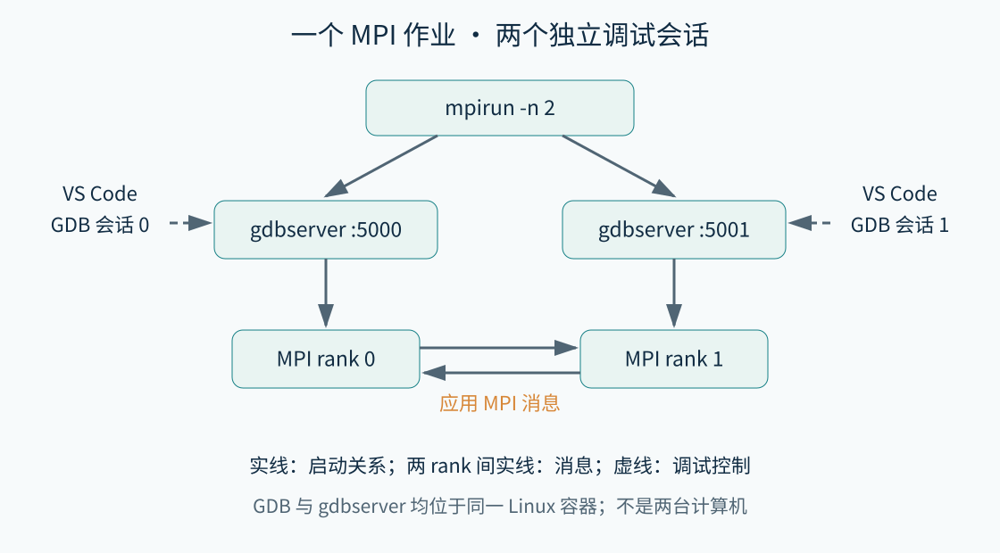
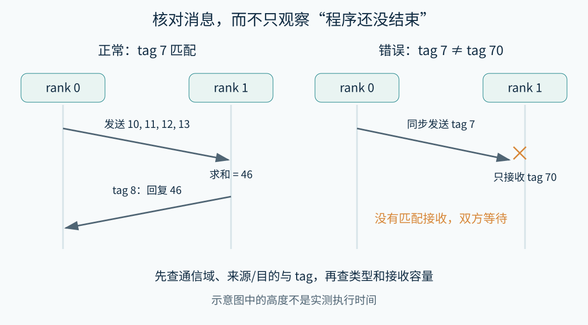

# 第 9.5 讲　用 VS Code 调试两个 MPI 进程

rank 0 把四个整数交给 rank 1 求和。正常运行时，终端最后打印 `reply=46 expected=46`。如果某次收到 47，究竟是发错了数据，还是算错了和？这次实验用两个断点追踪同一条请求和回复。

## 1. 先画出要追踪的数据

| 进程 | 先做什么 | 接下来做什么 |
|---|---|---|
| rank 0 | 以 tag 7 发送 `[10,11,12,13]` 给 rank 1 | 用 tag 8 接收一个整数，与独立计算的期望值 46 比较 |
| rank 1 | 用 tag 7 将四个整数接收到自己的 `recv_data` | 在本地求和，用 tag 8 把 `reply` 送回 rank 0 |

两个进程运行同一份 `exchange_debug.c`，各自有一份 `reply`。观察 rank 1 接到什么，再观察 rank 0 收到什么回复，可以把问题定位到一段具体的执行过程。下面所有终端命令都在**同一个课程容器的集成终端**中按顺序执行。

## 2. 准备好能在源码行上暂停的程序

1. 用 VS Code 打开课程仓库**根目录**。资源管理器顶层应同时看到 `.devcontainer`、`.vscode`、`examples` 和 `lectures`。打开命令面板，在本地窗口执行 **Dev Containers: Reopen in Container**。已连接课程容器时，直接在原窗口继续。
2. 确认左下角显示 **Dev Container**。在扩展视图里确认 Microsoft 的 **C/C++** 已在容器侧启用。在菜单 **Terminal → New Terminal** 打开终端，执行下面的命令。
3. 若环境检查报告找不到 `gdb` 或 `gdbserver`，先确认课程仓库已更新，在命令面板执行 **Dev Containers: Rebuild Container**。等窗口重连后重新打开容器终端，从下面这组命令开始。

```bash
cd /workspace
ls .vscode/launch.json
cd examples/mpi/09a_mpi_debug
bash scripts/check_debug.sh
```

`ls` 检查仓库自带的调试配置。环境脚本会列出 MPI 和调试工具，并试用 GDB 启动子进程。检查成功后，此时终端位于 `/workspace/examples/mpi/09a_mpi_debug`。继续编译并跑一次普通作业。

```bash
mkdir -p build
cd build
cmake ..
make
ctest
mpirun -n 2 ./exchange_debug correct
```

本例新建的构建目录默认使用 Debug。编译器的 `-g` 将指令和源码行关联起来，`-O0` 方便观察局部变量的逐次变化。原始示例有四项应用测试，均应通过。普通作业中两个 `ready` 的先后可以变化，结束前应看到以下两行。

```text
rank=0 reply=46 expected=46
CHECK PASS
```

## 3. 只设两个断点

在左侧资源管理器依次打开 **examples → mpi → 09a_mpi_debug → exchange_debug.c**。在编辑区的**行号左侧**点击，启用断点后该行出现红点。只保留表中 B、C 两个断点，首次运行时让 A 保持关闭。

| 断点 | 点在哪条可执行语句 | 此处可以回答什么 |
|---|---|---|
| **B** | `BREAK B` 注释的下一行 `reply = 0;`（原始文件第 52 行） | rank 1 已从 `MPI_Recv` 返回。它实际收到了哪四个整数？ |
| **C** | `BREAK C` 注释的下一行 `local_ok = (reply == expected);`（原始文件第 46 行） | rank 0 已收到回复。最终的 `reply` 与 `expected` 各是多少？ |

可以在编辑器搜索 `BREAK B`、`BREAK C` 来定位，点击注释下面的代码行。**B 虽然在文件中排在 C 后面，却会先触发。**B 在 rank 1 的分支上。它此时尚未发送回复，rank 0 要收到回复才能走到 C。

## 4. 启动同一个作业，再从 VS Code 接入

刚才的普通作业已结束，终端还在 `build` 目录。**在同一终端**执行下面两行，第一行回到有 `scripts` 的示例目录。

```bash
cd ..
bash scripts/start_debug.sh correct
```

等终端同时出现 `Listening on port 5000` 和 `Listening on port 5001`，两行顺序不限。此刻两个调试服务器正在等连接。**保持该终端运行，下一步在 VS Code 左侧操作。**

1. 点击左侧 **运行和调试 / Run and Debug**（带小虫的三角图标）。
2. 在该面板顶部的配置下拉框选择 **MPI: both ranks**，点击**下拉框旁边的绿色三角**。这样会建立 `MPI rank 0` 和 `MPI rank 1` 两个会话。
3. 在该面板展开 **调用堆栈 / CALL STACK**。第一次暂停应在 **MPI rank 1** 下的 `main`，编辑器指向 B。若面板里出现线程层级，展开已暂停的线程并点 `main`。**变量 / VARIABLES** 的内容随选中的栈帧而变。

`mpirun -n 2` 建立一个作业，两个应用进程属于同一 `MPI_COMM_WORLD`。启动脚本用 Open MPI 的 `OMPI_COMM_WORLD_RANK` 为两个 gdbserver 选择容器内的 5000 和 5001 端口。rank 是进程在通信域中的编号，PID 是操作系统里的进程号。课程根目录的 `.vscode/launch.json` 把两个 VS Code 会话分别连到这两个端口。调试器、服务器和可执行文件都位于同一课程容器。



## 5. 观察 B、C，完成一次正常调试

| 顺序 | 在哪里、做什么 | 此时应看到什么 |
|---|---|---|
| ① B | 在 CALL STACK 选择 **MPI rank 1 → main**。在 VARIABLES 展开 `recv_data`，查看 `rank` 和 `reply` | `rank=1`，四个元素依次为 `10,11,12,13`，`reply=-1`。黄色指示行 `reply = 0;` **即将**执行 |
| ② 单步 | 保持 rank 1 为当前会话，点击工具栏 **单步跳过 / Step Over** 一次 | rank 1 的 `reply` 变成 0。若要观察求和，可在循环中继续单步，四次累加后的值分别为 10、21、33、46 |
| ③ 让 rank 1 发回复 | 确认工具栏仍选中 **MPI rank 1**，点击 **继续 / Continue** | rank 1 完成求和并发送。下一个断点是 **MPI rank 0** 的 C |
| ④ C | 在 CALL STACK 选择 **MPI rank 0 → main**，查看该进程的局部变量 | `rank=0`，`reply=46`，`expected=46`。此处检查的是 rank 0 已经收到的值 |
| ⑤ 收尾 | 对 **MPI rank 0** 点击 **Continue**，回看刚才启动脚本的终端 | 程序打印 `rank=0 reply=46 expected=46`、`CHECK PASS`，作业结束，终端恢复命令提示符 |

调试工具栏的动作作用于当前会话。若变量列表里只看到了另一进程的数据，先在 CALL STACK 点选相应的 `main`。B 点的 rank 1 被暂停时，rank 0 仍在等待它的回复。在 C 点暂停 rank 0 时，rank 1 可能已经进入 `MPI_Allreduce` 等待全体成员。

**思考题**　为什么在 B 可以同时看到四个正确的整数和 `reply=-1`？

**参考答案**　`MPI_Recv` 已经返回，所以 `recv_data` 可以读取。断点使程序在清零 `reply` 之前暂停，所以仍能看到它的初值。单步一次可以检验这个判断。

## 6. 再调一次，找出 47 第一次出现在哪里

保留 B、C，再在 rank 1 的 `reply += 1;`（原始文件第 56 行）设置临时断点。等上一次作业结束并回到示例目录的提示符后，在同一终端启动新作业。

```bash
bash scripts/start_debug.sh wrong-value
```

等两条监听信息，再选择 **MPI: both ranks** 启动调试。沿着同一条数据传递路线收集三个观测。

| 停靠处 | 操作 | 观测 |
|---|---|---|
| rank 1，B | 检查 `recv_data`，继续 rank 1 | 与正常运行相同，四个整数仍是 10、11、12、13 |
| rank 1，`reply += 1;` | 查看 `reply`，单步跳过这条语句，再查看一次。然后继续 rank 1 | 该语句执行前为 46，执行后为 47 |
| rank 0，C | 查看 `reply` 和 `expected`，继续 rank 0 | 收到 47，期望 46。终端最后打印 `CHECK FAIL` |

**思考题**　第一处偏差发生在哪个进程、哪条语句？修复后怎样验收？

**参考答案**　偏差出现在 rank 1 的求和之后、回复发送之前。在自己的分支中删除故障语句 `reply += 1;`（也可以把只用于注入故障的整个 `if { … }` 分支一并删去）。两种修法都使 rank 1 在循环结束后发送 46。保存源码，在当前示例目录执行下面的命令，先编译，再以普通作业验收。

```bash
cd build
make
mpirun -n 2 ./exchange_debug wrong-value
```

验收应看到 `reply=46 expected=46`、`CHECK PASS`，进程正常退出。原始 CTest 的 `debug_wrong-value` 专门检查能否识别“47、FAIL、非零退出”。修复源码之后，打开 `tests/check_cli.cmake`，将 `wrong-value` 与 `correct` 设为同一成功条件，移除原先要求 47 的检查。保存后在 `build` 中运行 `ctest --output-on-failure`，四项测试应重新通过。结束时撤销临时断点。

## 7. 走不到下一步时，从当前画面找原因

| 看到的现象 | 下一步操作 |
|---|---|
| 下拉框里没有 **MPI: both ranks** | 检查左下角的 Dev Container 标识。在资源管理器确认打开的是含 `.vscode/launch.json` 的整个课程仓库，C/C++ 扩展已在容器侧启用。再从**运行和调试**面板选择配置 |
| 启动脚本报 `No such file or directory` 或找不到程序 | 执行 `pwd`。运行脚本时应在 `/workspace/examples/mpi/09a_mpi_debug`，且 `ls build/exchange_debug` 能看到刚编译的文件 |
| 报连接被拒绝，或出现端口占用 | 停止当前调试组，回启动终端，若作业仍占用终端则按 Ctrl+C。等回到提示符后重新执行启动脚本，两个端口都监听再连接 |
| 连接建立后断点仍为空心，或变量显示 `optimized out` | 先结束当前作业，确认编译和打开的是容器中的同一份源码。旧缓存若来自宿主机或 Release，可先把旧 `build` 改名保留，从第 2 节新建 Debug 的 `build` 并重新编译 |
| 停在 MPI 库内部，找不到 `recv_data` | 在 CALL STACK 展开当前已暂停的 rank，选择来自 `exchange_debug.c` 的 `main`。再查看 VARIABLES 或在 WATCH 输入 `recv_data[0]` |
| 点击单步后某个 rank 一直运行 | 查看另一个会话是否仍在断点处。单步跨过阻塞 MPI 调用也需要对端完成相应的通信动作 |
| 启动服务器时出现 `ptrace: Operation not permitted` | 先保存环境检查和 gdbserver 的错误输出，确认已按课程配置重建，在同一容器中重跑 `bash scripts/check_debug.sh`，由教师核对该容器的调试权限 |

**重新开始一次调试。** 正常结束后，从示例目录重跑启动脚本并重新启动复合配置。中途取消时，使用工具栏 **停止 / Stop**，该复合配置的 `stopAll` 会联动停止会话。若脚本仍占用终端，再在该终端按 Ctrl+C。两路 gdbserver 使用 `--once`，每次启动接受一次调试连接，端口留给容器内本次作业的 GDB 使用。

## 8. 选做　两个进程为什么会一直等

下列两个模式用于观察“等待”的区别。原始示例会在通信调用里停留，需要手动结束作业。每次只启动一种模式。先保留未改动的示例（或确认只修过计算偏差），关闭 B、C 及临时断点，启用 A（`BREAK A` 后的 `if`，原始文件第 37 行）。在**示例目录**用同一启动脚本将参数换为 `wrong-tag` 或 `deadlock`，等两路监听，再启动同一复合配置。

1. 两个 rank 到 A 后，分别在两个会话的 `main` 栈帧查看 `rank`、`peer`、`request_tag` 和 `recv_tag`。
2. 从 A 继续两个会话。依次选择每个运行中的 rank 并点击 **暂停 / Pause**，在该会话的 CALL STACK 中点回 `exchange_debug.c` 的 `main`。记录两边各自正在执行的 MPI 调用。可在 **调试控制台 / Debug Console** 选择当前已暂停的会话，用 `-exec bt` 查看栈帧。
3. 记录后按第 7 节的中途取消步骤结束作业。

| 模式 | rank 0 的调用 | rank 1 的调用 | 解释与修复方向 |
|---|---|---|---|
| `wrong-tag` | `MPI_Ssend`，发往 1，tag 7 | `MPI_Recv`，接收来自 0 的 tag 70 | 通信域和进程对应，但标签不同。改用相同的 `request_tag`，保存、编译并重跑 |
| `deadlock` | 先 `MPI_Ssend` 给 1 | 先 `MPI_Ssend` 给 0 | 两条同步发送都等匹配接收，接收排在发送之后。把此分支改成一次 `MPI_Sendrecv`，并逐元素核验收到的数组 |



`MPI_Ssend` 是同步模式的阻塞发送。调用完成时，匹配接收已经启动，发送缓冲区可以复用。接收方随后的求和有自己的执行进度。对于 `wrong-tag`，接收缓冲区有四个合适大小的位置，但给出的 tag 无法匹配。对于 `deadlock`，两边即使都已继续，也都到不了接收语句。普通 CTest 只自动运行能按预期结束的作业。

**迁移到热传导程序。** 选一个小网格，预测某个 rank 应从哪位邻居接收哪个边界值。在接收完成后的第一条可执行语句设断点，记录全局编号、本地拥有值与 ghost 值。把观测与编号预期或串行参考解对照，便能用同一方法检查邻居通信。


## 配套实验

[实验操作单](../../../examples/mpi/09a_mpi_debug/README.md)提供终端命令和手动连接两个 GDB 的选做步骤。[程序详解](../../../examples/mpi/09a_mpi_debug/程序详解.md)逐段解释源代码、分支和检查结果。

## 参考文献与图示来源

界面操作与根目录配置核对于 2026-11-02。

1. [VS Code：Debug code](https://code.visualstudio.com/docs/debugtest/debugging)。断点、变量、单步、多目标调试与当前会话。
2. [VS Code：Configure debugging](https://code.visualstudio.com/docs/debugtest/debugging-configuration)。compound 与 stopAll 的含义。
3. [VS Code：C/C++ launch.json reference](https://code.visualstudio.com/docs/cpp/launch-json-reference)。cppdbg、miDebuggerServerAddress、exec-continue。
4. [VS Code：Workspaces](https://code.visualstudio.com/docs/editing/workspaces/workspaces)。文件夹工作区和工作区配置的作用域。
5. [VS Code：Create a Dev Container](https://code.visualstudio.com/docs/devcontainers/create-dev-container)。Dockerfile 扩充工具与重建容器。
6. [GNU GDB：Using gdbserver](https://sourceware.org/gdb/current/onlinedocs/gdb.html/Server.html)。进程启动、端口、--once 与无认证的连接。
7. [GNU GDB：Connecting to a Remote Target](https://sourceware.org/gdb/current/onlinedocs/gdb.html/Connecting.html)。target remote 的 continue 与 run 区别。
8. [GNU GDB：Continuing and Stepping](https://sourceware.org/gdb/current/onlinedocs/gdb.html/Continuing-and-Stepping.html)。continue、step、next 的执行语义。
9. [GNU GDB：Backtrace](https://sourceware.org/gdb/current/onlinedocs/gdb.html/Backtrace.html)。栈帧与调用栈检查。
10. [Open MPI 5.0.x：Serial Debuggers](https://docs.open-mpi.org/en/v5.0.x/app-debug/serial-debug.html)。用独立调试器控制 MPI 应用进程。
11. [Open MPI 5.0.x：Environment variables](https://docs.open-mpi.org/en/v5.0.x/tuning-apps/environment-var.html)。OMPI_COMM_WORLD_RANK 和 SIZE。
12. [Open MPI 5.0.x：MPI_Ssend](https://docs.open-mpi.org/en/v5.0.x/man-openmpi/man3/MPI_Ssend.3.html)。同步模式的阻塞发送。
13. [Open MPI 5.0.x：MPI_Recv](https://docs.open-mpi.org/en/v5.0.x/man-openmpi/man3/MPI_Recv.3.html)。阻塞接收、消息匹配和接收容量。
14. [Open MPI 5.0.x：MPI_Sendrecv](https://docs.open-mpi.org/en/v5.0.x/man-openmpi/man3/MPI_Sendrecv.3.html)。双向交换及避免循环依赖。
15. [Open MPI 5.0.x：MPI_Allreduce](https://docs.open-mpi.org/en/v5.0.x/man-openmpi/man3/MPI_Allreduce.3.html)。所有成员获得归约结果。
16. [GCC：Debugging Options](https://gcc.gnu.org/onlinedocs/gcc/Debugging-Options.html)。-g、优化与源码调试。
17. [CMake 3.31：CMAKE_BUILD_TYPE](https://cmake.org/cmake/help/v3.31/variable/CMAKE_BUILD_TYPE.html)。单配置生成器的 Debug/Release 构建。
18. [Linux Kernel：Yama](https://www.kernel.org/doc/html/latest/admin-guide/LSM/Yama.html)。ptrace_scope 与进程调试权限。
19. [Docker：Seccomp security profiles](https://docs.docker.com/engine/security/seccomp/)。容器系统调用限制与针对性诊断。
20. [MPI 4.1 标准 §4.4 Communication Modes](https://www.mpi-forum.org/docs/mpi-4.1/mpi41-report/node67.htm)。标准/同步通信模式、缓冲与完成条件。

自绘图：`debug-topology.svg` 与 `message-evidence.svg` 为课程原创，分别依据上述调试器机制和 MPI 通信语义绘制。源码为课程原创；完整运行与验证步骤见配套实验。
