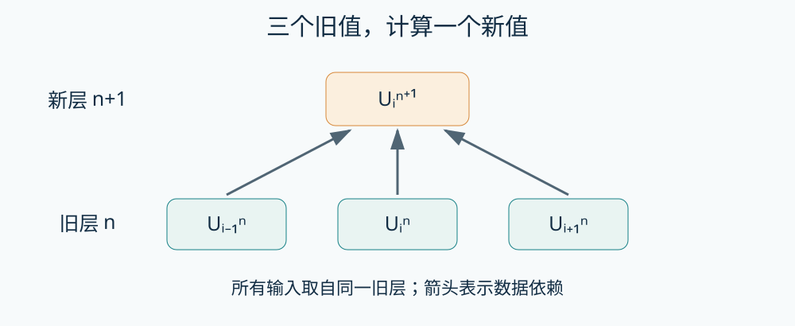
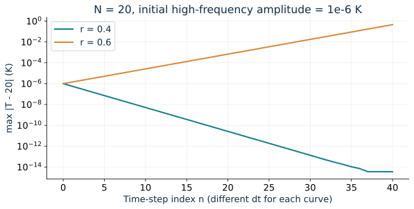
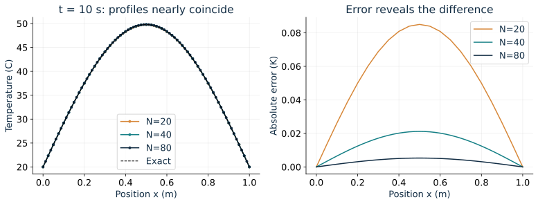
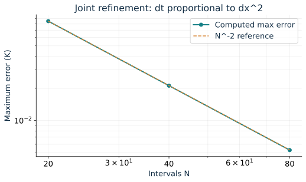

# 第十讲：有限差分与串行热传导求解

**把连续方程变成可计算、可检查的一次次数组更新。**

第九讲建立了热传导模型，并用解析公式生成参考温度；第 9.5 讲学习了怎样观察程序的执行状态。本讲开始真正进行数值时间推进：只给定初始温度和边界条件，用差分算法逐步计算未来温度。先建立可靠的串行基准，第十一讲再把网格分配给 MPI 进程。

## 1. 先把要解的问题写完整

沿用一维细杆模型：长度 $L=1\,\mathrm m$，常热扩散率 $\alpha=0.01\,\mathrm{m^2/s}$，侧面绝热、无内部热源，两端恒温。

$$
T_t=\alpha T_{xx},\qquad 0<x<L,
$$
$$
T(0,t)=T(L,t)=20,\qquad
T(x,0)=20+80\sin(\pi x/L).
$$

温度以 °C 表示，80 是温差，单位 K。上述参数是课程假设值，不是指定材料的测量数据。我们已有一个可代回方程检验的精确解：

$$
T_{\rm exact}(x,t)=20+80e^{-\alpha(\pi/L)^2t}\sin(\pi x/L).
$$

它只负责生成初值或验证结果。更新算法不能在每一步调用这个公式“算出答案”，否则没有实现数值求解。以后面对没有解析解的问题，同样的差分推进仍可以使用。

## 2. 网格：把函数值放进数组

将杆分成 $N$ 个等长小区间，节点与时刻记为：

$$
\Delta x=L/N,\qquad x_i=i\Delta x\quad(i=0,\ldots,N),
\qquad t_n=n\Delta t.
$$

$N$ 个区间有 **$N+1$ 个节点**。$i=0,N$ 是边界，$i=1,\ldots,N-1$ 是需要推进的内部节点。记

$$U_i^n\approx T(x_i,t_n).$$

上标 $n$ 表示时间层，不是幂；下标 $i$ 表示位置。在 C 中，当前时间层用 `old[i]` 表示，下一层用 `next[i]` 表示。这里的物理时间 $t_n$ 不等于程序运行耗时。

例如 $N=4$ 时，节点为 $0,0.25,0.5,0.75,1$ m，需要长度为 5 的数组；内部循环应写 `i=1; i<N; ++i`。



图中箭头表示数据依赖，不表示线程、进程或 MPI 消息。计算 $U_i^{n+1}$ 需要的三个数都来自旧时间层。

## 3. 空间二阶导数怎样近似？

先固定时刻 $t_n$。相邻两段的斜率可以估计为

$$
\frac{T(x_i+\Delta x)-T(x_i)}{\Delta x},\qquad
\frac{T(x_i)-T(x_i-\Delta x)}{\Delta x}.
$$

再用“右边斜率减左边斜率”，除以间距：

$$
T_{xx}(x_i,t_n)\approx
\frac{U_{i-1}^n-2U_i^n+U_{i+1}^n}{\Delta x^2}.
$$

分母必须是 $\Delta x^2$，单位才是 K/m²。中间的系数 −2 来自两次减去中心值。

为了判断精度，假设温度足够光滑，在 $x_i$ 两侧作 Taylor 展开：

$$
T(x_i\pm h)=T(x_i)\pm hT_x+\frac{h^2}{2}T_{xx}
\pm\frac{h^3}{6}T_{xxx}+\frac{h^4}{24}T_{xxxx}+O(h^5).
$$

对称相加时奇数项消去，进一步展开可得

$$
\frac{T(x_i-h)-2T(x_i)+T(x_i+h)}{h^2}
=T_{xx}+\frac{h^2}{12}T_{xxxx}+O(h^4).
$$

因此这是空间二阶精度的中心差分。$O(h^2)$ 说明在光滑性等条件保持时，主导截断误差随 $h^2$ 缩小，不是说任何网格上的误差都恰好等于 $h^2$。

## 4. 时间导数怎样近似？

固定位置 $x_i$，用当前层和下一层的差商：

$$
T_t(x_i,t_n)\approx\frac{U_i^{n+1}-U_i^n}{\Delta t}.
$$

Taylor 展开给出

$$
\frac{T(x_i,t_n+\Delta t)-T(x_i,t_n)}{\Delta t}
=T_t+\frac{\Delta t}{2}T_{tt}+O(\Delta t^2).
$$

这是时间一阶精度的前向差分，也称前向 Euler 时间推进。把空间与时间近似放入同一个方程：

$$
\frac{U_i^{n+1}-U_i^n}{\Delta t}
=\alpha\frac{U_{i-1}^n-2U_i^n+U_{i+1}^n}{\Delta x^2}.
$$

移项后得到本讲的核心：

$$
\boxed{U_i^{n+1}=U_i^n+r(U_{i-1}^n-2U_i^n+U_{i+1}^n)},
\qquad r=\frac{\alpha\Delta t}{\Delta x^2}.
$$

$r$ 无量纲。整个格式称为 FTCS（Forward Time, Centered Space，时间前向、空间中心）。右边全部已知，所以是**显式方法**；每步不需要求解一个联立方程组。

相反，若空间差分取在 $n+1$ 层，会得到

$$
-rU_{i-1}^{n+1}+(1+2r)U_i^{n+1}-rU_{i+1}^{n+1}=U_i^n.
$$

这是后向 Euler 的隐式格式，新值彼此耦合，需要解线性方程组。本讲只实现显式方法；隐式方法的稳定优势也不意味着任意大时间步都准确。

## 5. 先手算一个时间步

取一个独立的数组练习（不要求它等于正弦初值）：

$$[20,40,80,40,20],\qquad r=0.25.
$$

先预测三个内部节点的新值，再看下面答案。

**参考答案：**

$$
\begin{aligned}
U_1^{n+1}&=40+0.25(20-80+80)=45,\\
U_2^{n+1}&=80+0.25(40-160+40)=60,\\
U_3^{n+1}&=40+0.25(80-80+20)=45.
\end{aligned}
$$

新数组应为 **`[20,45,60,45,20]`**。峰值降低，两侧升温；端点由边界条件保持 20。这个可独立核对的结果已经写进 GoogleTest。

## 6. 为什么不能直接覆盖旧数组？

错误写法是按从左到右的顺序直接执行：

```c
/* Wrong for this FTCS scheme: mixes old and new time levels. */
for (int i = 1; i < N; ++i)
    u[i] = u[i] + r * (u[i-1] - 2*u[i] + u[i+1]);
```

更新 `u[1]` 后，算 `u[2]` 时读到的左邻居已经变成新值 45。手算例子中，中间点会变成 61.25，右侧会变成 40.3125，而不是 60 和 45。左右对称的输入被更新顺序破坏了。这不是公式对应的同步时间层更新。

正确实现写入另一个数组：

```c
next[0] = 20.0;
next[N] = 20.0;
for (int i = 1; i < N; ++i)
    next[i] = old[i] + r * (old[i-1] - 2.0*old[i] + old[i+1]);
```

完成整层之后交换指针：

```c
double *tmp = old;
old = next;
next = tmp;
```

交换的是两个数组的角色，不是逐元素复制温度。每一轮都完整写入 `next` 的内部节点和边界，然后交换。循环结束时最新结果在 `old` 中，与总步数是奇数还是偶数无关；若输出固定的原始内存块，则可能输出旧一层。

## 7. 初值与边界：在什么时候使用？

初始层只设置一次：

$$U_i^0=20+80\sin(\pi i/N).$$

两端直接赋值 20，避免 `sin(π)` 的浮点误差。内部节点之后由差分公式推进；不能每轮重新初始化。

固定温度边界则每一层都要满足：$U_0^n=U_N^n=20$。因此 `heat_step` 每次先写 `next[0]`、`next[N]`。边界不是需要套用内部三点公式的额外未知数。

这里是固定温度（Dirichlet）边界，不是绝热（零热流）边界。杆可向恒温端点散热，所以不能把“所有节点温度之和不变”当成本例的正确性标准。

## 8. 时间步为什么不能任意大？

把更新公式写成权重形式：

$$U_i^{n+1}=rU_{i-1}^n+(1-2r)U_i^n+rU_{i+1}^n.$$

当 $0\le r\le1/2$ 时，三个权重非负且总和为 1。新温度是旧层三个温度的加权平均，不会超出它们的最小值与最大值。若当前全部节点位于 20–100 °C 之间，固定端点也在这个范围内，新一层仍在此范围内。

对于本讲的常系数一维 FTCS，采用通用稳定约束：

$$\boxed{\Delta t\le\frac{\Delta x^2}{2\alpha}}.$$

当 $r>1/2$ 时中心权重为负，不能再用加权平均保证不出现新极值；高频误差可能被放大。这个阈值是对任意网格可采用的稳定条件，不意味着每个有限网格、每种初值只要稍超过阈值就立刻爆炸。

以 $N=20$ 为例，$\Delta x=0.05$ m，稳定步长上限为 0.125 s。选 $r=0.4$ 得 $\Delta t=0.1$ s。空间间距减半，稳定步长上限要缩小到四分之一。

稳定性关心误差会不会被推进过程不受控地放大；精度关心结果离真实解有多近。稳定不是准确的充分保证。

## 9. 让不稳定现象确实可见

仅用平滑的低频正弦初值跑很少几步，即使时间步过大，也可能暂时看不到明显异常。配套 `stability_demo` 改用受控的高频扰动：

$$U_i^0=20+10^{-6}\sin(19\pi i/20),\qquad N=20.$$

这是围绕常温 20 的独立误差实验，不叠加原来幅值 80 的温度曲线。它严格满足两端扰动为零。对一般模态 $e_i^n=A_n\sin(k\pi i/N)$，利用正弦加法公式，可由本讲更新式直接推得

$$A_{n+1}=g_kA_n,\qquad
g_k=1-4r\sin^2\left(\frac{k\pi}{2N}\right).$$

当 $k=19,N=20$，$r=0.4$ 时 $g\approx-0.590151$；$r=0.6$ 时 $g\approx-1.385226$。负号表示每步反号；是否增长取决于绝对值。40 步后，前者衰减到舍入误差附近，后者已从百万分之一 K 放大到可见量级。



横轴是步数，两条曲线的物理步长不同；本图用于比较每步放大机制，不是相同物理时刻的精度比较。稳定曲线最后受浮点舍入影响，不应把平台当成算法仍在指数衰减的精确证明。主求解器会拒绝 $r>0.5$；独立演示程序才故意运行不稳定参数。

## 10. 让最后一步恰好到达指定时刻

用户给出目标时刻 $t_{\rm end}$ 和希望采用的 $r_{\rm req}$。先计算允许的步长，再确定整数步数：

$$
\Delta t_{\rm lim}=r_{\rm req}\Delta x^2/\alpha,\qquad
M=\left\lceil t_{\rm end}/\Delta t_{\rm lim}\right\rceil,
\qquad \Delta t=t_{\rm end}/M.
$$

$t_{\rm end}>0$ 时至少做一步；$t_{\rm end}=0$ 时直接输出初值。这样 $M\Delta t=t_{\rm end}$，实际 $r\le r_{\rm req}$。实现还检查舍入误差，必要时增加一步。

不能先向下取整步数，再拿“提前停止的数值解”去与指定终止时刻的解析解比较。程序输出实际步数、步长、$r$ 和终止时刻，以便核查。

## 11. 编译与运行串行求解器

从课程仓库根目录进入：

```bash
cd examples/mpi/10_heat_serial
mkdir build
cd build
cmake ..
make
ctest
./heat_serial
./heat_serial 40 10
./heat_serial 20 10.03 0.4
./heat_serial 20 0
./stability_demo
```

已有 `build` 直接进入。主程序默认 `N=20`、终止时刻 10 s、请求 $r=0.4$；完整形式为 `./heat_serial N t_end [r]`。这是串行基准，直接运行，不需要 `mpirun`。

stdout 是 CSV：`x_m,T_numeric_C,T_exact_C,error_K`；最后一列为逐点绝对误差。stderr 是参数和最大误差摘要。保存时：

```bash
./heat_serial 20 10 > solution.csv
./stability_demo > stability.csv
```

CSV 重定向不包含 stderr 摘要。没有解析解的问题将不能输出精确值与精确误差列，但仍可以使用差分求解和网格加密等检验。

本教学程序固定 $L,\alpha$、初值与端点，允许 $2\le N\le2000$、有限非负的终止时刻、$0<r\le0.5$；最多一百万步和一亿次内部节点更新。这些是程序资源限制，不是热方程的数学限制。非法输入返回 2，正常结束返回 0；内存或输出失败返回非零。

### 11.1 把最终温度场与误差画出来

继续在 **`examples/mpi/10_heat_serial/build`** 执行；若刚打开终端，从仓库根目录先执行 `cd examples/mpi/10_heat_serial/build`。先输出数据，再绘图：

```bash
./heat_serial 20 10 > solution-N20.csv
head solution-N20.csv
python3 ../../plot_heat.py solution-N20.csv -o solution-N20.png
```

第一个命令求出终止时刻 **t=10 s** 的状态。每行保存同一个位置上的四个量：

| CSV 列名 | 含义 |
|---|---|
| `x_m` | 节点位置 x，单位 m |
| `T_numeric_C` | 时间推进得到的数值温度，单位 °C |
| `T_exact_C` | 同一位置、同一物理时刻的解析温度，单位 °C |
| `error_K` | 两者之差的绝对值，单位 K |

每个文件保存一个最终时刻的空间分布，并没有保存所有中间时间层。对于一维问题，这条“位置—温度”曲线就是温度场的图像；二维问题才将空间坐标画成平面、用颜色表示温度。

绘图脚本位于 `examples/mpi/plot_heat.py`，所以从当前 `build` 用 `../../plot_heat.py` 调用。课程容器已有 Python、NumPy 和 Matplotlib。图片写入当前目录，在 VS Code 左侧文件浏览器找到 `build/solution-N20.png` 并点击打开；脚本不需要弹出图形窗口。`-o` 后的名字决定输出文件，改成 `.pdf` 或 `.svg` 可以保存矢量图。


上图用黑线表示解析温度、橙色点表示数值温度，两者看起来几乎重合。下图单独画

$$e_i=|U_i^M-T_{\mathrm{exact}}(x_i,10)|,$$

让小误差清晰可见。这个 N=20 算例中心数值温度为 49.73162617 °C，解析温度为 49.81662711 °C，相差约 **0.085 K**，也就是 0.085 °C 的温差。最大误差出现在中心，固定的两端误差为零。误差图的纵轴是温差大小，不是温度本身；它也不表示一次实验中的随机波动。

### 11.2 自己重现网格加密图像

仍在同一个 `build`，保持相同终止时刻与默认请求 $r=0.4$，只改变 N：

```bash
for n in 20 40 80; do
  ./heat_serial "$n" 10 > "solution-N${n}.csv"
  python3 ../../plot_heat.py "solution-N${n}.csv" -o "solution-N${n}.png"
done
```

依次打开三张 PNG，对照终端显示的最大误差与下一节的表格。每张误差图的纵轴会按各自数值自动缩放，所以**比较误差时要读纵轴刻度和最大值，不能只看曲线在图中有多高**。N 加倍后，最大误差应约变为原来的四分之一；同时程序会自动调整时间步长，保证都比较 t=10 s 的结果。

## 12. 如何证明数值结果值得信任？

先验证一步，再验证完整推进。配套 GoogleTest 检查手算数组、常温稳态、固定边界、零步/奇数步/偶数步、对称性、解析误差、网格加密以及高频放大因子。CTest 还运行 CLI 检查：CSV 行数、端点、解析列、误差列与非法输入。测试不是把同一段循环复制一遍再比较。

在共同的 $t=10$ s，对 $N=20,40,80$ 请求相同 $r=0.4$。定义

$$E_\infty=\max_{0\le i\le N}|U_i^M-T_{\rm exact}(x_i,t_{\rm end})|.$$

| N（区间数） | 步数 M | Δt（s） | 中心温度（°C） | 最大误差（K） |
|---:|---:|---:|---:|---:|
| 20 | 100 | 0.1 | 49.73162617 | 0.08500094 |
| 40 | 400 | 0.025 | 49.79543111 | 0.02119600 |
| 80 | 1600 | 0.00625 | 49.81133149 | 0.00529562 |

相邻误差比约为 4.0102、4.0026；10 s 时精确中心温度约为 49.81662711 °C。



温度曲线几乎重合，并不说明误差为零；单独画误差更容易看出网格加密的效果。

对于充分光滑的解、固定终止时刻和稳定推进，本格式的误差通常为 $O(\Delta t+\Delta x^2)$。固定 $r$ 时 $\Delta t\propto\Delta x^2$，因此联合加密预期呈二阶：网格间距减半，主导误差约缩小为四分之一。这是联合加密结果，不能称为“时间二阶精度”。



不应把某个参数下误差异常小当成普遍高阶：时间和空间误差可能部分抵消；网格过细后舍入误差也会影响比值。

## 13. 二维扩展：五点模板与更严格的步长

在矩形网格上，对 $T_t=\alpha(T_{xx}+T_{yy})$ 分别作中心差分：

$$
U_{i,j}^{n+1}=U_{i,j}^n+r_x(U_{i-1,j}^n-2U_{i,j}^n+U_{i+1,j}^n)
+r_y(U_{i,j-1}^n-2U_{i,j}^n+U_{i,j+1}^n),
$$
$$r_x=\alpha\Delta t/\Delta x^2,\qquad r_y=\alpha\Delta t/\Delta y^2.$$

一个新值需要旧层的中心、左、右、上、下五个数。使所有权重非负的条件是 $r_x+r_y\le1/2$。若 $\Delta x=\Delta y=h$，则 $r=\alpha\Delta t/h^2\le1/4$。不能把一维的 $r\le1/2$ 直接搬来。

二维数组可按行连续存储：`index = j * (Nx + 1) + i`，其中 `Nx` 是 x 方向的区间数。左右邻居偏移 ±1，上下邻居偏移 ±(Nx+1)；只在内部节点使用这些偏移，不能跨越行边界。二维实现留作扩展，本讲已提供的主程序是一维求解器。

固定区域与物理终止时刻，等距网格加密一倍时：一维节点数约增至 2 倍、步数约增至 4 倍，总更新工作约 8 倍；二维节点数约 4 倍、步数约 4 倍，总工作约 16 倍。这里比较的是操作量量级，忽略边界与常数，不是实测运行时间或 MPI 加速比。

## 14. 练习与参考答案

### 练习 A：索引和一步更新

取 $N=4$、`old=[20,40,80,40,20]`、$r=0.25$。需要几个数组元素？哪些元素更新？改成原地覆盖后，为什么左右不再对称？

**答案：**长度 5；更新 1、2、3，边界固定。双数组结果为 `[20,45,60,45,20]`；从左往右原地覆盖为 `[20,45,61.25,40.3125,20]`，后面的更新混用了新旧时间层。

### 练习 B：选择步长

$\alpha=0.01$、$\Delta x=0.05$，试取 $\Delta t=0.15$。满足本讲通用稳定条件吗？网格间距减半，取 $r=0.4$ 应用多大步长？

**答案：**第一种 $r=0.6$，不满足。减半后 $\Delta x=0.025$，$\Delta t=0.4\times0.025^2/0.01=0.025$ s。二维等距网格若取同一 $r=0.4$，则超过二维条件 $1/4$。

### 练习 C：运行、修改、回归

先运行原程序和 `ctest`，保存 N=20/40/80 的误差。再在自己的实验分支中，将 `heat_step` 内部公式的 `-2.0 * old[i]` 暂改为 `-old[i]`，保存，执行 `make`、`ctest`。记录最先失败的独立检查，再恢复正确系数并重新验证。

**答案：**常温不再保持，手算的一步结果也失败；因此无需等待长时间模拟或 MPI 通信就能发现空间差分错误。修改后必须重编译，不能只重新运行旧二进制。保留具体失败值比只写“测试没过”更有用。

### 概念辨析

- **稳定就表示准确吗？** 不表示；仍要检查解析误差或加密趋势。
- **温度总和应该守恒吗？** 本例端点恒温，可交换热量，不要求节点温度总和不变。
- **数组角色交换后，哪里是最新结果？** 始终是当前 `old` 指针指向的数组。
- **本讲已经完成 MPI 并行求解了吗？** 还没有。本讲确定数学更新与串行正确性；下一讲讨论本地节点、相邻子域数据和通信顺序。

配套[实验说明](../../../examples/mpi/10_heat_serial/README.md)与[程序详解](../../../examples/mpi/10_heat_serial/程序详解.md)给出源码入口、操作与新增 CMake 组织方式。

## 参考文献与图示来源

以下资料核对于 2026-11-01。公式推导、手算例子、程序与数值实验为课程整理；图示为课程自绘，曲线由配套程序实际输出绘制。

1. [Stanford Math 220B：Heat Equation](https://web.stanford.edu/class/math220b/handouts/heateqn.pdf)，§2.2。热方程初边值问题与分离变量解。
2. [Driscoll 与 Braun：Finite differences](https://fncbook.com/finitediffs/)，FNC §5.4。有限差分与中心差分。
3. [Driscoll 与 Braun：Convergence of finite differences](https://fncbook.com/fd-converge/)，FNC §5.5。Taylor 展开、截断误差与精度阶。
4. [Driscoll 与 Braun：The method of lines](https://fncbook.com/methodlines/)，FNC §11.2。空间半离散和时间推进。
5. [Driscoll 与 Braun：Absolute stability](https://fncbook.com/absstab-diffusion/)，FNC §11.3。模态放大、显式与隐式方法的稳定性。
6. [Demmel：CS267 Lecture 13, 27 February 1996](https://people.eecs.berkeley.edu/~demmel/cs267/lecture17/lecture17.html)，Explicit Solution、Stability、Discretizing the 2D Heat Equation。显式热方程、稳定性、二维模板与并行局部性；页面标题为 Lecture 13，URL 目录名为 lecture17。
7. [GoogleTest Primer](https://google.github.io/googletest/primer.html)。浮点断言、独立可重复的测试。
8. [CMake 3.31：ctest(1)](https://cmake.org/cmake/help/v3.31/manual/ctest.1.html)。测试驱动与运行结果。
9. [Matplotlib：pyplot.savefig](https://matplotlib.org/stable/api/_as_gen/matplotlib.pyplot.savefig.html)。保存图片或矢量图，并根据扩展名选择格式；绘图资料核对日期：2026-11-09。

`stencil.svg` 为依赖关系示意；其余图取自本例可复现 CSV，参数与生成过程见 `assets/SOURCE.md`。图中稳定性实验的横轴是步数，不是同一物理时间。

`csv-solution-N20.png` 由本目录保存的 `solution-N20.csv` 经仓库统一脚本 `examples/mpi/plot_heat.py` 生成；输入为课程串行 C 程序的实际输出，温度和误差画在上下两个面板。
