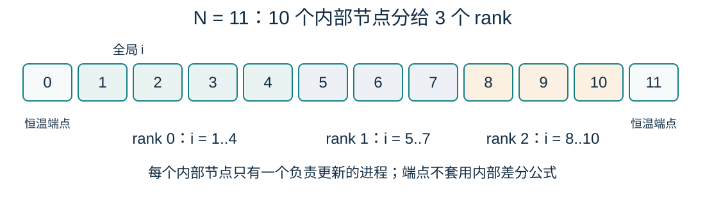
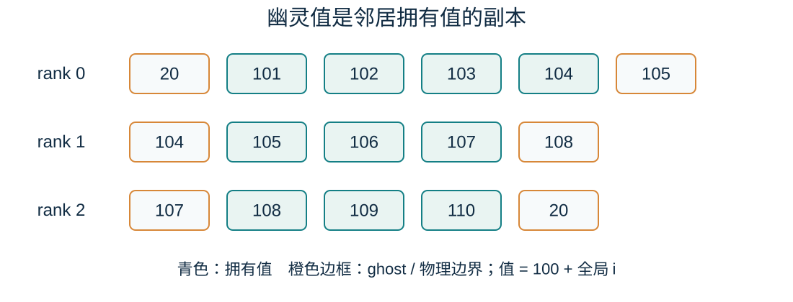
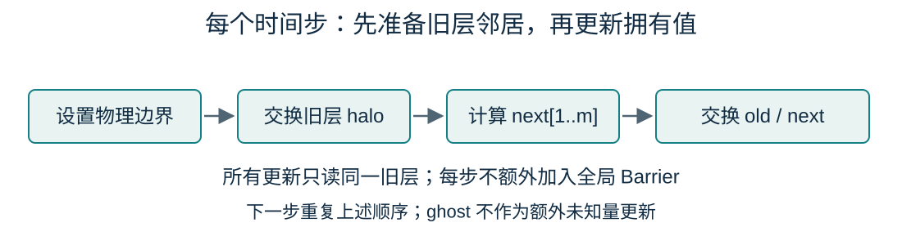
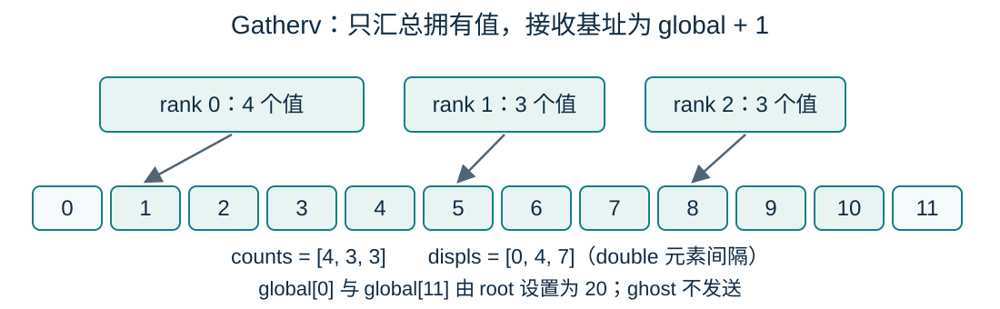
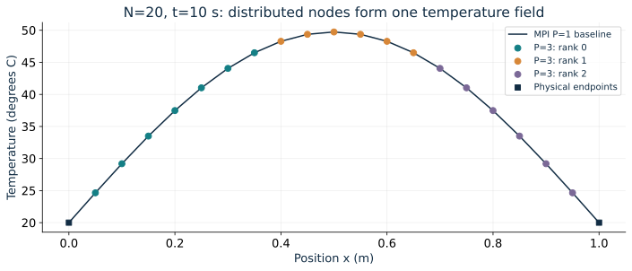
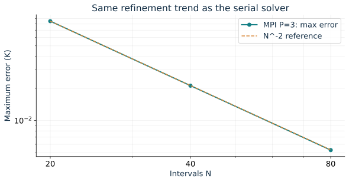
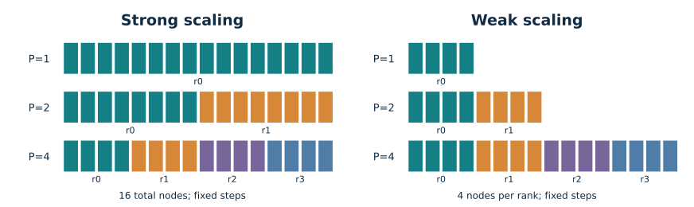
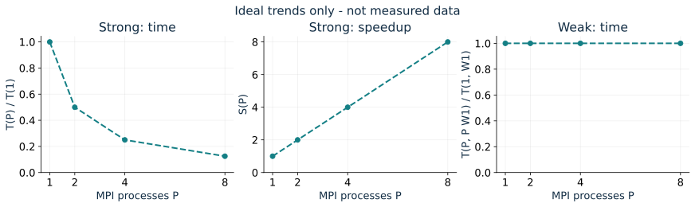
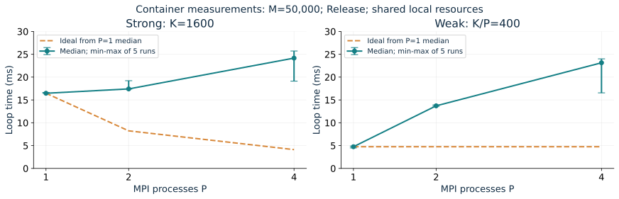

# 第十一讲：热传导的 MPI 并行实现

**把已经验证的数组更新分给多个进程，并确保每个节点读到正确时间层的邻居值。**

第九讲建立热传导模型，第十讲完成有限差分与串行求解。本讲保留同一个数学问题和时间推进方法，只改变数据归属与执行方式。目标是能解释一个节点由谁更新、需要谁的数据，以及怎样用实验确认 MPI 实现正确。

## 1. 并行化以前，哪些东西已经确定？

模型与第十讲一致：$L=1$ m，$\alpha=0.01\,\mathrm{m^2/s}$，两端恒温 20 °C，初值为 $20+80\sin(\pi x/L)$。这是课程假设参数。

$$
T_t=\alpha T_{xx},\qquad
U_i^{n+1}=U_i^n+r(U_{i-1}^n-2U_i^n+U_{i+1}^n),\qquad
r=\frac{\alpha\Delta t}{\Delta x^2}\le\frac12.
$$

$N$ 个区间有 $N+1$ 个节点，内部节点为 $1,\ldots,N-1$。时间层仍采用两个数组；初值只设置一次，每个时间步先完整读取旧层，再生成新层。

改变进程数时，必须保持相同的全局网格、初边值、实际步长与终止时刻。不能让每个进程把自己的子域重新当成长度为 1 的杆，也不能把本地节点数代入全局 $\Delta x=L/N$。增加进程数不会放宽稳定性条件。

## 2. 为什么只需要与相邻进程通信？

新值 $U_i^{n+1}$ 只依赖旧层的 $i-1,i,i+1$。如果把连续节点交给同一个进程，绝大多数更新需要的数据都已经在本地；只有子域边缘需要另一个进程拥有的节点。

这种把计算区域分成子域的方法称为**域分解**（domain decomposition）。本讲沿一维杆连续分块：每个内部节点有且只有一个负责更新它的进程；相邻进程之间保存必要的数据副本。

MPI 进程有各自的普通数组。即使运行在同一个容器里，另一个 rank 的 `old[i]` 也不会自动出现在当前进程的内存中。箭头表示消息带来的数值复制，不表示共享数组或物理网络连线。

## 3. 分的是 N−1 个内部节点

令内部节点总数 $K=N-1$，进程数为 $P$，rank 为 $p$。采用连续、尽量均匀的分块：

$$
q=\lfloor K/P\rfloor,\qquad s=K\bmod P,
$$
$$
m_p=q+[p<s],\qquad o_p=pq+\min(p,s).
$$

$[p<s]$ 为条件成立时取 1、否则取 0。$m_p$ 是本地负责的节点数；$o_p$ 是前面所有进程已分走的内部节点数。进程 $p$ 负责全局节点

$$i=o_p+1,\ldots,o_p+m_p.$$

取 $N=11$、$P=3$：一共有 12 个节点，其中 10 个内部节点分成 4、3、3 个。

| rank | 本地节点数 m | 偏移 o | 负责的全局 i |
|---:|---:|---:|---|
| 0 | 4 | 0 | 1–4 |
| 1 | 3 | 4 | 5–7 |
| 2 | 3 | 7 | 8–10 |



物理端点 $i=0,11$ 不参加内部更新。本例要求 $1\le P\le N-1$，保证每个进程至少有一个内部节点。$P>N-1$ 会统一报错退出；这只是示例的范围，不是 MPI 无法处理空任务。

## 4. 本地数组为什么多出两个位置？

对拥有 $m$ 个节点的进程，分配长度为 **$m+2$** 的数组：

| 本地下标 j | 含义 | 对应全局位置 |
|---|---|---|
| 0 | 左邻居副本，或左物理边界 | o |
| 1..m | 本进程负责更新的节点 | o+j |
| m+1 | 右邻居副本，或右物理边界 | o+m+1 |

两侧额外位置称为**幽灵节点**或 **halo / ghost cells**。它们保存邻居的副本，不是额外的全局未知量。内部子域的幽灵值由通信更新；整根杆两端的值由边界条件给出。

以 rank 1 为例，`o=4,m=3`：

```text
local j:     0     1     2     3     4
 global i:   4     5     6     7     8
 role:     ghost owned owned owned ghost
```

`old[0]` 必须来自 rank 0 的全局节点 4；`old[4]` 必须来自 rank 2 的全局节点 8。更新 `next[1]` 时要读取 `old[0]`，因此这份副本必须先准备好。

## 5. 先用可辨认的数观察通信

`halo_demo` 固定 $N=11$，令每个内部节点的值为 `100+i`。这是一组人工编号值，用来追踪数据来源，不是热方程的正弦初值。幽灵位置先设为 −999，物理端点仍设为 20。

先预测三进程交换后各 rank 的左右幽灵值，再运行：

```bash
mpirun -n 3 ./halo_demo
```

**参考输出：**

```text
rank first_i count left_ghost right_ghost
0 1 4 20 105
1 5 3 104 108
2 8 3 107 20
```



例如 rank 1 的左幽灵是 104，而不是 rank 0 的首个值 101。`halo_demo` 用一次 `MPI_Gather` 收集短记录，由 root 按 rank 打印；这解释了表格顺序，并不表示各进程按 rank 依次执行了交换。

## 6. 把两个方向的消息写清楚

我们使用非周期相邻关系：左邻居为 `rank-1`，右邻居为 `rank+1`。最左侧的左邻居、最右侧的右邻居设为 `MPI_PROC_NULL`。

| 调用 | 发出什么 | 发给谁 | 收到哪里 | 来自谁 | tag |
|---|---|---|---|---|---:|
| 第一次 | `old[1]`，本地最左拥有值 | left | `old[m+1]`，右幽灵 | right | 71 |
| 第二次 | `old[m]`，本地最右拥有值 | right | `old[0]`，左幽灵 | left | 72 |

```c
MPI_Sendrecv(&old[1], 1, MPI_DOUBLE, left, 71,
             &old[m+1], 1, MPI_DOUBLE, right, 71,
             comm, MPI_STATUS_IGNORE);
MPI_Sendrecv(&old[m], 1, MPI_DOUBLE, right, 72,
             &old[0], 1, MPI_DOUBLE, left, 72,
             comm, MPI_STATUS_IGNORE);
```

`MPI_Sendrecv` 组合一次阻塞发送与一次阻塞接收。正常返回时，该次接收数据可用，该次发送缓冲区可重新使用；发送和接收区域必须分开。它可以把数据发给左邻居，同时从右邻居接收，两个对象不必相同。

本例两个调用覆盖两个方向，不必人为安排奇偶 rank 先发或先收。71、72 是自行约定的标签，只需在对应发送和接收间匹配。每个时间步以相同顺序调用，标签可以重复使用；它们不是时间层编号。

若 $m=1$，`old[1]` 与 `old[m]` 是同一个拥有值，它需要分别发给左右邻居；两次接收仍分别写到 `old[2]` 和 `old[0]`。单进程时左右均为 `MPI_PROC_NULL`。

## 7. PROC_NULL 不会替你设置边界温度

从 `MPI_PROC_NULL` 接收会直接完成，但**不会改变接收缓冲区**。因此在每次交换前执行：

```c
if (left == MPI_PROC_NULL) old[0] = 20.0;
if (right == MPI_PROC_NULL) old[m+1] = 20.0;
```

不能把 `MPI_PROC_NULL` 理解为“自动填零”或“自动填 20”。数组交换角色后，幽灵位置可能保存旧内容，必须按当前角色重新准备。

也不能把所有进程两侧的幽灵值一律固定为 20。内部子域接口不是物理边界：那样等于在杆中间人为插入恒温条件，改变了数学问题。

## 8. 每个时间步的顺序



完整的主要循环是：

```c
for (int step = 0; step < plan->steps; ++step) {
    heat_exchange(old, m, comm);
    for (int j = 1; j <= m; ++j)
        next[j] = old[j] + plan->r *
                  (old[j-1] - 2.0*old[j] + old[j+1]);
    double *tmp = old;
    old = next;
    next = tmp;
}
```

`heat_exchange` 先设置物理边界，再完成两个方向的旧层交换。计算只更新 `j=1..m`，不更新幽灵节点；`next` 的幽灵值会在它成为 `old` 后、下一次读取前重新准备。

为什么不能先更新再交换？子域边缘会读取尚未准备好或过期的邻居值；即使程序正常结束，结果也可能错误。为什么不能只在开始时交换一次？邻居的温度每一层都在变化。

本例依靠相邻进程之间匹配的 `Sendrecv` 把所需旧值送到位，再执行本地更新。某个 rank 的交换返回，表示它这次接收的数据已经可用，不表示所有 rank 都执行到了同一行。各进程遵守同一套消息匹配和时间步顺序，就能完成逐层推进。

## 9. 初值和时间计划怎样在各 rank 保持一致？

root 解析 `N,t_end,r`，调用第十讲的 `heat_plan`，得到相同的整数步数 $M$、实际 $\Delta t$ 与 $r$。首先广播输入是否合法，再按类型广播计划中的两个整数和四个浮点数。这样各 rank 要么一起退出，要么按同一计划计算。

```c
MPI_Bcast(&ok, 1, MPI_INT, 0, comm);
/* On success: N, steps, dx, dt, r, final_time. */
MPI_Bcast(ints, 2, MPI_INT, 0, comm);
MPI_Bcast(values, 4, MPI_DOUBLE, 0, comm);
```

C 结构体可能包含填充字节，因此示例没有把 `HeatPlan` 的整块内存作为字节直接广播。

各 rank 按全局下标生成自己的初值：

```c
int i = block.offset + j;
old[j] = 20.0 + 80.0 * sin(pi * i / N);
```

初值有明确公式，故不必先在 root 建立完整数组再 `Scatterv`。如果初值来自只有 root 读取的文件，可以另行设计 `Scatterv` 分发；本讲程序不包含这种文件输入模式。

## 10. 用 Gatherv 把最终曲线接起来

### 10.1 为什么需要收集？为什么不是直接用 Gather？

时间推进结束后，完整曲线仍分散在各 rank 中。若要由 rank 0 输出一个按位置排列的 CSV，就需要把每段的最终温度放回全局数组。

继续用 N=11、P=3 的例子：rank 0 有 4 个内部节点，rank 1、2 各有 3 个。此前使用 `MPI_Gather` 时，root 从各 rank 接收相同数量的同类型元素；这里各段长度不同，改用 **`MPI_Gatherv`**，由 root 分别指定每个 rank 的接收数量和放置位置。

每个 rank 只发送自己拥有的 `old[1..m]`。两侧 ghost 是邻居值的副本，如果也收集，会把同一个全局节点重复计算在内。

### 10.2 先读懂接口中的三组参数

```c
int MPI_Gatherv(const void *sendbuf, int sendcount,
                MPI_Datatype sendtype,
                void *recvbuf, const int recvcounts[],
                const int displs[], MPI_Datatype recvtype,
                int root, MPI_Comm comm);
```

可以把这个接口读成：“本进程从哪里取多少个数；root 把每段放到哪里；谁是 root，哪些进程参加。”

| 参数组 | 含义 | 本例取值 |
|---|---|---|
| `sendbuf, sendcount, sendtype` | 本 rank 发出的数据起点、元素数和类型 | `old+1, m, MPI_DOUBLE` |
| `recvbuf` | root 接收区的起点 | rank 0 的 `global+1` |
| `recvcounts[p]` | root 从 rank p 接收多少个元素 | `counts[p]`，即该 rank 的 m |
| `displs[p]` | rank p 的数据相对接收起点放在哪里 | `displs[p]`，即该段的偏移 o |
| `recvtype` | root 接收元素的类型 | `MPI_DOUBLE` |
| `root, comm` | 接收者的 rank，以及参加收集的通信域 | `0, comm` |

`sendcount` 是每个进程自己的一个整数，`recvcounts` 是 root 保存的长度为 P 的整数数组。它们不是同一个参数：rank 1 的 `sendcount=3`，对应 root 的 `recvcounts[1]=3`。MPI 不会自动猜测这些段的长度；本例由已知分块规则事先算出 `counts` 和 `displs`。

### 10.3 用 4 / 3 / 3 算出 counts 与 displs

rank 0 为完整温度场准备 `global[0..11]`，一共 N+1=12 个元素。`global[0]`、`global[11]` 是固定边界，中间 `global[1..10]` 留给收集的内部节点。

接收起点选择 `global+1`，即 `&global[1]`。于是第一个 rank 的数据从偏移 0 开始，第二段跳过前面的 4 个数，第三段跳过前面的 4+3 个数：

| rank p | 发出的拥有值 | `counts[p]` | `displs[p]` | root 中的落点 |
|---:|---|---:|---:|---|
| 0 | 全局节点 1–4 | 4 | 0 | `global[1..4]` |
| 1 | 全局节点 5–7 | 3 | 4 | `global[5..7]` |
| 2 | 全局节点 8–10 | 3 | 7 | `global[8..10]` |

```text
counts = [4, 3, 3]
displs = [0, 4, 7]
```



例如 rank 1 的首个数写入 `(global+1)+4`，也就是 `global[5]`。位移按接收类型的间隔计，本例就是几个 `double`，不是几个字节。三段应完整覆盖内部节点且互不重叠。若改用 `global` 作接收起点，位移就应改成 `[1,5,8]`；起点和位移需要一起理解。

### 10.4 再看程序中的实际调用

root 先按分块规则准备 `counts`、`displs`，并设置 `global[0]=global[N]=20`；然后所有 rank 执行同一个调用：

```c
MPI_Gatherv(old + 1, m, MPI_DOUBLE,
            rank == 0 ? global + 1 : NULL,
            counts, displs, MPI_DOUBLE, 0, comm);
```

`old+1` 跳过本地左 ghost，接着发送 m 个拥有值；右 ghost 位于 `old[m+1]`，也不会发出。条件表达式 `rank == 0 ? global + 1 : NULL` 只选择接收指针，并没有决定谁参加收集。

**所有 rank，包括 root，都必须调用 `MPI_Gatherv`。**不能把整个调用放进 `if (rank == 0)`。只有接收侧的缓冲区、数量数组、位移数组和接收类型仅在 root 有意义，非 root 的接收指针及数组可以为 `NULL`。各 rank 的 `root` 和 `comm` 应一致。

rank 0 从这次调用返回后，`global` 中已有完整的最终温度，可以顺序写 CSV。收集只发生在推进完成之后；每一步更新仍使用相邻进程间的 halo 交换。

## 11. 验证分两层，不能混为一谈

第一层检查**并行实现是否保留了串行离散算法**：

$$D_\infty=\max_i|U_{i,\rm MPI}^{M}-U_{i,\rm serial}^{M}|.$$

root 使用第十讲的串行函数与完全相同的计划重新求解，逐点比较，示例阈值为 $10^{-10}$ K。只比较曲线截图、某个中心点或最终退出码都不充分。

第二层检查**数值解与连续问题的精确解是否接近**：

$$E_\infty=\max_i|U_i^M-T_{\rm exact}(x_i,t_{\rm end})|.$$

各 rank 只对拥有的节点计算局部最大绝对误差，然后以 `MPI_Reduce` 和 `MPI_MAX` 得到全局最大值。两端满足精确边界，误差为零；幽灵副本不参加本地统计。

```c
MPI_Reduce(&local_error, &max_error, 1, MPI_DOUBLE,
           MPI_MAX, 0, comm);
```

在 $N=20,t=10$ s、请求 $r=0.4$ 下，本次实际运行结果如下。所有情况都是 100 步，$\Delta t=0.1$ s。

| P | 各 rank 拥有的内部节点数 | 与串行最大差值（K） | 与精确解最大误差（K） |
|---:|---|---:|---:|
| 1 | 19 | 0 | 0.08500094 |
| 2 | 10, 9 | 0 | 0.08500094 |
| 3 | 7, 6, 6 | 0 | 0.08500094 |
| 4 | 5, 5, 5, 4 | 0 | 0.08500094 |

零差值是本次实现和环境的观测，不是所有并行浮点程序必须逐位一致的要求。更重要的是：**MPI 结果与串行相同，并不意味着离散误差为零。**



采用 $P=3$，将 N 从 20 加密到 40、80，最大误差约为 0.08500094、0.02119600、0.00529562 K；相邻误差比约 4.0102、4.0026，与第十讲的联合加密趋势一致。



### 11.1 从 MPI 程序输出温度场

先在课程容器中从仓库根目录进入本讲示例，按第 16 节的 `mkdir build`、`cmake ..`、`make`、`ctest` 完成构建。以下命令均在 `examples/mpi/11_heat_mpi/build` 中运行。

```bash
mpirun -n 1 ./heat_mpi 20 10 > baseline.csv
mpirun -n 3 ./heat_mpi 20 10 > solution-p3.csv
head -n 4 solution-p3.csv
```

`20` 是空间区间数 N，`10` 是物理终止时刻，单位 s。程序算完所有时间步后，`MPI_Gatherv` 把各 rank 拥有的内部节点按全局顺序收集到 rank 0。rank 0 补齐两端边界，并把最终的一维温度场写入标准输出。CSV 含一行表头和 N+1=21 行节点值，每个全局节点只写一次。

| CSV 列 | 含义 |
|---|---|
| `x_m` | 节点的位置，单位 m |
| `T_numeric_C` | 差分程序计算的温度，单位 °C |
| `T_exact_C` | 同一位置、同一物理时刻的解析温度，单位 °C |
| `error_K` | 两个温度之差的绝对值，单位 K |

`>` 保存标准输出中的 CSV。终端仍会显示标准错误中的 `P`、`N`、`steps`、`max_error_K`、`serial_diff_K`、`loop_max_s` 和 `CHECK`。其中 `loop_max_s` 是本程序给“各 rank 时间推进循环耗时的最大值”起的输出字段名，单位为秒；第 13 节会从测量过程说明它怎样得到。如需保存摘要，使用 `> solution-p3.csv 2> solution-p3.log`，避免把摘要混入 CSV 的数值列。先检查 `CHECK=PASS`，再读图。

### 11.2 用自己的 CSV 画温度和误差

在同一个 `build` 目录执行下面这条命令。`../../plot_heat.py` 是三讲共用的绘图脚本，课程容器已具备 Python、NumPy 和 Matplotlib。

```bash
python3 ../../plot_heat.py solution-p3.csv \
  --ranks 3 --baseline baseline.csv -o ranks.png
```

在 VS Code 文件栏中打开 `build/ranks.png`。上图用黑线画解析温度、虚线画单进程结果，再用三种颜色标出三进程的节点。rank 0、1、2 分别负责全局节点 1–7、8–13、14–19，两端的黑色方块为恒温边界。CSV 没有 rank 列，`--ranks 3` 应与生成这份 CSV 的 `mpirun -n 3` 一致。

下图画的是 `error_K`，即数值温度与解析温度的逐点绝对差。N=20、t=10 s 时，中心约为 49.7316 °C，解析值约为 49.8166 °C，差约为 0.0850 K。单进程和三进程结果可以重合，同时都具有这一离散误差。


`--baseline` 使用相同网格、相同参考温度的 CSV。比较网格加密时，每个 N 单独作图，避免拿 N=20 的节点与 N=40 的节点逐行对齐。

```bash
mpirun -n 3 ./heat_mpi 40 10 > solution-N40.csv
python3 ../../plot_heat.py solution-N40.csv -o error-N40.png
```

**观察与核对。**先找两处 rank 颜色交界，检查温度曲线是否连续。再读误差图，核对两端为零，中心接近该次摘要的 `max_error_K`。N=40 时最大误差约为 0.021196 K，约为 N=20 的四分之一。若要用于报告，将输出扩展名改为 `.pdf` 或 `.svg` 即可保存矢量图。

## 12. 从正确结果到性能测量

现在我们已经知道，数值结果怎样分散计算、怎样收集成完整曲线，以及怎样核对串行一致性与解析误差。接下来才能问：用更多进程，计算是否更快？

一次完整程序运行包含启动、初始化、时间推进、收集、验证和文件输出。比较前应选定同一段工作。本讲首先测量**时间推进循环**，即重复进行邻居交换、节点更新和数组角色交换的那一段；这样后面的加速比才有明确的对象。

## 13. 从本地计时到输出字段 loop_max_s

### 13.1 一个进程怎样量出“这一段花了多久”？

`MPI_Wtime()` 返回调用进程本地的墙钟时间，单位为秒，类型为 `double`。在同一个 rank 中，记录开始值和结束值，再相减，就得到这段代码经历的时间。计时也会包含该段代码等待通信的时间，不只是 CPU 做算术的时间。

```c
double start = MPI_Wtime();
/* Execute the complete time-stepping loop here. */
double elapsed = MPI_Wtime() - start;
```

`start` 是开始读数，`elapsed` 是本 rank 的时间差。开始和结束必须由同一个 rank 读取；不同 rank 的绝对读数不保证具有相同的时钟基准，不能拿 rank 0 的开始读数与 rank 1 的结束读数相减。

### 13.2 多个进程得到多个数，用哪一个？

假设一次三进程作业各自测得下面的循环耗时，这组数只用于说明统计方法：

| rank | 本地 `elapsed` / s |
|---:|---:|
| 0 | 0.0040 |
| 1 | 0.0050 |
| 2 | 0.0045 |

本讲取最大值 **0.0050 s**。因为这段并行工作需要所有 rank 都完成，用平均值可能掩盖较慢的参与者。第六讲的 `MPI_Reduce` 可以把三个数按 `MPI_MAX` 归约到 root：

```c
double slowest = 0;
MPI_Reduce(&elapsed, &slowest, 1, MPI_DOUBLE,
           MPI_MAX, 0, comm);
```

每个 rank 提交一个 `elapsed`；root 得到 `slowest=0.0050`。这仍是一次作业内部的统计，重复运行多次后的中位数将在下一节介绍。

### 13.3 计时前先介绍 MPI_Barrier：等大家都准备好

各 rank 完成内存分配、初值设置的时刻可能不同。开始测循环之前，本例先调用一次

```c
MPI_Barrier(comm);
```

`MPI_Barrier` 称为**屏障同步**。`comm` 中所有 rank 都要调用；在这些成员都进入这次调用之前，任何一个 rank 都不能从这次调用返回。

例如 rank 0 最先完成初值设置，它进入 Barrier 后等待；rank 1 随后到达，也等待；当最后的 rank 2 进入时，大家才具备返回条件。各 rank 从 Barrier 返回后再读取自己的开始时间，确保测量开始前，所有参与者都已完成初始化。

Barrier 不传输温度数组，不同步各机器的时钟，也不保证所有 rank 在完全相同的瞬间返回。它解决的是“大家是否都到达这里”，邻居交换解决的是“所需温度是否已经收到”。

因此，即使所有 rank 都从这次 Barrier 返回，也不能据此判断 ghost 已装入邻居的当前温度。本例循环中的 `heat_exchange` 通过 `Sendrecv` 刷新 ghost；已有的逐步邻居交换不需要每一步再插入全局 Barrier。本例只在整个循环计时开始前调用一次屏障。

### 13.4 把准备、测量、汇总连起来

下面是 `heat_mpi.c` 中的计时结构。中间省略的是第 8 节已经给出的完整时间推进循环，实际程序会执行全部时间步。

```c
MPI_Barrier(comm);
double start = MPI_Wtime();
/* Exchange, update, and swap for all time steps. */
double elapsed = MPI_Wtime() - start, slowest = 0;
MPI_Reduce(&elapsed, &slowest, 1, MPI_DOUBLE,
           MPI_MAX, 0, comm);
```

现在可以沿着程序追踪同一个数：

```text
各 rank 的 elapsed
        ↓ MPI_Reduce(..., MPI_MAX, ...)
rank 0 的 slowest
        ↓ 保存到 HeatMPIStats 的 loop_seconds 成员
main.c 中的 stats.loop_seconds
        ↓ fprintf 写入 stderr
日志字段 loop_max_s
```

`HeatMPIStats` 的两个成员依次为 `max_error`、`loop_seconds`。求解器在 root 上用 `*stats = (HeatMPIStats){max_error, slowest};` 保存它们，主程序再把 `stats.loop_seconds` 打印为 `loop_max_s=...`。因此 **`loop_max_s` 是本示例自己定义的输出字段名，不是 MPI 函数，也不是 MPI 自动提供的变量**。

名字可以拆开读：`loop` 表示时间推进循环，`max` 表示各 rank 耗时中的最大值，`s` 表示单位为秒。后面的性能实验把这个数记作当前进程数下的耗时 $T_P$。

### 13.5 在实际输出中找到这个字段

在已经构建好的 `examples/mpi/11_heat_mpi/build` 中运行：

```bash
mpirun -n 3 ./heat_mpi 20 10 > solution.csv 2> run.log
cat run.log
```

`solution.csv` 保存温度；`run.log` 保存参数、检查结果和耗时。下面摘出 2026-11-01 已归档的一次 P=3、N=20、t=10 s 运行摘要中的字段，为便于阅读分成三行：

```text
P=3 N=20 steps=100 dt=0.1 r=0.4 t=10
max_error_K=0.0850009426409 serial_diff_K=0
loop_max_s=0.00482 CHECK=PASS
```

这次 `loop_max_s=0.00482` 意味着循环的最大本地耗时为 **0.00482 秒，即 4.82 毫秒**；`t=10` 表示模拟到的物理时刻是 10 秒。前者是机器运行用时，后者是热传导模型中的时间。

该记录来自 macOS ARM64、Open MPI 5.0.9 的 Debug 功能验证，只用于学习读日志，不作为后面 Release 性能实验的基线。自己运行得到的耗时会不同，应记录自己的结果。

### 13.6 明确计时的起点与终点

| 包含在 `loop_max_s` 中 | 不包含在其中 |
|---|---|
| 每步邻居交换与通信等待 | MPI 启动、输入广播 |
| 本地内部节点更新 | 数组分配、初值设置、开始前的 Barrier |
| 两个数组的指针交换 | 循环后的归约、Gatherv、串行验证、CSV 输出 |

因此 `loop_max_s` 不是整个作业的总耗时。要讨论端到端性能，需要另行测量相应的完整过程，并说明测量范围。

测量前记录 CPU、容器可用资源、MPI 版本、编译器与优化选项、N、步数、进程数和计时口径。重复运行并保存每次原始值；本实验先对每次作业取 rank 耗时最大值，再对重复作业取中位数，并报告最小值至最大值。两个统计层次不能颠倒。

本例新建单配置构建目录默认 Release，学生仍使用 `cmake ..`、`make`、`ctest`。已有目录会保留原构建类型；性能实验另建 `build-scaling` 后按相同步骤构建，避免混用 Debug 和 Release 的耗时。`--oversubscribe` 可用于资源不足时的功能检查，不作为独占核心加速的证据。

## 14. 加速比、强扩展与弱扩展

### 14.1 从“快了多少”算起

先看一组假设的耗时。计算完全相同的温度场，单进程要 10 s，四进程要 4 s。每次都测同一个时间推进循环。

- 速度提高了多少倍？原来的 10 s 除以现在的 4 s，得到 **2.5 倍**。这个比值叫加速比（speedup）。
- 四个进程的理想目标是多少？如果工作均分、没有额外开销，每个进程分担四分之一，理想耗时为 2.5 s，理想加速比为 4。
- 实际达到了理想目标的多少？2.5 除以 4 得到 **62.5%**，这个比值叫并行效率（parallel efficiency）。

把进程数记为 P，把 P 个进程的耗时记为 $T_P$，就得到

$$S_P=\frac{T_1}{T_P},\qquad E_P=\frac{S_P}{P}.$$

这里 $T_P$ 表示运行耗时，单位 s。本节用同一份 `heat_mpi` 的 P=1 结果作为 $T_1$，所有运行采用相同算法、Release 编译和循环计时范围。效率 62.5% 描述相对理想线性加速的程度。操作系统中的 CPU 利用率测量的是另一个量。

**再算一次。**若四进程耗时为 12 s，则 $S_4=10/12\approx0.833$，$E_4\approx20.8\%$。加速比小于 1 表示这次四进程计算比单进程更慢。先核对数值结果，再检查通信、工作规模与资源条件。

### 14.2 强扩展：把同一份工作分给更多进程

**强扩展（strong scaling）固定总工作量，增加进程数。**对热传导，要固定全局网格、初边值、步数和实际步长；不能同时改变终止条件。

一次时间步要更新 K=N−1 个内部节点，重复 M 步后，总共需要 KM 次节点更新。本实验取 K=1600、M=50000，得到 **8000 万次更新**。N 个区间有 N+1 个节点，去掉两端边界后 K=N−1，因此 K=1600 时命令行填写 N=1601。

| P | 每个 rank 的内部节点 | 每个 rank 的更新次数 | 全体更新次数 |
|---:|---:|---:|---:|
| 1 | 1600 | 8000 万 | 8000 万 |
| 2 | 800 | 4000 万 | 8000 万 |
| 4 | 400 | 2000 万 | 8000 万 |

这就是本节的强扩展实验。N、M、r=0.4 和初边值保持相同，只改变 P。理想耗时按 $T_1/P$ 下降，理想加速比按 P 增长。真实的循环除了节点更新，还要完成邻居交换与数组角色交换。

### 14.3 弱扩展：每个进程仍做同样多的工作

**弱扩展（weak scaling）固定每个进程的工作量，总工作量随 P 成比例增长。**本实验固定每 rank 的内部节点数 k=400，以及 M=50000步，让 K=Pk。因此每个 rank 都做2000万次节点更新。

| P | 强扩展 K / 每 rank 节点数 | 弱扩展 K / 每 rank 节点数 | 两组时间步数 M |
|---:|---:|---:|---:|
| 1 | 1600 / 1600 | 400 / 400 | 50000 |
| 2 | 1600 / 800 | 800 / 400 | 50000 |
| 4 | 1600 / 400 | 1600 / 400 | 50000 |



弱扩展比较的已是不同总规模。记单进程基准工作为 $W_1=kM$，理想目标是 $T_P(PW_1)=T_1(W_1)$。这里采用的弱扩展效率为：

$$E_P^{\rm weak}=\frac{T_1(W_1)}{T_P(PW_1)}.$$

**这个公式不再除以 P。**例如400个节点单进程耗时2 s，1600个节点四进程耗时2.5 s，则弱扩展效率为80%。这里的2/2.5比较的是不同规模，不能称为“同一问题的加速比”。若另报告单位时间处理节点更新数的增长，其比值为 $P E_P^{\rm weak}$，应明确叫吞吐量比。



### 14.4 热传导特有的陷阱：网格点数不等于完整工作量

在固定杆长 L、扩散系数、物理终止时刻和 r 下，

$$\Delta x=\frac{L}{N},\quad \Delta t=\frac{r\Delta x^2}{\alpha}\propto N^{-2},\quad
M\approx\frac{t_{\rm end}}{\Delta t}\propto N^2.$$

若只让 K=Pk，而保持同一物理终止时刻，P增大时 N约随P增长，步数约按 $P^2$ 增长。即便每rank仍只有400个节点，累计更新次数也不再固定。这样的网格加密实验有科学意义，却不是本节定义的固定每进程工作量弱扩展。

为使每个进程的更新次数容易核对，本例采用**固定步数的时间推进循环弱扩展**。L=1、r=0.4、M固定，N随P增大，程序根据稳定步长计算 $t_{\rm end}=M\Delta t$。因此不同P运行到的物理终止时刻不同，比较的是相同局部更新工作量的性能，不能把不同P的最终温度当作同一时刻的数值解相互比较。

另一种实验设计是固定网格间距、每rank节点数和物理终止时刻，随P扩大物理域，并相应调整初边值与参考解。那也能保持每rank工作量，但本课程的一维程序固定L=1，没有实现这种扩域方式。

### 14.5 实验一：先手动比较三个进程数

在课程 Linux 容器中，从仓库根目录开始。性能实验使用新建的 `build-scaling`，首次 `cmake ..` 会选用本例默认的 Release 优化。若已做过此实验，可进入已有的 Release 目录继续运行。只有两个可用 CPU 时，先阅读第 14.6 节的对应方案：把下方 `ctest` 换成该处的功能测试命令，跳过手动 P=4 测量，并在自动实验中使用 P=1、2。

```bash
cd examples/mpi/11_heat_mpi
mkdir build-scaling
cd build-scaling
cmake ..
make
ctest
```

完整 CTest 会启动最多 4 个进程，正常应有 7 项通过。四进程测量也需容器有相应可用资源。确认构建类型和 MPI 版本，并记录容器可用 CPU 情况。

```bash
grep '^CMAKE_BUILD_TYPE:' CMakeCache.txt
mpirun --version
nproc
```

第一条应显示 `CMAKE_BUILD_TYPE:STRING=Release`。`nproc` 是环境提示，若 MPI 报可用 slots 不足，以启动器实际允许的资源为准。记录 Docker 的 CPU 分配和是否与其他计算共享资源，便于解释运行差异。

下面三次只改变 P。`--steps 1601 50000` 表示 1601 个空间区间、固定 50000 次时间步，r=0.4。它与 `./heat_mpi 20 10` 的“给定物理终止时刻”形式不同。

```bash
mpirun -n 1 ./heat_mpi --steps 1601 50000 > p1.csv 2> p1.log
mpirun -n 2 ./heat_mpi --steps 1601 50000 > p2.csv 2> p2.log
mpirun -n 4 ./heat_mpi --steps 1601 50000 > p4.csv 2> p4.log
cat p1.log p2.log p4.log
```

逐行检查 P=1/2/4、N=1601、steps=50000、r=0.4 和 `CHECK=PASS`，然后抄下各行的 `loop_max_s`。用 P=1 的值分别除以 P=2、P=4 的值，得到两次加速比，再各除以进程数得到效率。`t` 是模拟到的物理时刻，`loop_max_s` 是机器花费的运行时间。

这一步帮助理解每个数字的来源。一次启动容易受系统状态影响，正式记录再用下面的重复测量结果。

### 14.6 实验二：自动重复测量并保留原始数据

保持在同一 `build-scaling` 目录，运行

```bash
python3 ../run_scaling.py ./heat_mpi
```

默认参数已经设好，可以不加参数完成本讲实验。

| 配置项 | 默认值与作用 |
|---|---|
| 进程数 P | 1、2、4，每组都包含单进程基线 |
| 强扩展内部节点 K | 1600，对应 N=1601 |
| 弱扩展每 rank 内部节点 k | 400，对应 N=401、801、1601 |
| 时间步数 M | 50000，强弱两组都固定 |
| 统计采样 | 每配置预热 1 次，再测量 5 次 |
| 输出目录 | `scaling-results`，保存这一次完整实验 |

两种实验乘以三个 P，共有 6 个配置。每个配置启动 6 次，因此共 **36 次 MPI 作业**，其中 6 次预热被排除，剩下 30 次参与统计。脚本轮换配置顺序，每次检查 `CHECK=PASS` 和 P、N、steps。最终 `summary.csv` 应有一行表头和六行统计记录。

统计分两步。先在一次作业内取各 rank 的最大耗时，得到一个 `loop_max_s`。再把同一配置的五个数从小到大排序，取中间的第三个。例如假设采样为 4.0、4.2、3.9、7.0、4.1 s，排序后中位数是 4.1 s，范围是 3.9–7.0 s。脚本用中位数计算加速比，同时保留最小和最大值显示波动。

| 文件 | 用来检查什么 |
|---|---|
| `raw.csv` | 每次作业的参数、循环耗时与 CHECK，`warmup=1` 标记预热 |
| `summary.csv` | 每配置 5 次的中位数、最小值、最大值、加速比和效率 |
| `environment.json` | CPU、MPI、编译、程序哈希、参数、绑定与计时范围 |
| `runs.log` | 每次实际启动命令与完整 stderr 摘要 |

本例每个新作业的首次邻居通信仍在循环计时内。预热作业主要用来减少首次执行的偶然影响，各次作业仍独立启动 MPI。

**再次运行。**输出目录按每次实验单独保存，使用新名字即可重新测量。

```bash
python3 ../run_scaling.py ./heat_mpi --output scaling-repeat2
```

**只有两个可用 CPU。**功能测试可以在单条命令中允许超额订阅，再把性能实验限制为 P=1、2。下方环境变量只影响该次 `ctest`。

```bash
OMPI_MCA_rmaps_base_oversubscribe=1 ctest
python3 ../run_scaling.py ./heat_mpi --processes 1 2 --output scaling-two-cpu
```

双 CPU 实验跳过手动 P=4 测量，应得到 4 个配置、24 次作业和 4 行统计记录。报告中写明实际 P 与资源条件。测量期间尽量保持相同运行环境，并保存所有样本。

### 14.7 从统计表到自己的性能图

在同一目录运行

```bash
head scaling-results/summary.csv
python3 ../plot_scaling.py scaling-results/summary.csv \
  -o scaling-results/scaling.png
```

若前面使用了双 CPU 方案或自定义输出目录，把这两条命令中的 `scaling-results` 改成实际目录名，例如 `scaling-two-cpu`。

脚本还会在终端打印 `mode`、`P`、`median_s`、`speedup`、`efficiency`。在 VS Code 中打开 `scaling-results/scaling.png`，从左到右读三张图。

1. **强扩展耗时**随 P 怎样变化？实线表示中位数，虚线表示 $T_1/P$，纵轴越低表示循环完成得越快。
2. **强扩展加速比**离理想值 P 有多远？P=1 是共同起点，值小于 1 表示慢于基线。
3. **弱扩展耗时**是否接近水平？每 rank 更新次数相同，虚线为弱扩展 P=1 的耗时，便于比较随总规模增长的变化。

耗时图中的误差线从五次样本最小值延伸到最大值。若两组范围大量重叠，要在报告中说明波动，避免只用一次小差异下结论。

| `summary.csv` 列 | 如何读与复核 |
|---|---|
| `mode`、`P`、`N`、`steps` | 核对强弱两组的工作量 |
| `samples` | 默认应为 5，预热已排除 |
| `median_s`、`min_s`、`max_s` | 单位 s，绘图时转换为 ms |
| `speedup` | 强扩展 P=1 中位数除以当前中位数 |
| `strong_efficiency` | 强扩展加速比除以 P，CSV 用小数表示 |
| `weak_efficiency` | 弱扩展 P=1 中位数除以当前中位数，CSV 用小数表示 |

强、弱两组各使用自己的 P=1 基线。弱扩展的 `speedup` 和 `strong_efficiency` 留空，强扩展的 `weak_efficiency` 留空。保存参数、四份原始文件、PNG 和一行手算核对过程，别人就可以按相同方法重新运行。不同机器的耗时会不同，复现时重点核对相同的工作量、计时范围与统计过程。

### 14.8 读一份已归档的测量

下面保留 **2026-11-01** 的课程容器历史数据，供练习计算与读图。

实线/点是测量，虚线是理想趋势；误差线表示5次测量的最小值至最大值，不是置信区间。容器运行在共享的本机环境，未保证独占核心、固定绑核或跨节点网络，因此这些结果用于演示完整分析流程，不代表集群扩展上限。



环境：课程容器 `course-mpi-debug:9.5`，Linux ARM64，GNU 13.3、Open MPI 4.1.6，Release（`-O3 -DNDEBUG`）；容器可见16个逻辑CPU，当前cgroup无CPU时间配额上限，未保证宿主机资源独占。所有测量均通过串行比较。

| 实验 | P | 循环耗时中位数（ms） | 最小—最大（ms） | 加速比 | 对应效率 |
|---|---:|---:|---:|---:|---:|
| 强扩展 | 1 | 16.464 | 16.452—16.650 | 1.000 | 100.0% |
| 强扩展 | 2 | 17.415 | 17.368—19.213 | 0.945 | 47.3% |
| 强扩展 | 4 | 24.168 | 19.117—25.716 | 0.681 | 17.0% |
| 弱扩展 | 1 | 4.750 | 4.489—4.890 | 不适用 | 100.0% |
| 弱扩展 | 2 | 13.709 | 13.615—13.902 | 不适用 | 34.7% |
| 弱扩展 | 4 | 23.146 | 16.554—24.002 | 不适用 | 20.5% |

这次小问题的强扩展没有加速；弱扩展耗时也明显增加。最短样本只有约4.5 ms，4进程的重复样本还有明显波动，所以它是观察开销与采样方法的例子，不能单凭这组数据精确归因或概括MPI的性能。强/弱两组P=4虽使用相同N和M，也因独立采样得到不同统计值。

### 14.9 怎样解释“增加进程，反而变慢”？

一维每个rank每步约更新K/P个节点，内部rank仍需向左右各发送一个double、各接收一个double。全局每步跨P−1个接口传递2(P−1)个double有效载荷，不包括MPI协议与末尾集合通信。

强扩展时本地计算减少，通信启动延迟不会按同样比例消失。弱扩展时每rank计算不变，也不能保证每rank通信成本不变：P=1没有真实邻居，P=2各有一个，P>=3会出现两个邻居的内部rank；更多进程还可能竞争资源。固定本地节点数不能保证耗时严格恒定。

先排除数值错误，再看样本范围、工作规模、CPU分配、绑定、编译与通信模式。过短的运行容易受计时和系统噪声影响；本例限制N<=2000，计算量不大，增加M能延长测量，却不会改善每一步计算相对通信的比例。不能只保留最快样本或删掉“不好看”的进程数。

最后，本例末尾还要Gatherv到root并运行串行参考，root有O(N)存储和串行验证工作。因此**循环的强/弱扩展不等于整个程序的强/弱扩展**。答辩应明确测了哪一段；讨论端到端性能时，还需把初始化、收集、验证与输出纳入相应计时。

## 15. 拓展：非阻塞交换与二维分块

在正确的 `Sendrecv` 基础上，可进一步尝试：先发起两个 `Irecv` 和两个 `Isend`，用旧数组计算不依赖幽灵值的本地内部点 `j=2..m-1`，再 `Waitall`，最后计算 `j=1,m` 并交换数组角色。

等待期间可以读取发送区域，但不能修改它；不能读取或修改仍在接收的幽灵位置。新结果写到另一数组。`m=1` 时边缘点只有一个，不能重复计算；`m=2` 时没有可提前计算的内部点。非阻塞只提供组织重叠的机会，不保证通信在后台充分推进，也不保证更快。配套主程序仍采用已验证的 `Sendrecv`。

二维五点模板需要上下左右邻居。按行条带划分时，一次交换的是整行；进一步分成矩形子域后还要处理列数据、四个邻居和全局到本地的下标映射。列在行主序数组中通常不连续，需要打包或合适的数据类型描述。数学稳定性仍为 $r_x+r_y\le1/2$。本讲的可运行求解器是一维，二维作为扩展设计题。

## 16. 构建、运行与检查

从课程仓库根目录，在课程容器中执行：

```bash
cd examples/mpi/11_heat_mpi
mkdir build
cd build
cmake ..
make
ctest
mpirun -n 3 ./halo_demo
mpirun -n 1 ./heat_mpi 20 10
mpirun -n 3 ./heat_mpi 20 10
mpirun -n 4 ./heat_mpi 20 10 > solution.csv
mpirun -n 4 ./heat_mpi 5 1.03
```

已有 build 直接进入；性能实验使用新的 Release 构建目录。主程序参数为 `heat_mpi [N t_end [r]]`，默认 20、10、0.4；继承第十讲的 N=2..2000、有限非负终止时刻、$0<r\le0.5$、最多一百万步与一亿次内部更新限制，并增加 $P\le N-1$。root 把 CSV 写到 stdout，把 `CHECK`、误差和计时摘要写到 stderr。

CTest 共7个入口，包含分块单元测试、1/2/3/4进程的MPI测试、命令行测试以及强弱扩展实验工作量与统计公式测试。覆盖不均匀分块、每 rank 一个节点、零/奇/偶步、幽灵值刷新、串行比较、解析误差、加密趋势、非法输入与可观察的三进程表格；新增固定步数模式检查零步、奇偶步、物理时间和资源限制。

运行练习以观察正确程序为主：先核对 `halo_demo` 的编号值，再比较 P=1、3 的温度和误差图，最后按第 14 节完成性能测量。每次改变输入后，记录参数、`CHECK`、误差和所采用的计时范围。

## 17. 思考题与参考答案

1. **N=11、P=3 时，rank 1 的 `old[1]` 对应全局哪里？** 全局 i=5；它的左右幽灵分别对应 i=4、8。
2. **可以每步 Gather 全部数组，再广播给所有 rank 吗？** 可以构造等价但开销更大的实现；三点模板只需要相邻旧值，本例不需要每步集中整个温度场。
3. **计时前的 Barrier 与循环中的 halo 交换各做什么？** 前者等待所有参与者完成初始化并进入屏障，后者把当前时间层的邻居温度送到 ghost；两者的作用不同。
4. **Gatherv 为什么不发送两个 ghost？** 它们是别的进程拥有值的副本，发送会重复计入并破坏全局位置关系。
5. **与串行差值为零，就说明没有误差吗？** 只说明两种实现本次结果一致；与连续精确解的离散误差仍可非零。
6. **P=4 比 P=1 慢，是否说明程序一定错了？** 不一定。先检查数值，再依据计时范围、规模、通信与计算资源分析。
7. **同一问题T1=10 s、T4=4 s，加速比与效率是多少？** 2.5与62.5%；效率不是CPU利用率。
8. **弱扩展T1=2 s、T4=2.5 s，效率是否为20%？** 不是，应为2/2.5=80%，不再除以4。
9. **每rank节点数固定、L和物理终止时刻也固定，就是弱扩展吗？** 对本例的显式算法不是：细网格要求更小步长，累计步数增多。必须说明时间步数或采用扩域设计。
10. **loop_max_s显示良好扩展，能说明整体程序也扩展良好吗？** 不能，收集、串行核对和输出都在该计时之外。

## 18. 把本讲整理成可答辩的科学计算项目

大作业仍按已确认的课程安排个人完成，允许自选 MPI 科学计算题目，热传导是参考题。对本例，PPT 应能串起：模型与边界 → 差分与稳定条件 → 分块和消息 → 两层正确性证据 → 加速比与并行效率 → 强/弱扩展的实验条件和解释。

保留源码、CMakeLists.txt、README、测试结果、原始 CSV 和绘图方法，说明自己的修改和参考内容。一次看似漂亮的曲线或加速数字不能替代可复现证据。具体提交日期与评分以正式任务书为准，本讲不新增评分规则。

配套[实验说明](../../../examples/mpi/11_heat_mpi/README.md)与[程序详解](../../../examples/mpi/11_heat_mpi/程序详解.md)给出完整源码入口与新增函数解释。

## 19. 扩展实验：高阶 Runge–Kutta 能改善加速比吗？

### 19.1 先区分三个问题

当前 FTCS 格式是**时间一阶、空间二阶**。时间阶数描述减小时间步长时误差怎样下降，不能直接决定并行加速比。

原性能算例只有 1600 个内部节点，P=4 时每个 rank 每步只更新 400 个节点，却仍需交换相邻端点。这提示每步计算相对通信可能太少；历史计时包含通信、计算和等待，单凭总耗时还不能精确分解各项成本。

本扩展同时实现 Euler、显式梯形 RK2（Heun 法）和经典 RK4，分别回答：时间误差有没有减小？同一种方法从单进程到多进程快了多少？更换方法以后完成计算的绝对耗时是多少？这三个问题需要分别记录数据。

### 19.2 先把空间差分写成一个函数

空间网格仍用原来的三点中心差分，先不离散时间：

$$\frac{dU_i}{dt}=F_i(U),\qquad
F_i(U)=\frac{\alpha}{\Delta x^2}(U_{i-1}-2U_i+U_{i+1}).$$

U 表示各节点温度组成的向量，F(U) 表示当前温度下各节点的变化率，单位 K/s。两端始终为 20 °C。所谓“算一次 F”，就是交换当前状态的 halo，然后对本地内部节点应用这个三点公式。

Euler 方法只看当前变化率：

$$U^{n+1}=U^n+\Delta t F(U^n).$$

### 19.3 RK2：预测一次，再平均两次变化率

显式梯形 RK2 使用

$$k_1=F(U^n),\qquad Y=U^n+\Delta t k_1,$$
$$k_2=F(Y),\qquad U^{n+1}=U^n+\frac{\Delta t}{2}(k_1+k_2).$$

先按当前变化率预测一个状态 Y，再求预测状态下的变化率，最后取两次变化率的平均推进。这里两次求 F 是同一个时间步的两个阶段，不是把物理时间推进了两步。

经典 RK4 再增加两个中间阶段：

$$\begin{aligned}
k_1&=F(U^n),\\
k_2&=F(U^n+\tfrac{\Delta t}{2}k_1),\\
k_3&=F(U^n+\tfrac{\Delta t}{2}k_2),\\
k_4&=F(U^n+\Delta t k_3),\\
U^{n+1}&=U^n+\tfrac{\Delta t}{6}(k_1+2k_2+2k_3+k_4).
\end{aligned}$$

在光滑、稳定且舍入误差尚未主导时，三种方法的时间误差分别为一阶、二阶、四阶；空间差分仍是二阶。给时间积分换成 RK4，不会自动得到空间四阶算法。

为简化数组更新，配套 C 程序把 `k1` 等数组保存为已经乘过 Δt 的温度增量，即代码中的 k 等于上述公式的 Δt·k。因此读源码时不要再乘一次 Δt；它与这里的变化率写法表示同一个方法。

### 19.4 每一个阶段都需要正确的邻居温度

计算 F(Y) 时，子域边缘需要的是邻居的阶段状态 Y，不能继续使用 Uⁿ 的 ghost。因此本例在**每个阶段求 F 之前**交换该阶段的温度。

| 方法 | 每步求 F 的次数 | 每步 halo 交换轮数 | 本例时间阶数 |
|---|---:|---:|---:|
| Euler | 1 | 1 | 1 |
| 显式梯形 RK2 | 2 | 2 | 2 |
| 经典 RK4 | 4 | 4 | 4 |

一轮 halo 交换仍包含原来的两个方向的 Sendrecv。各阶段的温度边界保持 20 °C；k 是变化率，不能把温度边界 20 当成 k 的边界值。

这说明增加阶段数也增加通信轮数。用简单模型表示，一个含 s 个阶段的方法每步大致花费 $s(C/P+L)$，还要做阶段组合；C 是全域一次求 F 的计算成本，L 是每轮通信相关成本。C 和 L 同时乘以 s，计算相对通信的比例不会因此自动变大。实际速度还受数组访问、缓存、MPI 实现和资源分配影响，必须测量。

显式 RK 仍有稳定步长限制。对本例的一维中心差分，Euler 与上述 RK2 的通用充分条件均为 $r\le1/2$；经典 RK4 的负实轴稳定区允许约 $r\le0.6963$，只是常数有所放宽，步长仍随 $\Delta x^2$ 缩小。为了让方法对照易于复现，本扩展统一限制 $0<r\le0.5$，性能实验用 r=0.4。

### 19.5 精度实验：固定空间网格，单独观察时间误差

若始终与连续热方程的解析解比较，空间误差可能掩盖 RK4 的时间误差。本例的正弦初值还给出了一个可直接计算的**半离散精确解**：空间已经差分，时间仍精确。

$$T_{h,i}(t)=20+80e^{\lambda_h t}\sin\frac{\pi i}{N},\qquad
\lambda_h=-4\alpha N^2\sin^2\frac{\pi}{2N}\quad(L=1).$$

因此程序同时报告两种误差：`max_error_K` 与连续解析解比较；`time_error_K` 与这个半离散精确解比较，用来检验时间积分阶数。

扩展示例在独立目录中，使用熟悉的构建步骤：

```bash
cd examples/mpi/11_heat_mpi/rk_extension
mkdir build
cd build
cmake ..
make
ctest
```

新程序的参数是 `heat_rk 方法 N M [r]`，M 明确表示时间步数，程序根据 r 计算 Δt 和最终物理时刻。固定 N=10，用 M=25、50、100 和 r=0.4、0.2、0.1，三组都达到 t=10 s：

```bash
for method in euler rk2 rk4; do
  mpirun -n 3 ./heat_rk "$method" 10 25 0.4 > "${method}-25.csv" 2> "${method}-25.log"
  mpirun -n 3 ./heat_rk "$method" 10 50 0.2 > "${method}-50.csv" 2> "${method}-50.log"
  mpirun -n 3 ./heat_rk "$method" 10 100 0.1 > "${method}-100.csv" 2> "${method}-100.log"
done
cat rk4-25.log rk4-50.log rk4-100.log
```

只有两个可用CPU时，将上述手动精度命令的 `-n 3` 改成 `-n 2`；误差比较方法不变。

先确认 `CHECK=PASS`，再比较 `time_error_K`。步长减半时，Euler、RK2、RK4 的时间误差预期分别约缩小 2、4、16 倍。不能把 `max_error_K` 的比值直接称作时间收敛阶。

CSV 沿用四列温度格式，可以运行 `python3 ../../../plot_heat.py rk4-25.csv -o rk4-temperature.png`。这里从扩展的 build 返回 `examples/mpi` 需要向上三层。该图的误差面板仍显示相对于连续解析解的总误差。

课程容器中的实际结果如下，表中误差均为 `time_error_K`，单位 K：

| 方法 | Δt=0.4 s | Δt=0.2 s | Δt=0.1 s | 两次相邻误差比 |
|---|---:|---:|---:|---|
| Euler | 0.585749 | 0.290423 | 0.144608 | 2.017、2.008 |
| RK2 | 0.00774346 | 0.00190743 | 0.000473356 | 4.060、4.030 |
| RK4 | 5.95433×10⁻⁷ | 3.66119×10⁻⁸ | 2.26965×10⁻⁹ | 16.263、16.131 |

九次运行均通过串行核对，原始温度与日志保存在 `assets/rk-accuracy`。此时半离散解与连续解的最大空间误差约为0.242218 K；RK4时间误差已经很小，因此总误差主要由空间网格决定。要继续降低总误差，还要加密空间网格或更换空间离散。

### 19.6 性能实验：分别改变方法和每步的网格大小

每种方法都用自己的单进程结果作基线：

$$S_{P,\mathrm{RK4}}=\frac{T_{1,\mathrm{RK4}}}{T_{P,\mathrm{RK4}}}.$$

将 Euler 的单进程时间除以 RK4 的多进程时间，会把算法更换和并行分工混在一起；不能把该比值标成 RK4 的并行加速比。还要查看耗时本身：一个方法加速比更高，也可能仍比另一种方法耗时更长。

三种方法都在新扩展的统一阶段框架中运行。扩展 Euler 先求增量再更新温度，原 `heat_mpi` 则直接在一次循环中完成更新；实现组织不同，不能把旧历史表的单进程耗时拼接到新扩展的性能表中。

本实验使用两个规模，区分“阶段更多”和“每次交换之间本地计算更多”：

| 规模 | N | 内部节点 K | 步数 M | 每种方法每个阶段的总节点更新量 KM |
|---|---:|---:|---:|---:|
| small | 1601 | 1600 | 50000 | 8000 万 |
| large | 160001 | 160000 | 500 | 8000 万 |

large 每步的全域节点增至 100 倍、步数降为百分之一。对同一种方法，节点求值总量相同，而 halo 交换轮数减少。它专门用于观察工作粒度；两组 Δt 和物理终止时刻不同，不能把它解释为“对同一热传导问题求解到同一时刻”的快慢比较。

阶段数也要计入实际工作量：Euler、RK2、RK4 分别求值 0.8、1.6、3.2 亿个 RHS 节点。两种规模还会改变缓存和内存访问行为，不能将全部耗时变化只归因于通信。

原 `heat_mpi` 的规模限制和实验保持不变。新的 `heat_rk` 为此允许 N≤200000，并按阶段数限制每次作业的 RHS 节点求值总量，避免无意启动过大实验。

仍在扩展的 Release build 目录运行：

```bash
python3 ../run_compare.py ./heat_rk
python3 ../plot_compare.py rk-results/summary.csv -o rk-results/comparison.png
```

默认两种规模、三种方法、P=1/2/4，共18个配置；每配置预热1次、正式采样5次，总共108次 MPI 作业。`rk-results` 保存 `raw.csv`、`summary.csv`、`environment.json`、`runs.log`，计时范围仍是各 rank 的完整推进循环耗时取最大值。每个配置报告中位数与最小—最大范围。

在 VS Code 打开图片，对每种规模分别读绝对耗时和加速比。同一方法按 P 增加怎样变化？同一 P 下换方法是否更快？增大每步的网格以后，结果又怎样变化？报告中同时保留这些结果，不能只挑加速比最大的曲线。

只有两个可用 CPU 时，功能测试可使用临时超额订阅，性能测量只使用 P=1、2：

```bash
OMPI_MCA_rmaps_base_oversubscribe=1 ctest
python3 ../run_compare.py ./heat_rk --processes 1 2 --output rk-two-cpu
python3 ../plot_compare.py rk-two-cpu/summary.csv -o rk-two-cpu/comparison.png
```

重复完整实验时使用新目录，如 `--output rk-repeat2`，绘图路径也相应改为新目录。具体实现与命令见[扩展实验说明](../../../examples/mpi/11_heat_mpi/rk_extension/README.md)。

### 19.7 实测结果：提高时间精度与提高并行速度是两回事

以下是2026-11-09在课程容器中取得的五次采样中位数；GNU 13.3、Open MPI 4.1.6、Release构建、r=0.4。每个配置均通过串行核对，加速比使用本行方法与规模自己的单进程基线。

| 规模 | 方法 | 单进程耗时 T₁（ms） | 四进程耗时 T₄（ms） | S₄=T₁/T₄ |
|---|---|---:|---:|---:|
| small | Euler | 30.049 | 18.920 | 1.588 |
| small | RK2 | 62.406 | 38.242 | 1.632 |
| small | RK4 | 134.386 | 79.654 | 1.687 |
| large | Euler | 40.726 | 11.694 | 3.483 |
| large | RK2 | 85.389 | 25.053 | 3.408 |
| large | RK4 | 176.982 | 51.372 | 3.445 |


左列是推进循环的绝对耗时，误差线表示五次采样的最小—最大范围；右列是各方法自己的加速比，虚线表示理想值S=P。每一行固定网格与步数，分别构成强扩展实验；上下两行是不同工作粒度，不能拼成一条强扩展曲线。

可以从数据读出三点：

- 新的统一实现中，Euler本身也有加速，因此“一阶方法必然没有加速”不成立。它与原程序的历史记录来自不同实现与运行，不能据此推断旧记录变慢的唯一原因。
- small中三种方法的四进程加速比接近，RK4绝对耗时仍明显较长。提高时间精度有价值，但本实验没有证明提高阶数能缩短求解耗时。
- large中三种方法都达到约3.4–3.5倍。更大的每步网格与更少的交换轮数有助于解释这一现象；缓存、内存和宿主机负载也会影响结果，未单独计时的因素不能精确归因。

本次在共享宿主机容器、MPI默认绑定下测量，未保证CPU独占，不是跨节点集群基准。`assets/rk-data`保存全部108次作业、90个正式样本、18行统计及环境记录。若要回答“同样误差要求下哪种方法更快”，还需要固定物理终止时刻、控制空间与时间误差，再比较达到目标精度的总耗时；本次固定步数的性能对照不回答这个问题。

### 19.8 大规模网格继续增加到八个进程

这里的大规模网格仍是同一根1 m长的杆，内部节点为160000个。固定N=160001、M=500、r=0.4，增加P=8；每个进程每步负责20000个内部节点。P表示MPI进程数，运行8个进程不等于已经保证独占8个物理核心。

本轮对Euler、RK2、RK4的P=1、2、4、8全部重新采样，每配置预热1次、正式测量5次。共72次MPI作业，全部通过串行核对；每条加速比曲线都使用本轮该方法的P=1基线，因此本节数值不与上一节旧样本拼接。

| 方法 | T₁（ms） | T₄（ms） | T₈（ms） | S₈=T₁/T₈ | E₈=S₈/8 |
|---|---:|---:|---:|---:|---:|
| Euler | 40.380 | 11.764 | 6.308 | 6.401 | 80.0% |
| RK2 | 85.823 | 25.011 | 13.804 | 6.217 | 77.7% |
| RK4 | 180.221 | 51.744 | 27.962 | 6.445 | 80.6% |


左图显示五次正式采样的耗时中位数及最小—最大范围，右图显示各方法自己的加速比。八进程得到约6.2–6.4倍加速，并行效率约78%–81%；与本轮四进程相比仍有明显收益，但没有达到理想的8倍。该实验只计时推进循环，不把启动、最终收集、串行验证与输出计入加速比。

本轮课程容器可用16个CPU，CPU配额无额外上限，未请求超额订阅；GNU 13.3、Open MPI 4.1.6、Release构建与前一轮相同。使用MPI默认绑定，共享宿主机资源，未保证CPU独占。完整的60个正式样本、12行统计、环境和命令保存在`assets/rk-large-p8-data`。

有至少8个可用CPU及相应配额时，在扩展的Release build目录复现：

```bash
python3 ../run_compare.py ./heat_rk --grids large --processes 1 2 4 8 --output rk-large-p8
python3 ../plot_compare.py rk-large-p8/summary.csv -o rk-large-p8/comparison.png
```

`--grids large`只测大规模网格；不指定时仍默认测两种规模。单组数据画一行两个面板。再次运行时换一个新的输出目录，所有进程数一并重新采样，不只补测P=8。

## 附录：程序检查与调试（选读）

### A. 错误处理也需要所有进程走一致的路径

某一个 rank 分配失败后，不能独自 `return`，却让其他 rank 继续等待它的消息。本例把本地成功标志用 `MPI_Allreduce(..., MPI_MIN, ...)` 合并，结果返回所有进程；只要有一个标志为 0，就一起释放资源并退出求解。

`Allreduce` 与 `Reduce` 的区别在于结果返回给全部成员，而不是仅 root。它不替代异常进程崩溃的容错机制；这里处理的是所有进程仍正常参与时可检测的输入或分配失败。

MPI 测试也遵守这条原则：各 rank 按相同顺序完成通信，用非致命断言记录数值错误；最后归约测试退出码。避免在某个 rank 中途用致命断言跳过后续集合调用。

### B. 需要观察内部数组时，再使用调试器

完成温度场与性能实验后，如果还希望直接观察某个 rank 的局部状态，可以回看第 9.5 讲的 VS Code 多进程调试方法。本讲的计算、绘图和性能实验不依赖先完成这项操作。

选择一个内部 rank，在一次 `heat_exchange` 返回后暂停：先确认它的 `block.offset` 与 `m`，再检查 `old[0]`、`old[1..m]`、`old[m+1]` 分别对应哪个全局节点。随后观察更新循环如何写入 `next`，以及指针交换后哪个数组保存最新时间层。暂停一个进程时，其他进程可能等待它完成通信；断点观察期间的时间不能作为性能测量。

## 参考文献与图示来源

原资料核对日期为 2026-11-01，绘图与实验流程补充于 2026-11-09；本次同步复核 Gatherv、Barrier 与 Wtime 的接口语义，并补充使用背景和计时字段的来源。数学模型沿用第九、十讲；分块例子、源码、手算值和图示为课程原创。运行数值与环境保存在 assets，不以示意图替代性能测量。

1. [Demmel：CS267 Lecture 13 (1996)](https://people.eecs.berkeley.edu/~demmel/cs267/lecture17/lecture17.html)。热方程显式离散的局部依赖、并行分工与二维扩展。
2. [Open MPI 5.0.x：MPI_Sendrecv](https://docs.open-mpi.org/en/v5.0.x/man-openmpi/man3/MPI_Sendrecv.3.html)。收发组合、缓冲区、阻塞完成与邻居移位。
3. [MPI 4.1 §4.10：Null MPI Processes](https://www.mpi-forum.org/docs/mpi-4.1/mpi41-report/node84.htm)。PROC_NULL 与接收缓冲区保持不变。
4. [Open MPI 5.0.x：MPI_Gatherv](https://docs.open-mpi.org/en/v5.0.x/man-openmpi/man3/MPI_Gatherv.3.html)。不同接收数量、位移及 root 参数。
5. [Open MPI 5.0.x：MPI_Reduce](https://docs.open-mpi.org/en/v5.0.x/man-openmpi/man3/MPI_Reduce.3.html)。最大误差和耗时的归约。
6. [Open MPI 5.0.x：MPI_Allreduce](https://docs.open-mpi.org/en/v5.0.x/man-openmpi/man3/MPI_Allreduce.3.html)。全部进程获得统一成功标志。
7. [Open MPI 5.0.x：MPI_Bcast](https://docs.open-mpi.org/en/v5.0.x/man-openmpi/man3/MPI_Bcast.3.html)。传播输入检查结果与时间计划。
8. [MPI 4.1 §7.6：Scatter](https://www.mpi-forum.org/docs/mpi-4.1/mpi41-report/node124.htm)。Scatterv 作为文件初值分发的扩展方向。
9. [Open MPI 5.0.x：MPI_Barrier](https://docs.open-mpi.org/en/v5.0.x/man-openmpi/man3/MPI_Barrier.3.html)。屏障完成条件。
10. [Open MPI 5.0.x：MPI_Wtime](https://docs.open-mpi.org/en/v5.0.x/man-openmpi/man3/MPI_Wtime.3.html)。本地墙钟时间及不同节点时钟的边界。
11. [Open MPI 5.0.x：MPI_Isend](https://docs.open-mpi.org/en/v5.0.x/man-openmpi/man3/MPI_Isend.3.html)、[MPI_Irecv](https://docs.open-mpi.org/en/v5.0.x/man-openmpi/man3/MPI_Irecv.3.html)、[MPI_Waitall](https://docs.open-mpi.org/en/v5.0.x/man-openmpi/man3/MPI_Waitall.3.html)。非阻塞拓展的请求与缓冲区约束。
12. [课程导览](../first-day-hangout/first-day-hangout.md)及任课教师确认的安排：个人项目、自选 MPI 科学计算题目、热传导参考题与 PPT 答辩；后续构建方式按第五讲起的 CMake 约定。
13. [GoogleTest Primer](https://google.github.io/googletest/primer.html)。测试入口与非致命断言。
14. [CMake 3.31：FindMPI](https://cmake.org/cmake/help/v3.31/module/FindMPI.html)。MPI 导入目标与构建。

15. [LLNL：Introduction to Parallel Computing Tutorial](https://hpc.llnl.gov/documentation/tutorials/introduction-parallel-computing-tutorial)。2026-06-16版，Scalability：强/弱扩展定义与理想趋势。
16. [EPCC：Analysing performance](https://epcced.github.io/understanding-package-performance/04-analysis/index.html)。加速比、并行效率、计算阶段与整体耗时的区分。
17. [LeVeque：AMath 586, Solving the heat equation](https://faculty.washington.edu/rjl/classes/am586s2019/_static/HeatEquation.html)。Forward Euler time stepping：热方程显式稳定步长；本讲据此推导固定终止时刻下M随N平方增长。

18. [Matplotlib：savefig](https://matplotlib.org/stable/api/_as_gen/matplotlib.pyplot.savefig.html) 与 [errorbar](https://matplotlib.org/stable/api/_as_gen/matplotlib.pyplot.errorbar.html)。图片文件输出与最小—最大耗时误差线，核对日期为 2026-11-09。

19. [Driscoll 与 Braun：Runge–Kutta methods](https://fncbook.com/rk/)，FNC §6.4。多阶段显式时间积分、二阶方法与经典RK4；本讲明确采用显式梯形RK2。
20. [Driscoll 与 Braun：Absolute stability](https://fncbook.com/absstab-diffusion/)，FNC §11.3。稳定函数、负实轴稳定区及扩散问题步长限制。RK4的约0.6963由其稳定多项式与本例空间算子特征值界推得；RK补充资料核对于2026-11-09。
21. [University of Colorado：Runge–Kutta methods](https://cu-numpde.github.io/fall21/slides/2021-10-01-runge-kutta.html)，2021-10-01课程资料。显式梯形Heun方法、经典RK4和稳定函数；不同教材的二阶方法名称可能不同，本讲以给出的公式为准。

结构图、强弱扩展工作量图与理想趋势图为课程自绘，理想趋势不是测量；温度与误差曲线来自配套 C/MPI 程序输出，具体参数、CSV 和绘图脚本见 `assets/SOURCE.md`。
