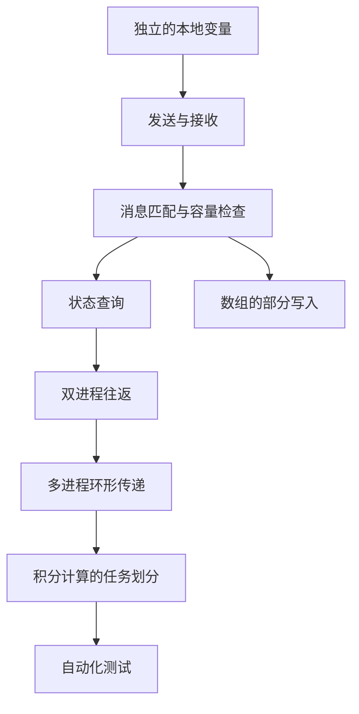
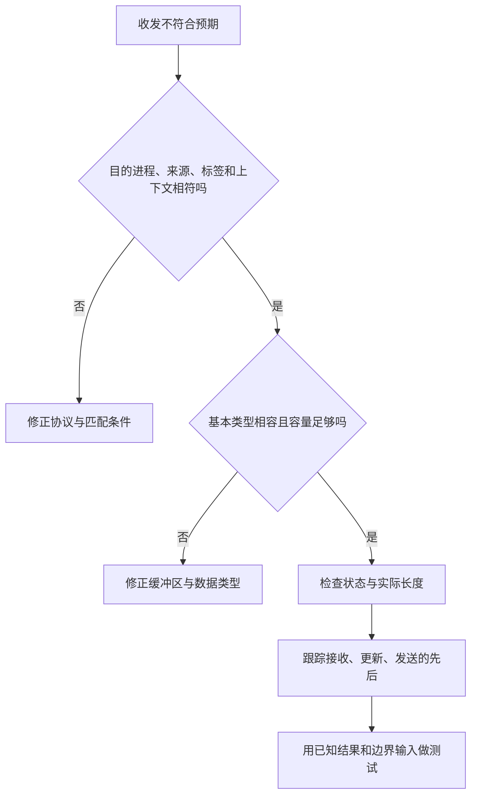

---
subject:
- 并行与分布式计算
type: lecture
class_no: 14
date: '2026-10-19'
teacher: 雷闻宇
source:
- 腾讯会议录制（MPI通信与并行计算培训）
- MPI及GoogleTest官方文档（语义校正与补充）
- '[[03_Sources/Courses/并行与分布式计算/课堂笔记/raw/2026-10-19-MPI通信与并行计算培训-358400-逐字稿]]'
- '[[03_Sources/Courses/并行与分布式计算/课堂笔记/raw/2026-10-19-MPI通信与并行计算培训-358400-纪要]]'
- '[[03_Sources/Courses/并行与分布式计算/课堂笔记/2026-10-14-第13节-Git与MPI编程教学]]'
meeting_code: null
start_time: '2026-10-19T16:24:46+08:00'
tags:
- GoogleTest
aliases:
- 2026-10-19 第14节 MPI点对点通信、环形传递与积分测试
schema_version: 2
time: "2026-10-20T19:43:13+08:00"
legacy_status: 已完成
legacy_topics:
- MPI_Send
- MPI_Recv
- 消息匹配
- 接收容量
- MPI_Status
- 环形令牌
- 复合中点积分
- GoogleTest
status: not done
polish_status: done
lecture_date: '2026-10-19'
---

# 2026-10-19 第14节 MPI点对点通信、环形传递与积分测试

## 课程信息与来源边界

- 时间：2026-10-19，课表第 7—8 节；录音自 16:24:46 开始。教师据课表登记，不根据录音账户推断身份。
- 原始记录：[[03_Sources/Courses/并行与分布式计算/课堂笔记/raw/2026-10-19-MPI通信与并行计算培训-358400-逐字稿|逐字稿]]、[[03_Sources/Courses/并行与分布式计算/课堂笔记/raw/2026-10-19-MPI通信与并行计算培训-358400-纪要|智能纪要]]；下文时间为录音相对时间。
- 本地课件检查：现有 PPT/源 MD 主要覆盖背景、硬件、性能、程序设计基础和 OpenMP，未找到对应本次 MPI 点对点通信及 GoogleTest 的课件。录音中教师展示过 PPT，并不表示该 PPT 已上传；缺失原图、题面和源码不凭空补成“课件原文”。
- 课次校正：[[03_Sources/Courses/并行与分布式计算/课堂笔记/2026-10-14-第13节-Git与MPI编程教学|上一课为10月14日第13节]]，含 10 月 10 日补课并沿用已核对的国庆停课扣除口径，本次为第14节；纠正自动占位的“第15节”。10 月 16 日不在本课程固定星期一、三排课内。
- “已完成”仅表示本次能够确认的课堂内容已整理；外部文档只用于语义校正，不代表教师课堂讲授范围。

## 一、本次课核心脉络

核心问题：分离的进程怎样交换数据，怎样知道收对了数据，再怎样把这种通信用于数值计算？

必要先修：每个 MPI 进程有独立的本地变量；rank 是通信器中的进程编号，不是物理 CPU 核编号；size 是进程数量。程序仍需 MPI_Init、MPI_Comm_rank、MPI_Comm_size 和 MPI_Finalize，不熟悉时回看[[03_Sources/Courses/并行与分布式计算/课堂笔记/2026-10-14-第13节-Git与MPI编程教学|上一课的 MPI 程序骨架]]。



阅读路线：先理解“消息选中”和“数据正确存入”的区别，再跟踪三个小程序，最后推导积分与测试。课堂末尾仅引入积分、局部求和和测试；完整并行划分、汇总实现留待后续程序，不写成已讲完。

## 二、MPI_Send 与 MPI_Recv 的参数（核心）

来源：逐字稿 00:00—10:13。

```c
MPI_Send(buf, count, datatype, dest, tag, comm);
MPI_Recv(buf, count, datatype, source, tag, comm, &status);
```

| 参数 | 发送端含义 | 接收端含义 |
|:--|:--|:--|
| buf | 本地待发送数据的起始地址 | 本地接收缓冲区的起始地址 |
| count | 本次发送的元素数 | 最多可接收的元素数，即容量 |
| datatype | 元素的 MPI 数据类型 | 接收缓冲区对应的 MPI 数据类型 |
| dest 或 source | 接收进程在通信器中的 rank | 允许的发送进程 rank 或来源通配符 |
| tag | 消息类别标签 | 要匹配的标签或标签通配符 |
| comm | 通信器及其上下文 | 必须相匹配的通信上下文 |
| status | 无此参数 | 接收结果的状态记录 |

对于本课的基本类型：C 的 int 对应 MPI_INT，double 对应 MPI_DOUBLE，char 对应 MPI_CHAR。count 数的是**该 datatype 的元素**，不是字节数。

标量 value 需要传入 &value；数组作为函数实参时，数组名通常退化为指向首元素的指针，所以可传 values。这里传入的地址帮助 MPI 读取本地数据；**并不是把本进程地址当成远端可直接解引用的共享地址**。

> 一句话来说：前三项说明“从本地哪里取多少数据”，后三项说明“把哪类消息发给谁、放在哪个通信上下文”。

**课堂类比及边界**：教师用快递正文、收件地址和号码解释参数。tag 是程序约定的消息分类整数，不是安全认证、加密或身份鉴别机制；通信器也不是简单的地理范围。对于本课常规通信器内通信，rank、tag、上下文共同界定消息的投递与选择。

## 三、匹配、容量与完成是三件不同的事（核心）

来源：逐字稿 10:13—25:18、50:38—52:32。

### 1. 先判断消息能否被这次接收选中

接收选择要满足：消息目的进程为当前接收进程；通信上下文相同；source 与来源相符或使用通配；tag 相符或使用通配。即使两个通信器包含同一组进程，若上下文不同，也不能直接让其中一个的消息被另一个接收操作选中。

课堂以 rank 0 向 rank 1 发送一个 MPI_INT、tag=10、comm=MPI_COMM_WORLD 为例：

| rank 1 的接收条件 | 能否选中该消息 | 还需注意 |
|:--|:--|:--|
| source=0、tag=10、同一上下文、容量1 | 能 | 正常接收 |
| source=0、tag=20、同一上下文 | 不能 | 标签不匹配 |
| source=0、tag=10、同一上下文、容量3 | 能 | 只写入一个元素，余下位置保持原状 |
| source=0、tag=10、不同上下文 | 不能 | 相同进程成员不等于相同上下文 |

**校正与补充解释**：datatype 不参与上述信封匹配，不等于“任意收发类型混用也正确”。正确通信还要求相容的基本类型序列和足够接收空间。不要把 MPI_INT 发出的整数随意按 MPI_DOUBLE 接收。

### 2. count 是接收容量，不是本次实际长度

本课收发均使用相同的基本类型，所以可以直接比较元素数：

- 发 3 个 int，收方容量 5：前三个位置写入，后两个位置不变。
- 发 1 个 int，收方容量 3：只写入第一个位置。
- 发 3 个 int，收方容量 2：容量不足，发生消息截断错误，不是安全地“只接收前两个”。

依据 [MPI_Recv 官方说明](https://docs.open-mpi.org/en/main/man-openmpi/man3/MPI_Recv.3.html) 校正。错误处理器可能终止程序，不保证截断后程序还能继续正常执行。

> 一句话来说：匹配回答“这是不是要收的消息”，类型和容量回答“收进来后能不能正确存放”。

### 3. Send 返回不代表对方已处理完

MPI_Send 是**标准模式阻塞发送**；成功返回后，本地发送缓冲区可复用。实现可能采用内部缓冲，也可能等待匹配接收，不保证“永远只是拷进缓冲区立刻返回”。返回也不证明接收方已经完成业务计算，更不是所有进程一起到达的屏障。

这是对纪要“缓冲区与异步机制”的语义校正，依据 [MPI 标准：Communication Modes](https://www.mpi-forum.org/docs/mpi-4.1/mpi41-report/node67.htm)。不要把课堂“各进程进度不同”的描述误记为调用了非阻塞接口。

MPI_Recv 成功返回时，接收缓冲区中已有本次收到的数据；之后才可基于这些数据计算。不要在接收前对本地初始值运算，期待它自动变成远端发送的数据。

> 一句话来说：发送完成保证本地发送缓冲区可复用，接收完成保证本地已拿到数据，都不等于远端业务处理结束。

### 自测（新编）：判断消息能否正确接收

rank 0 用 MPI_INT、count=3、tag=10 发给 rank 1；rank 1 定义五元素 int 数组并初始化为 -1。分别判断：同上下文收方 count=5、tag=10；count=2、tag=10；count=5、tag=20。若发送数据为 10、20、30，第一种接收后的数组是什么？

> [!hint]- 提示
> 依次看信封匹配、元素类型、缓冲区容量，别把三个判定混成一个。

> [!solution]- 解析
> 第一种匹配且容量足够，结果为 $(10,20,30,-1,-1)$；第二种信封仍匹配，但容量不足，发生截断错误；第三种标签不同，不选中这条消息，不能据此认为接收已完成。
> datatype 是否进入信封匹配，与缓冲区能否按正确类型存放是不同问题。

## 四、MPI_Status、实际长度与通配符

来源：逐字稿 18:28—23:07、30:42—31:40。

status 是 MPI_Status 类型的状态对象，不是收到的数值本身。常用查询为：

```c
MPI_Status status;
int actual_count;
MPI_Recv(values, 5, MPI_INT, 0, 30, MPI_COMM_WORLD, &status);
MPI_Get_count(&status, MPI_INT, &actual_count);
/* status.MPI_SOURCE 是实际来源，status.MPI_TAG 是实际标签 */
```

- MPI_Get_count 查询本次消息中实际接收的元素数；上面容量为 5，不代表 actual_count 必为 5。
- source=MPI_ANY_SOURCE：在指定通信器内接受任意来源。
- tag=MPI_ANY_TAG：接受任意标签。
- 没有任意通信器的通配符；发送仍需明确目的地，不能把 MPI_ANY_SOURCE 当目的 rank。
- 不需要状态时，用 MPI_STATUS_IGNORE，而不是随意传未初始化指针。
- 多个来源均可匹配时，不保证先收 rank 最小者；这也不等于 MPI 的所有消息顺序约束都不存在。

> 一句话来说：通配符扩大可接受消息的范围，status 记录最终真正收到了谁、哪个标签及多少数据。

## 五、课堂程序一：10 发过去，11 返回来

来源：逐字稿 25:18—37:07。教师将此程序作为 examples/MPI 中第 03 个示例讲解；以下为**按课堂逻辑整理的代码**，不是已核对的仓库源码。

程序严格使用 2 个进程；若 size!=2，课堂做法是 rank 0 输出错误提示、各进程 MPI_Finalize 后返回 1，而不是继续访问不存在的 rank。

核心收发段（接续已初始化的 rank、size）：

```c
int value = -1;
int actual_count = 0;
MPI_Status status;

if (rank == 0) {
    value = 10;
    MPI_Send(&value, 1, MPI_INT, 1, 10, MPI_COMM_WORLD);
    MPI_Recv(&value, 1, MPI_INT, 1, 20, MPI_COMM_WORLD, &status);
    MPI_Get_count(&status, MPI_INT, &actual_count);
    printf("value=%d source=%d tag=%d count=%d\n",
           value, status.MPI_SOURCE, status.MPI_TAG, actual_count);
} else {
    MPI_Recv(&value, 1, MPI_INT, 0, 10, MPI_COMM_WORLD, &status);
    value += 1;
    MPI_Send(&value, 1, MPI_INT, 0, 20, MPI_COMM_WORLD);
}
```

必须先通过进程数校验才进入上面分支；else 在此条件下才恰好表示 rank 1。

跟踪过程：rank 0 的本地 10 经 tag 10 发出；rank 1 收到后，本地 value 变为 10，再加一得到 11；以 tag 20 发回；rank 0 最终应报告 value=11、source=1、tag=20、count=1。

两个进程即便都用变量名 value，也不是共享同一个变量。不同方向使用不同 tag 是本例的协议约定，方便区分去程和回程；不是所有往返都强制不同 tag，也不是 tag 的数值大小决定执行先后。

## 六、课堂程序二：环形令牌为何得到 P-1

来源：逐字稿 37:07—50:38、01:10:00—01:10:31。

假设 $P\ge2$，进程编号为 $0,\ldots,P-1$。rank 0 发出 token=0，非零进程依次“接收—加一—发送”，rank 0 最后接收，但**不再加一**。

当前 rank 为 $r$ 时，下一站为 $(r+1)\bmod P$；非零进程的上一站为 $r-1$，rank 0 的上一站为 $P-1$。

**代码整理（前提：已初始化 rank、size，并拒绝 size<2）**：

```c
int token = 0;
if (rank == 0) {
    MPI_Send(&token, 1, MPI_INT, 1, 10, MPI_COMM_WORLD);
    MPI_Recv(&token, 1, MPI_INT, size - 1, 10,
             MPI_COMM_WORLD, MPI_STATUS_IGNORE);
    printf("processes=%d token=%d\n", size, token);
} else {
    int next = (rank + 1) % size;
    MPI_Recv(&token, 1, MPI_INT, rank - 1, 10,
             MPI_COMM_WORLD, MPI_STATUS_IGNORE);
    token += 1;
    MPI_Send(&token, 1, MPI_INT, next, 10, MPI_COMM_WORLD);
}
```

只有 $P-1$ 个非零进程执行加一，所以

$$
t_{\rm final}=0+(P-1)=P-1.
$$

课堂运行 $P=4,8,16$，最终分别为 $3,7,15$。这与“每经过一条边都加一”不同，后者会错误计入根进程最后一次接收。

**课堂提出的推广**：若初值为 $a$，每个非零进程加 $d$，则

$$
t_{\rm final}=a+(P-1)d.
$$

依据是共有 $P-1$ 次更新，不是总共 $P$ 次。“进程越多一定越快”没有依据，令牌沿环串行传递，增加进程还会增加通信跳数。

> 一句话来说：数清谁真正执行了更新，才能从通信路径推得最终结果。

**补充解释**：拒绝单进程输入还避免把该阻塞收发结构直接变成可能死锁的自发自收。正确性不能依赖系统恰好缓冲了小消息。

### 自测（新编）：改初值与步长

用 6 个进程，初值 5，每个非零进程减 2。根进程最终收到什么？如果根进程在收到后也减 2，结果又是多少？这与原课堂程序有何差别？

> [!hint]- 提示
> 原程序只有 rank 1 到 rank 5 执行更新；改变根进程逻辑会多一次更新。

> [!solution]- 解析
> 原程序结果为 $5+(6-1)(-2)=-5$。如果根进程也减 2，则变成 $-7$，已改变协议，不能再套 $a+(P-1)d$ 而不说明。
> 进程数量与加法次数不同；预测结果要以实际代码为准。

## 七、课堂程序三：三元素消息装入五元素数组

来源：逐字稿 53:02—01:10:00。

教师演示新建 count_demo.c，通过 touch 创建文件、code 打开编辑，并在课程既有 Makefile 中切换 TARGET 编译目标；此处不把项目约定写成所有 Makefile 通用规则。

**代码整理：发送与接收核心分支**。仍要求恰好 2 个进程，rank 已初始化。

```c
if (rank == 0) {
    int values[3] = {10, 20, 30};
    MPI_Send(values, 3, MPI_INT, 1, 30, MPI_COMM_WORLD);
} else {
    int values[5] = {-1, -1, -1, -1, -1};
    MPI_Status status;
    MPI_Recv(values, 5, MPI_INT, 0, 30, MPI_COMM_WORLD, &status);
    for (int i = 0; i < 5; ++i) {
        printf("%d ", values[i]);
    }
    printf("\n");
}
```

发送数组中的具体数字转写不清；上面用 10、20、30 **替代示意**以展示同一机制，不宣称恢复了原屏幕数值。预期前三项被替换、最后两项保持 -1。必须先明确初始化，不能把未初始化位置当成确定的零。

课堂操作要点：创建文件不等于编译该文件；确认 TARGET 指向 count_demo，按既有环境用 2 个进程运行。只接收不输出，会看不到演示结果，不能仅因无输出判定通信失败。

## 八、从积分公式到可分解的求和（核心）

来源：逐字稿 01:16:05—01:24:32。

### 1. 为什么一个积分等于 π

课堂使用

$$
\pi=\int_0^1\frac4{1+x^2}\,dx.
$$

**补充解释：等式依据**为反正切的导数：
$[4\arctan x]_0^1=4(\pi/4-0)=\pi$。

将 $[0,1]$ 等分成 $N\ge1$ 段，步长 $h=1/N$，以零起始编号，第 $i$ 段中点为 $x_i=(i+1/2)/N$。复合中点公式给出

$$
\pi_N
=\frac1N\sum_{i=0}^{N-1}\frac4{1+\left((i+1/2)/N\right)^2}.
$$

每项是“中点函数值乘小区间宽度”，把矩形面积相加近似积分。当 $N=1$，只有中点 $1/2$，故 $\pi_1=4/(1+1/4)=3.2$；这不是说 π 本身等于 3.2。

> 一句话来说：积分问题先化成有限项求和，才能把各段计算交给不同进程。

### 2. 局部函数为何使用半开指标区间

课堂将局部求和写为 begin 到 end，**不包含 end**；两个参数表示小区间的编号，而非积分实变量的左右端点。

**代码整理（依据课堂公式）**：

```c
double midpoint_sum(int n, int begin, int end) {
    double sum = 0.0;
    for (int i = begin; i < end; ++i) {
        double x = (i + 0.5) / n;
        sum += 4.0 / (1.0 + x * x);
    }
    return sum;
}

double pi_serial(int n) {
    return midpoint_sum(n, 0, n) / n;
}
```

调用前需保证 $n\ge1$ 且 $0\le\text{begin}\le\text{end}\le n$；片段未实现输入校验。midpoint_sum 只累加函数值，统一汇总后再乘 $h$，所以不要重复除以 $N$。

### 3. 并行设计讲到了哪里

课堂提出四个环节：选积分公式、划分指标任务、用通信汇总、用测试验证。对不重叠且并集为 $\{0,\ldots,N-1\}$ 的各进程指标集 $I_r$，局部和为 $S_r=\sum_{i\in I_r}f(x_i)$，则

$$
\pi_N=\frac1N\sum_{r=0}^{P-1}S_r.
$$

这是由求和可分解得到的设计表达。教师强调 MPI 不会像已经介绍过的 OpenMP reduction 那样自动完成课堂程序的汇总，需要显式安排通信；这里“人工汇总”指程序员编写汇总逻辑，不是要求手工抄数相加。

> [!info] 本课边界与待查
> 完整划分算法、非整除时的分块、完整 MPI 汇总代码尚未在本录音中讲解完成；教师建议预读第 05 个程序。录音所述区间数上限转写不清，不据“18层”等残文猜成确切常数，也不提前声称本课已使用 MPI_Reduce。

## 九、GoogleTest 怎样取代肉眼检查（核心）

来源：逐字稿 01:24:32—01:30:49。

课堂用 $N=1$ 时结果应为 3.2 来建立自动化检查。TEST 的两个名称分别组织测试套件和具体测试；测试代码放在 C++ 测试环境中，课程容器已配置 C/C++ 混合构建。

**代码整理（假定 pi_serial 已正确声明并链接、已包含 gtest/gtest.h）**：

```cpp
TEST(IntegrationTest, OneInterval) {
    EXPECT_NEAR(pi_serial(1), 3.2, 1e-4);
}
```

EXPECT_NEAR(a,b,eps) 检查 $\lvert a-b\rvert\le\varepsilon$，其中 eps 为允许的**绝对误差**。课堂用 $10^{-4}$ 展示容差；该值不是所有浮点测试的通用阈值。

| 检查 | 含义 | 适合场合 |
|:--|:--|:--|
| EXPECT_EQ(a,b) | 相等比较 | 整数编号、元素数量等 |
| EXPECT_NEAR(a,b,eps) | 差值在绝对容差内 | 数值计算结果 |
| EXPECT_TRUE(cond) | 条件为真 | 逻辑约束 |

> [!warning] 校正：EXPECT 与 ASSERT 不是“异常和断言”二选一
> EXPECT_* 失败通常记录非致命测试失败并继续当前函数；ASSERT_* 失败产生致命失败并从当前函数返回，不表示必然终止整个测试可执行程序。两者区别不应写成普通 C++ 异常处理的区别。
> 依据 [GoogleTest Assertions Reference](https://google.github.io/googletest/reference/assertions.html) 校正纪要相关表述。自动化测试记录失败，不会自动修复算法。

> 一句话来说：把可推导的预期值和容差写成机器能反复执行的检查，代码改动后就不必每次靠肉眼找输出。

### 自测（新编）：验证近似值而不误认精确值

推导 $N=1$ 的结果；说明为什么 EXPECT_NEAR(pi_serial(1), π, 1e-4) 不应通过。若 EXPECT_NEAR 未通过，换成 ASSERT_NEAR 是否会让数值计算变正确？

> [!hint]- 提示
> 测试预期应区分算法在有限 N 下的结果与连续积分真值；宏只改变失败报告与执行控制。

> [!solution]- 解析
> $N=1$ 时 $x_0=0.5$，$h=1$，故 $\pi_1=3.2$；与真值的差约为 $0.058407$，大于 $10^{-4}$。检验这一步具体实现，应使用已知的有限步结果 3.2；检验整体精度，则需选择适当 N 和合理误差界。
> ASSERT_NEAR 不改变计算公式，只改变断言失败后的控制流，不会把错误结果修正。

## 十、判定与调试流程



## 十一、核心公式速查表

| 内容 | 公式或规则 | 条件 |
|:--|:--|:--|
| 环的下一站 | $(r+1)\bmod P$ | $P\ge2$ 的课堂程序 |
| 环形最终值 | $a+(P-1)d$ | 仅非零进程更新一次 |
| 中点 | $x_i=(i+1/2)/N$ | $0\le i<N$ |
| π 的近似 | $N^{-1}\sum_i4/(1+x_i^2)$ | $N\ge1$ |
| 局部和汇总 | $\pi_N=N^{-1}\sum_r S_r$ | 指标覆盖全部且不重叠 |
| 近似断言 | $\lvert a-b\rvert\le\varepsilon$ | 给出合理绝对容差 |

## 十二、易错点与注意事项

> [!warning] 五个课堂判断均不能直接成立
> - “MPI_Send 返回就说明对方读完且处理完”：错，不能由本地完成推出远端业务完成。
> - “发一个整数，接收 count 必须为 1”：错，更大容量也可接收。
> - “tag 和类型相同就肯定匹配”：错，还要看进程、来源与通信上下文；类型兼容又是正确收取的额外要求。
> - “ANY_SOURCE 总先接最小 rank”：错，没有这种跨来源优先级保证。
> - “环里进程越多令牌传得越快”：没有依据，先分析依赖与通信跳数。
>
> 另须注意：MPI_SUCCESS 是成功返回码，不能把函数返回值当成“收到的整数”；不要把进程数与物理核数等同。具体成功常量不据错转写写成固定的 1。

## 十三、课堂疑惑与解答及缺失资料

本次未发现当日日计划文件“每日疑惑/2026-10-19.md”，没有可提取并回写的用户疑惑；本笔记自测是新编练习，不作为用户原问题追加。

- 本课程此前 9 月 28 日缺失课已标为“已补全（无逐字稿）”；此次未发现新的同课程“缺少逐字稿”占位课，不重复追加旧回填内容。
- 待补：本次 MPI 课件及原练习题、课堂 examples/MPI 第 03—05 个程序。当前代码是依据录音整理的教学片段，不宣称已在课程容器编译或运行。
- 无法确定的课件数字、区间上限及尚未讲完的完整并行实现保留待查，不伪造源码或运行日志。

## 十四、相关知识点链接与作业练习

- [[03_Sources/Courses/并行与分布式计算/课堂笔记/2026-10-14-第13节-Git与MPI编程教学|上一课]]：查 MPI 初始化、rank/size、Git 提交与构建环境。
- [[03_Sources/Courses/并行与分布式计算/课堂笔记/README|课堂笔记索引]]：回看 OpenMP 与本次 MPI 手动安排通信的区别。
- 上述原始逐字稿与纪要用于核对课堂顺序和要求；官方文档链接仅用于实现语义校正。

**教师明确的练习线索**：

1. 完成 PPT 后的 MPI 基础练习；题面未上传，不把整理者编题冒充原题。
2. 编写、运行 count_demo.c，观察三元素消息进入五元素接收数组。
3. 修改环形令牌初值或增量，先预测再运行核对。
4. 把自己的代码改动提交至个人 Fork，保留更改记录。
5. 预读第 05 个计算 π 程序；教师说明下次先有同学讲解，但本记录不足以登记具体人选与分工。

本次仅记录这些要求，未代为提交、推送或操作远程仓库。学习自测尚未收到实际作答，不填写能力等级或“已掌握”。
