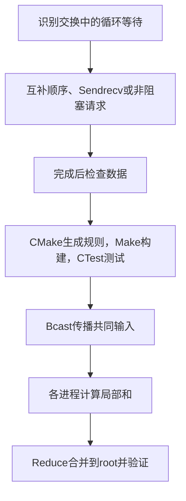
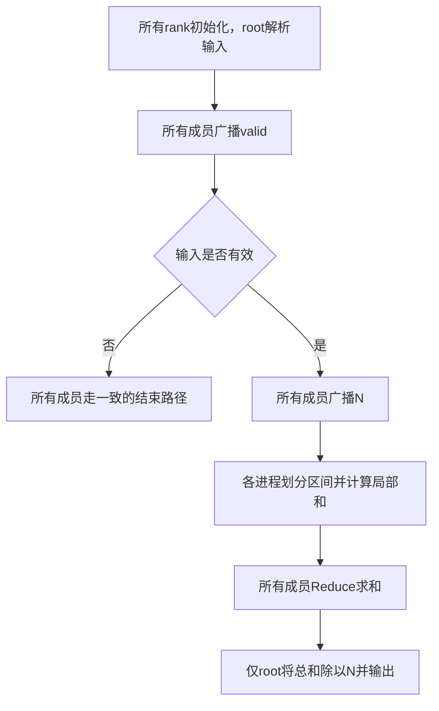

---
subject:
- 并行与分布式计算
type: lecture
class_no: 16
date: '2026-10-26'
teacher: 雷闻宇
source:
- 腾讯会议录制（MPI集合通信与CMake编译教学）
- '[[03_Sources/Courses/并行与分布式计算/课堂笔记/raw/2026-10-26-MPI集合通信与CMake编译教学-015168-逐字稿]]'
- '[[03_Sources/Courses/并行与分布式计算/课堂笔记/raw/2026-10-26-MPI集合通信与CMake编译教学-015168-纪要]]'
- '[[03_Sources/Courses/并行与分布式计算/PPT/mpi/05-死锁与非阻塞通信/讲义]]'
- '[[03_Sources/Courses/并行与分布式计算/PPT/mpi/06-广播与归约/讲义]]'
meeting_code: null
start_time: '2026-10-26T16:24:55+08:00'
review_required: true
tags:
- 死锁
- CMake
- GoogleTest
aliases:
- 2026-10-26 第16节 MPI集合通信、CMake构建与故障验证
schema_version: 2
time: "2026-10-26T22:25:12+08:00"
legacy_status: 已完成
legacy_topics:
- MPI集合通信
- MPI_Bcast
- MPI_Reduce
- MPI_Waitall
- 死锁
- CMake
- CTest
- GoogleTest
- 并行数值积分
status: "done"
polish_status: done
lecture_date: '2026-10-26'
---

# 2026-10-26 第16节 MPI集合通信、CMake构建与故障验证

## 课程信息与来源边界

- 课表：星期一第7—8节，16:20—17:55，第9周，教师雷闻宇；录音16:24:55开始。承接[[03_Sources/Courses/并行与分布式计算/课堂笔记/2026-10-21-第15节-MPI并行计算与死锁课程|第15节]]，沿用此前核对的假期、调休和停课口径，修正自动归档“第17节”为第16节。
- 原始材料：[[03_Sources/Courses/并行与分布式计算/课堂笔记/raw/2026-10-26-MPI集合通信与CMake编译教学-015168-逐字稿|逐字稿]]、[[03_Sources/Courses/并行与分布式计算/课堂笔记/raw/2026-10-26-MPI集合通信与CMake编译教学-015168-纪要|智能纪要]]。
- 实际结合的课件源MD：[[03_Sources/Courses/并行与分布式计算/PPT/mpi/05-死锁与非阻塞通信/讲义|第五讲：死锁、请求完成与CMake]]、[[03_Sources/Courses/并行与分布式计算/PPT/mpi/06-广播与归约/讲义|第六讲：广播与归约]]。配套PDF见[[03_Sources/Courses/并行与分布式计算/PPT/mpi/05-死锁与非阻塞通信/课件.pdf|第五讲课件]]、[[03_Sources/Courses/并行与分布式计算/PPT/mpi/06-广播与归约/课件.pdf|第六讲课件]]；本次依据源MD核对文字和代码，未另做PDF图像识别。
- 覆盖00:00—01:30左右的教学，以及01:32附近的作业线索；更后的闲聊不归入课程知识。
- 当前课程目录只有课堂记录和课件，未包含讲义引用的examples、tests、tools及完整CMakeLists.txt。以下代码来自讲义或按确认步骤整理，命令是课程工程中的复现路线，**不是本次已编译或实测通过的结果**。不伪造源码行号、软件名称或运行日志。
- 原始资料未改写。正文区分课堂内容、转写勘误、课件补充和新编自测。

## 一、本节核心脉络

问题：怎样安全交换两个进程的数据、构建测试多文件工程，再用集合通信完成并行积分？

必要先修：

- rank是通信器内编号，不是固定物理核心。各进程普通变量独立，同名不等于共享，见[[03_Sources/Courses/并行与分布式计算/PPT/mpi/02-程序结构与通信域/讲义|MPI程序结构与本地变量]]。
- 点对点消息需匹配通信器、来源/目标、tag、类型，见[[03_Sources/Courses/并行与分布式计算/课堂笔记/2026-10-19-第14节-MPI通信与并行计算培训|第14节通信基础]]。
- 上节积分已使用连续分块和局部和，见[[03_Sources/Courses/并行与分布式计算/课堂笔记/2026-10-21-第15节-MPI并行计算与死锁课程|第15节分块、验证与死锁]]。

阅读路线：等待与缓冲区 → 工程入口和构建 → 广播、归约 → 一致参与和积分。



## 二、双向交换：先看等待依赖（核心）

来源：00:00—00:05:28、00:17—00:25；结合第五讲。

通信器恰有两个进程，rank为 $r=0,1$，对端为 $1-r$。各有独立收发数组，初始化与预期为

$$
\operatorname{sendbuf}_r[i]=10\,000\,000r+i,\qquad
\operatorname{recvbuf}_r[i]=10\,000\,000(1-r)+i,
\quad i=0,\ldots,N-1.
$$

$N=4$ 时rank 0应收到10000000到10000003，rank 1应收到0到3；课堂也使用N=8。数组长度不是启动进程数，且应核对全部元素而非只看第一项。

双方都先阻塞发送、后接收，一旦发送完成需要对端开始匹配接收，两边就都走不到接收语句，形成循环等待。

> 一句话来说：死锁来自“为了继续等对方，而对方也在等我”，不是来自“只要阻塞就死锁”。

**转写勘误**：大消息的rendezvous握手是常见实现策略，不等于MPI_Send变成MPI_Ssend；标准模式可以依赖缓冲也可以等待接收。小数组一次成功不能证明顺序安全，标准也没有统一的“大于多少字节就死锁”阈值。明确同步发送的接口是MPI_Ssend，两端先发后收即使一个整数也可形成上述循环。

### 三种修复

| 方法 | 组织方式 | 仍需保证 |
|:--|:--|:--|
| ordered | rank 0先发后收，rank 1先收后发 | 消息匹配，解除循环等待 |
| Sendrecv | 一次调用表达发送与接收 | 分离收发区，分别匹配对象、标签、类型 |
| nonblocking | 先发起所需收发，再等两项完成 | 请求保留，缓冲区有效，不提前使用 |

讲义Sendrecv片段：

```c
MPI_Sendrecv(sendbuf, n, MPI_INT, peer, 20,
             recvbuf, n, MPI_INT, peer, 20,
             comm, MPI_STATUS_IGNORE);
```

前五个参数描述发送，随后五个描述接收，最后是通信器及接收状态。仍是阻塞接口，不会自动修复写错的tag、来源或通信器。

### 请求与缓冲区的使用时机

课堂以“下订单、凭小票确认”解释MPI_Request；请求句柄不是消息本身：

```c
MPI_Request requests[2];
MPI_Irecv(recvbuf, n, MPI_INT, peer, 20, comm, &requests[0]);
MPI_Isend(sendbuf, n, MPI_INT, peer, 20, comm, &requests[1]);
/* 此处只安排不访问两块缓冲区的独立工作。 */
MPI_Waitall(2, requests, MPI_STATUSES_IGNORE);
```

2是本rank的请求数，不是N或进程数。成功返回才可读接收区、修改或释放发送区；完成前两块内存都须有效，接收区不能提前读写，发送区不能改写。非阻塞提供重叠工作的机会，不保证自动加速。

**课堂错误实验（00:37、00:45—00:48）**：把Waitall改成只Wait发送请求，然后读取接收区。录音的“WaitFor”结合讲义校为MPI_Waitall。

- 只等发送不保证接收完成；应保留Waitall，或在两项通信都已发起后分别Wait两个请求。
- 单个Wait不是天然错误，错在以为它确认所有请求；两项非持久请求成功完成后句柄置空。
- 课堂观察到失败，不代表错误版本每次都必定显式报错；可能偶发输出正确、错数或其他非可靠行为。

请求完成细节另核对[Open MPI：MPI_Waitall](https://docs.open-mpi.org/en/v5.0.10/man-openmpi/man3/MPI_Waitall.3.html)。

## 三、多文件工程先从main读起（课堂方法）

来源：00:18:34—00:25:38。

教师建议先看主入口，再跳转到函数定义：

1. MPI初始化，获取rank、size。
2. 根据算法名选具有同一接口的交换函数。
3. 分配数组，按rank初始化可核对的数据。
4. 调用交换函数。
5. 逐元素验证、报告错误数/PASS，最后清理资源。

ordered、sendrecv、nonblocking是三种算法选择；未知名字如ABC应报用法错误，不能悄悄选默认算法。exchange function是**函数指针抽象**，转写“线性方程”“模板”不应误解为新数学对象。

> 一句话来说：main交代“做什么和怎样验”，具体函数决定“用哪种实现做”。

课堂演示编辑器“跳转到定义”追踪exchange.c、exchange_data.c；文件名可由讲义核对，但当前未收录完整工程，不据此编造源代码行号。

## 四、CMake、Make、CTest与GoogleTest各管什么（核心）

来源：00:05:28—00:16:59、00:25:51—00:35:59；结合第五讲第六、七部分。

### 1. 固定构建路径

以下在课程Linux容器或已配置MPI、GoogleTest的完整课程工程中执行：

```bash
cd examples/mpi/06_exchange
mkdir build
cd build
cmake ..
make -j4
ctest --output-on-failure
```

已有build时直接进入，无需重复创建，也不盲目执行递归删除。

| 阶段 | 工具/文件 | 作用 |
|:--|:--|:--|
| 描述项目 | CMakeLists.txt | 声明语言、目标、依赖和测试 |
| 配置生成 | cmake .. | 读上一级工程说明，寻找编译器和依赖，生成构建文件 |
| 编译链接 | make或make -j4 | 构建目标及依赖；-j4允许最多4个并行构建任务 |
| 启动MPI作业 | mpirun -n 2 | 启动2个MPI进程，与编译并行度不同 |
| 启动测试 | ctest | 执行已构建的测试命令，汇总退出状态 |
| 检查数据 | GoogleTest断言 | 在测试程序内部比较预期与实际 |

> 一句话来说：CMake生成规则，Make造程序，CTest启动测试，GoogleTest在测试里检查答案。

**补充解释**：CMake不总是生成Makefile，也可为Visual Studio、Xcode等生成工程。配置成功不等于编译成功；CTest不替你重编译。改源码后的路径是保存 → make → ctest。-j4也不保证4个任务始终同时运行，更不等于运行4个MPI rank。

### 2. 按target读配置

录音“3.2”结合讲义配置核为**3.20**；C标准11，C++标准17：

```cmake
cmake_minimum_required(VERSION 3.20)
project(mpi_exchange LANGUAGES C CXX)
set(CMAKE_C_STANDARD 11)
set(CMAKE_C_STANDARD_REQUIRED ON)
set(CMAKE_C_EXTENSIONS OFF)
set(CMAKE_CXX_STANDARD 17)
set(CMAKE_CXX_STANDARD_REQUIRED ON)
set(CMAKE_CXX_EXTENSIONS OFF)
find_package(MPI REQUIRED COMPONENTS C CXX)

add_library(exchange_core STATIC exchange.c exchange_data.c)
target_include_directories(exchange_core PUBLIC "${CMAKE_CURRENT_SOURCE_DIR}")
target_link_libraries(exchange_core PUBLIC MPI::MPI_C)
add_executable(exchange_demo exchange_main.c)
target_link_libraries(exchange_demo PRIVATE exchange_core)
```

这是配置片段，不冒充完整工程或完整测试注册：

- REQUIRED要求依赖存在，否则配置失败；find_package不是自动下载器，也不保证任意安装位置都能找到。
- exchange_core是静态库，exchange_demo是可执行目标。转写涉及DLL时应校正：DLL通常为动态链接库，不能说成静态库。
- target_include_directories指定头文件搜索路径，不会自动把目录内所有源文件加入编译。
- MPI::MPI_C是导入目标，提供MPI编译和链接条件。PUBLIC供本目标及使用者使用，PRIVATE供当前目标使用。
- CXX组件表示C++可使用MPI C API，不等于使用已移除的旧MPI C++绑定。

分别核对[CMake目标依赖](https://cmake.org/cmake/help/v3.20/command/target_link_libraries.html)、[FindMPI组件与导入目标](https://cmake.org/cmake/help/v3.20/module/FindMPI.html)。

### 3. 注册测试与故障注入

讲义用include(CTest)、find_package(GTest REQUIRED)、add_test登记普通测试及MPI测试。MPI测试通过启动器运行；PROCESSORS是调度信息，不能代替启动器的进程数参数；TIMEOUT是时间上限，不是算法解锁工具。

课堂00:54—01:00演示：交换后、断言前故意改接收数据，保存并重建，GoogleTest应检测不一致，CTest报告失败。这是在验证测试能发现错误，不是要求扩大容差“修好”测试。

**补充验证路线**：正常测试 → 注入已知错误 → 重建 → 检出失败 → 恢复 → 重建 → 再验正常。整数数组逐元素精确比较；不要套浮点容差，也不能只看rank 0是否正确。

### 4. 死锁超时演示不是修复

来源：00:38:22—00:40:27。两端先MPI_Ssend再接收，外部Python包装器等约3秒后终止。讲义命令为：

```bash
make deadlock_demo
python3 ../tools/run_with_timeout.py --seconds 3 -- \
  mpirun -n 2 ./deadlock_demo
```

必须先取得实际工具文件，本次不在知识库里运行故意挂起程序。超时表示外部结束作业，不表示MPI自动修复；一般程序超时也未必死锁，还须分析等待依赖。

## 五、广播：每个成员得到本地副本（核心）

来源：01:01:29—01:08:37、01:12—01:16；结合第六讲第二部分，仅讨论组内通信器。

```c
const int root = 0;
int n = rank == root ? 10 : -1;
MPI_Bcast(&n, 1, MPI_INT, root, MPI_COMM_WORLD);
```

参数为本地缓冲区地址、元素数、类型、root编号、通信器。包括root在内的所有成员调用；root先赋10，其他rank先赋-1，各自成功返回后本地n为10。

> 一句话来说：广播复制数据到各进程自己的内存，不会把这些变量变成共享变量。

count=1是一个整数，不是一个进程或一段积分；各进程的&n地址数值不必相同。后续某rank独自改n，不自动影响其他rank；打印顺序也未被广播排好。

root可改为通信器中其他合法编号，但参与成员对本次root必须一致。类型签名与数量须兼容；本课基础类型示例采用相同count和datatype。见[Open MPI：MPI_Bcast](https://docs.open-mpi.org/en/v5.0.10/man-openmpi/man3/MPI_Bcast.3.html)。

## 六、归约：合并贡献，结果只给root（核心）

来源：01:08:37—01:15:49；结合第六讲第三部分。

```c
int local = rank + 1;
int total = 0;
MPI_Reduce(&local, &total, 1, MPI_INT, MPI_SUM,
           root, MPI_COMM_WORLD);
if (rank == root) {
    printf("total=%d\n", total);
}
```

每rank贡献一个整数，MPI_SUM指定加法；4个rank得到10，8个rank得到36。root自身贡献已包含，不能再加一次。

> 一句话来说：大家各提供一份输入，按指定运算合并；普通Reduce只把完整结果写到指定root。

MPI_Reduce的C返回值是错误码，求和经缓冲区写回；不能用total = MPI_Reduce(...)取和。非root的total不承载本次全局结果，求和也不自动除以P。

**数组例**：输入 $(1,10),(2,20),(3,30),(4,40)$，count=2得到 $(10,100)$，不是8个元素的拼接，也不是110。count表示每个进程的元素数。操作和类型须是支持的组合，见[Open MPI：MPI_Reduce](https://docs.open-mpi.org/en/v5.0.10/man-openmpi/man3/MPI_Reduce.3.html)。

## 七、一致参与不等于同时到达（易混核心）

来源：01:16:39—01:19:19。课堂与纪要“同时调用”“全局同步”须结合讲义与标准校正：

1. 同一通信器的相应成员参加同一轮操作，root等参数符合约定。
2. 集合调用顺序一致，不能一端先Bcast再Reduce，另一端反过来。
3. 成员到达/返回时刻可以不同；阻塞返回只给相应的本地完成保证，不代表其他成员都返回。
4. 集合调用无应用指定tag，不能用普通Recv“补齐”缺席成员。
5. 不让某成员在仍需参加后续集合操作时提前退出。

只在if(rank == root)内调用Bcast是错误结构；可以只让root赋值，但随后所有成员都要参与Bcast。

> 一句话来说：共同完成同一件事要有一致的参与和顺序，不要求大家永远处于同一代码位置。

核对[MPI标准：集合通信的完成与同步边界](https://www.mpi-forum.org/docs/mpi-5.0/mpi50-report/node116.htm)。通信图是逻辑关系，既不规定实现总是root逐个直连，也不是性能实测；不能仅换接口就断言必然更快。

## 八、并行积分：只换通信，不换数学问题（核心）

来源：01:19:35—01:30:19；结合第六讲第六部分。

$$
f(x)=\frac4{1+x^2},\quad
\int_0^1f(x)\,\mathrm dx=\pi,\quad
x_i=\frac{i+\tfrac12}{N},\quad
Q_N=\frac1N\sum_{i=0}^{N-1}f(x_i).
$$

这是复合**中点**公式，转写“终点”须校正。N>0为小区间总数，P为进程数。令 $N=qP+s,\ 0\le s<P$，rank r的连续分块为

$$
b_r=rq+\min(r,s),\quad
c_r=q+\mathbf1_{\{r<s\}},\quad e_r=b_r+c_r.
$$

局部和 $S_r=\sum_{i=b_r}^{e_r-1}f(x_i)$，空区间取0。半开区间与i < end保证不重不漏。

N=10、P=4时分别为 $[0,3),[3,6),[6,8),[8,10)$，任务数3、3、2、2。录音01:20的下标转写混乱，以分块定义及讲义核对为准。



- valid是输入解析标志，不是保证MPI通信可靠的标志。先广播valid，让所有rank选同一后续路径；不能root独自因无效输入退出。
- 用相同合法N算分块；count=1、MPI_DOUBLE、MPI_SUM归约未归一化局部和，root最后除N一次。
- N<P时空任务rank仍参加广播和Reduce，贡献加法单位元0。N=2、P=4时四段为 $[0,1),[1,2),[2,2),[2,2)$。
- 相同N下比较串并行，采用有依据的浮点容差，不要求末位逐位一致。独立预期 $Q_1=3.2$、$Q_2=1344/425$；小N不等于π本身，不因此判通信失败。

> 一句话来说：先让各进程同意输入和执行路径，再独立计算，最后把同一个数学求和合并。

### 教师的二维网格动机

来源：01:22—01:25。教师展示正方形区域的非均匀网格、跨曲线的不连续数据，不同颜色对应约16个进程的不规则分区，说明实际科学计算的网格信息分发远比广播整数N复杂。

转写未可靠保留软件名与完整PDE，不臆造名称、方程或加速数字；这是应用动机，不写成已经讲完网格分区算法。

## 九、速查与易错点

| 对象 | 速查 | 注意 |
|:--|:--|:--|
| MPI_Wait | 等一个请求 | 不自动等所有通信 |
| MPI_Waitall | 等列出的活动请求 | count是请求数，不是全局屏障 |
| MPI_Bcast | root输入，各成员得到副本 | 所有成员参与，无tag |
| MPI_Reduce | 成员提供贡献，root得结果 | 逐元素运算，返回值是错误码 |
| make -j4 | 最多4个并行构建任务 | 不等于启动4个MPI进程 |
| mpirun -n 2 | 启动2个MPI进程 | 不保证独占2个物理核心 |
| ctest | 运行已有测试程序 | 改源码后先保存与构建 |
| 积分归一化 | $Q_N=(\sum_rS_r)/N$ | S尚未除N，最后只除一次 |

> [!warning] 不能省略的边界
> 小消息能跑不等于收发顺序安全；非阻塞返回不等于数据可读；发送完成不保证接收完成；集合参与不等于同时到达；归约不等于拼接或共享变量；配置/编译成功不等于数值正确；超时不等于已定位死锁。

## 十、课堂练习与自测

00:35:59—00:40:27给出以下练习；00:45:28提示下次课前约10—20分钟查看结果：

1. 分析两端先同步发送、后接收的死锁；普通Send小消息成功是否足以证明安全。
2. 写出N=4时应收到的数组，再改成100000，对比三种正确交换方法。
3. Waitall改为只Wait发送请求，分析缺失的接收完成保证；课堂已故意制造失败。
4. 交换后、断言前故意改接收数据，看GoogleTest与CTest是否检出，恢复后重建复验。
5. 用约3秒超时保护观察故意死锁示例。

01:32提到“剩余三道题”，但无可靠题号；不把第六讲全部拓展自动写成当天教师作业。换root、数组归约、空任务、无效输入属于**课件补充练习**，可回看完整讲义。

取得课程工程后，第五讲运行ordered/sendrecv/nonblocking；第六讲进入07_pi_collective的build运行collective_demo、pi_serial、pi_collective与ctest。当前不输出伪造PASS日志。

### 自测（新编）一：两个请求只等一个

已经发起Irecv和Isend，只等发送完成可否读接收数组？分别用两个Wait是否可行？

> [!hint]- 提示
> 逐一对应缓冲区与请求，区别发起和完成。

> [!solution]- 解析
> 不能据此读接收区。先发起两项匹配通信后，分别Wait两个请求可行，或使用Waitall。不要在接收尚未投递时立即Wait发送，重建循环依赖。

### 自测（新编）二：改root后数组怎样归约

P=4，各rank提供 $(r+1,10(r+1))$，root=3，count=2求和。谁取得结果，值是多少？

> [!hint]- 提示
> 两个位置分别求和，root自己的贡献不漏。

> [!solution]- 解析
> rank 3接收区得到 $(10,100)$，其余rank不承载全局结果。root改变不改变rank编号和参与者。

### 自测（新编）三：验证同一个离散问题

N=2、P=4，列分块、空任务贡献和中点积分预期。

> [!hint]- 提示
> 计算 $f(1/4)$、$f(3/4)$，不要直接断言等于π。

> [!solution]- 解析
> 分块为 $[0,1),[1,2),[2,2),[2,2)$，空任务贡献0但仍参加Reduce。
> $Q_2=\tfrac12(64/17+64/25)=1344/425\approx3.16235294117647$。

## 十一、课堂疑惑与待查

当日“每日疑惑/2026-10-26.md”不存在，没有可提取回写的个人疑惑；勘误、补充与新编自测不冒充个人问题。

待补资料：

- 完整examples/mpi/06_exchange、07_pi_collective工程、测试及超时工具，供实际编译运行；讲义引用的相对路径在当前库中没有对应工程，不复制成失效的笔记链接。
- 末尾“剩余三道题”的具体题号。
- 第9节9月28日已按OpenMP前后课程补全；今天为MPI阶段，无新依据恢复那堂课原板书与作业，因此不重复追加、不改称已有逐字稿。

“已完成”仅表示本次可确认课堂内容已整理；review_required标记工程资料与题号待核，不表示读者已掌握或程序已实测通过。

## 十二、相关导航

- [[03_Sources/Courses/并行与分布式计算/课堂笔记/README|课堂索引]]：实际课次及缺勤补全状态。
- [[03_Sources/Courses/并行与分布式计算/PPT/mpi/05-死锁与非阻塞通信/讲义|第五讲完整讲义]]：完整配置、测试登记与错误实验条件。
- [[03_Sources/Courses/并行与分布式计算/PPT/mpi/06-广播与归约/讲义|第六讲完整讲义]]：完整main、积分入口及课件练习。
- 第六讲文末预告Scatter/Gather属于后续方向，不写成本次已讲完。
