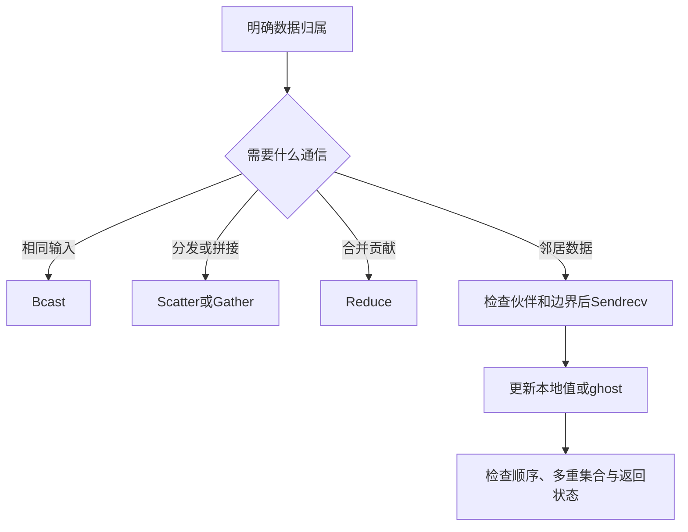

# 2026-10-28 第17节 MPI邻居交换、奇偶排序与热扩散模型

> [!info] 资料补传与处理边界
> 本次录音于10月28日22:56后归档，晚于当天检查；现已找到逐字稿和纪要，撤销当前“缺少资料”的判断，保留此前检查时资料缺失的经过说明。承接10月26日第16节，本课文件名及索引为第17节，核正自动元数据中的第18节。
> 前22分钟结合[[03_Sources/Courses/并行与分布式计算/PPT/mpi/06-广播与归约/讲义|第六讲讲义]]核对。后续邻居交换、排序和热扩散以本次录音为准；本地未找到相应07/08后续课件及课堂完整演示工程。下文代码为补充解释，不宣称执行过教师程序或复现CTest。原始资料保留。

## 一、问题、先修与主线

先修：进程各有独立内存；root是通信器内的rank；集合通信要求参与者按一致次序调用。回看[[03_Sources/Courses/并行与分布式计算/课堂笔记/2026-10-26-第16节-MPI集合通信与CMake编译教学|上一课]]核对广播、归约和构建测试。

本课依次回答：数据怎样分给各进程？邻居怎样互相提供数据？怎样验证全局排序？热扩散为何需要这种交换？


## 二、广播与归约的课堂练习（00:00—00:22）

1. 教师重建构建目录、配置编译，并运行广播、串行π、并行π及CTest；录音报告四项测试通过。这是课堂运行记录，不是本次Agent实际测试结果。
2. 将root改成size-1：广播源可以是最后一个或其他合法rank，各成员须使用一致root；数据须先在新root初始化。
3. 把单个整数改为数组。录音先说“广播二维数组”，实际00:15—00:17演示的是**长度2的整数数组逐分量归约**：各rank输入 $(r+1,10(r+1))$，四进程结果为 $(10,100)$。这不是矩阵乘法或把数组拼接，count应为2。
4. 改变进程数及积分区间数，包括区间数小于进程数，检查空工作进程也能正常参与通信；逐步增加区间数观察数值收敛。
5. 故意删去输入检查的广播，分别输入0、字母等非法值，观察进程等待；恢复广播后检查程序能一致报错退出。**不是“删除任何一条广播必然死锁”**，而是本例各rank控制流失配。
6. 故意扰动某rank的局部求和，使测试能发现超出误差容许范围的结果。扰动常数转写不清，不补造具体数值。

> 一句话来说：广播统一输入及成功/失败状态；归约合并各进程计算出的贡献。

补充解释：中点积分可写为
$$
\pi_N=\frac1N\sum_{i=0}^{N-1}\frac4{1+((i+1/2)/N)^2}.
$$
并行改变求和顺序，浮点结果不必逐位相等；用合理误差检验，而非强求完全一致。合法输入范围本例口述为 $1\le N\le10^7$，以实际工程参数校验为准。

## 三、Scatter/Gather与邻居交换（00:22—00:47）

### 1. 三类操作不可混淆

| 操作 | 数据效果 | count的本课含义 |
|---|---|---|
| Bcast | root的数据复制到各成员 | 整份广播数据的元素数 |
| Scatter | root分给各rank各自的一份 | 每个接收者的一份元素数 |
| Gather | 按rank顺序拼接到root | 从每个发送者接收的元素数 |
| Reduce | 按指定运算逐分量合并 | 每rank贡献的元素数 |

课堂先取每rank一个整数，如9、3、7、1。Scatter分发不同元素；Gather收回数组的顺序由rank决定，不表示按数值排好序。

### 2. 邻居和边界

线性非周期排列中，rank $r$ 的邻居是 $r-1,r+1$。边界无邻居时用MPI_PROC_NULL，而非随意把负数当合法rank。调用空源接收不会写入有效数据，ghost变量须预置合适值，不能读未初始化缓冲区。

课堂初值为10、11、12、13。向右发送本地值、接收左邻居值到left_ghost；反向发送则得到right_ghost。ghost是邻居数据的本地副本，**不覆盖本地拥有的数据**。

补充解释性片段（省略已完成的初始化及状态处理）：
```c
MPI_Sendrecv(&local, 1, MPI_INT, right, 0,
             &left_ghost, 1, MPI_INT, left, 0,
             MPI_COMM_WORLD, MPI_STATUS_IGNORE);
MPI_Sendrecv(&local, 1, MPI_INT, left, 1,
             &right_ghost, 1, MPI_INT, right, 1,
             MPI_COMM_WORLD, MPI_STATUS_IGNORE);
```
两方向的来源、目的地、标签及缓冲区须对应。两边都先写阻塞Send再Recv可能等待，Sendrecv用于组合交换；不能仅因消息小就假定发送总有缓冲。

### 3. 输出与资源管理

每rank各自printf不保证输出次序。课堂把(left_ghost,local,right_ghost)三个值Gather到root，接收区需要 $3P$ 个整数，再由root按rank打印。验证结果由root产生后再广播，让全部进程按一致成功/失败状态收尾。初始化与MPI_Finalize配对，动态申请的内存要释放；本地输出次序不等同于计算正确性。

## 四、奇偶排序（00:47—01:10）

### 1. 配对与比较交换

设 $P$ 个rank，每rank一个整数。偶阶段配 $(0,1),(2,3),\ldots$；奇阶段配 $(1,2),(3,4),\ldots$。阶段phase从0起：
$$
\mathrm{candidate}=
\begin{cases}
r+1,&r\bmod2=\mathrm{phase}\bmod2,\\
r-1,&\text{其他}.
\end{cases}
$$
candidate越界则没有伙伴。先互换数据，让双方都知道两个数；低rank保留min，高rank保留max。双方都得更新，不能只修改一个分支。

> 一句话来说：相邻配对交替错开，小值向低rank传播，大值向高rank传播。

对每rank一个值的此算法，执行 $P$ 个交替阶段足以排序。不能把这个阶段数直接搬到每rank持有任意数据块的实现；那需相应的块比较合并算法。

### 2. 课堂样例的完整轨迹

补充核算9、3、7、1：
$$
(9,3,7,1)\to(3,9,1,7)\to(3,1,9,7)
\to(1,3,7,9)\to(1,3,7,9).
$$
第三阶段后已排好，固定循环仍可执行最后一次。倒序8个数使用8阶段；单进程、重复整数、负整数也应覆盖。

### 3. 验证不只检查递增

Gather后既要检查非降序，也要检查输入输出的多重集合相同；把所有值错写成0也可能通过“递增”检查。还需测试输入数量/格式、边界无伙伴、各rank返回状态与单rank运行。
课堂练习：破坏只保留某rank分支的更新，确认测试发现错误；尝试隐藏中间阶段输出。转写的开关名“max”不可靠，需原程序或help确认，不能直接认定为实际命令。课堂没有在此证明实测加速比。

### 自测（新编）

对 $(4,3,2,1)$ 写出四阶段结果。若两伙伴都保留min，会破坏什么性质？

> [!hint]-
> 分别按偶配对、奇配对交替更新；关注元素出现次数。

> [!solution]-
> $(3,4,1,2)\to(3,1,4,2)\to(1,3,2,4)\to(1,2,3,4)$。双方保留min会丢失较大值、复制较小值，破坏多重集合守恒，即便最终有序也不正确。

## 五、一维热扩散模型（01:11—01:27）

### 1. 从物理假设到守恒式

均匀细杆横截面积 $A$，侧面绝热；截面内温度近似一致，只沿轴向传导；密度 $\rho$、比热 $c$、导热系数 $k$ 为常数；忽略对流、辐射与内热源。两端保持20℃，初始温度另给，并应与端点相容。

Fourier定律为 $q=-kT_x$，负号表示热从高温向低温传。小区间能量守恒为
$$
\frac d{dt}\int_x^{x+\Delta x}\rho cA T(s,t)\,ds
=A[q(x,t)-q(x+\Delta x,t)].
$$
除以 $A\Delta x$ 并令 $\Delta x\to0$：
$$
\rho cT_t=-q_x=kT_{xx},
\qquad T_t=\alpha T_{xx},\quad\alpha=\frac{k}{\rho c}>0.
$$
这是课堂推理的数学展开。$\alpha$ 是热扩散率，不是把导热系数k直接当扩散率；有量纲时单位应一致。

> 一句话来说：温度曲率决定局部净流入热量，从而决定温度的时间变化率。

$T_{xx}<0$ 的局部峰随时间降低，$T_{xx}>0$ 的局部谷升高；不是任意位置温度都必然下降。端点温度固定是Dirichlet条件；绝热端则是零法向导数的Neumann条件，不应将固定20℃说成初始条件。

### 2. 用解析解验证未来数值程序

补充明确课堂正弦初温的记号：若
$$
T(x,0)=20+B\sin(\pi x/L),\quad T(0,t)=T(L,t)=20,
$$
则
$$
T(x,t)=20+B e^{-\alpha(\pi/L)^2t}\sin(\pi x/L).
$$
代入方程、初值与边界均成立。衰减的是相对20℃的扰动，不是温度趋向0；课堂未确定唯一的振幅B，不擅自把口头“中间60℃”当成最终固定参数。数值结果可与此解析解比较误差，但本次未执行热方程程序。

## 六、二维推广及后续边界（01:27—01:31）

各向同性常系数模型：
$$
T_t=\alpha(T_{xx}+T_{yy})=\alpha\Delta T.
$$
拉普拉斯算子是 $\Delta$ 或 $\nabla^2$，不是 $\Delta^2$（后者通常表示双调和算子）。在正方形 $(0,L)^2$ 四边20℃，补充写清课堂乘积正弦例：
$$
T(x,y,t)=20+B e^{-2\alpha(\pi/L)^2t}
\sin(\pi x/L)\sin(\pi y/L).
$$
因两个方向的二阶导分别贡献 $-(\pi/L)^2$，指数中出现2。课堂至此引入连续模型，下一课再讨论求解；本次不把未讲的差分格式、稳定性阈值、并行网格实现写成已讲内容。

## 七、方法选择与公式速查



| 对象 | 核心关系 | 条件 |
|---|---|---|
| 奇偶伙伴 | rank与phase同奇偶时向右，否则向左 | 越界不配对 |
| 排序更新 | 低rank取min，高rank取max | 每rank一个值、双方正确交换 |
| 一维扩散 | $T_t=\alpha T_{xx}$ | 常系数、无内源 |
| 二维扩散 | $T_t=\alpha(T_{xx}+T_{yy})$ | 各向同性常系数 |
| 解析验证 | 衰减因子 $e^{-\alpha\lambda t}$ | 边界对应的空间特征值 |

> [!warning] 核对重点
> Gather不是Reduce；MPI_PROC_NULL不是任意非法rank；阻塞集合通信不是屏障。不要把长度2数组误称必然二维矩阵，不把课堂测试通过写成本次已运行。验证排序须保留全部原始数据。

## 八、疑惑、来源与缺失回查

当日检查使用的“每日疑惑/2026-10-29.md”不存在，没有个人疑惑可以提取；不编造提问或时间。

- [[03_Sources/Courses/并行与分布式计算/课堂笔记/raw/2026-10-28-MPI并行计算与热扩散方程课程-301504-逐字稿|逐字稿]]：上述时间段为课堂知识；01:31后杂谈不作为教学来源。
- [[03_Sources/Courses/并行与分布式计算/课堂笔记/raw/2026-10-28-MPI并行计算与热扩散方程课程-301504-纪要|纪要]]：辅助定位；数组操作、程序等待与算子符号已结合原文校正。
- [[03_Sources/Courses/并行与分布式计算/PPT/mpi/06-广播与归约/讲义|第六讲]]：核对root、count、数组归约与集合调用顺序；讲义中指向旧代码工程的链接目前缺失，因此不声称已读到或运行完整教师源码。
- 10月28日晚检查时曾因未见资料标记缺失，之后原始录音补传；旧Inbox占位现已不在原位置，本次不重建。现在属于根据原始逐字稿直接整理，不是无逐字稿回填。
- 9月28日第9节已由前后课程补全，今天没有精确定位该旧课的新边界依据，不重复追加还原内容。
- [[03_Sources/Courses/并行与分布式计算/课堂笔记/README|课堂索引]]：更新当前资料与润色状态。
