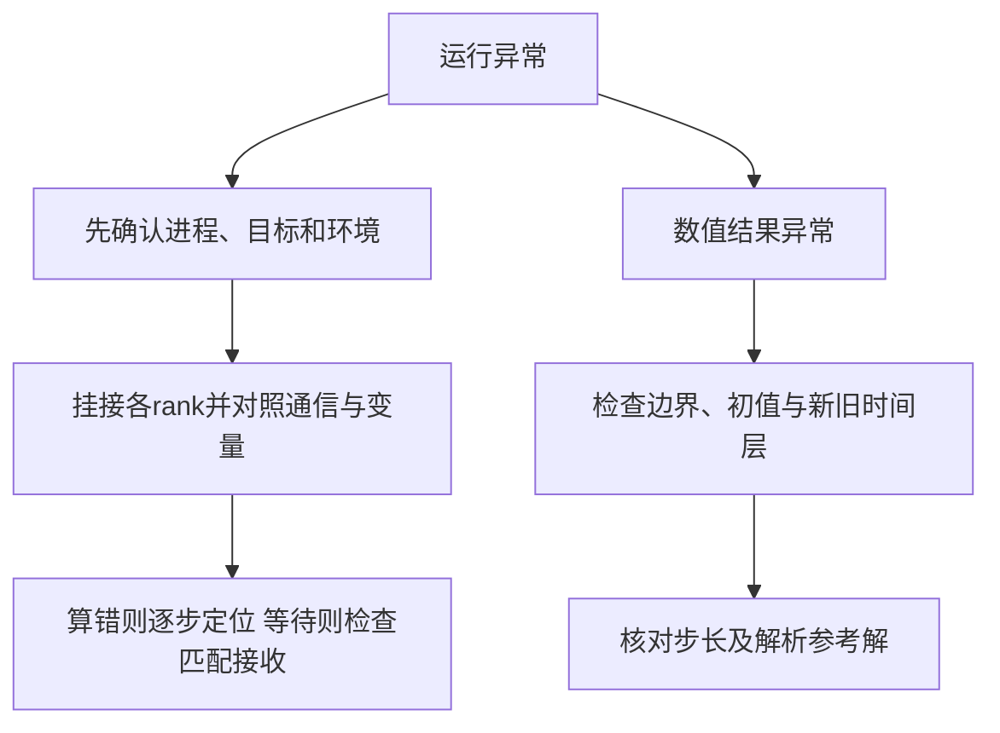

# 2026-11-02 第18节 并行与分布式计算：MPI调试与热方程显式差分

> [!info] 来源与执行边界
> 本节录音于11月3日补传，录制16:20:12–18:49:23；有效教学主要至约01:34，后续杂音不当作课程内容。依据逐字稿、纪要及已存在的MPI通信讲义整理。教师演示工程包含09a、heat_reference、heat_solver等，但当前本地未定位完整工程或本课热方程专章课件；下文是课堂过程及补充推导，不宣称本次运行了教师代码或修复了其容器。

## 一、本次主线与考核提示

先修可回看 [[03_Sources/Courses/并行与分布式计算/课堂笔记/2026-10-28-第17节-MPI并行计算与热扩散方程课程|上一课热模型与邻居通信]]；同步通信与死锁核对 [[03_Sources/Courses/并行与分布式计算/PPT/mpi/05-死锁与非阻塞通信/讲义|通信讲义]]。

录音00:01–03:00说明：课程预计11月18日结束，拟于本周三（11月4日）前后给出一组选题，供选择后开展类似数学建模的大作业；最后一周约5分钟PPT展示思路、结果及程序。具体题单、评分与汇报日期尚未提供，不替老师补造要求或新建提醒。

## 二、为什么先写出热方程解析解（03:21–13:45）

一维模型$T_t=\alpha T_{xx}$，$\alpha=k/(\rho c)>0$，端点固定20℃，初值另给。解析解用于与离散解对照，而非复杂几何总能直接写出解析式。

**结合上一课的补充表达**：对长度$L$区间的一个正弦模态，

$$
T(x,t)=20+A e^{-\alpha(\pi/L)^2t}\sin(\pi x/L).
$$

对二维同边长正方形的正弦乘积模态，对应衰减因子是$e^{-2\alpha(\pi/L)^2t}$。这解释课堂所说“多一个2”；并不表示所有二维初值都具有同一倍数或都在10秒达到均匀。振幅$A$须由实际初值确定，不能从模糊口述猜定。

教师尝试打开heat_reference和部分heat_solver文件时发现文件疑似被错误覆盖为二进制，随后先转入调试演示，表示待修复。不得写成本课已经完整展示、编译并验证了热求解器。

## 三、MPI调试的架构：每个rank有自己的执行状态（13:45–28:59）

课堂采用VS Code、容器、GDB和gdbserver。先更新/重建Dev Container以取得新增调试工具，再检查MPI编译器/运行器、GDB、gdbserver及项目调试配置。命令面板可用Ctrl+Shift+P；从Ctrl+P快速打开框进入命令模式时须先输入`>`。重建容器和重新打开窗口并非每次都等效，按项目实际配置操作。

演示是两个进程、两个调试端口5000与5001。rank是MPI通信域内编号，PID是操作系统进程号，端口是调试连接端点，三者不是同一东西。运行时PID会变，不能照抄老师屏幕上的数字。

老师在项目的build目录配置、编译并执行CTest后，退出build，从项目scripts目录相应脚本启动调试模式，再用VS Code预置配置连接两个rank。录音未清晰给出完整脚本文件名和参数拼写，因此不伪造可直接执行的命令。

> 一句话来说：调试MPI不是只停住一个“程序整体”，而是观察并协调多个进程各自停在哪里、等谁提供什么数据。

## 四、交换数据例题与断点观察（22:04–52:19）

课堂初始发送数组是$10,11,12,13$，接收缓冲区初值为四个$-1$。正确流程：rank0发送四个数 → rank1接收并求和46 → rank1把结果发回 → rank0核对结果，最后用归约汇总测试状态。

### 三类情况要分开

| 模式/现象 | 课堂用途 | 要核对什么 |
|---|---|---|
| correct | 正确交换与回传 | 接收数组、求和46、返回值 |
| one value（口述名称） | 故意使计算结果出错 | 在求和附近停下，追踪哪一步改错了数据 |
| 死锁模式 | 两边同步发送都等接收 | 两个rank的调用栈、通信对象及执行顺序 |

录音称有四种模式，但未可靠列明全部名称，第四种不补造。模式的准确大小写和命令行选项以实际项目为准。

老师先在exchange.c约46行、52行设断点；练习要求在约56行求和位置设断点，用one value模式观察故意错误。行号随版本变化，应按语句定位，不能把行号当作稳定API。

### 观察顺序

1. 选中rank0或rank1，观察调用栈、当前语句与局部变量；执行到某行通常表示该行尚待执行。
2. Step Over前进一行，Step Into进入函数，Continue继续到下一断点；控制的是选中的调试会话/进程。
3. 在同步发送处，发送者会等待匹配接收。让接收进程执行后，接收数组从$-1$变为$10,11,12,13$，再跟踪求和与回传46。
4. “另一个rank停在断点”本身会导致当前同步操作等待，不能只看一个窗口卡住就断言代码死锁。真正的对称同步发送且双方都未发起接收会形成循环等待。
5. 课堂还演示异常断点：调试器配置为捕获C++异常时可在抛出位置停下。这是暂停定位，不是自动减慢程序、修复异常。

> 一句话来说：断点的价值是让预期数据流与实际变量变化逐步对照，而非仅看到程序最终输出。

## 五、环境故障的课堂处理及限制（52:36–01:22:39）

学生遇到工具未更新、GDB缺失、下载/连接失败、插件与本地修改冲突等情况。先分辨是否真正进入容器、是否重建到了新镜像、下载是否完成、调试目标是否已经启动，再检查环境。Mac主机与Linux容器的工具环境不能混淆。

教师最后建议某个有多处个人修改的工程先备份再重新拉取；这是针对当时故障的处理，不能把它写成每次更新都删除工作目录的常规步骤。录音中的安装命令转写不清，未把“安全APP”等噪声写成可执行命令。本次没有安装工具、重建容器、删除工程或修改独立代码仓库。

## 六、热方程离散：空间二阶、时间一阶（01:23:03–01:34:36）

课堂参数$L=1\mathrm m$、$\alpha=0.01$，两端20℃。将区间分为$N$小段，有$N+1$个节点，

$$
\Delta x=L/N,\quad x_i=i\Delta x\ (i=0,\ldots,N),\quad
t_n=n\Delta t,\quad u_i^n\approx T(x_i,t_n).
$$

$i$是空间编号，$n$是时间层；初值$u_i^0=T(x_i,0)$来自初始温度函数，边界$u_0^n=u_N^n=20$。摄氏与开尔文温差相同，常数平移不改变方程中的导数；绝对温度读数仍须统一。

### 空间中心差分的来由

在半节点处先近似热梯度：

$$
T_x(x_{i+1/2},t_n)\approx\frac{u_{i+1}^n-u_i^n}{\Delta x},\quad
T_x(x_{i-1/2},t_n)\approx\frac{u_i^n-u_{i-1}^n}{\Delta x}.
$$

两式相减再除以$\Delta x$，得

$$
T_{xx}(x_i,t_n)\approx\frac{u_{i-1}^n-2u_i^n+u_{i+1}^n}{\Delta x^2}.
$$

分母是$\Delta x^2$。**按课堂Taylor思路补全**：对足够光滑的$T$，

$$
\frac{T(x+h,t)-2T(x,t)+T(x-h,t)}{h^2}
=T_{xx}(x,t)+\frac{h^2}{12}T_{xxxx}(x,t)+O(h^4).
$$

故空间导数近似误差为$O(\Delta x^2)$；局部相容精度不能未经稳定性检查就等同于整个数值解必然二阶收敛。

### 时间显式欧拉与更新式

$$
\frac{u_i^{n+1}-u_i^n}{\Delta t}
=\alpha\frac{u_{i-1}^n-2u_i^n+u_{i+1}^n}{\Delta x^2},\qquad
r=\frac{\alpha\Delta t}{\Delta x^2},
$$

$$
\boxed{u_i^{n+1}=r u_{i-1}^n+(1-2r)u_i^n+r u_{i+1}^n,\quad1\le i\le N-1.}
$$

已知初始层即可算第一层，依次迭代。**补充实现提醒**：新旧层用不同缓冲区，整层算完后交换，避免后一个点读到已经更新的新值；每层重新保证边界。课堂本次只推到格式和迭代思路，串行/并行完整实现留待后续。

> 一句话来说：显式法用旧时刻的自己和左右邻居，计算新时刻的温度。

**补充理解（非本节已讲结论）**：本一维格式常用稳定限制为$0\le r\le1/2$。此时三权重非负且和为1，可保持旧层温度范围；高频误差的放大因子$1-4r\sin^2(\theta/2)$也不超过单位模。不能把纪要中的局部误差阶数当作不受步长限制的收敛承诺。

## 七、方法选择、自测与后续任务

### 自测（新编）

取$\alpha=0.01,N=10,\Delta t=0.25$，某内点及其邻居旧温度为$(20,60,20)$。求$r$和新温度；若$\Delta t$改为1，同样算一次，解释有什么风险。

> [!hint]- 提示
> $\Delta x=0.1$；查看中央权重$1-2r$是否非负。

> [!solution]- 解析
> 第一种$r=0.25$，新温度$0.25\times20+0.5\times60+0.25\times20=40$。第二种$r=1$，新温度$20-60+20=-20$，产生超出旧值范围的振荡风险，不满足上述一维稳定限制。该数值为新编验证，不是教师运行输出。

| 项目 | 速查 |
|---|---|
| 同步发送调试 | 同时查看发送者和匹配接收者的执行状态 |
| 空间差分 | 三点二阶导数，分母$\Delta x^2$ |
| 时间差分 | 显式欧拉，一阶时间精度 |
| 权重参数 | $r=\alpha\Delta t/\Delta x^2$ |
| 实现边界 | 新旧层分离、端点保持20℃ |

老师安排练习故意错误模式、修复后验证及死锁观察；选题正式发布后再确定大作业范围。当前缺少教师完整工程，因此本次不能提供其编译/测试通过记录。

## 八、课堂疑惑与解答、资料补传记录

11月2日、3日日计划均不存在，没有新增虚构个人问答。昨天建立的资料缺失事实已由本次真实逐字稿与纪要解除，原Inbox记录保留历史说明并链接本笔记；本课按真实资料整理，不标为“无逐字稿重建”。

## 九、来源

- [[03_Sources/Courses/并行与分布式计算/课堂笔记/raw/2026-11-02-热方程求解与调试培训-377792-逐字稿|逐字稿]]：教学及故障处理的主要依据。
- [[03_Sources/Courses/并行与分布式计算/课堂笔记/raw/2026-11-02-热方程求解与调试培训-377792-纪要|纪要]]：辅助定位；未据转写猜补脚本命令或安装操作。
- [[03_Sources/Courses/并行与分布式计算/PPT/mpi/05-死锁与非阻塞通信/讲义|既有通信讲义]]：同步等待及死锁的背景核对，不冒充本节调试工程或热方程课件。
- [[03_Sources/Courses/并行与分布式计算/课堂笔记/2026-10-28-第17节-MPI并行计算与热扩散方程课程|上一课笔记]]：解析模态与热物理先修。
