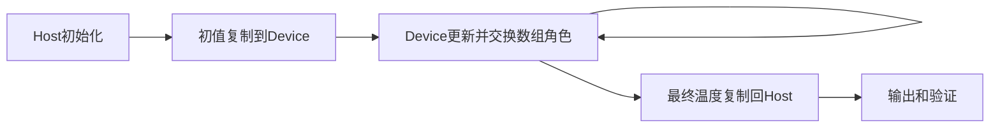

# 2026-11-16 第22节 GPU并行计算与期末汇报指导

## 本节问题与阅读路线

本节用已经学过的一维热方程说明：怎样把“每个进程循环更新一段节点”改为“许多GPU逻辑线程分别更新节点”，并避免数据搬运抵消计算收益。后半段是期末项目材料与汇报的个别答疑。教师在03:32说明这是最后一次正课，GPU部分以基本原理和程序阅读为主，没有在录音中形成可核实的全班GPU实操任务。

必要先修：[[03_Sources/Courses/并行与分布式计算/lectures/mpi/10-有限差分与串行热传导求解/讲义|第10讲]]提供三点显式差分、稳定性和双数组；[[03_Sources/Courses/并行与分布式计算/课堂笔记/2026-11-09-第20节-MPI并行计算技术授课|第20节]]解释MPI分区和邻居旧值。这里只需先记住：新时间层的一个内部值，必须从同一旧时间层的左、中、右三个值计算。


**来源边界**：已完整读取本节逐字稿（00:00:00至01:21:01）与智能纪要。当前课程资料有MPI第10、11讲等讲义，但未找到与本次GPU展示可靠对应的课件、`.cu`源码或完整演示工程；以下不恢复屏幕上无法确认的设备型号、参数、运行命令及性能数字。正式期末要求另对照[[03_Sources/Courses/并行与分布式计算/lectures/docs/final.pdf|期末大作业任务书]]，并明确区分任务书补充和本日口述。

## 一、为什么热方程适合尝试GPU（04:52–13:53）

### 从进程分块转向细粒度线程

教师以约2万个节点、8个MPI进程说明已有实现：将节点连续分成8段，每个进程在本地对很多节点作循环。GPU的另一个思路是定义大量逻辑线程，让一个线程负责一个节点的相同更新。这样，同一时间层内有大量可并行的工作。

> 一句话来说：原来的循环迭代可以映射到许多GPU线程，但时间层之间的数据依赖仍然存在。

这里的“GPU里面很多进程”是课堂帮助理解的类比，准确术语是GPU线程，不能把它们当作拥有独立MPI地址空间的进程。逻辑线程数也不等于物理计算单元数：硬件分批调度执行，并非所有网格点必然在同一个瞬间计算完成。多卡可继续做子域划分与数据交换，教师只是提示这一方向，没有给出完整的多GPU实现。

### CPU与GPU各自擅长什么

教师强调软硬件配合：CPU适合初始化、控制流和较复杂的调度；GPU适合许多线程反复做结构相近的计算。CPU具备分支预测、缓存、向量化等优化，不能仅凭“核心少”判断它一定慢；小问题或复杂分支任务也可能更适合CPU。

GPU由多个SM（Streaming Multiprocessor，流式多处理器）等部件组成，SM调度并执行线程组。**术语核对**：SM不是单个线程，也不宜与单个算术核心混称；块与线程是编程时组织工作的方法。课堂对CPU SIMD的举例意在说明一条向量指令可以处理多个数据，转写中的“总线拆分”等表述不作为硬件原理。GPU能处理分支与访存，“不能做不同任务”“不找地址”应理解为对效率取向的简化，不能当作功能限制。[NVIDIA编程模型说明](https://docs.nvidia.com/cuda/cuda-programming-guide/01-introduction/programming-model.html)

课堂将本课程的三种视角连在一起：OpenMP在本课程中主要用于CPU线程并行；MPI用进程和消息传递组织分布式计算；本节CUDA展示GPU上的大量线程。这个比较限定于课堂用法，不把OpenMP概括为只能支持CPU。

## 二、同一差分公式怎样交给GPU（14:32–21:12）

### 更新关系与稳定条件

课堂仍采用一维热方程的时间前向、空间中心格式。沿用先修记号，$U_i^n$表示第$i$个节点在时间层$n$的数值温度，$\alpha$为热扩散率，$\Delta x$为空间间距，$\Delta t$为时间步长：

$$
U_i^{n+1}=U_i^n+r(U_{i-1}^n-2U_i^n+U_{i+1}^n),
\qquad r=\frac{\alpha\Delta t}{\Delta x^2}.
$$

本节取$r=1/4$。对这里的常系数一维显式格式，先修讲义给出的通用稳定条件为$0\le r\le1/2$；$1/4$满足该条件。它不是所有维数、所有算法统一的稳定常数。

**补充解释**：此时三个权重为$1/4,1/2,1/4$，新值是三个旧值的加权平均。单个线程读取`old[i-1]`、`old[i]`、`old[i+1]`，写入`next[i]`。例如先修讲义的三个旧值40、80、40，得到中心新值60；这一组完整输入取自第10讲，不冒充本次屏幕数字的逐项还原。

### 为什么仍然需要old与next

教师再次提醒不能直接原地更新。若某线程先覆盖了一个旧值，邻居线程可能读到新时间层的数据；这既改变了原来的格式，也可能引入执行顺序问题。应保持本轮所有线程只读旧层、各自写新层；一层完成后，再交换两个数组的角色。

固定边界不是需要套用内部三点格式的点。两个缓冲区都要具有正确边界，且多余线程不能越界。不同时间层也不能无条件同时推进：下一层依赖上一层已经完成的结果。

## 三、Host、Device与数据驻留（15:53–22:32）

课堂在独立显卡的基本模型下区分：Host是CPU侧的执行与主机内存，Device是GPU侧的执行与设备内存（显存）。CPU准备初始温度、参数及输出安排，GPU执行核心更新。



优化重点是让中间结果留在设备端：开始复制初值，连续迭代时访问设备上的两个缓冲区，最后才回传所需结果。Host中交换设备指针变量的角色，不等于把两个显存数组逐元素搬回CPU。课堂提到初始化可能有多次复制，但没有完整源码，不能把具体API调用次数写死为“一定两次”或“一定三次”。

> 一句话来说：省掉每一步不必要的CPU–GPU往返，往往比只盯着一次加减法的速度更有用。

**概念核对**：Host–Device传输受PCIe等互连及传输开销限制；GPU计算单元访问本地显存则受设备内存带宽、访问模式等限制。这是不同的数据路径。纪要把CPU–GPU频繁传输直接归结为“显存带宽”，不够准确。显存容量还决定能容纳多少数据，也不是带宽；大模型吞吐量不能只由显存容量或一个带宽数字决定。[NVIDIA数据传输建议](https://docs.nvidia.com/cuda/cuda-c-best-practices-guide/index.html#data-transfer-between-host-and-device)

教师还用苹果设备及新型CPU–GPU共享物理内存设备作对照，意在说明数据路径随架构而变。**补充解释**：共享物理内存、统一地址空间与CUDA Unified Memory不是完全相同的概念；共享或统一内存也不意味着没有同步、访存或数据迁移成本。转写中的具体新设备名称不够可靠，保留这一架构对比，不据此添加型号结论。

## 四、核函数、Block与线程编号（18:50–26:28，29:41–31:34）

核函数（kernel）描述一个线程应做什么；启动配置决定启动多少个块、每块多少线程。课堂使用一维节点索引与块号、线程号相映射，并提到256这一块内线程数示例。录音对总节点数和块数的表述不清，不恢复为精确演示配置。

**补充解释：规范化的索引关系**。对一维启动，块号为$b$，每块线程数为$B$，块内线程号为$t$，则全局线程索引为

$$i=bB+t.$$

CUDA中对应`blockIdx.x * blockDim.x + threadIdx.x`。若数组含$N$个区间、$N+1$个节点，可启动足够覆盖这些位置的线程，并仅让$0<i<N$的线程计算内部值。块数可取$\lceil(N+1)/B\rceil$；最后一块通常有多余线程，因此范围判断必不可少。$B=256$是常用示例选择，不是对所有GPU、所有核函数都最优的规则。[NVIDIA CUDA C++入门](https://docs.nvidia.com/cuda/cuda-programming-guide/02-basics/intro-to-cuda-cpp.html)

**补充代码片段，仅说明课堂逻辑，未还原或执行教师工程：**

```cpp
__global__ void heat_step(const double* old, double* next,
                          int N, double r) {
    int i = blockIdx.x * blockDim.x + threadIdx.x;
    if (i > 0 && i < N)
        next[i] = old[i] + r * (old[i-1] - 2.0*old[i] + old[i+1]);
}
// 主机侧以 heat_step<<<blocks, threads>>>(...) 启动。
// 两个设备缓冲区事先准备好固定边界；每轮启动后交换指针角色。
```

转写的“logo/global”应核对为`__global__`，表示该函数在设备上执行、可由主机启动。普通未特殊限定的主机函数仍承担初始化等工作；`__device__`用于设备函数。`cudaMemcpy`及方向`cudaMemcpyHostToDevice`、`cudaMemcpyDeviceToHost`对应课堂展示的数据传输。

**补充解释：时间层的完成顺序**。同一stream内依次提交核函数，可利用有序执行满足先后时间层的依赖；不需要为每个时间步都把结果拷回CPU。一个块内的同步不能替代所有块之间的整层完成，不能仅在单个普通kernel中写循环并加块内屏障，就认定全网格各时间层已经同步。

## 五、环境、编译与计时（25:15–32:21）

### 编译环境

教师讲的是CUDA C++：需有支持的NVIDIA设备、驱动和相应工具链，并使用`nvcc`编译涉及CUDA的程序。`nvcc`是编译驱动，会处理设备代码并配合Host编译器处理主机部分。课堂说到目标设备架构；转写出现类似“SM80”的音节，但设备型号与目标架构未能对应确认，因此不提供套用到所有机器的固定`-arch`命令。应按实际设备与工具链设置。[NVCC官方说明](https://docs.nvidia.com/cuda/cuda-compiler-driver-nvcc/index.html)

**转写勘误**：`<cstdio>`等头文件前面的`c`是C++对C标准库头文件的命名方式，不表示“CUDA专用头文件”。教师没有针对全班平台展开安装；提到可借助AI检查与准备环境，不等于本笔记已经配置、编译或验证了任何CUDA工程。

### 分段计时与公平比较

课堂分别关注三个区间：初始数据Host到Device、GPU核函数迭代、最终数据Device到Host；同时保留CPU实现作基准。这样才能看清瓶颈来自传输还是更新。

**补充解释**：核函数启动通常相对Host异步。只测“提交kernel调用到返回”的CPU时间，会漏掉尚未完成的GPU工作。可使用正确同步的主机计时或CUDA events，并在记录时说明测量范围。比较纯迭代速度与比较端到端运行时间是两个问题，需分别标清。[NVIDIA计时说明](https://docs.nvidia.com/cuda/cuda-c-best-practices-guide/index.html#timing)

课堂没有可靠可恢复的GPU/CPU时间、加速比或硬件型号；不生成虚构的性能表。小规模、频繁传输或启动开销较大时，GPU也可能没有速度优势。

## 六、期末项目：口述提醒与个别答疑（37:21以后）

### 本日可以确认的提醒

- 教师在QQ群准备共享表格，请同学填写项目相关名单/信息；41:03提醒不要同时编辑同一位置或覆盖别人内容。转写不足以还原全部列名、排序或填写截止时间，以实际表格为准。
- 56:55说报告字数没有要求，并谈到加速与分析；01:07:50强调讲清关键点和采用的策略，不必把大量内容全部写出。
- 01:09:34提醒抓紧准备代码、报告和PPT；01:10:59明确要求**5分钟讲完**，算法思想必须讲清楚，伪代码可以不展示；01:18:43再次强调严格节约时间。

### 个别项目交流不能直接变成全班要求

01:10:08–01:10:59讨论了某组256×256和1024×1024规模的矩阵计算、MPI与OpenMP效果、行分块及交错策略，并认可其展示方案。这只能说明该组的方案受到讨论，不能推出全班必须做矩阵乘法、必须取这两种规模，或必须同时实现纯OpenMP、纯MPI与混合三种版本。纪要把这段写成统一要求，应按逐字稿语境及任务书纠正。

01:06:21附近还有计算偏差、与期望或参考值比较的个别建议，但对象与完整题面不明，不补造算法、误差值或标准答案。其他有关矩阵系数、算子、网页展示等零散话语转写失真，不能可靠恢复为统一任务。53:14的“周三交”等语句不够清晰，不能据此新增确定截止日期或提交渠道；纪要中“提前提交给某老师审阅”的具体流程也需原通知核实。

## 七、任务书补充核对：最终材料应覆盖什么

以下依据[[03_Sources/Courses/并行与分布式计算/lectures/docs/final.pdf|期末大作业任务书第1页]]，用于核实项目要求，**不认定每一项都在本日录音中重新讲过**。

1. **选题与组队**：六题任选其一，可独立或组队，每组最多3人。六题为Householder QR与特征值、共轭梯度、Cholesky、二维显式热传导、一维隐式热传导与Jacobi、多维蒙特卡洛与方差缩减。具体算法和各题检验要求见任务书相应页，不把某组矩阵子算子的交流替代正式题目。
2. **程序与正确性**：所选算法都要有串行、并行实现；并行方式自行选择，例如OpenMP、MPI或混合，说明划分、同步和通信。说明测试数据构造，使用解析解、残差或可信参考结果；串并行比较保持相同输入与精度要求。矩阵题可自定矩阵形式和规模。
3. **性能实验**：记录硬件、编译选项、规模、并行度$p$和计时范围，固定规模重复计时。以同一算法的串行时间$T_s$、并行时间$T_p$计算

$$S_p=T_s/T_p,\qquad E_p=S_p/p.$$

结合Amdahl定律分析固定规模，再扩大工作量并结合Gustafson定律讨论可扩展性。多层并行时还需说明$p$如何定义，不能只给一个无语境的“加速比”。

4. **书面报告**：说明问题、原理、并行实现、正确性和性能结果，并分析数据；组队项目逐人写明实际贡献。口述“字数无要求”不取消这些内容要求。
5. **5分钟PPT**：介绍算法、实现、主要测试结果与AI工具使用情况；组队PPT注明姓名及实际工作。使用AI者举例说明使用环节以及如何核查、采纳或修正输出；未使用者如实说明。
6. **现场提问与评分**：任一成员可能被随机问到算法、代码或实验；评分综合实现难度、完成度、答辩情况。每位成员都应能解释自己提交的实现与结果。

**补充准备建议**：围绕“解决什么问题 → 怎样并行 → 如何证明正确 → 性能结果为什么如此”组织5分钟讲解，优先展示能支撑结论的图表和数据。此为笔记建议，不是教师规定的PPT页数或固定模板。

## 八、自测（新编）

### 1. 线程索引与时间层

有1000个区间、1001个节点，设每块256个线程。按本文覆盖全节点的启动方式需要多少块？最后一块的块内线程号232对应哪个全局索引？应执行内部更新吗？若第一个时间步后不交换old与next，第二次调用会得到哪个时间层？

> [!hint]- 提示
> 先向上取整，再用$i=bB+t$；内部节点条件是$0<i<N$。检查第二次调用读取的输入有没有改变。

> [!solution]- 解析
> 需要4块，共1024个逻辑线程。最后一块$b=3$，$i=3\times256+232=1000$，是右端点，不执行内部更新；1001至1023也必须被范围判断挡住。若第二次仍读初始old且覆盖next，就再次计算第一时间层，没有推进到第二层。

### 2. 性能结论是否成立

某程序每步都将整个温度数组传回CPU又传到GPU；GPU更新本身很快，却总耗时较大。应先核查哪段时间？能用“显存容量不够快”概括这个现象吗？

> [!hint]- 提示
> 区分容量、设备内部带宽、主机与设备间传输；再检查是否需要输出每一个中间时间层。

> [!solution]- 解析
> 分别测Host–Device往返、kernel迭代及端到端耗时，并确认同步正确。若只需要最终状态，可让中间数组驻留显存。容量是能装多少数据，不能用“容量快慢”代替带宽或传输开销；仅凭此题也不能认定一定是哪个硬件瓶颈，仍须测量。

## 九、待核与此前缺失课复核

- 尚缺本次GPU课件、完整演示工程、原始硬件配置和性能输出。本文公式有先修讲义依据，CUDA语法和计时语义按官方资料核对；短代码是补充示意，未宣称本地GPU测试通过。
- 项目表格列名、准确提交截止日期和提交渠道，逐字稿未能完整确认，需查课程原通知；不把个别答疑的含混内容扩展为新要求。
- 已回看[[00_Inbox/课堂录音/缺失记录/并行与分布式计算/2026-11-11-第21节-缺少逐字稿|11月11日第21节]]与[[00_Inbox/课堂录音/缺失记录/并行与分布式计算/2026-11-04-第19节-缺少逐字稿|11月4日第19节]]占位。今日提到已经采用MPI分区、此前学过热方程，属于泛指既有内容，没有明确将公式、性能实验或作业归到这两天。现有第10、11讲也不能独自证明实际授课日期，因此不新增日期性回填，不标整课重建完成。
- 11月2日缺失历史记录已由真实录制解除；9月28日第9节无逐字稿的旧重建记录，今日没有足够具体回顾可新增可靠内容。以上复核不改变原占位状态，不提炼原子。

## 来源与核对入口

- [[03_Sources/Courses/并行与分布式计算/课堂笔记/raw/2026-11-16-GPU并行计算与期末汇报指导-405184-逐字稿|完整逐字稿]]：课堂讲解、强调、答疑与时间位置的主依据。
- [[03_Sources/Courses/并行与分布式计算/课堂笔记/raw/2026-11-16-GPU并行计算与期末汇报指导-405184-纪要|智能纪要]]：辅助定位；涉及传输路径、三种方案及审阅安排的泛化不能替代逐字稿。
- [[03_Sources/Courses/并行与分布式计算/lectures/mpi/10-有限差分与串行热传导求解/讲义|第10讲]]：核对差分、稳定条件、双数组和手算例子。
- [[03_Sources/Courses/并行与分布式计算/课堂笔记/2026-11-09-第20节-MPI并行计算技术授课|第20节笔记]]：补先修MPI分区及既有缺失课恢复边界；其历史PPT路径不作为本次有效来源链接，本文使用当前lectures目录。
- [[03_Sources/Courses/并行与分布式计算/lectures/docs/final.pdf|期末任务书]]：完整读取5页，核对全班统一项目要求及六题范围；本文仅补充与本次项目指导相关要求，不替代各题详细题面。

## 课堂疑惑与解答

本日日计划不存在，未补造个人课堂疑惑、作答记录或“已掌握”判断。
