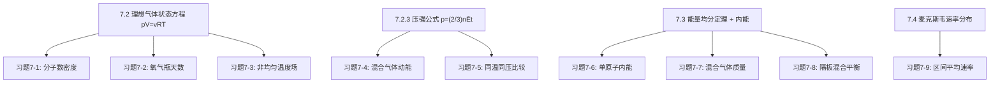

## 第7章 统计物理初步 · 习题索引

链接回课件笔记：[[../课件/MD/大学物理II-热学-统计物理初步|统计物理初步课件]]

### 习题列表

| 题号 | 题目简述 | 知识点 | 状态 |
|:--|:--|:--|:--|
| [[03_Sources/Courses/归档/大学物理/作业/07-统计物理初步/习题7-1]] | 估算标准状态下每立方厘米空气分子数 | 理想气体状态方程、分子数密度 | mineru解析 |
| [[03_Sources/Courses/归档/大学物理/作业/07-统计物理初步/习题7-2]] | 氧气瓶使用天数计算 | 理想气体状态方程、气体质量计算 | mineru解析 |
| [[03_Sources/Courses/归档/大学物理/作业/07-统计物理初步/习题7-3]] | 非均匀温度场中气体压强计算 | 平衡态与定态、积分法求质量 | mineru解析 |
| [[03_Sources/Courses/归档/大学物理/作业/07-统计物理初步/习题7-4]] | 混合气体的平均平动动能和温度 | 压强公式、平均平动动能 | mineru解析 |
| [[03_Sources/Courses/归档/大学物理/作业/07-统计物理初步/习题7-5]] | 不同气体在相同温压下的比较 | 分子数密度、气体密度 | mineru解析 |
| [[03_Sources/Courses/归档/大学物理/作业/07-统计物理初步/习题7-6]] | 单原子理想气体单位体积内能 | 理想气体内能、自由度 | mineru解析 |
| [[03_Sources/Courses/归档/大学物理/作业/07-统计物理初步/习题7-7]] | 混合气体中各组分质量计算 | 内能公式、能量均分定理 | mineru解析 |
| [[03_Sources/Courses/归档/大学物理/作业/07-统计物理初步/习题7-8]] | 隔板移除后混合气体的平衡p和T | 内能守恒、状态方程 | mineru解析 |
| [[03_Sources/Courses/归档/大学物理/作业/07-统计物理初步/习题7-9]] | 速率区间内分子的平均速率 | 麦克斯韦速率分布、分布函数 | mineru解析 |

### 知识点分布与依赖关系

### 章节知识对应

- **习题7-1 ~ 7-3**：理想气体状态方程及其变形（$pV = \nu RT$，$p = nkT$）
- **习题7-4 ~ 7-5**：理想气体压强公式与温度的统计意义（$p = \frac{2}{3}n\bar{E}_t$，$\bar{E}_t = \frac{3}{2}kT$）
- **习题7-6 ~ 7-8**：能量按自由度均分定理与理想气体内能（$E = \frac{i}{2}\nu RT = \frac{i}{2}pV$）
- **习题7-9**：麦克斯韦速率分布定律与分布函数的统计应用
