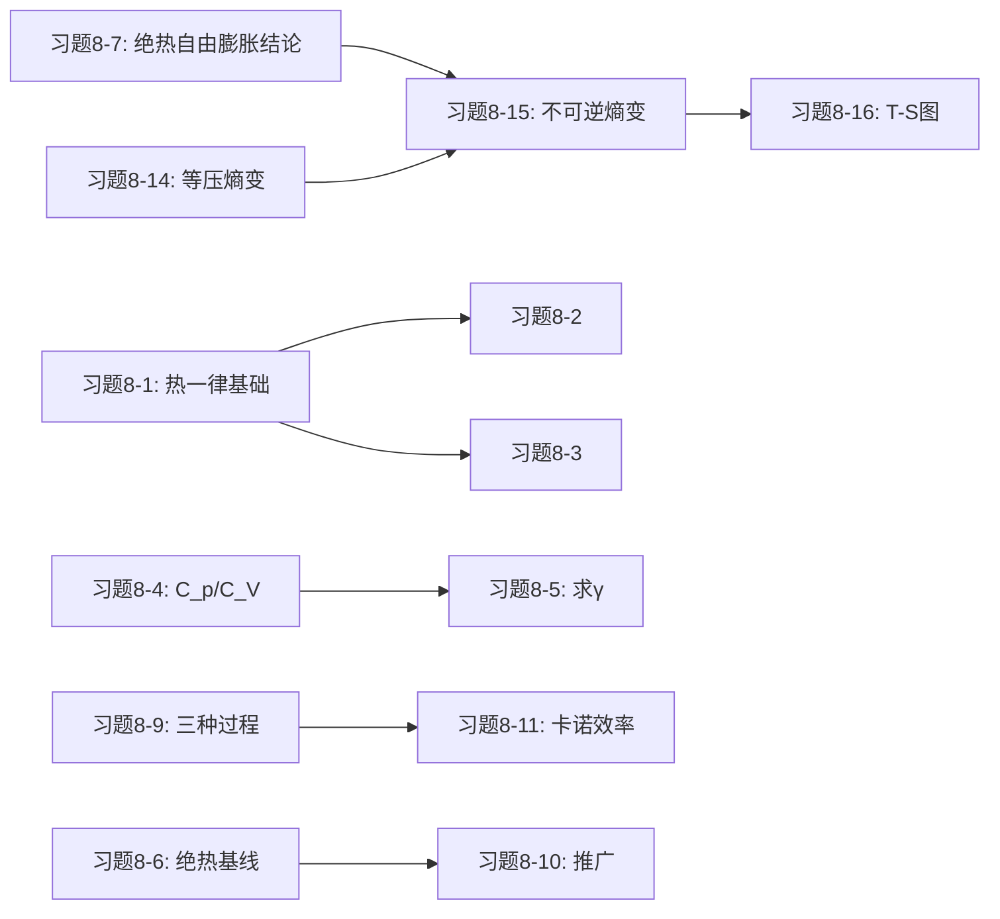

## 章节习题索引

链接回课件笔记：[[../../课件/MD/大学物理II-热学-热力学|大学物理II · 热力学基础]]

本文件夹包含热力学基础章节的全部习题，共 18 道，按教材章节顺序排列。

### 习题列表

| 编号 | 文件 | 题目 | 知识点 | 状态 |
|:-----|:-----|:-----|:-------|:-----|
| 8-1 | [[03_Sources/Courses/归档/大学物理/作业/08-热力学基础/习题8-1]] | 热力学第一定律判断过程吸放热 | 热一律、内能、功 | mineru解析 |
| 8-2 | [[03_Sources/Courses/归档/大学物理/作业/08-热力学基础/习题8-2]] | P-V图中循环过程的吸热量计算 | 热一律、P-V图、功的面积 | mineru解析 |
| 8-3 | [[03_Sources/Courses/归档/大学物理/作业/08-热力学基础/习题8-3]] | 刚性双原子分子循环过程求A/ΔE/Q | 等体/等压过程、P-V图 | mineru解析 |
| 8-4 | [[03_Sources/Courses/归档/大学物理/作业/08-热力学基础/习题8-4]] | 等压膨胀吸热用于作功的比例 / 等体吸热求压强 | 等压/等体过程、C_p/C_V | mineru解析 |
| 8-5 | [[03_Sources/Courses/归档/大学物理/作业/08-热力学基础/习题8-5]] | 等温膨胀+等体加热求比热比γ | 等温/等体过程、γ | mineru解析 |
| 8-6 | [[03_Sources/Courses/归档/大学物理/作业/08-热力学基础/习题8-6]] | 以绝热线为基准判断吸放热 | 绝热过程、热一律 | mineru解析 |
| 8-7 | [[03_Sources/Courses/归档/大学物理/作业/08-热力学基础/习题8-7]] | 绝热自由膨胀求平衡态p和T | 绝热自由膨胀、非准静态 | mineru解析 |
| 8-8 | [[03_Sources/Courses/归档/大学物理/作业/08-热力学基础/习题8-8]] | 等温与等体+等压两种路径的功和热比较 | 等温/等体/等压、过程量 | mineru解析 |
| 8-9 | [[03_Sources/Courses/归档/大学物理/作业/08-热力学基础/习题8-9]] | 三种过程压缩氮气：等温/绝热/等压 | 三种过程对比、ΔE/Q/A' | mineru解析 |
| 8-10 | [[03_Sources/Courses/归档/大学物理/作业/08-热力学基础/习题8-10]] | 以绝热线判断任意过程做功与吸放热 | 绝热线基准、热一律 | mineru解析 |
| 8-8-循环 | [[03_Sources/Courses/归档/大学物理/作业/08-热力学基础/习题8-8-循环]] | 单原子气体循环效率（ab等温） | 循环效率、等温/等压/等体 | mineru解析 |
| 8-9-喷气 | [[03_Sources/Courses/归档/大学物理/作业/08-热力学基础/习题8-9-喷气]] | 喷气发动机循环（布雷顿循环） | 布雷顿循环、绝热关系 | mineru解析 |
| 8-10-循环 | [[03_Sources/Courses/归档/大学物理/作业/08-热力学基础/习题8-10-循环]] | 非线性过程循环（ca满足p/V²=常量） | 积分求功、循环效率 | mineru解析 |
| 8-11 | [[03_Sources/Courses/归档/大学物理/作业/08-热力学基础/习题8-11]] | 卡诺循环提高T₁后的效率和温升 | 卡诺效率、Q₂不变 | mineru解析 |
| 8-13 | [[03_Sources/Courses/归档/大学物理/作业/08-热力学基础/习题8-13]] | 卡诺致冷机电能消耗计算 | 致冷系数、逆循环 | mineru解析 |
| 8-14 | [[03_Sources/Courses/归档/大学物理/作业/08-热力学基础/习题8-14]] | 等压膨胀过程的熵变计算 | 熵变、等压过程 | mineru解析 |
| 8-15 | [[03_Sources/Courses/归档/大学物理/作业/08-热力学基础/习题8-15]] | 绝热自由膨胀的熵变（不可逆） | 不可逆过程熵计算 | mineru解析 |
| 8-16 | [[03_Sources/Courses/归档/大学物理/作业/08-热力学基础/习题8-16]] | 温熵图（T-S图）中循环效率 | T-S图、循环效率 | mineru解析 |

### 知识点覆盖

### 习题间依赖关系

### 学习路线建议

1. **基础入门**：习题 8-1 → 8-2 → 8-3（热力学第一定律基本应用）
2. **过程辨析**：习题 8-4 → 8-5 → 8-6 → 8-7 → 8-8 → 8-9 → 8-10（四种特殊过程）
3. **循环分析**：习题 8-8-循环 → 8-9-喷气 → 8-10-循环（循环效率计算）
4. **卡诺专题**：习题 8-11 → 8-13（卡诺热机与致冷机）
5. **熵进阶**：习题 8-14 → 8-15 → 8-16（熵的计算与应用）
