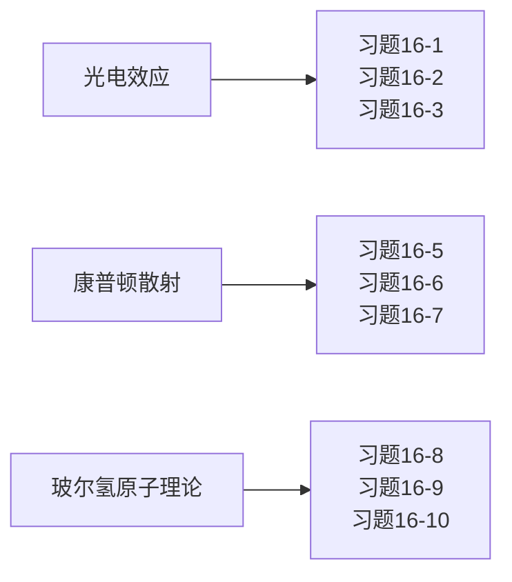
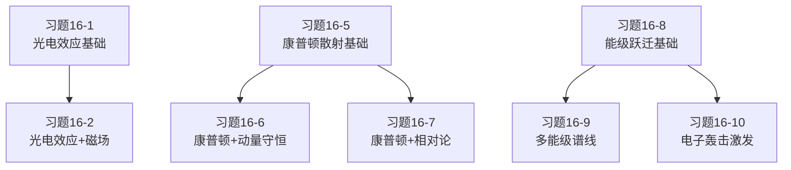

# 第16章 早期量子论 习题库

> 课件笔记：[[../../课件/MD/大学物理_16量子光学基础|大学物理_16量子光学基础]]
> 知识梳理：[[../../知识点解析梳理/16-早期量子论-知识梳理|16-早期量子论-知识梳理]]

## 习题列表

| 题号 | 题目简述 | 涉及知识点 | 图片 |
|:--|:--|:--|:--:|
| [[习题16-1\|16-1]] | 铯的光电效应计算（速度与遏止电势差） | 光电效应方程、红限频率、逸出功 | - |
| [[习题16-2\|16-2]] | 磁场中光电子的逸出功计算 | 洛伦兹力、光电效应、遏止电势差 | - |
| [[习题16-3\|16-3]] | 光电流曲线的判断（选择题D） | 光电流曲线、饱和电流、遏止电压 | ![[images/3082e0e5f2053f21ed39d8ff5c83f18d39ca6626bd70e447c3f9940ca3c89ecc.jpg\|100]] |
| [[习题16-5\|16-5]] | 康普顿散射反冲电子的最大动能 | 康普顿散射、能量守恒 | - |
| [[习题16-6\|16-6]] | 康普顿散射（90°方向） | 康普顿公式、能量守恒、动量守恒 | - |
| [[习题16-7\|16-7]] | 康普顿散射（已知反冲电子速度） | 相对论动能、康普顿公式 | - |
| [[习题16-8\|16-8]] | 可见光能否激发基态氢原子 | 玻尔氢原子理论、能级跃迁 | ![[images/7fd82a6c71b1bf7d9e6291fca82b05e3b2d5b6c77ea5a75677794041d3ce63f7.jpg\|100]] |
| [[习题16-9\|16-9]] | 第3激发态的谱线跃迁 | 能级跃迁、谱线系（莱曼/巴耳末/帕邢） | ![[images/e892cd18333e4a4927c864da96e43dfdd40f0af010dd89c89825f55a0d78acbc.jpg\|100]] |
| [[习题16-10\|16-10]] | 电子轰击基态氢原子的谱线 | 能级激发、跃迁波长计算 | ![[images/c5db900adfdc193fe261a92807e7b156e33ea8aedd86d8e436c9d1682f593f93.jpg\|100]] |

> 共 **9** 道习题，覆盖光电效应（3道）、康普顿散射（3道）、玻尔氢原子理论（3道）。

## 知识板块覆盖

## 习题依赖关系

