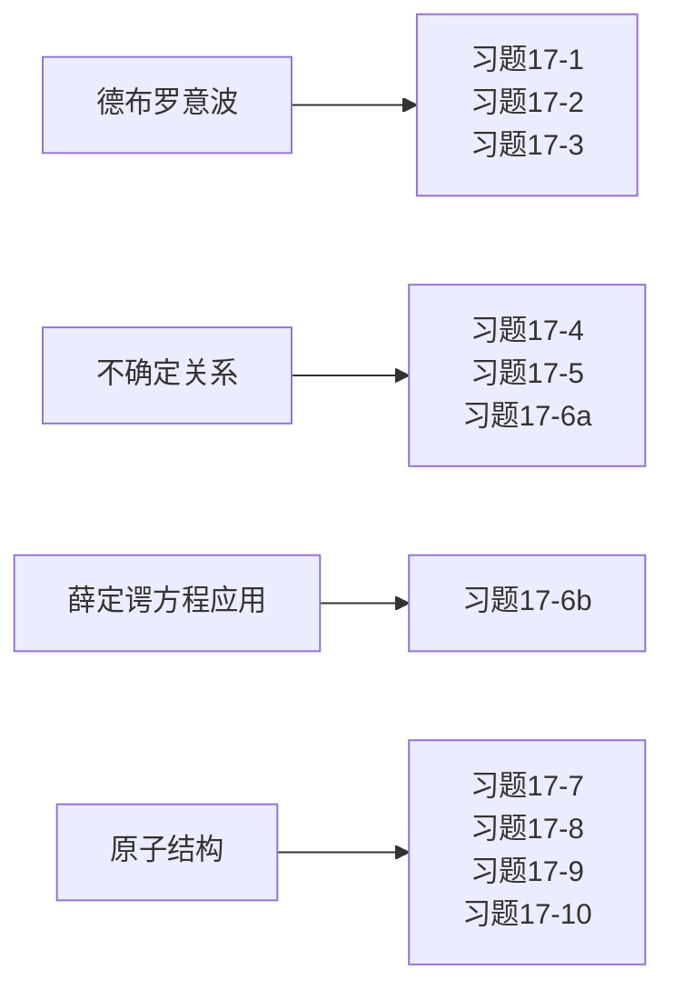
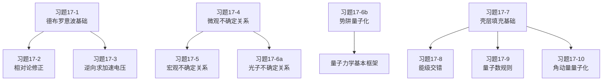

# 第17章 量子力学基础 习题库

> 课件笔记：[[../../课件/MD/大学物理_17量子力学基础|大学物理_17量子力学基础]]
> 知识梳理：[[../../知识点解析梳理/17-量子力学基础-知识梳理|17-量子力学基础-知识梳理]]

## 习题列表

| 题号 | 题目简述 | 涉及知识点 | 图片 |
|:--|:--|:--|:--:|
| [[习题17-1\|17-1]] | 电子和子弹的德布罗意波长 | 德布罗意波、物质波、波粒二象性 | - |
| [[习题17-2\|17-2]] | 高压加速电子的相对论波长 | 德布罗意波、相对论效应、电子加速 | - |
| [[习题17-3\|17-3]] | 给定波长求加速电压 | 德布罗意波、加速电压 | - |
| [[习题17-4\|17-4]] | 氢原子中电子速度的不确定量 | 不确定关系、氢原子 | - |
| [[习题17-5\|17-5]] | 子弹坐标的不确定量 | 不确定关系、宏观物体 | - |
| [[习题17-6a\|17-6a]] | 光子的坐标不确定量 | 不确定关系、光子动量 | - |
| [[习题17-6b\|17-6b]] | 一维无限深势阱中的粒子 | 薛定谔方程、能量量子化、概率密度 | ![[images/9c849587caee3cd522ff572636dc0be654cfc52abdbbc38049b8f2a833f3f566.jpg\|100]] |
| [[习题17-7\|17-7]] | 氩原子的电子组态 | 壳层结构、泡利原理、能量最小原理 | - |
| [[习题17-8\|17-8]] | 钴原子的3d电子数 | 壳层结构、电子组态、能级交错 | - |
| [[习题17-9\|17-9]] | L壳层电子的量子数（选择题B） | 四个量子数、量子数取值规则 | - |
| [[习题17-10\|17-10]] | n=3时电子动量矩的可能值 | 角动量量子化、量子数 | - |

> 共 **11** 道习题，覆盖德布罗意波（3道）、不确定关系（4道）、薛定谔方程（1道）、原子结构（3道）。

## 知识板块覆盖

## 习题依赖关系

