# 第1章 习题库 - 集合论与点集拓扑基础

## 课件笔记索引

- [[03_Sources/Courses/归档/实变函数/课件/MD/RA-01|第一讲 集合论(1)]]
- [[03_Sources/Courses/归档/实变函数/课件/MD/RA-02|第二讲 序列的极限]]
- [[03_Sources/Courses/归档/实变函数/课件/MD/2023-RA-03|第三讲 映射（函数）]]
- [[03_Sources/Courses/归档/实变函数/课件/MD/2023-RA-03-a|第四讲 自然数集的势]]
- [[03_Sources/Courses/归档/实变函数/课件/MD/2023-RA-04-05|第五讲 R^n中的点集拓扑]]
- [[03_Sources/Courses/归档/实变函数/课件/MD/2023-RA-06|第六讲 开集和闭集]]
- [[03_Sources/Courses/归档/实变函数/课件/MD/2023-RA-07|第七讲 开集的结构]]
- [[03_Sources/Courses/归档/实变函数/课件/MD/2023-RA-08|第八讲 度量空间]]
- [[03_Sources/Courses/归档/实变函数/课件/MD/2023-RA-09|补充：自然数、整数、有理数和实数]]
- [[03_Sources/Courses/归档/实变函数/课件/MD/2023-RA-09-I|第九讲 有序集与Zorn公理]]

## 作业范围说明

本章习题库覆盖第1章全部内容，共 **44 道题**，来源于课件中的三类问题：
- **例题（例/Ex）**：课件中作为示例讲解的题目
- **思考题（想一想/怎么证）**：课件中抛出的引导性问题
- **习题/作业题（问题）**：课件末尾明确布置的练习题

题型涵盖：集合运算与De Morgan律、序列的极限与上下极限、映射与逆映射的基本性质、集合的势与可列性、R^n中的点集拓扑（内点、聚点、开集、闭集）、Cantor集、度量空间、连续函数刻画、Zorn公理。

## 习题列表

| 题号 | 题目 | 知识点 | 类型 | 状态 |
|------|------|--------|------|------|
| 1.1 | 自然数集与偶数集的一一对应 | 一一对应、无穷集的势 | 思考题 | 已录入 |
| 1.2 | 线段与正方形上点的一一对应 | 基数相等、维数不变性 | 思考题 | 已录入 |
| 1.3 | 区间(0,1)上有理数集的长度 | 测度、有理数集 | 思考题 | 已录入 |
| 1.4 | 区间(0,1)的任意子集都能定义长度吗 | 不可测集、选择公理 | 思考题 | 已录入 |
| 1.5 | 与(0,1)一一对应但长度为零的集合 | Cantor集、基数与测度 | 思考题 | 已录入 |
| 1.6 | 距离的不同定义方式 | 度量空间、距离公理 | 思考题 | 已录入 |
| 1.7 | 讨论四个函数列的收敛性 | 函数列收敛、逐点收敛 | 思考题 | 已录入 |
| 1.8 | Dirichlet函数的积分 | Riemann可积、Lebesgue积分 | 思考题 | 已录入 |
| 1.9 | 函数列积分与极限的交换 | 积分与极限交换 | 思考题 | 已录入 |
| 1.10 | 求集合列的交与并 | 升列与降列 | 思考题 | 已录入 |
| 1.11 | 集合等式与函数值域 | 集合的并与交、实数完备性 | 例题 | 已录入 |
| 1.12 | 集合补充题（篮球与羽毛球） | 容斥原理 | 思考题 | 已录入 |
| 1.13 | 用集合列表示极限收敛 | 集合列上下极限 | 例题 | 已录入 |
| 1.14 | 证明De Morgan法则 | 对偶律、补运算 | 习题 | 已录入 |
| 1.15 | 升列的交与并的分配律 | 升列、分配律 | 习题 | 已录入 |
| 1.16 | 构造互不相交的集合列 | 不交化技巧 | 习题 | 已录入 |
| 1.17 | 函数水平集的集合等式 | 严格与弱不等式 | 习题 | 已录入 |
| 1.18 | $x_n=n\sin(1/n)$ 的有界性与极限 | 极限计算 | 例题 | 已录入 |
| 1.19 | $x_n=n\bmod 7$ 的性质 | 有界性、聚点 | 例题 | 已录入 |
| 1.20 | 写出下极限的充分必要条件 | 上下极限、$\varepsilon$语言 | 思考题 | 已录入 |
| 1.21 | 集合列特征函数的上下极限 | 特征函数、集合列极限 | 例题 | 已录入 |
| 1.22 | $\sin(1/x)$ 在 $x=0$ 处的上下极限 | 振荡奇点、上下极限 | 习题 | 已录入 |
| 1.23 | 特定函数在无理点处的上下极限 | Riemann函数变体 | 习题 | 已录入 |
| 1.24 | 复合映射的逆映射 | 逆映射、双射 | 证明题 | 已录入 |
| 1.25 | 映射下交集的原像包含关系及反例 | 像与交、单射条件 | 证明题 | 已录入 |
| 1.26 | 原像运算与集合运算的交换性 | 原像、交并运算 | 证明题 | 已录入 |
| 1.27 | 原像操作的单调性 | 原像、保序性 | 证明题 | 已录入 |
| 1.28 | 原像与补集的交换性 | 原像、补集 | 证明题 | 已录入 |
| 1.29 | 区间与单位圆周的对等性 | 双射构造、对等 | 思考题 | 已录入 |
| 1.30 | 不相交开区间族可数 | 可数性、有理数稠密 | 例题 | 已录入 |
| 1.31 | 单调函数不连续点可数 | 跳跃间断、可数性 | 例题 | 已录入 |
| 1.32 | 可列集的有限子集全体可列 | 势的运算 | 证明题 | 已录入 |
| 1.33 | 连续统假设 | 基数、ZFC独立性 | 思考题 | 已录入 |
| 1.34 | 求集合 $A=[-1,0)\cup\{1/n\}$ 的各类点集 | 内点、聚点、边界点、闭包 | 例题 | 已录入 |
| 1.35 | 模收敛等价于坐标收敛 | $\mathbb{R}^n$中收敛 | 思考题 | 已录入 |
| 1.36 | 导集与闭包的四个例题 | 导集、闭包、稠密性 | 例题 | 已录入 |
| 1.37 | 由集合族生成的代数 | 集合代数、生成代数 | 例题 | 已录入 |
| 1.38 | 有理数集和无理数集的类型 | $F_\sigma$集、$G_\delta$集 | 思考题 | 已录入 |
| 1.39 | 连续函数下闭集的原像是否闭 | 连续性、原像、闭集 | 思考题 | 已录入 |
| 1.40 | 度量空间中开集依赖度量和环绕空间 | 开集、离散度量、子空间 | 例题 | 已录入 |
| 1.41 | 证明 $\sqrt{2}$ 是无理数 | 无理数、反证法 | 证明题 | 已录入 |
| 1.42 | 诱导映射的单调性 | 单调映射、幂集 | 例题 | 已录入 |
| 1.43 | 最大全序子集的判定 | 偏序集、整除关系 | 思考题 | 已录入 |
| 1.44 | 学习报告（类Cantor集/可数不可数/Zorn公理） | 综合、研究性学习 | 作业 | 已录入 |

## 依赖关系图

```mermaid
graph TD
    subgraph 集合论基础
        A1[1.1 自然数与偶数一一对应]
        A2[1.10 集合列交与并]
        A3[1.11 集合等式与函数值域]
        A4[1.12 容斥原理]
        A5[1.13 极限收敛的集合表示]
        A6[1.14 De Morgan法则]
        A7[1.15 升列分配律]
        A8[1.16 不交化构造]
        A9[1.17 函数水平集等式]
    end

    subgraph 序列的极限
        B1[1.18 n*sin1/n]
        B2[1.19 n mod 7]
        B3[1.20 下极限充要条件]
        B4[1.21 特征函数上下极限]
        B5[1.22 sin1/x上下极限]
        B6[1.23 无理点处上下极限]
    end

    subgraph 映射与势
        C1[1.24 复合逆映射]
        C2[1.25 像与交包含关系]
        C3[1.26 原像交换性]
        C4[1.27 原像单调性]
        C5[1.28 原像与补]
        C6[1.29 区间与圆周对等]
        C7[1.30 不交开区间族可数]
        C8[1.31 单调函数不连续点]
        C9[1.32 有限子集全体可列]
        C10[1.33 连续统假设]
    end

    subgraph 点集拓扑
        D1[1.34 各类点集]
        D2[1.35 模收敛=坐标收敛]
        D3[1.36 导集与闭包四例]
        D4[1.37 生成代数]
        D5[1.38 有理数集类型]
        D6[1.39 闭集原像]
    end

    subgraph 度量空间与补充
        E1[1.40 开集依赖度量]
        E2[1.41 根号2无理]
        E3[1.42 诱导映射单调]
        E4[1.43 最大全序子集]
        E5[1.44 学习报告]
    end

    subgraph 思考题连
        F1[1.2 线段与正方形]
        F2[1.3 有理数集长度]
        F3[1.4 任意子集长度]
        F4[1.5 零测连续统集]
        F5[1.6 距离定义方式]
        F6[1.7 函数列收敛]
        F7[1.8 Dirichlet积分]
        F8[1.9 积分极限交换]
    end

    C7 --> D1
    A5 --> B4
    C2 --> C3
    C3 --> C5
    C5 --> D6
    A6 --> A8
    A9 --> F3
    D2 --> B5
    C10 --> E5
    F4 --> F2
    B6 --> B5
```

**图例说明**：箭头表示依赖或关联关系（如前置知识、结论引用）。各子图按主题分组，实际依赖可能更复杂。

## 统计

- **总题数**：44
- **例题**：14 道
- **思考题**：15 道
- **习题/证明题**：14 道
- **作业**：1 道
- **覆盖源文件**：10 个课件
