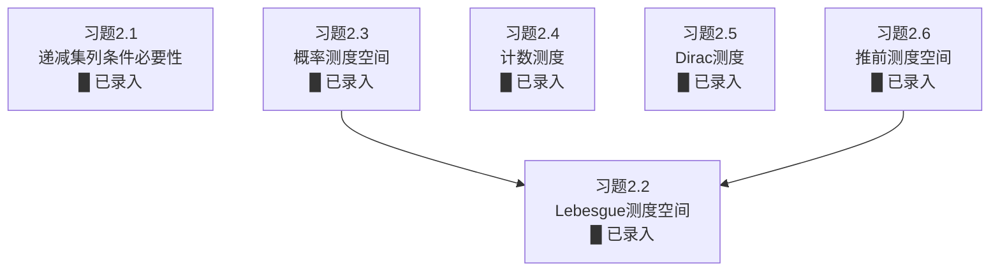

# 第2章 习题库 — Lebesgue测度

## 课件来源

- [[2023-RA-11 第11讲 Lebesgue可测集]]

## 习题列表

| 题号 | 题目简述 | 知识点 | 类型 | 状态 |
|------|----------|--------|------|------|
| 2.1 | 递减可测集列中 $m(E_1)<\infty$ 条件的必要性 | 可测集列的极限、测度下连续性、反例构造 | 思考题 | 已录入 |
| 2.2 | Lebesgue 测度空间 $(\mathbb{R}^n, \mathfrak{M}, m)$ | 测度空间、Lebesgue测度、$\sigma$-代数 | 例题 | 已录入 |
| 2.3 | 概率测度空间（Gauss 密度） | 概率测度、Gauss密度、Lebesgue积分 | 例题 | 已录入 |
| 2.4 | 计数测度 $\mu(A)=\lvert A\rvert$ | 计数测度、完备测度、$\sigma$-有限测度 | 例题 | 已录入 |
| 2.5 | Dirac 测度 $\delta_x(A)=\chi_A(x)$ | Dirac测度、完备测度 | 例题 | 已录入 |
| 2.6 | 推前测度空间（pushforward） | 推前测度、测度空间构造、一一满映射 | 例题 | 已录入 |

## 依赖关系

## 说明

本章习题对应第11讲"Lebesgue可测集"的内容，涵盖测度空间的定义（定义2.1.12）及其五个典型示例（Ex1-Ex5），以及一道关于推论2.1.9中条件必要性的思考题。所有题目均来源于课件 `2023-RA-11.md`，经 OCR 转换并校对。
