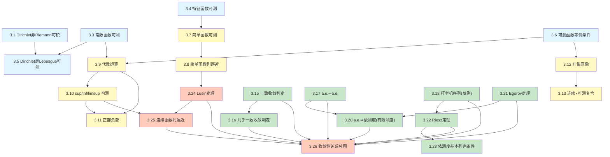

# 第3章 习题库 - 可测函数

## 课件链接

- [[12-Lebesgue可测函数|第12讲：Lebesgue可测函数]]
- [[13-可测函数列的收敛性|第13讲：可测函数列的收敛性]]
- [[14-可测函数与连续函数|第14讲：可测函数与连续函数]]

## 习题列表

| 题号 | 题目 | 知识点 | 来源 | 前置习题 |
|------|------|--------|------|----------|
| 3.1 | Dirichlet函数不是Riemann可积 | Dirichlet函数、Riemann可积性 | RA-12, Ex1 | - |
| 3.2 | 连续函数列的极限不一定是连续函数 | 连续函数、逐点收敛 | RA-12, Ex2 | - |
| 3.3 | 常数函数是可测的 | 可测函数定义 | RA-12, Ex3 | - |
| 3.4 | 特征函数可测的充要条件 | 特征函数、可测集 | RA-12, Ex4 | - |
| 3.5 | Dirichlet函数是Lebesgue可测的 | a.e.相等、Dirichlet函数 | RA-12, Ex5 | 3.1, 3.3 |
| 3.6 | 可测函数的等价条件 | 可测函数定义、等价刻画 | RA-12, 定理2.2.2 | - |
| 3.7 | 简单函数是可测的 | 简单函数、特征函数 | RA-12, 定理2.2.4 | 3.4 |
| 3.8 | 非负可测函数的简单函数列逼近 | 简单函数、逐点逼近 | RA-12, 定理2.2.5 | 3.7 |
| 3.9 | 可测函数的代数运算 | 四则运算、封闭性 | RA-12, 定理2.2.6 | 3.3, 3.6 |
| 3.10 | sup, inf, limsup, liminf的可测性 | 极限运算封闭性 | RA-12, 定理2.2.8 | 3.9 |
| 3.11 | 正部、负部与绝对值可测 | 正部负部分解、反例 | RA-12, 定理2.2.10 | 3.9, 3.10 |
| 3.12 | 可测函数与开集原像 | 开集原像、拓扑刻画 | RA-12, 思考题 | 3.6 |
| 3.13 | 连续函数与可测函数的复合 | 复合函数、连续保可测 | RA-12, 定理2.2.11 | 3.12 |
| 3.14 | 几乎处处相等保持可测性 | a.e.相等、零测集 | RA-12, 定理2.2.12 | - |
| 3.15 | 一致收敛的判定 | 一致收敛、逐点收敛 | RA-13, 例题 | - |
| 3.16 | 几乎一致收敛的判定 | 几乎一致收敛、Egorov反例 | RA-13, 例题 | 3.15 |
| 3.17 | 几乎一致收敛 ⇒ 几乎处处收敛 | 收敛性关系 | RA-13, 思考题 | - |
| 3.18 | 依测度收敛但不逐点收敛 | 打字机序列、反例 | RA-13, 例题 | - |
| 3.19 | 依测度收敛极限的唯一性 | 极限唯一性 | RA-13, 定理2.3.5 | - |
| 3.20 | 有限测度集上a.e. ⇒ 依测度收敛 | Egorov定理应用 | RA-13, 定理2.3.6 | 3.17 |
| 3.21 | Egorov定理 | 几乎处处⇒几乎一致 | RA-13, 定理2.3.3 | - |
| 3.22 | Riesz定理（子列a.e.收敛） | 依测度收敛子列 | RA-13, 定理2.3.7 | 3.18 |
| 3.23 | 依测度基本列完备性 | Cauchy准则、完备性 | RA-13, 定理2.3.9 | 3.22 |
| 3.24 | Lusin定理 | 可测函数接近连续函数 | RA-14, 定理2.3.10 | 3.8 |
| 3.25 | 可测函数的连续函数列逼近 | 连续逼近、扩张定理 | RA-14, 推论2.3.11/13 | 3.10, 3.24 |
| 3.26 | 收敛性关系总图 | 四种收敛性综合 | RA-13+RA-14 | 3.15-3.25 |

## 依赖关系图

## 习题分布说明

- **第12讲 可测函数**（习题3.1-3.14）：可测函数的定义、等价刻画、基本性质、代数运算、极限封闭性
- **第13讲 可测函数列的收敛性**（习题3.15-3.23）：四种收敛模式、Egorov定理、Riesz定理、完备性
- **第14讲 可测函数与连续函数**（习题3.24-3.26）：Lusin定理、连续函数逼近、Littlewood三大原理

## 关键定理

| 定理 | 习题编号 | 核心内容 |
|------|----------|----------|
| 定理2.2.5（结构定理） | 3.8 | 非负可测函数 = 非降简单函数列的极限 |
| 定理2.2.8/推论2.2.9 | 3.10 | 可测函数类对极限运算封闭 |
| Egorov定理 | 3.21 | 有限测度上 a.e. 收敛 ⇔ 几乎一致收敛 |
| Riesz定理 | 3.22 | 依测度收敛 ⇒ 存在 a.e. 收敛子列 |
| Lusin定理 | 3.24 | 可测函数 = 连续函数 + 任意小测度误差 |
