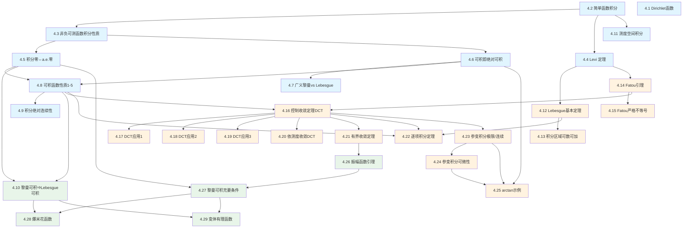

# 第4章 习题库 — Lebesgue 积分

## 课件来源

- [[15-黎曼积分|第15讲：黎曼积分]] — 黎曼积分定义、Lebesgue 积分的三种定义方法、非负可测简单函数积分、Levi 定理、积分线性性质
- [[16-一般可测函数的积分|第16讲：一般可测函数的积分]] — 一般可测函数的积分定义（正部/负部）、可积即绝对可积、积分性质、绝对连续性、平移不变性
- [[17-黎曼积分和Lebesgue积分的关系|第17讲：黎曼积分和Lebesgue积分的关系]] — 黎曼可积 ⇒ Lebesgue 可积、测度空间上的积分
- [[18-Lebesgue积分的极限定理|第18讲：Lebesgue积分的极限定理]] — Lebesgue 基本定理、Fatou 引理、控制收敛定理（DCT）、有界收敛定理
- [[19-逐项积分|第19讲：逐项积分]] — 逐项积分定理、参变积分的极限/连续性/可微性
- [[20-黎曼可积性的刻画|第20讲：黎曼可积性的刻画]] — 振幅函数、黎曼可积的充要条件（Lebesgue 准则）

## 作业范围说明

本章习题库覆盖第4章（2023-RA-15 至 2023-RA-20）中的全部习题与例题，共计 29 道。内容涵盖从非负可测简单函数积分基础到黎曼可积性 Lebesgue 准则的完整链条，是实变函数课程的核心章节。

## 习题列表

| 题号 | 题目简述 | 知识点 | 来源 |
|:---:|:---|:---|:---:|
| 4.1 | Dirichlet 函数不是黎曼可积的 | 黎曼积分、黎曼上下积分、Dirichlet 函数 | RA-15 |
| 4.2 | 非负可测简单函数积分的线性性质 | 简单函数、积分线性、测度连续性 | RA-15 |
| 4.3 | 非负可测函数积分的四条基本性质 | 零测集、积分子集、单调性、有界可积 | RA-15 |
| 4.4 | Levi 单调收敛定理 | Levi 定理、单调收敛、积分与极限交换 | RA-15 |
| 4.5 | 积分零 ⇔ 函数几乎处处为零 | 积分正定性、a.e. 零、零测集 | RA-15 |
| 4.6 | 可积即绝对可积 | 正部/负部、绝对可积、与黎曼对比 | RA-16 |
| 4.7 | 广义黎曼可积但非 Lebesgue 可积 | (1/x)sin(1/x)、条件收敛、反例 | RA-16 |
| 4.8 | 可积函数的基本性质 (1)-(5) | a.e. 有限、控制判别、有界可测可积 | RA-16 |
| 4.9 | 积分的绝对连续性 | 简单函数逼近、小测度集上的积分 | RA-16 |
| 4.10 | 黎曼可积 ⇒ Lebesgue 可积 | 达布上下和、阶梯函数逼近、积分一致 | RA-17 |
| 4.11 | 测度空间上的积分定义 | 抽象测度、简单函数泛函、μ 可积 | RA-17 |
| 4.12 | Lebesgue 基本定理（级数逐项积分） | 非负级数、积分与求和交换 | RA-18 |
| 4.13 | 积分关于区域的可数可加性 | 可数划分、正部负部分解 | RA-18 |
| 4.14 | Fatou 引理 | 下极限、非负可测函数列 | RA-18 |
| 4.15 | Fatou 引理严格不等式示例 | 正态密度、质量逃逸到零测集 | RA-18 |
| 4.16 | 控制收敛定理 (DCT) | 控制函数、极限与积分交换 | RA-18 |
| 4.17 | DCT 应用：e^{-x} cos 型 | 指数衰减、cos 有界性 | RA-18 |
| 4.18 | DCT 应用：n^{3/2}x/(1+n^2x^2) | 幂次控制函数、不等式缩放 | RA-18 |
| 4.19 | DCT 应用：sin(x/n)/(1+x/n)^n | 极限 e、Bernoulli 不等式 | RA-18 |
| 4.20 | 依测度收敛下的 DCT | Riesz 定理、子列论证 | RA-18 |
| 4.21 | 有界收敛定理 | 有限测度、一致有界、BCT | RA-18 |
| 4.22 | 逐项积分定理 | 绝对收敛级数、逐项积分 | RA-19 |
| 4.23 | 参变积分的极限与连续性 | DCT 参数化、连续性定理 | RA-19 |
| 4.24 | 参变积分的可微性 | 积分号下求导、Lagrange 中值 | RA-19 |
| 4.25 | 参变积分示例：arctan(xy) | arctan 有界性、可微性条件 | RA-19 |
| 4.26 | 振幅函数与黎曼上下积分的关系 | 振幅函数、有界收敛定理 | RA-20 |
| 4.27 | 黎曼可积的充要条件 (Lebesgue 准则) | 不连续点集、零测集、振幅函数 | RA-20 |
| 4.28 | Riemann 函数（爆米花函数）可积性 | 有理点可数、零测集 | RA-20 |
| 4.29 | 有理点变体函数的黎曼可积性 | 不连续点分析、积分计算 | RA-20 |

## 依赖关系图

**图例：** 蓝色 = 积分定义基础层，橙色 = 极限定理层，绿色 = 黎曼可积性刻画层

## 学习路线建议

1. **入门（4.1--4.9）**：从黎曼积分回顾出发，掌握 Lebesgue 积分的定义（三种等价方式），理解"可积即绝对可积"的关键差异
2. **巩固（4.10--4.13）**：建立黎曼与 Lebesgue 积分的桥梁，推广到抽象测度空间
3. **核心（4.14--4.22）**：掌握 Fatou 引理、DCT、有界收敛定理、逐项积分——这是 Lebesgue 理论最强大的武器库
4. **应用（4.23--4.25）**：参变积分的连续性和可微性，理论联系实际
5. **升华（4.26--4.29）**：用 Lebesgue 积分的眼光重新审视黎曼可积性，到达本章的最高点——Lebesgue 准则
