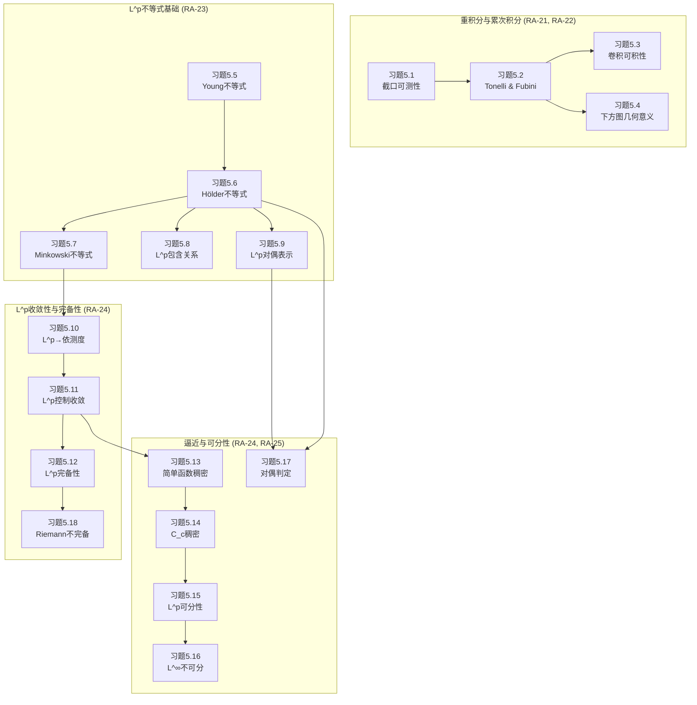

# 第5章 习题库

## 课件链接

- [[03_Sources/Courses/归档/实变函数/课件/MD/2023-RA-21]] — 第21讲：重积分与累次积分（Tonelli定理、Fubini定理）
- [[03_Sources/Courses/归档/实变函数/课件/MD/2023-RA-22]] — 第22讲：卷积与积分的几何意义（卷积的可积性、下方图）
- [[03_Sources/Courses/归档/实变函数/课件/MD/2023-RA-23]] — 第23讲：$L^p$空间的定义（Hölder、Minkowski、对偶表示）
- [[03_Sources/Courses/归档/实变函数/课件/MD/2023-RA-24]] — 第24讲：$L^p$空间的性质（收敛性、完备性）
- [[03_Sources/Courses/归档/实变函数/课件/MD/2023-RA-25]] — 第25讲：完备性与可分空间（可分化、$L^\infty$不可分）

## 习题列表

| 编号 | 题目 | 知识点 | 来源 | 状态 |
|:---:|------|------|:---:|:---:|
| 习题5.1 | 可测集截口的可测性（定理3.3.2） | 截口集、可测性、Tonelli基础 | RA-21 | 待校对 |
| 习题5.2 | Tonelli定理与Fubini定理的证明 | 重积分交换顺序、Levi定理 | RA-21 | 待校对 |
| 习题5.3 | 卷积的定义与可积性（定理3.3.7） | 卷积、Fubini应用、$L^1$ | RA-22 | 待校对 |
| 习题5.4 | 下方图与积分的几何意义（定理3.3.7） | 下方图、图像、测度与积分 | RA-22 | 待校对 |
| 习题5.5 | Young不等式 | 凸函数、Hölder基础 | RA-23 | 待校对 |
| 习题5.6 | Hölder不等式 | 共轭指数、Schwarz不等式 | RA-23 | 待校对 |
| 习题5.7 | Minkowski不等式（$L^p$三角不等式） | 三角不等式、$L^p$范数公理 | RA-23 | 待校对 |
| 习题5.8 | 有限测度集上$L^p$空间的包含关系 | $L^{p_2}\subset L^{p_1}$、$p\to\infty$极限 | RA-23 | 待校对 |
| 习题5.9 | $L^p$范数的对偶表示（定理4.1.5） | 对偶表示、Hölder取等条件 | RA-23 | 待校对 |
| 习题5.10 | $L^p$收敛蕴含依测度收敛（定理4.1.9） | Chebyshev不等式、收敛关系 | RA-24 | 待校对 |
| 习题5.11 | $L^p$控制收敛定理（定理4.1.10） | $L^p$控制、Lebesgue控制 | RA-24 | 待校对 |
| 习题5.12 | $L^p$空间的完备性（Riesz-Fischer） | 基本列、Fatou、Banach空间 | RA-24 | 待校对 |
| 习题5.13 | 简单可测函数在$L^p$中稠密（定理4.1.15） | 简单函数逼近、$L^p$控制 | RA-25 | 待校对 |
| 习题5.14 | $C_c(\mathbb{R}^n)$在$L^p(E)$中稠密（定理4.1.16） | 紧支集连续函数、距离函数 | RA-25 | 待校对 |
| 习题5.15 | $L^p$空间的可分性（定理4.1.18） | 可数稠密子集、有理阶梯函数 | RA-25 | 待校对 |
| 习题5.16 | $L^\infty[0,1]$的不可分性 | 不可分、特征函数族 | RA-25 | 待校对 |
| 习题5.17 | $L^p$对偶判定定理（定理4.1.19） | 对偶检验法、$L^p$判据 | RA-25 | 待校对 |
| 习题5.18 | Riemann可积函数空间在$L^1$范数下不完备 | 反例构造、不完备性 | RA-24 | 待校对 |

## 依赖关系

### 依赖说明

- **习题5.1 → 习题5.2**：截口的可测性是 Tonelli/Fubini 定理的测度论基础，先证明可测集满足截口性质，再推广到函数。
- **习题5.2 → 习题5.3**：卷积的可积性证明依赖 Tonelli 定理交换积分顺序。
- **习题5.2 → 习题5.4**：下方图的逆向部分（集合可测 $\Rightarrow$ 函数可测）使用截口定理（定理3.3.2）。
- **习题5.5 → 习题5.6 → 习题5.7**：Young 不等式是 Hölder 的代数基础，Hölder 又是 Minkowski 的核心工具。
- **习题5.6 → 习题5.8**：有限测度集上 $L^p$ 包含关系直接使用 Hölder 不等式。
- **习题5.6 → 习题5.9**：对偶表示中等号可达性验证依赖 Hölder 不等式的取等条件。
- **习题5.7 → 习题5.10**：$L^p$ 范数的三角不等式保证了 $L^p$ 距离空间的结构。
- **习题5.10 → 习题5.11**：$L^p$ 收敛与依测度收敛的关系是 $L^p$ 控制收敛定理的前置知识。
- **习题5.11 → 习题5.12**：完备性证明中需要 $L^p$ 控制收敛定理（或 Fatou 引理）完成最后一步。
- **习题5.11 → 习题5.13**：简单函数逼近的证明直接应用 $L^p$ 控制收敛定理。
- **习题5.13 → 习题5.14**：由简单函数到连续函数的提升使用稠密性传递。
- **习题5.14 → 习题5.15**：可分化证明以 $C_c$ 稠密为前提，再有理化得到可数族。
- **习题5.15 → 习题5.16**：$L^\infty$ 不可分与 $L^p$ 可分形成对照，需理解可分性的定义。
- **习题5.6 + 习题5.9 → 习题5.17**：对偶判定定理综合运用 Hölder 不等式和对偶表示的思想。
- **习题5.12 → 习题5.18**：$L^p$ 完备性是对照 Riemann 积分不完备性的理论背景。
