# 实变函数 考试图谱

> 基于原始课程知识图谱，参照考试纲要标注重点。🟢 考试重点 | 🟡 仅了解 | 🔴 不考

```mermaid
flowchart TD
    subgraph S1["🔴 集合论（只考基数）"]
        A1["🟢 映射→势<br>可数/不可数"]:::exam
        A1b["🔴 集合基本运算"]:::noExam
        A1c["🔴 选择公理 / Zorn引理"]:::noExam
        A1d["🔴 ℝⁿ: 开/闭集(结构)"]:::noExam
        A1e["🔴 Borel集/代数"]:::noExam
        A1f["🔴 闭集套/有限覆盖"]:::noExam
    end

    subgraph S2["🔴 测度（只考收敛性）"]
        B1["🔴 外测度·可列可加性"]:::noExam
        B2["🔴 可测集/不可测集"]:::noExam
    end

    subgraph S3["🟢 可测函数 → 收敛性（考）"]
        C0["简单函数 / Littlewood三原理"]:::exam
        C1["几乎处处收敛 a.e."]:::exam
        C2["🟢 Egorov定理<br>m(E)＜∞: a.e.⇒a.u."]:::examStar
        C3["几乎一致收敛 a.u."]:::exam
        C4["依测度收敛"]:::exam
        C5["🟢 Riesz定理<br>依测度⇒子列a.e."]:::examStar
        C6["Lusin定理<br>可测≈连续"]:::exam
        C1 --> C2 --> C3
        C4 --> C5
        C3 --> C6
    end

    subgraph S4["🟢 可积函数（考极限交换）"]
        D0["🟡 Lebesgue积分定义<br>vs Riemann"]:::understand
        D1["🟢 Levi单调收敛"]:::exam
        D2["🟢 Fatou引理"]:::exam
        D3["🟢★★★ 控制收敛DCT"]:::examStar
        D4["🟢 有界收敛定理"]:::exam
        D5["🟢 Lebesgue基本定理"]:::exam
        D6["🟡 重积分<br>Tonelli & Fubini"]:::understand
        D7["🟡 累次积分"]:::understand
    end

    subgraph S5["🟢 Lᵖ空间（全考）"]
        E1["🟢 Hölder / Minkowski"]:::exam
        E2["🟢 Schwarz / Young"]:::exam
        E3["🟢★★★ 完备性<br>Riesz-Fisher"]:::examStar
        E4["🟢 可分性"]:::exam
        E5["🟢 对偶 Lᵖ↔Lᑫ"]:::exam
        E6["🟢 强弱收敛"]:::exam
        E7["🟢 正交基 / Fourier展开"]:::exam
        E8["🟢 Lᵖ可积判断"]:::exam
    end

    subgraph S6["🟢 卷积与Fourier变换"]
        F1["🟢 卷积 f*g"]:::exam
        F2["🟢 Young不等式<br>‖f*g‖ₚ≤‖f‖ₚ‖g‖₁"]:::exam
        F3["🟢 磨光算子 φε*f→f"]:::exam
        F4["🟢 Fourier变换 ḟ(t)"]:::exam
        F5["🟢 (f*g)∧ = ḟ·ĝ"]:::exam
        F6["速降函数 S / Plancherel"]:::exam
    end

    A1 --> C0
    B1 --> C0
    C5 --> D1
    C1 --> D3
    D3 --> E3
    D6 --> F1
    E1 --> F2

    classDef exam fill:#d4edda,stroke:#28a745,color:#155724
    classDef examStar fill:#155724,stroke:#28a745,color:#fff,font-weight:bold
    classDef understand fill:#fff3cd,stroke:#ffc107,color:#856404
    classDef noExam fill:#f8f9fa,stroke:#ccc,color:#999
```

## 图例

| 标记 | 含义 | 复习策略 |
|:--|:--|:--|
| 🟢★★★ | 最核心考点 | 必须熟练掌握定义+证明+典型题 |
| 🟢 | 考试内容 | 掌握定义、会用、理解关系 |
| 🟡 | 仅作了解 | 知道即可，不深究证明细节 |
| 🔴 | 不考 | 跳过，节省复习时间 |

## 四大板块考点速览

### 第一块：集合论 → 只考基数
- 🟢 可数集/不可数集定义 + Cantor 对角线法 + 证明可数/不可数
- 🔴 其余（开闭集、完备性、Borel集、选择公理等）全部跳过

### 第二块：测度 → 只考收敛性
- 🟢★★★ Egorov 定理（有限测度上 a.e. ⇒ a.u.）
- 🟢★★★ Riesz 定理（依测度 ⇒ 存在子列 a.e.）
- 🟢 四种收敛定义 + Lusin 定理
- 🔴 测度定义、可列可加性等不考

### 第三块：可积函数 → 考极限交换
- 🟢★★★ Lebesgue 控制收敛定理 DCT（最常用）
- 🟢 Levi / Fatou / 有界收敛定理
- 🟡 积分定义 vs 黎曼、重积分 Fubini（仅了解）

### 第四块：Lᵖ空间 → 全考
- 🟢★★★ 完备性（Riesz-Fisher）
- 🟢 Hölder/Minkowski/Schwarz/Young 不等式
- 🟢 可分性 / 对偶性 / 强弱收敛 / 正交基·Fourier / Lᵖ 可积判断

### 第五块：卷积与 Fourier 变换
- 🟢 Young 不等式（卷积版）/ 磨光算子逼近
- 🟢 Fourier 变换定义 + 卷积的 Fourier 变换 = 乘积
- 🟢 Plancherel 定理（L² 上的酉延拓）
