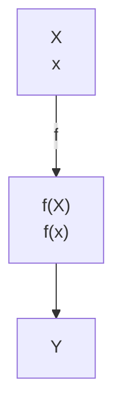
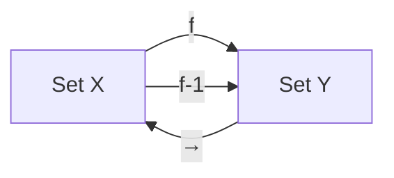

## 实变函数

## Functions of Real Variables

## 第三讲

电子科技大学 数学科学院

周 冠宇

## 集合论 （3） ：映射 （函数）

：非空集合

映射 $X  Y$ 对于任何的 $x \in X$ 存在唯一的 $f ( x ) \in Y$ 与之对应。

例. (1)集合列 $\left\{ A _ { n } \right\}$ 可以看作是自然数集到 $2 ^ { X }$ 的映射。这里 $X = \cup A _ { n }$

$$
f: \mathbb {N} \to 2 ^ {X} f (n) = A _ {n} \in 2 ^ {X} (A _ {n} \subset X)
$$

(2)集合 的子集的并运算是一个 $2 ^ { X } \times 2 ^ { X }$ 上的函数。

$$
f: 2 ^ {X} \times 2 ^ {X} \to 2 ^ {X}, (A, B) \to A \cup B (\forall A, B \in 2 ^ {X})
$$

(3) $E \in 2 ^ { \mathbb { N } }$ 是自然数集的有限子集，定义映射

中元素的个数。 计数函数

如果 是一个无限子集呢？比如偶数集，奇数集等。

的定义域可以是 $2 ^ { \mathbb { N } }$ 吗？值域该为什么？

映射 $f : X \to Y$

定义域 对于任何的 $x \in X$ 有 $f ( x ) \in Y$

值域 $f ( X ) = \{ f ( x ) \in Y \mid x \in X \} \subset Y$

像 对于 $A \subset X , f ( A ) = \{ f ( x ) \mid x \in A \}$ 为 在映射 下的像。

原像 $\{ x \in X \mid f ( x ) \in B \}$ 为 $B \subset Y$ 的原像，通常记为 $f ^ { - 1 } ( B )$

图（像） 的图（像）是 $X \times Y$ 的一个子集：

$$
G _ {r} (f) = \{(x, f (x)) \mid x \in X \}
$$

![[课程/实变函数/课件/RA-images/2023-RA-03_aa0fb1dd3af99785007539f46a66a41664aed9bc7a1e2d6dd1b01fc28e8c124f.jpg]]

flowchart

![[课程/实变函数/课件/RA-images/2023-RA-03_b6507c70b56590825978d29c54849751311e1a99fc33b42019ea091c185adc05.jpg]]

text_image

G_r(f)
f(X)
f
x
X

满射

$$
X \xrightarrow {f} Y = f (X)
$$

$$
\forall y \in Y, \exists x \in X \text {   s.t.   } f (x) = y
$$

一一映射（单射）

![[课程/实变函数/课件/RA-images/2023-RA-03_ae885d3cae01ef2c6f2f830a7402e31fba2185c1f785819c017c0ead3fd3dfad.jpg]]

text_image

X
f
X

For $x _ { 1 } , x _ { 2 } \in X$ ，if $x _ { 1 } \neq x _ { 2 }$

then $f ( x _ { 1 } ) \neq f ( x _ { 2 } )$

双射=满射+单射

![[课程/实变函数/课件/RA-images/2023-RA-03_2b5f580481f4120000e7ec7f9bd62d73bdea7fa0529c0ebfc2d3fd1ecdd50cda.jpg]]

flowchart

逆映射

为双射时存在逆映射

$$
f ^ {- 1}: Y \to X, y = f (x) \to x
$$

$$
f: X \to Y, g: Y \to Z
$$

复合映射 $g \circ f : X \to Z , ( g \circ f ) ( x ) = g ( f ( x ) )$

![[课程/实变函数/课件/RA-images/2023-RA-03_070aeb6dec9de12e3314f25f764036bb26adfcadbd2ac8cc4d2b770e57b8d65a.jpg]]

flowchart

命题. 如果 $f$ 和 都有逆映射，则 $g \circ f$ 也有逆映射，且

$$
(g \circ f) ^ {- 1} = f ^ {- 1} \circ g ^ {- 1}
$$

证明该命题

关于映射 $: X  Y$ ，以及集合 $A _ { \lambda } \subset X , B _ { \lambda } \subset Y$ 有以下简单事实：

$$
f \left(\bigcup_ {\lambda \in I} A _ {\lambda}\right) = \bigcup_ {\lambda \in I} f (A _ {\lambda});
$$

$$
f \left(\bigcap_ {\lambda \in I} A _ {\lambda}\right) \subset \bigcap_ {\lambda \in I} f (A _ {\lambda});
$$

证明并给出一个真包含的例子

$$
f ^ {- 1} \left(\bigcup_ {\lambda \in I} B _ {\lambda}\right) = \bigcup_ {\lambda \in I} f ^ {- 1} (B _ {\lambda});
$$

$$
f ^ {- 1} \left(\bigcap_ {\lambda \in I} B _ {\lambda}\right) = \bigcap_ {\lambda \in I} f ^ {- 1} (B _ {\lambda});
$$

证明之

班 $B _ { 1 } \subset B _ { 2 }$ ，then $f ^ { - 1 } ( B _ { 1 } ) \subset f ^ { - 1 } ( B _ { 2 } )$

$$
f ^ {- 1} (B ^ {c}) = (f ^ {- 1} (B)) ^ {c}.
$$

证明之

## 集合 的势

对等关系如果存在一个从集合 到集合 的一一满映射，称 与 对等，记作 $A \sim B$

对等关系满足：

（1）自反性： $A \sim A$  
（2）对称性： $A \sim B$ ，then $B \sim A$  
（3）传递性： $A \sim B , B \sim C .$ then $A \sim C$

满足自反性， 对称性和传递性的二元关系称为等价关系

比如矩阵的相似关系，合同关系也是等价关系。

例.1 $\mathbb { N } \sim \mathbb { Z }$ 自然数集和整数集是对等的。存在双射

$$
f: \mathbb {N} \to \mathbb {Z}, \quad f (n) = \left\{ \begin{array}{l l} k, & n = 2 k, \\ - (k - 1), & n = 2 k - 1, \end{array} \right. k = 1, 2, \dots .
$$

![[课程/实变函数/课件/RA-images/2023-RA-03_04217630da864ca0451a8444078d6abd40b13a411bf015d4b4ed95c8b3f549bf.jpg]]

flowchart

```mermaid
graph TD
  f["1"] --> 3["3"]
  f --> 0["0"]
  f --> 4["4"]
  f --> 5["5"]
  f --> 6["6"]
  f --> 7["7"]
  f --> 8["8"]
  f --> 9["9"]
  f --> 10["10"]
  f --> 11["11"]
  f --> 12["12"]
  f --> 13["13"]
  f --> 14["14"]
  f --> 15["15"]
  f --> 16["16"]
  f --> 17["17"]
  f --> 18["18"]
  f --> 19["19"]
  f --> 20["20"]
  f --> 21["21"]
  f --> 22["22"]
  f --> 23["23"]
  f --> 24["24"]
  f --> 25["25"]
  f --> 26["26"]
  f --> 27["27"]
  f --> 28["28"]
  f --> 29["29"]
  f --> 30["30"]
  f --> 31["31"]
  f --> 32["32"]
  f --> 33["33"]
  f --> 34["34"]
  f --> 35["35"]
  f --> 36["36"]
  f --> 37["37"]
  f --> 38["38"]
  f --> 39["39"]
  f --> 40["40"]
  f --> 41["41"]
  f --> 42["42"]
  f --> 43["43"]
  f --> 44["44"]
  f --> 45["45"]
  f --> 46["46"]
  f --> 47["47"]
  f --> 48["48"]
  f --> 49["49"]
  f --> 50["50"]
```

例.2 $( - 1 , 1 ) \sim \mathbb { R }$

$f : ( - 1 , 1 ) \to \mathbb { R } , \quad f ( x ) = \tan ( \pi x / 2 )$ 一一满映射

想一想 $[ 0 , 1 ) \sim \mathbf { S }$ 单位圆周

$$
(0, 1) ^ {2} \sim \{(x, y) \mid x ^ {2} + y ^ {2} <   1 \}
$$

$\mathbb { C } \sim \{ ( x , y ) \mid x ^ { 2 } + y ^ { 2 } < 1 \}$ 是否成立？

集合的势 如果集合 , 满足 ，就称 与 有相同的势（基数）。记为

如果有一个从 到 的一一映射（不一定是满射），则有

$$
| A | \leq | B |
$$

如果 $| A | \leq | B | \neq | A |$ ，则约定 $| A | < | B |$

如果 是一个含有 个元素的有限集，则记 $| A | = n$

定理\*. 对于任意两个势 $\alpha , \beta ,$ 关系式 $\alpha < \beta , \alpha = \beta , \beta < \alpha$ 中有且仅有一式成立。 证明需要集合论公理（Zorn公理）

推论. $\alpha \leq \beta , \alpha \geq \beta \Rightarrow \alpha = \beta$

自然数集的势，记为 $\aleph _ { 0 }$ （阿列夫（ $( A l e p h )$ ）零）， $| \mathbb { N } | = \aleph _ { 0 }$

实数集的势，记为 $| \mathbb { R } | = c$

可列集（可数集） 与自然数集对等的集合。

是一个可列集，则有一一对应关系 可列集合的势都是 $\aleph _ { 0 }$ 。

$$
f: \mathbb {N} \to A, n \mapsto x _ {n}
$$

于是 $A = \{ x _ { 1 } , x _ { 2 } , \cdot \cdot \cdot , x _ { n } , \cdot \cdot \cdot \}$ 即可按顺序排成一序列。

定理 1.2.9. 任何无穷集合都包含一个可列子集。

证明. 是一个无穷集合。

任取 $x _ { 1 } \in A$ 则 $A \backslash \{ x _ { 1 } \}$ 仍是无穷集合。

再任取 $x _ { 2 } \in A \backslash \{ x _ { 1 } \}$ 则 $\cdot A \backslash \{ x _ { 1 } , x _ { 2 } \}$ 仍是无穷集合。 $x _ { 1 } \neq x _ { 2 }$

假设已取出 个互不相同的元素 $\{ x _ { 1 } , x _ { 2 } , \cdots , x _ { n } \}$

$A \backslash \{ x _ { 1 } , x _ { 2 } , \cdot \cdot \cdot , x _ { n } \}$ 仍是无穷集合，从而可取

$$
x _ {n + 1} \in A \backslash \{x _ {1}, x _ {2}, \dots , x _ {n} \}
$$

由归纳法，可以从 中取出互不相同的元素排成序列

$$
\{x _ {1}, x _ {2}, \dots , x _ {n}, \dots \}
$$

为 $A$ 的可列子集。

可列集是势最小的无穷集合。

定理 1.2.10. 可列集合的无穷子集仍是可列的。

证明. 假设 $A$ 是一个可列集合， $A _ { 1 }$ 是 $A$ 的无穷子集。由定理1.2.9可知，$A _ { 1 }$ 含有可列子集 $A _ { 2 }$ . 于是有 $| A | = | A _ { 2 } | = \aleph _ { 0 } , A _ { 2 } \subset A _ { 1 } \subset A$

因为 $| A _ { 2 } | \leq | A _ { 1 } | \leq | A |$ 所以 $| A _ { 1 } | = | A | = | A _ { 2 } | = \aleph _ { 0 }$

即 $A _ { 1 }$ 是一个可列集合。 ■

定理 1.2.11. 可列集与有限集（或可列集）的并集仍是可列集。

证明略.

定理 1.2.12. 可数个有限集或可列集的并仍是可列集。

证明. 设 $A _ { 1 } , A _ { 2 } , \cdots , A _ { n } , \cdots$ 是一列有限集或可测集。 令

$$
A _ {i} = \{x _ {i 1}, x _ {i 2}, \dots , x _ {i n}, \dots \}
$$

（如果 $A _ { i }$ 是有限集。令 $A _ { i } = \{ x _ { i 1 } , x _ { i 2 } , \cdot \cdot \cdot , x _ { i m _ { i } } \} )$

${ \big \lfloor } { \big \rfloor } A _ { i }$ 中的元素可以用多种不同方法排成一个序列，比如

$$
\bigcup_ {i = 1} ^ {\infty} A _ {i} = \left\{x _ {1 1}, x _ {2 1}, x _ {1 2}, x _ {3 1}, x _ {2 2}, x _ {1 3}, x _ {4 1}, \dots , x _ {i j}, \dots \right\}
$$

$\boldsymbol { x } _ { i j }$ 排在第 $n = j + \sum _ { k = 1 } k$ 位。

集合元素与自然数集的一一对应。

$$
\begin{array}{l} A _ {1}: \quad x _ {1 1} \quad x _ {1 2} \quad x _ {1 3} \quad x _ {1 4} \quad \dots \\ A _ {2}: \quad x _ {2 1} \quad x _ {2 2} \quad x _ {3 3} \quad x _ {2 4} \quad \dots \\ A _ {3}: \quad x _ {3 1} \quad x _ {3 2} \quad x _ {3 3} \quad x _ {3 4} \quad \dots \\ A _ {4}: \quad x _ {4 1} \quad x _ {4 2} \quad x _ {4 3} \quad x _ {4 4} \quad \dots \end{array} \text {对角线排序}
$$

：中

定理 1.2.13. 有限个可列集的直积仍是可列集。

$$
A _ {1}, A _ {2}, \dots , A _ {n} \text {是可列集} \Rightarrow \prod_ {i = 1} A _ {i} \text {也是可列集}
$$

可数个可列集的直积？

可数个有穷可列集的直积？

证明. 设 是可列集，我们证明 $A \times B$ 是可列集（然后用归纳法可推出任意有限个可列集的直积仍是可列集）。

$$
A \times B = \{(x, y) \mid x \in A, y \in B \} = \bigcup_ {y \in B} \{(x, y) \mid x \in A \}
$$

注意到 $C _ { y } = \{ ( x , y ) \mid x \in A \} \sim A$ ，即 $C _ { y }$ 可列。由定理1.2.12可得$A \times B$ 是可列集。（省略了归纳法的步骤） ■

例.3 有理数集 是可列集。事实上每个有理数都可以表示成分数的形式。

$$
f: \mathbb {Z} \times \mathbb {Z} \to \mathbb {Q}, (p, q) \mapsto p / q
$$

是一个满射。所以

$$
| \mathbb {Q} | \leq | \mathbb {Z} \times \mathbb {Z} | = \aleph_ {0} \quad (\mathbb {Z} \sim \mathbb {N})
$$

又由 $\mathbb { N } \subset \mathbb { Q } , \aleph _ { 0 } \leq | \mathbb { Q } |$ 可知 $\aleph _ { 0 } = | \mathbb { Q } |$

例.4 由有限个自然数构成的有序数组的全体构成的集合 是可列的。

$$
A = \{(n _ {1}, n _ {2}, \dots , n _ {k}) \mid n _ {i} \in \mathbb {N}, i = 1, 2, \dots , k, k \in \mathbb {N} \} = \bigcup_ {k = 1} ^ {\infty} \mathbb {N} ^ {k}
$$

$k$ 个自然数构成的有序数组的全体：

$$
\mathbb {N} ^ {k} = \{(n _ {1}, n _ {2}, \dots , n _ {k}) \mid n _ {i} \in \mathbb {N}, i = 1, 2, \dots , k \}
$$

$$
| \mathbb {N} ^ {k} | = \aleph_ {0}
$$

例.5 有理系数多项式之全体是可列集。

$$
p (x) = a _ {0} + a _ {1} x + a _ {2} x ^ {2} + \dots a _ {k} x ^ {k}
$$

由 个有理系数 $( a _ { 0 } , a _ { 1 } , \cdots , a _ { k } )$ 唯一决定。 所以有理系数多项式8之全体与有限个有理数数构成的有序数组的全体相对等，后者是 $\bigcup \mathbb { Q } ^ { k }$ 与例4一样是可列集。 k=

例.6 中任意不相交的开区间族是有限集或可列集。

（提示：每个开区间必含有一个有理数）

例.7 上任意单调上升函数的不连续点为有限集或可列。

（提示：每个不连续点 对应一个开区间 $( f ( x _ { 0 } - 0 ) , f ( x _ { 0 } + 0 ) ) )$

证明可列集的有限子集全体仍是可列集。

（提示：和例4类似）

定理 1.2.15. 是无限集， 是可数集，则

$$
\left| A \cup B \right| = \left| A \right|
$$

定理 1.2.16. 集合 是无限集的充分必要条件是： 与其自身的一个真子集对等。