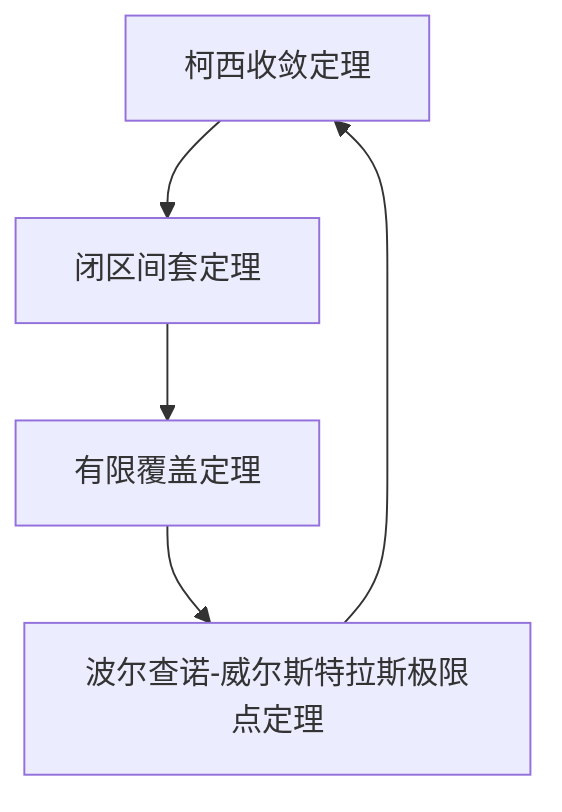

## 实变函数

## Functions of Real Variables

## 第七讲

电子科技大学 数学科学院

周 冠宇

## 集合论 （7） ：开集的结构

定理1.3.16. 实数集的每个开集都是可数个不交开区间的并集。

## 实数集开集的结构

证明 设 是 中的一个非空开集。对任意的 $x \in O , x$ 是 的内点，

所以必有 $( y , z ) \subset O$ 使 $x \in ( y , z )$

这样我们找到 中一个包含 的开区间，我们让这个开区间尽可能的大。

令

$$
b = \sup \{z \mid (x, z) \subset O \}, a = \inf \{y: (y, x) \subset O \}.
$$

取 的上确界 ， 的下确界 ，这样我们就找到 中包含 的最大开区间令 $I _ { x } = ( a , b )$ 我们有：

$$
I _ {x} \subset O \Leftarrow \forall w \in I _ {x} (w <   b), \exists z > w \text {s.t.} w \in (x, z) \subset O.
$$

$$
b \notin O \Leftarrow \mathrm{If} b \in O, \exists \delta > 0 \mathrm{s.t} (b - \delta , b + \delta) \subset O, \mathrm{i.e.} (x, b + \delta) \subset O (\mathrm{wrong!})
$$

$$
a \notin O (\text {同理可证})
$$

考虑开区间族 $\{ I _ { x } \} _ { x \in O }$

$$
I _ {x} \subset O (\forall x) \Rightarrow \bigcup_ {x \in O} I _ {x} \subset O; \forall x \in O, x \in I _ {x} \Rightarrow \bigcup_ {x \in O} I _ {x} \supset O
$$

$$
\therefore O = \bigcup_ {x \in O} I _ {x}
$$

已被表示成开区间族的并集。下一步我们证明该开区间族的开区间两两不交。

假设 $( a , b ) , ( c , d ) \in \{ I _ { x } \}$ 有公共点，则必须有 $a < d , c < b$

$$
c \notin O \Rightarrow c \notin (a, b) \Rightarrow c \leq a;
$$

$\Rightarrow a = c . b = d .$ （同理可证）

$$
a \notin O \Rightarrow a \notin (c, d) \Rightarrow a \leq c.
$$

$( a , b ) = ( c , d )$ 所以 $\{ I _ { x } \}$ 中不同的开区间是不交的。

最后一步我们证明该开区间族可数。

完备性公理 阿基米德公理

因为该开区间族两两不交，每个开区间都包含一个有理数，我们可以建立该开区间族与有理数的一个子集的一一对应，所以它是一个可数集合族。

推论1.3.17. 闭集 $F \subsetneqq$ 是从 中挖去至多可数个互不相交的开区间的集合。若 $F$ 是有界闭集，则 $F$ 是从一个闭区间中挖去至多可数个互不相交的开区间后所得的集合。

## Cantor集

将区间 $[ 0 , 1 ]$ 三等分，并移去中间的那个开区间 ，存留部分记

为 $F _ { 1 }$ ，即

$$
F _ {1} = [ 0, 1 / 3 ] \cup [ 2 / 3, 1 ]
$$

2个，长度1/3

再将 $F _ { 1 }$ 中的区间三等分，并移去中央的那个开区间 ，存留部分记为 $F _ { 2 }$ ，即

$$
F _ {2} = \left[ 0, \frac {1}{9} \right] \cup \left[ \frac {2}{9}, \frac {1}{3} \right] \cup \left[ \frac {2}{3}, \frac {7}{9} \right] \cup \left[ \frac {8}{9}, 1 \right]
$$

4个，长度1/9

$F _ { n }$ 是 $2 ^ { n }$ 个长度为 $/ 3 ^ { n }$ 的互不相交的闭区间的并集。将每个闭区间三等分并移去中央的开区间，剩余的部分记为 $F _ { n + 1 }$ 。

$$
C = \bigcap F _ {n}
$$

$$
n = 1
$$

$$
[ 0, 1 ]
$$

$$
F _ {1} \left[ 0, \frac {1}{3} \right] \cup \left[ \frac {2}{3}, 1 \right]
$$

$$
F _ {2} \left[ 0, \frac {1}{3 ^ {2}} \right] \cup \left[ \frac {2}{3 ^ {2}}, \frac {3}{3 ^ {2}} \right] \cup \left[ \frac {6}{3 ^ {2}}, \frac {7}{3 ^ {2}} \right] \cup \left[ \frac {8}{3 ^ {2}}, 1 \right]
$$

$F _ { n }$ $2 ^ { n }$ 个长度为 $\frac { 1 } { 3 ^ { n } }$ 的闭区间的并集

总长度为： $\left( { \frac { 2 } { 3 } } \right) ^ { n } \to 0 .$

## 挖去的开区间

$$
\left(\frac {1}{3}, \frac {2}{3}\right)
$$

$$
\left(\frac {1}{3 ^ {2}}, \frac {2}{3 ^ {2}}\right) \cup \left(\frac {7}{3 ^ {2}}, \frac {8}{3 ^ {2}}\right)
$$

$$
\left(\frac {1}{3 ^ {3}}, \frac {2}{3 ^ {3}}\right) \cup \left(\frac {7}{3 ^ {3}}, \frac {8}{3 ^ {3}}\right) \cup \left(\frac {1 9}{3 ^ {3}}, \frac {2 0}{3 ^ {3}}\right) \cup \left(\frac {2 5}{3 ^ {3}}, \frac {2 6}{3 ^ {3}}\right)
$$

：

挖去 $2 ^ { n }$ 个长度为 $\frac { 1 } { 3 _ { ~ n ~ } ^ { n } }$ 的开区间共挖去总长度为 $\sum _ { i = 0 } ^ { n } { \frac { 2 ^ { i } } { 3 ^ { i + 1 } } } = 1 - { \frac { 2 ^ { n + 1 } } { 3 ^ { n + 1 } } } \to 1$ 3i+1 2n+1 →1的开区间集合。

可证： $C = \left\{ x = \sum _ { i = 1 } ^ { \infty } \frac { a _ { i } } { 3 ^ { i } } \ | \ a _ { i } \in \{ 0 , 2 \} \right\}$

$$
C \sim 2 ^ {\mathbb {N}}.
$$

Ex. $0 = ( 0 . 0 0 0 \cdots ) _ { 3 } , { \frac { 1 } { 3 } } = ( 0 . 1 ) _ { 3 } = ( 0 . 0 2 2 2 \cdots ) _ { 2 } ,$

$$
\frac {2}{3} = (0. 2 0 0 0 \dots) _ {3}, \quad 1 = (0. 2 2 2 2 0 0 0 \dots) _ {3},
$$

$$
\frac {7}{9} = \frac {2}{3} + \frac {1}{3 ^ {2}} = (0. 2 1 \dots) _ {3} = (0. 2 0 2 2 2 \dots) _ {3},
$$

$$
\frac {8}{9} = \frac {2}{3} + \frac {2}{3 ^ {2}} = (0. 2 2 0 0 0 \dots) _ {3},
$$

$$
{\frac {4}{9}} = {\frac {1}{3}} + {\frac {1}{3 ^ {2}}} = (0. 1 1 0 0 0 \dots) _ {3} \notin C, \quad {\frac {5}{9}} = {\frac {1}{3}} + {\frac {2}{3 ^ {2}}} = (0. 1 2 0 0 0 \dots) _ {3} \notin C.
$$

(1) Cantor集 是非空有界闭集。

(2) $C = C ^ { \prime }$  
(3) $C \sim [ 0 , 1 ] , \quad | C | = 2 ^ { \aleph _ { 0 } }$

定理1.3.18. $\mathbb { R } ^ { n }$ 中任意非空开集 可表示为至多可数个互不相交的维半开矩体的并集。

半开矩体: $\left[ a _ { 1 } , b _ { 1 } \right) \times \left[ a _ { 2 } , b _ { 2 } \right) \times \cdots \times \left[ a _ { n } , b _ { n } \right)$

各边长为: $b _ { i } - a _ { i }$

## 开集与函数的连续性

$f$ 是定义在 $\mathbb { R } ^ { n _ { \mathrm { L } } }$ 的实值函数， $a \in \mathbb { R } ^ { n }$

$f$ 在点 连续

$$
\stackrel {d e f} {\Longleftrightarrow} \forall \varepsilon > 0, \exists \delta > 0 \mathrm{s.t.} | f (x) - f (a) | <   \varepsilon (\forall x \in B _ {\delta} (a)).
$$

若 在 上每一点都连续，则称 $f$ 在 $\mathbb { R } ^ { n }$ 上连续。

定理1.3.20. 设 $f$ 是 上的实值函数，则以下条件互相等价：

（1） $f$ 在 $\mathbb { R } ^ { n }$ 上连续。  
（2） $\forall \lambda \in \mathbb { R } , \ \{ x \mid f ( x ) < \lambda \} \varXi \{ x \mid f ( x ) > \lambda \}$ 是开集。  
（3） $\forall \lambda \in \mathbb { R } , \ \{ x \mid f ( x ) \leq \lambda \} \ G \{ x \mid f ( x ) \geq \lambda \}$ 是闭集。

证明： 显然有 $( 2 ) \Leftrightarrow ( 3 )$ 只需证 $( 1 ) \Leftrightarrow ( 2 )$

[(1)→ (2)] f在 $\mathbb { R } ^ { n } .$ 上连续。设 $\lambda \in \mathbb { R }$ 我们要证 $\{ x \mid f ( x ) < \lambda \}$ 是开集。

对任意的 $x \in \{ x \mid f ( x ) < \lambda \}$ （2 由连续性，存在 $\epsilon > 0$ 使得当

$$
y \in B _ {\epsilon} (x), \text {有} f (y) <   \lambda . \text {即} B _ {\epsilon} (x) \subset \{x \mid f (x) <   \lambda \}.
$$

故 $\{ x \mid f ( x ) < \lambda \}$ 的每一点是内点，从而它是开集。

同理可证 $\{ x \mid f ( x ) > \lambda \}$ 也是开集。

在点 连续 $\Leftrightarrow { \mathrm { G i v e n ~ } } \delta > 0 , \exists \epsilon > 0 { \mathrm { ~ s . t . ~ } } | f ( x ) - f ( y ) | < \delta \ ( \forall { \underline { { \forall } } } \in B _ { \epsilon } ( x ) )$

$$
\exists \delta > 0 \text {s.t.} f (x) \leq \lambda - 2 \delta .
$$

对于给定的 $\delta > 0$ 因为 $f$ 在 连续，所以

$$
\exists \epsilon > 0 \mathrm{s.t.} | f (y) - f (x) | <   \delta (\forall y \in B _ {\epsilon} (x))
$$

$$
\Rightarrow \forall y \in B _ {\epsilon} (x), f (y) \leq f (x) + | f (y) - f (x) | <   f (x) + \delta \leq \lambda - \delta <   \lambda .
$$

[(2) $\Rightarrow ( 1 ) ] ( \forall \lambda \in \mathbb { R } ) \ \{ x \mid f ( x ) < \lambda \} , \{ x \mid f ( x ) > \lambda \}$ 是开集。

对于任意的 $a \in \mathbb { R } ^ { n }$ ，我们证明 $f$ 在 连续。 对任意的 $\epsilon > 0$

$$
O = \{x \mid f (a) - \epsilon <   f (x) <   f (a) + \epsilon \} = \{x \mid f (x) > f (a) - \epsilon \} \cap \{x \mid f (x) <   f (a) + \epsilon \}
$$

是开集, 且 $a \in O$ 存在 $\delta > 0$ 使得

$$
B _ {\delta} (a) \subset O, \mathrm{i.e.,} f (x) - \epsilon <   f (y) <   f (x) - \epsilon (\forall y \in B _ {\delta} (a)).
$$

也即 $| f ( y ) - f ( x ) | < \epsilon \left( \forall y \in B _ { \delta } ( a ) \right)$ 所以 $f$ 在 连续。

![[课程/实变函数/课件/RA-images/2023-RA-07_812d84215d9dfe25dae8457e5f6f6debfb42e10eea3151798799d055d03044c8.jpg]]

命题. $f$ 是 $\mathbb { R } ^ { n _ { \mathrm { E } } }$ 的连续函数

对每个开集 集合 $f ^ { - 1 } ( O )$ 是开的。

对每个闭集 $F \subset \mathbb { R }$ 集合 $f ^ { - 1 } ( F )$ 是闭的吗？

想一想

开集的例子： $\{ ( x , y ) \in \mathbb { R } ^ { 2 } \ | \ y < x ^ { 2 } \}$

![[课程/实变函数/课件/RA-images/2023-RA-07_7837a4a9f4abdfb084b262249562816aeb9a6cb43f948233bf33ca41707cecb0.jpg]]

$$
\{x \in \mathbb {R} ^ {n} \mid \| x - y \| <   r, \forall y \in A \} = \bigcap_ {y \in A} B _ {r} (y)
$$

闭集的例子： $\{ ( x , y ) \in \mathbb { R } ^ { 2 } \ | \ y \leq x ^ { 2 } \}$

$$
\{x \in \mathbb {R} ^ {n} \mid \| x - y \| \leq r, \forall y \in A \} = \bigcap_ {y \in A} (B _ {r} (y) \cap \partial B _ {r} (y))
$$

设 $E \subset \mathbb { R } ^ { n } , f : E  \mathbb { R } , a \in E$ 若对于任意的 $\epsilon > 0$ 总存在 $\delta > 0$ 使得当$x \in E \cap B _ { \delta } ( a )$ 有 $| f ( x ) - f ( a ) | < \epsilon ,$ 就称 $f$ 在点 处连续， 是 $f$ 的连续点。$f$ 在 $E$ 上处处连续，就称 $f$ 在 上连续。全体 上连续函数集合记为 $C ( E )$

设 $A \subset E \subset \mathbb { R } ^ { n }$ 如果存在开集（闭集） $B \subset \mathbb { R } ^ { n }$ 使得 $A = E \cap B$ ，则称 $A$ 相对于 $E$ 是开集（闭集）

区间 相对于 是开集，

相对于 是闭集。

$$
[ 0, 1) = [ 0, 2) \cap (- 1, 1)
$$

$$
[ 0, 1) = [ - 1, 1) \cap [ - 1, 1 ]
$$

$$
E (f <   \lambda) := \{x \in E \mid f (x) <   \lambda \},
$$

$$
f \in C (E)
$$

$$
\Leftrightarrow \forall \lambda \in \mathbb {R}, E (f <   \lambda) \mathrm{and} E (f > \lambda) \mathrm{areopenin} E,
$$

$$
\Leftrightarrow \forall \lambda \in \mathbb {R}, E (f \leq \lambda) \text {and} E (f \geq \lambda) \text {are closed in} E.
$$

## 维点集连续性的基本定理

定理 1.3.23（柯西收敛定理） 序列 $\{ x _ { n } \} \subset \mathbb { R } ^ { n }$ 收敛的充要条件是：

$$
\lim _ {k, l \to \infty} \| x _ {k} - x _ {l} \| = 0.
$$

证明

由 $\left\| x _ { k } - x _ { l } \right\| = \left( \sum _ { i = 1 } ^ { n } | x _ { k , i } - x _ { l , i } | ^ { 2 } \right) ^ { 1 / 2 }$

可知 $C | x _ { k , i } - x _ { l , i } | \leq \| x _ { k } - x _ { l } \| \leq C | x _ { k , i } - x _ { l , i } | \quad ( 1 \leq i \leq n )$

$$
\lim _ {k, l \to 0} \| x _ {k} - x _ {l} \| = 0 \Leftrightarrow \lim _ {k, l \to 0} | x _ {k, i} - x _ {l, i} | = 0
$$

一维的柯西收敛定理

$$
\Leftrightarrow x _ {k, i} \rightarrow x _ {i} \in \mathbb {R} \quad (k \rightarrow \infty , 1 \leq n \leq n)
$$

$$
\Leftrightarrow x _ {k} \rightarrow x = (x _ {1}, \dots , x _ {n}) \in \mathbb {R} ^ {n} (k \rightarrow \infty)
$$

覆盖，开覆盖设 $A \subset \mathbb { R } ^ { n } , { \mathcal { F } }$ 是 的子集族。若 $A \subset \bigcup _ { B \in { \mathcal { F } } } B$ 则称 $\mathcal { F }$ 是集 $A$ 的一个覆盖。当 $\mathcal { F }$ 是开集族时，称 $\mathcal { F }$ 是集 $A$ 的开覆盖。

当 是有限族时，称 $\mathcal { F }$ 是集 的有限覆盖。 若 ${ \mathcal { F } } ^ { \prime }$ 也是 $\mathbb { R } ^ { n }$ 的子集族，${ \mathcal { F } } ^ { \prime } \subset { \mathcal { F } }$ 当 ${ \mathcal { F } } ^ { \prime }$ 也是集合 $A$ 的覆盖时，称 ${ \mathcal { F } } ^ { \prime }$ 是 的子覆盖。

## 定理 1.3.24 （有限覆盖定理）

若 是有界闭集 $F$ 的开覆盖，则可以从 $\mathcal { F }$ 中取出有限子覆盖。

证明（用反证法）设不存在有限子覆盖。因为 $F$ 有界，存在一个方体

$$
C _ {0} = \prod_ {i = 1} [ a _ {i}, b _ {i} ], \text {使得} F \subset C _ {0}.
$$

将 $C _ { 0 }$ 等分成 $2 ^ { n }$ 个边长减半的小方体，其中必有一个，记作 $C _ { 1 }$ 满足 $C _ { 1 } \cap F$ 不被 $\mathcal { F }$ 中有限个集所覆盖。

再将 $C _ { 1 }$ 等分成 $2 ^ { n }$ 个边长减半的小方体，其中必有一个，记作 $C _ { 2 }$ 满足 $C _ { 2 } \cap F$ 不被 $\mathcal { F }$ 中有限个集所覆盖。

![[课程/实变函数/课件/RA-images/2023-RA-07_fc5deb7507decc4af99a0e7be50d01bec71866624a930b41241027140d7f7947.jpg]]

natural_image

Geometric diagram showing a large circle inscribed in a smaller square, with grid lines and no text or symbols present.

如此做下去，得到一个方体的降列 $\{ C _ { k } \}$ ，使得每个 $C _ { k } \cap F$ 不被 $\mathcal { F }$ 中有限个集所覆盖。我们有

$$
\mathrm{diam} C _ {k} \rightarrow 0 (k \rightarrow \infty).
$$

这里 $\mathrm { d i a m } A = \operatorname* { s u p } _ { \boldsymbol { x } , \boldsymbol { y } \in A } \| \boldsymbol { x } - \boldsymbol { y } \|$ 为集合 $A$ 的直径。

任取 $x _ { k } \in C _ { k } \cap F \left( k = 1 , 2 , \cdot \cdot \cdot \right)$ ，则当 $l \geq k$ 时

$$
\| x _ {k} - x _ {l} \| \leq \mathrm{diam} C _ {k},
$$

即 $\left[ x _ { k } \right]$ 为柯西列。由定理1.3.23及 $F$ 是闭集，有 $x _ { k } \to x \in F$

存在 $U \in { \mathcal { F } }$ ，使 $x \in U$ 因为 是开集，所以存在 $r > 0$ ，使得$B _ { r } ( x ) \subset U .$ 又因为 $x _ { k } \in C _ { k }$ $\mathrm { d i a m } C _ { k }  0$ 故当 $k$ 充分大时，

$$
F \cap C _ {k} \subset C _ {k} \subset B _ {r} (x) \subset U,
$$

这于 $C _ { k } \cap F$ 不被 $\mathcal { F }$ 中有限个集覆盖矛盾。证毕。

定理 1.3.25（闭区间套定理） 设 $\{ F _ { k } \}$ 是 $\mathbb { R } ^ { n }$ 中的非空有界闭集列，满足8$F _ { 1 } \supset F _ { 2 } \supset \dots \supset F _ { k } \supset \dots .$ 则 $\bigcap { F _ { k } } \neq \varnothing$ i=1

证明（用反证法）假设 $\bigcap _ { i = 1 } ^ { \infty } F _ { k } = \varnothing$ 由德摩根律知 $\bigcup F _ { k } ^ { c } = \mathbb { R } ^ { n }$ 从而 $\{ F _ { k } ^ { c } \}$ i=1

是有界闭集 $F _ { 1 }$ 的一个开覆盖。由定理1.3.24，存在一个有限子覆盖 $\{ F _ { k _ { j } } ^ { c } \} _ { j = 1 } ^ { s }$

使得 $F _ { 1 } \subset \bigcup _ { j = 1 } ^ { s } F _ { k _ { j } } ^ { c } = \left( \bigcap _ { j = 1 } ^ { s } F _ { k _ { j } } \right) ^ { c } = F _ { k _ { s } } ^ { c } ,$ Fkj

注意 $( F _ { 1 } ^ { c } \subset F _ { 2 } ^ { c } \cdot \cdot \cdot )$

这与 $F _ { 1 } \supset F _ { k _ { s } }$ 矛盾。因此有

$$
\bigcap_ {i = 1} ^ {\infty} F _ {k} \neq \emptyset .
$$

## 定理 1.3.26（波尔查诺-威尔斯特拉斯极限点定理）

$\mathbb { R } ^ { n }$ 中任意有界无限点集 必有一个聚点，即 $A ^ { \prime } \neq \emptyset$

（等价表述） ${ \mathbb { R } } ^ { n }$ 中有界无限序列必有收敛子列。

取 中的一个无限可列子集 证明（用反证法） $\{ x _ { k } \}$ ，令

$$
F _ {k} = \{x _ {j} \mid j \geq k \}, k = 1, 2 \dots ,
$$

易见 $F _ { 1 } \supset F _ { 2 } \supset \cdots$ 假设 $A ^ { \prime } = \varnothing$ 则有 $F _ { k } ^ { \prime } = \varnothing \left( \forall k \right)$ 所以 $F _ { k }$ 是有界闭集。

8由定理1.3.25可知 $\bigcap { F _ { k } } \neq \varnothing$ 显然矛盾，所以 $A ^ { \prime } \neq \emptyset$ .■i=1

$$
\boxed {F _ {k} \supset F _ {k} ^ {\prime}}
$$

![[课程/实变函数/课件/RA-images/2023-RA-07_4e7da07cb875c2d49cabaa265a7d4e27291cb5f00b1d827dd25cf53e13ff248f.jpg]]

flowchart

1维的柯西收敛定理

![[课程/实变函数/课件/RA-images/2023-RA-07_93462c85a67086f3ea89e104b4212ba2a8c150292359d236f0a9ab7ff4569e18.jpg]]

实数的完备性/连续性公理（确界原理戴德金定理）

设 $\{ x _ { k } \}$ 是柯西列，我们用定理1.3.26证明它收敛。

$$
\forall \epsilon > 0, \exists N > 0 \mathrm{s.t.} \text {for any} k, l \geq N \text {we have}
$$

$$
\left\| x _ {k} - x _ {l} \right\| <   \epsilon .
$$

显然 $\{ x _ { k } \}$ 有界，则由定理1.3.26可知它必有一收敛子列

$$
\left\{x _ {k _ {j}} \right\}, x _ {k _ {j}} \rightarrow x (j \rightarrow \infty).
$$

当 充分大时，有

$$
\left\| x _ {k} - x _ {k _ {j}} \right\| \leq \epsilon .
$$

令 $j \to \infty$ 有

$$
\| x _ {k} - x \| \leq \epsilon , \text {即得} x _ {k} \rightarrow x (k \rightarrow \infty).
$$

紧集 集合 $E \subset \mathbb { R } ^ { n }$ 的任意一个开覆盖均包含有限子覆盖，就称 为紧集。

## 定理 1.3.28

设 $E \subset \mathbb { R } ^ { n }$ 。若 的任一开覆盖都包含有限子覆盖，则 是有界闭集。

（即） $\mathbb { R } ^ { n }$ 中的紧集 = 有界闭集。

证明 设 $z \in E ^ { c } . \forall x \in E , \exists \delta _ { x } > 0 \mathrm { s . t . } B ( x , \delta _ { x } ) \cap B ( z , \delta _ { x } ) = \emptyset .$

$\{ B ( x , \delta _ { x } ) \mid x \in E \}$ 是 的一个开覆盖，由题设，存在一个有限子覆盖：

$$
B (x _ {1}, \delta_ {x _ {1}}), B (x _ {2}, \delta_ {x _ {2}}), \dots , B (x _ {n}, \delta_ {x _ {n}}).
$$

n$\bigcup B ( x _ { i } , \delta _ { x _ { i } } ) \supset E \Rightarrow E$ 有界。另外，记

$$
_ {i = 1} \delta = \min \{\delta_ {x _ {1}}, \dots , \delta_ {x _ {n}} \}.
$$

我们有 $B ( z , \delta ) \cap E = \varnothing , { \mathrm { ~ i . e . , ~ } } z \notin E ^ { \prime }$ 这说明 $E \supset E ^ { \prime }$ 即 是闭集。