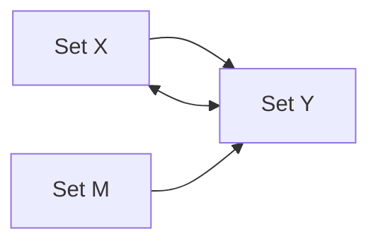
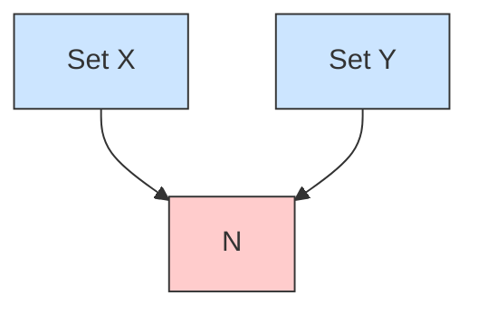
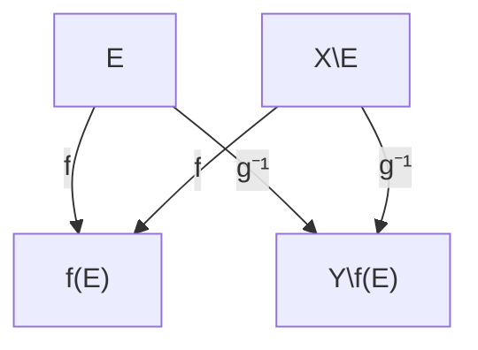
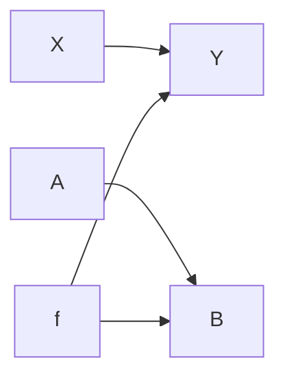

## 实变函数

## Functions of Real Variables

## 第九讲

电子科技大学 数学科学院

周 冠宇

## 有序集与Zorn公理，势的序关系

对于集合 ，我们引入一个(序)关系 ，即对任意的 $y \in X$

$x \preceq y$ 要么为真， 要么为假。

![[课程/实变函数/课件/RA-images/2023-RA-09-I_197d87c794640524c19ec811f60758541f66580fe52da69b60d930492f9cbc75.jpg]]

不代表有 $y \preceq x$

是一个二元关系，满足：序关系

（1）自反性： $\forall x \in X , x \preceq x .$  
（2）反对称性： $x \preceq y$ and $y \preceq x$ ，then $x = y$  
（3）传递性： $\operatorname { I f } x \preceq y$ and $y \preceq z ,$ ，then $x \preceq z$ .

$\{ X , \preceq \}$ :(偏)序空间 记号： $x \preceq y , x \neq y$ then we say $x \prec y !$ $x \preceq y \Leftrightarrow y \succeq x$

若 被赋予了关系 ，则称 是一个偏序集。

例. 1 $\{ 2 ^ { X } , \subset \}$

(1） For all $E \in 2 ^ { X } ( { \mathrm { i . e . , } } E \subset X ) , E \subset E .$  
(2）For $A , B \in 2 ^ { X }$ ,if $A \subset B , B \subset A$ ， then $A = B$  
(3)For $A , B , C \in 2 ^ { X }$ ,if $A \subset B , B \subset C$ , then $A \subset C$

例. 2 $\{ \mathbb { R } , \leq \}$

例. 3 $\{ \mathbb { N } , | \} ( \mathrm { F o r } \ a , b \in \mathbb { N } , \ a | b \overset { d e f } { \longleftrightarrow } \exists c \in \mathbb { N } \ \mathrm { s . t . } \ a c = b . )$

全序集 $\{ X , \preceq \}$ 是一个偏序空间，如果对任意的 $a , b \in X$ 我们有 $a \preceq b$ 或 $b \preceq a$ ,则称 $\{ X , \preceq \}$ 是全序空间， 是全序集。例. $4 \{ \mathbb { N } , \leq \} , \{ \mathbb { Q } , \leq \} , \{ \mathbb { R } , \leq \}$ 是全序空间。

$\{ X , \preceq \}$ 是一个偏序空间。我们称 的任意一个子集 为有序子集。

如果 是全序空间，则称 是全序子集。

如果 中不存在真包含 的全序子集，则称 是 的一个最大全序子集。

例. 5 $\{ 2 ^ { n } : n = 0 , 1 , 2 , \cdot \cdot \cdot \}$ 是 $\{ \mathbb { N } , | \}$ 的一个最大全序子集。

$\{ 3 ^ { n } : n = 0 , 1 , 2 , \cdot \cdot \cdot \}$ 也是 $\{ \mathbb { N } , | \}$ 的一个最大全序子集。

$\{ 4 ^ { n } : n = 0 , 1 , 2 , \cdot \cdot \cdot \}$ 是 $\{ \mathbb { N } , | \}$ 的一个全序子集，但非最大。

$$
\{4 ^ {n}: n = 0, 1, 2, \dots \} \subsetneqq \{2 ^ {n}: n = 0, 1, 2, \dots \}
$$

$\{ 6 ^ { n } : n = 0 , 1 , 2 , \cdot \cdot \cdot \}$ 是 $\{ \mathbb { N } , | \}$ 的一个最大全序子集吗？

Zorn 公理 每个偏序集都有最大全序子集。

：偏序集 $B \subset X$ ：全序子集

若 $a \in X$ 满足 $x \preceq a \ ( \forall x \in B )$ 则称 为 的一个上界。

若 $b \in B$ 满足 $x \preceq b \ ( \forall x \in B )$ 则称 为 的最大元。

若 $a \in X$ 对所有 中能与 比较顺序的元 都有 $x \preceq a$ ，则称 为 的一个极大元。

例. 6 $X = \{ \varnothing , \{ 0 \} , \{ 1 \} , \{ 3 \} , \{ 0 , 1 \} , \{ 0 , 2 \} ,$

$$
\{1, 2 \}, \{1, 3 \}, \{0, 1, 2 \}, \{1, 2, 3 \} \}
$$

$\{ X , \subset \}$ 是一个偏序空间

$B = \{ \emptyset , \{ 0 \} , \{ 0 , 1 \} \}$ 是 的一个全序子集是 的一个上界，同时也是 的最大元

无最大元

也是 的一个上界，也是 的一个极大元。

也是 的一个极大元。

Zorn 引理 设 是一个非空偏序集，若 的每个全序子集在 中都有界，则 必有极大元。

## Zorn 公理 每个偏序集都有最大全序子集。

Zorn 引理 设 是一个非空偏序集，若 的每个全序子集在 中都有界，则 必有极大元。

证明 由Zorn公理， 有一个最大全序子集 。根据假设， 有上界 $a \in X$ 。现证明 为 的极大元。（反证）若 非 的极大元，则存在 $b \in X$ 使得$a \preceq b$ 。于是 $B \cup \{ b \}$ 是 的一个全序子集且真包含 。矛盾。

选择公理 设 是一个集合（指标集），且对每个 $\alpha \in I$ ，集合 $X _ { \alpha }$ 非空。则集合 $\prod X _ { \alpha }$ 也非空。αEI

换言之，存在一个选择函数，对每一个 $\alpha \in I$ 都指定了一个元素 $x _ { \alpha } \in X _ { \alpha }$ $\mathsf { Z o r n }$ 引理也可以由选择公理推出。

怎么证明对任意两个集合 ，以下三者之间有且仅有一个成立：

$$
| X | <   | Y |, | X | > | Y |, | X | = | Y |.
$$

怎么比较两个集合 的势？我们需要找一个 到 的一一映射。

![[课程/实变函数/课件/RA-images/2023-RA-09-I_d736432928ddc05fc76972659dd717c68b2cec9ff8e7740f163124f86831e928.jpg]]

flowchart

从 的一个子集 到 上的一一满映射

$$
\left. \begin{array}{l} | M | = | Y | \\ M \subset X \Rightarrow | M | \leq | X | \end{array} \right\} \Rightarrow \frac {| Y | \leq | X |}{\text {中映射定}}
$$

![[课程/实变函数/课件/RA-images/2023-RA-09-I_65995c94ca61cc53c5b623d093f698bf6f097802cde92a6caa92b2870eb6e966.jpg]]

flowchart

从 到 的一个子集 上的一一满映射。

$$
\left. \begin{array}{l} | X | = | N | \\ N \subset Y \Rightarrow | N | \leq | Y | \end{array} \right\} \Rightarrow | X | \leq | Y |
$$

由映射定义的序关系

我们要做的是：对任意的 $M \subset X , N \subset Y ,$

考虑所有从 到 的一一映射，从中找出满足 或 $N = Y$ 的一一映射。

## Step 2

这样就能说明：

$$
| X | \leq | Y | \mathrm{or} | X | \geq | Y | \mathrm{成立}!
$$

## Step 1

另外， 我们要需证明：

$$
| X | \leq | Y |, | X | \geq | Y | \Rightarrow | X | = | Y |
$$

![[课程/实变函数/课件/RA-images/2023-RA-09-I_1e47652e15ec63baedee307dcdea0800d72d9a5f2b1e3f5d9bf9bc885bbf47d3.jpg]]

text_image

Blue bracket symbol on white background, commonly used as a list or bracket

以下三者之间有且仅有一个成立：

$$
| X | <   | Y |, | X | > | Y |, | X | = | Y |.
$$

：集合

若 $2 ^ { X }  2 ^ { X }$ 满足：

当 $A \subset B \subset X$ 时都有 $f ( A ) \subset f ( B )$ 则称 $f$ 是 $2 ^ { X } .$ 上的单调映射。

Ex. 7 设 $\phi : X \to X$ 由 $\phi$ 诱导的 $2 ^ { X }$ 上的一个映射 $f : 2 ^ { X } \to 2 ^ { X }$

定义为 $f ( A ) : = \phi ( A ) \ ( \forall A \in 2 ^ { X } )$

是单调的。 $( A \subset B \Rightarrow \phi ( A ) \subset \phi ( B ) )$

引理 $2 ^ { X } .$ 上的单调映射有不动点。

$$
a = f (a)
$$

证明： 令 ${ \mathcal { F } } = \{ A \in 2 ^ { X } \mid A \subset f ( A ) \} , \ E = \bigcup \ A$

$$
A \in \mathcal {F}
$$

现证明 $E = f ( E ) . \forall A \subset E , { \underline { { A } } } \subset f ( A ) \subset f ( E ) \Rightarrow E \subset f ( E )$

$$
\Rightarrow f (E) \subset f (f (E)) \Rightarrow f (E) \subset E.
$$

$$
E = f (E).
$$

定理 是两个集合。若 $| X | \leq | Y |$ 且 $| Y | \leq | X |$ ，则有 $| Y | = | X |$

证明

$| X | \leq | Y | \Rightarrow \exists f : X \to Y$ 一一映射（不一定满）

$| Y | \leq | X | \Rightarrow \exists g : Y \to X$ 一一映射（不一定满）

目的：找一个 $h : X \to Y$ 一一满映射

$$
X \xrightarrow {f} f (X)
$$

$$
h: X \to Y
$$

![[课程/实变函数/课件/RA-images/2023-RA-09-I_3faf665f427e410be9c1a04f84d5095ed47f5b83322d83bf2a1902f5f3c1b815.jpg]]

flowchart

![[课程/实变函数/课件/RA-images/2023-RA-09-I_56976a52d7cc07ec05d0a718d6eac6fa4deae18cf8aa26b6f8dba02b91978a5a.jpg]]

flowchart

我们要找 $E \subset X$ 满足：

$$
X \backslash E = g (Y \backslash f (E))
$$

即E = X\g(Y\f(E))

定义

$$
\psi : 2 ^ {X} \to 2 ^ {X}, \psi (A) := X \backslash g (Y \backslash f (A))
$$

$$
A \subset B \Rightarrow f (A) \subset f (B) \Rightarrow Y \backslash f (A) \supset Y \backslash f (B) \Rightarrow g (Y \backslash f (A)) \supset g (Y \backslash f (B))
$$

$$
\Rightarrow X \backslash g (Y \backslash f (A)) \subset X \backslash g (Y \backslash f (B))
$$

即 $\psi ( A ) \subset \psi ( B )$ $\psi$ ：单调

$$
\exists E \subset X (\mathrm{i.e.} E \in 2 ^ {X}) \mathrm{s.t.} E = \psi (E) = X \backslash g (Y \backslash f (E))
$$

$f : E \to f ( E )$ 一一满映射

$g : Y \backslash f ( E )  g ( Y \backslash f ( E ) ) = X \backslash E$ 一一满映射

$g ^ { - 1 } : X \backslash E  Y \backslash f ( E )$ 一一满映射

$$
h (x) = \left\{ \begin{array}{l l} {{f (x)}} & {{\quad x \in E,}} \\ {{g ^ {- 1} (x)}} & {{\quad x \in X \backslash E.}} \end{array} \right. \qquad h: X \to Y \mathrm{一一满映射}
$$

定理 设 $| X | = \alpha , | Y | = \beta$ 则 $\alpha < \beta , \alpha = \beta , \beta < \alpha$ 必有且仅有一个成立。

证明： 只需证明 $\beta \leq \alpha$ 与 $\alpha \leq \beta$ 中至少有一个成立。

设 $A _ { 1 } \subset A _ { 2 } \subset X , f : A _ { 1 }  Y , g : A _ { 2 }  Y$ 一一映射

若 $f ( x ) = g ( x ) \quad \forall x \in A _ { 1 }$ 则称 是 $f$ 在 $A _ { 2 }$ 上的延拓，是 $g$ 在 $A _ { 1 }$ 上的限制。

$$
\begin{array}{c c c} X & & Y \\ \hline g & & \\ A _ {2} & A _ {1} & f \end{array}
$$

$$
\mathcal {F} = \{f: A \to B \mid f \text {一一满映射} \quad , A \subset X, B \subset Y \}
$$

![[课程/实变函数/课件/RA-images/2023-RA-09-I_daa1243dcbbe644da3004dd0c6213eec9d447b34bf7701d0cd67bf937da600d2.jpg]]

flowchart

找一个定义域尽量

大或者值域尽量大

的 ，

即 或 $B = Y$

不是空集 对 $a \in X , b \in Y . { \widehat {  } } f ( a ) = b .$

取 $A = \{ a \} , B = \{ b \}$ 则有 $f \in { \mathcal { F } } .$

对 $f , g \in { \mathcal { F } }$ 若 是 $f$ 的延拓，则称 $f \preceq g .$

$\{ \mathcal { F } , \preceq \}$ 是一个偏序空间

对于任意的一个 的全序子集 $F _ { I }$

$$
F _ {I} = \{f _ {i}: A _ {i} \to B _ {i} \mid f _ {i}: \text {一一满映射}, f _ {i} \in \mathcal {F}, i \in I \}
$$

$$
\begin{array}{c c c} \vdots & \vdots \\ & f _ {\zeta} \\ & f _ {\beta} \\ A _ {\beta} A _ {\alpha} & f _ {\alpha} \\ A _ {\zeta} & B _ {\alpha} B _ {\beta} B _ {\zeta} \end{array}
$$

$$
f: \bigcup_ {i \in I} A _ {i} \to \bigcup_ {i \in I} B _ {i},
$$

for any $x \in \bigcup _ { i \in I } A _ { i } , \exists i \in I { \mathrm { ~ s . t . ~ } } x \in A _ { i } .$ ieI

we set $f ( x ) = f _ { i } ( x )$ 由Zorn引理， $\mathcal { F }$ 有极大元 .

是每个 $f _ { i }$ 在 $\bigcup A _ { i }$ 上的延拓。

$f \in { \mathcal { F } } ,$ 且 $f$ 冏B人¥ $\overset { i \in I } { \mathop { \exists } ^ { \equiv } } F _ { I }$ 的上界。

$g : M  N , \quad \quad \cdots \forall \mathbb { H } \mathbb { H } \mathbb { H } \mathbb { H } \mathbb { H } \mathbb { \cdots } \quad \quad M \subset X , N \subset Y .$

![[课程/实变函数/课件/RA-images/2023-RA-09-I_369aa6b4d394cfb1af5ca4681a6fe5a2f724e75918f61ece1ffebeed42ad969a.jpg]]

$$
| M | = | N |
$$

现证明 $M \neq X , N \neq Y$ 不能同时成立。

用反证法。 若有 $a \in X \backslash M , b \in Y \backslash N$ 则令

$$
h (x) = \left\{ \begin{array}{l l} {{g (x),}} & {{\quad x \in M,}} \\ {{b,}} & {{\quad x = a.}} \end{array} \right. h: M \cup \{a \} \to N \cup \{b \} — — \mathrm{满映射}
$$

$h \in \mathcal { F } , g \prec h$ 与 是一个极大元矛盾。 所以有两种可能:

$$
M = X \Rightarrow | X | = | M | = | N | \leq | Y | (N \subset Y).
$$

或

$$
N = Y \Rightarrow (X \supset M) \quad | X | \geq | M | = | N | = | Y |.
$$

## 作业：交一份学习报告

## 下列主题任选一个：

类Cantor集  
可数集和不可数集的例子（要求：不能是和课件内容相似的例子）  
选择公理和Zorn公理

## 内容和书写要求：

手写版（字迹清晰、A4纸至少1.5页）or Word/PDF版（A4纸至少4页）  
内容需涵盖所讨论主题的背景、相关的数学概念、定义、定理/命题，具体的例子和必要的证明