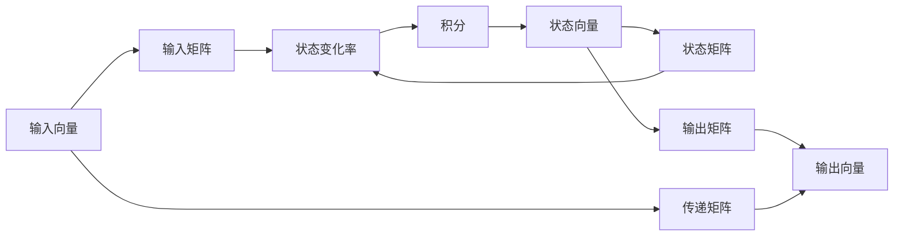

---
subject:
- 控制理论基础
type: lecture
class_no: 4
date: '2026-09-09'
source:
- 腾讯会议录制（状态空间模型与群体智能讲座）
- '[[03_Sources/Courses/归档/控制理论基础/课堂笔记/raw/2026-09-09-状态空间模型与群体智能讲座-108992-逐字稿]]'
- '[[03_Sources/Courses/归档/控制理论基础/课堂笔记/raw/2026-09-09-状态空间模型与群体智能讲座-108992-纪要]]'
meeting_code: null
start_time: '2026-09-09T19:32:05+08:00'
tags:
- 状态空间
aliases:
- 2026-09-09 第4节 状态空间模型与群体智能
schema_version: 2
time: "2026-10-14T20:49:51+08:00"
legacy_status: 已完成
legacy_topics:
- 状态空间
- 线性定常系统
- 状态轨迹
- 群体智能
- 图论
- 可解释性
status: not done
polish_status: done
lecture_date: '2026-09-09'
---

# 2026-09-09 第4节 状态空间模型与群体智能

## 资料来源

- 原始逐字稿：[[raw/2026-09-09-状态空间模型与群体智能讲座-108992-逐字稿.md]]
- 智能纪要：[[raw/2026-09-09-状态空间模型与群体智能讲座-108992-纪要.md]]
- 开始时间：2026-09-09 19:32

## 一、本节课核心脉络

本节课先把上一节的状态空间模型写成统一矩阵形式，说明状态、输入与输出的维度关系，再把单个系统推广到多个智能体相互作用的网络，讨论群体智能、自组织协同与可解释群体决策。

## 二、状态空间模型的统一表达

一般非线性系统可写为

$$
\dot{x}(t)=f\bigl(x(t),u(t),t\bigr),\qquad
y(t)=g\bigl(x(t),u(t),t\bigr).
$$

在工作点附近线性化后，得到线性时变模型

$$
\dot{x}(t)=A(t)x(t)+B(t)u(t),
$$

$$
y(t)=C(t)x(t)+D(t)u(t).
$$

当各矩阵不随时间变化时，模型进一步简化为线性定常系统

$$
\boxed{\dot{x}=Ax+Bu,\qquad y=Cx+Du}.
$$

### 矩阵含义与维度

设 $x\in\mathbb{R}^{n}$、$u\in\mathbb{R}^{m}$、$y\in\mathbb{R}^{p}$，则

| 矩阵 | 维度 | 作用 |
|:--|:--:|:--|
| $A$ | $n\times n$ | 状态之间的内部耦合 |
| $B$ | $n\times m$ | 输入怎样影响状态 |
| $C$ | $p\times n$ | 状态怎样形成输出 |
| $D$ | $p\times m$ | 输入对输出的直接作用 |

> 一句话来说：四个矩阵分别回答“系统自己怎样变、输入怎样推它、状态怎样被看见、输入是否直接出现在输出中”。

## 三、状态变量与状态轨迹

状态变量组成能够完整描述系统运动的最小变量集合。给定时刻 $t_0$ 的状态 $x(t_0)$ 和之后的输入 $u(t)$，便能确定未来状态。随着时间变化，向量 $x(t)$ 在 $n$ 维状态空间中描出一条状态轨迹。

状态变量需要独立，但“独立”不等于彼此毫无作用；$A$ 的非对角元素恰好可以表示不同状态之间的耦合。真正需要避免的是用冗余变量重复表达同一动态信息。

## 四、框图与方程如何对应

状态方程中的积分环节把 $\dot{x}$ 变为 $x$，矩阵 $A$ 构成状态反馈，矩阵 $B$ 把输入送入状态通道；输出端再由 $C$ 和 $D$ 合成 $y$。因此框图不是装饰，而是矩阵方程的信号流表示。

## 五、从单体控制到群体智能

群体智能研究多个个体通过局部感知和交互，形成单个个体无法独立完成的宏观行为。无人机集群、仓储机器人、微型机器人和生物群体都可以抽象为“节点 + 交互边”的网络动态系统。

每个智能体可具有自己的状态 $x_i$ 和控制输入 $u_i$。若第 $i$ 个个体只能获得邻居信息，一类典型一致性控制律为

$$
u_i=-\sum_{j\in\mathcal{N}_i}a_{ij}(x_i-x_j),
$$

其中 $\mathcal{N}_i$ 是个体 $i$ 的邻居集合，$a_{ij}$ 表示交互强度。该规则只比较局部差异，却可能使全体状态逐渐趋于一致。

> 一句话来说：群体智能的关键不是每个个体都很聪明，而是简单个体通过合适的局部规则涌现出有组织的整体行为。

## 六、应用与涌现机制

### 1. 工程应用

- 无人机编队与协同搜索：要求保持队形、避免碰撞并分配任务。
- 灾害侦查：在通信受限环境中依靠局部信息完成区域覆盖。
- 智能仓储：多个机器人协同搬运、避障和规划路径。
- 微型机器人群：利用群体协同完成单体难以执行的生物医学任务。

### 2. 生物与社会启发

蚂蚁搭桥、蜜蜂选巢等现象展示了分布式决策：个体没有全局视角，却能通过信息素、局部接触和正反馈形成群体选择。多人估重取平均值、掌声节奏逐渐同步等例子，则说明信息汇聚和相互影响可能产生宏观一致性。

正反馈能加速选择，也可能放大早期偶然误差；因此群体系统还需要负反馈、探索机制或异质性来避免错误锁定。

## 七、群体决策与可解释性

神经网络能够拟合复杂关系，但其内部决策机制有时难以解释。控制论与图论提供另一条路径：明确写出个体状态、交互网络和演化规则，再分析系统是否收敛、收敛到哪里、哪些节点影响最大。

课堂介绍了一个带从众效应的二选一市场模型，用于讨论客观评分差异如何影响长期占有率。理解这类结论时应区分模型假设与现实：网络结构、信息质量、个体异质性和外部干预都会改变结果，数学定理只在其假设满足时成立。

## 八、易错点与后续问题

> [!warning] 易错点
> - 状态变量相互独立，不代表动力学上没有耦合。
> - 线性化后的结论通常只在工作点附近成立。
> - “无中心控制”不等于没有规则，而是规则分布在各个个体及其连接中。
> - 群体出现一致并不自动代表决策正确，还要检查信息来源和模型目标。

- 后续问题：能控性、能观性怎样由矩阵判定？
- 后续问题：图的连通性怎样决定一致性算法是否收敛？
- 课程安排相关通知具有时效性，以教师和教务系统后续信息为准。

## 课堂导航

- 上一节：[[03_Sources/Courses/归档/控制理论基础/课堂笔记/2026-09-07-第3节-控制系统理论授课|第3节 控制系统分类与状态空间模型]]
- 上级索引：[[README|控制理论基础课堂笔记]]
