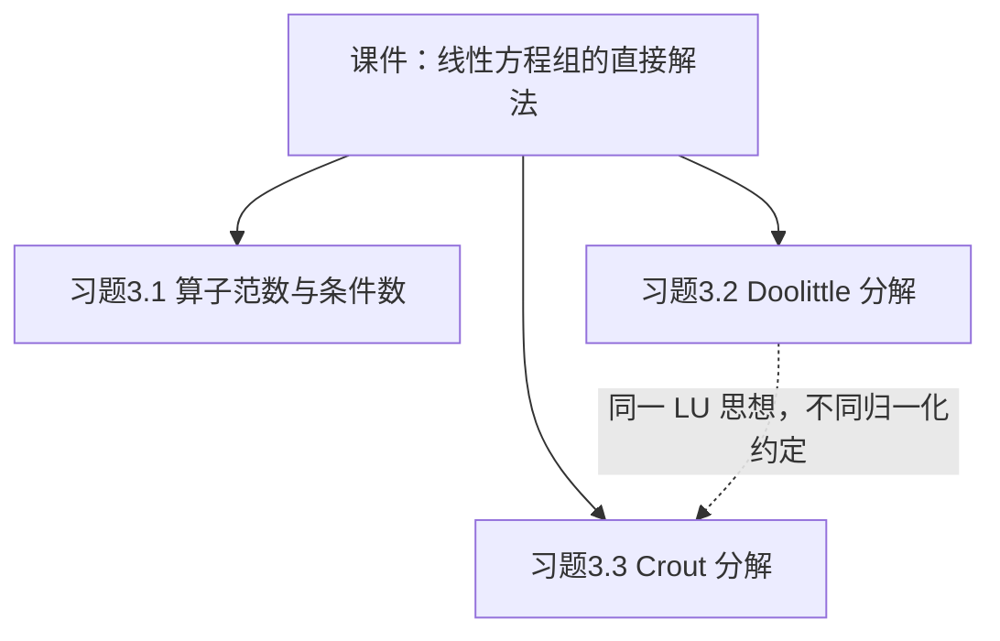

# 第3章 习题库

链接回课件笔记：[[03_Sources/Courses/归档/数值分析/课件/MD/03-线性方程组的直接解法]]

## 习题列表

| 编号 | 题目 | 知识点 | 状态 |
|------|------|------|:---:|
| 习题3.1.md | 算子范数证明与条件数计算 | 算子范数, 条件数, 误差放大因子 | 待校对 |
| 习题3.2.md | Doolittle 分解与 LU 求解 | LU 分解, Doolittle 分解, 三角方程组回代 | 待校对 |
| 习题3.3.md | Crout 分解与 LU 求解 | LU 分解, Crout 分解, 三角方程组回代 | 待校对 |

## 依赖关系

