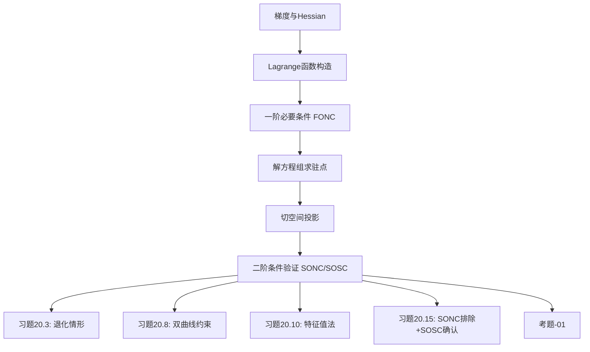

# 第20章 习题库

> **课件笔记：** [[03_Sources/Courses/归档/最优化方法/最优化方法PPT课件/MD/20-等式约束优化问题]] | **知识梳理：** [[../知识点解析梳理/20-等式约束优化问题-知识梳理|第20章 知识梳理]] | **复习纲要：** [[../复习/VII-约束优化及求解方法|VII-约束优化]]

| 题号 | 题目 | 知识点 | 状态 |
|------|------|--------|------|
| 20.3 | [[习题20.3\|线性约束下目标函数退化分析]] | Lagrange乘子法、退化情形、二阶条件 | ✅ 已录入 |
| 20.8 | [[习题20.8\|双曲线约束下的线性目标]] | Lagrange乘子法、SOSC、全局性分析 | ✅ 已录入 |
| 20.10 | [[习题20.10\|二次型最大化的特征值方法]] | Rayleigh商、特征值、Lagrange乘子法 | ✅ 已录入 |
| 20.15 | [[习题20.15\|非凸约束下的Lagrange分析与二阶条件]] | Lagrange乘子法、SONC排除、SOSC确认 | ✅ 已录入 |
| 考题-01 | [[考题-Lagrange乘子法\|Lagrange函数求解等式约束优化]] | Lagrange乘子法、一阶必要条件、二阶充分条件 | ✅ 已录入 |

## 作业范围

课件标注必做题：**20.3, 20.8, 20.10, 20.15**。覆盖等式约束优化的核心方法：退化解的识别（20.3）、线性目标下的驻点搜索（20.8）、Rayleigh商/特征值问题（20.10）、二阶条件区分候选解（20.15）。

## 依赖关系

