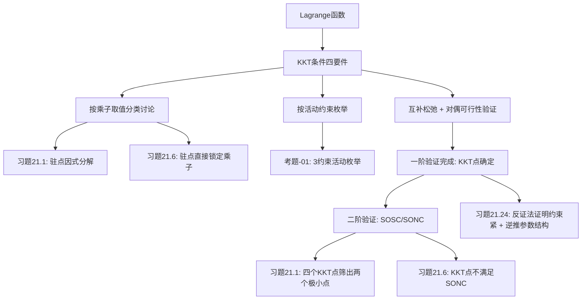

# 第21章 习题库

> **课件笔记：** [[03_Sources/Courses/归档/最优化方法/最优化方法PPT课件/MD/21-不等式约束优化问题]] | **知识梳理：** [[../知识点解析梳理/21-不等式约束优化问题-知识梳理|第21章 知识梳理]] | **复习纲要：** [[../复习/VII-约束优化及求解方法|VII-约束优化]]

| 题号 | 题目 | 知识点 | 状态 |
|------|------|--------|------|
| 必做-21.1 | [[习题21.1\|KKT条件与二阶充分条件求解]] | KKT条件、SOSC、临界锥、互补松弛 | ✅ 已录入 |
| 必做-21.6 | [[习题21.6\|KKT条件与可行方向锥/法锥/二阶必要条件]] | KKT条件、F(x)/T(x)/N(x)、SONC、临界锥 | ✅ 已录入 |
| 必做-21.24 | [[习题21.24\|球约束下线性目标的最优性分析]] | KKT条件、互补松弛、球约束、逆问题分析 | ✅ 已录入 |
| 考题-01 | [[考题-KKT条件求解\|KKT条件求解不等式约束优化]] | KKT条件、互补松弛、约束资格 | ✅ 已录入 |

## 作业范围

本章包含 3 道必做习题（21.1 / 21.6 / 21.24）和 1 道考题补充，覆盖：

- **KKT 条件求解**：标准四条件（原始可行 / 对偶可行 / 驻点 / 互补松弛）+ 分类讨论
- **二阶最优性条件**：SOSC（充分条件）与 SONC（必要条件）的验证，临界锥 $\mathcal{C}$ 的构造
- **锥的刻画**：线性化可行方向锥 $T(x^*)$、法锥 $N(x^*)$、实际可行方向锥 $F(x^*)$
- **最优解结构分析**：球约束下线性目标的最优性条件，逆问题（已知解形式反推参数）

## 依赖关系

