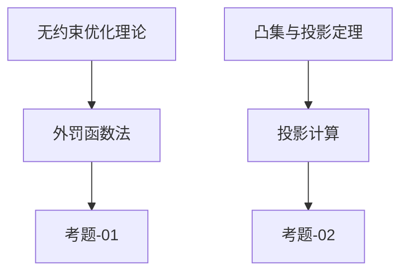

# 第23章 习题库

> **课件笔记：** [[03_Sources/Courses/归档/最优化方法/最优化方法PPT课件/MD/23-约束优化方法]] | **知识梳理：** [[../知识点解析梳理/23-约束优化方法-知识梳理|第23章 知识梳理]]

| 题号 | 题目 | 知识点 | 状态 |
|------|------|--------|------|
| 考题-01 | [[考题-外罚函数法\|外罚函数法求解等式约束]] | 二次罚函数、罚参数序列、收敛性分析 | ✅ 已录入 |
| 考题-02 | [[考题-投影计算\|投影计算—五种常见集合]] | 闭凸集投影、盒子/球/超平面/非负卦限/仿射集 | ✅ 已录入 |

## 作业范围

本章为复习纲要补充的考试型计算题，覆盖两类重要的约束优化算法：外罚函数法（二次罚函数）的数值求解与投影法的基础计算。

## 依赖关系

