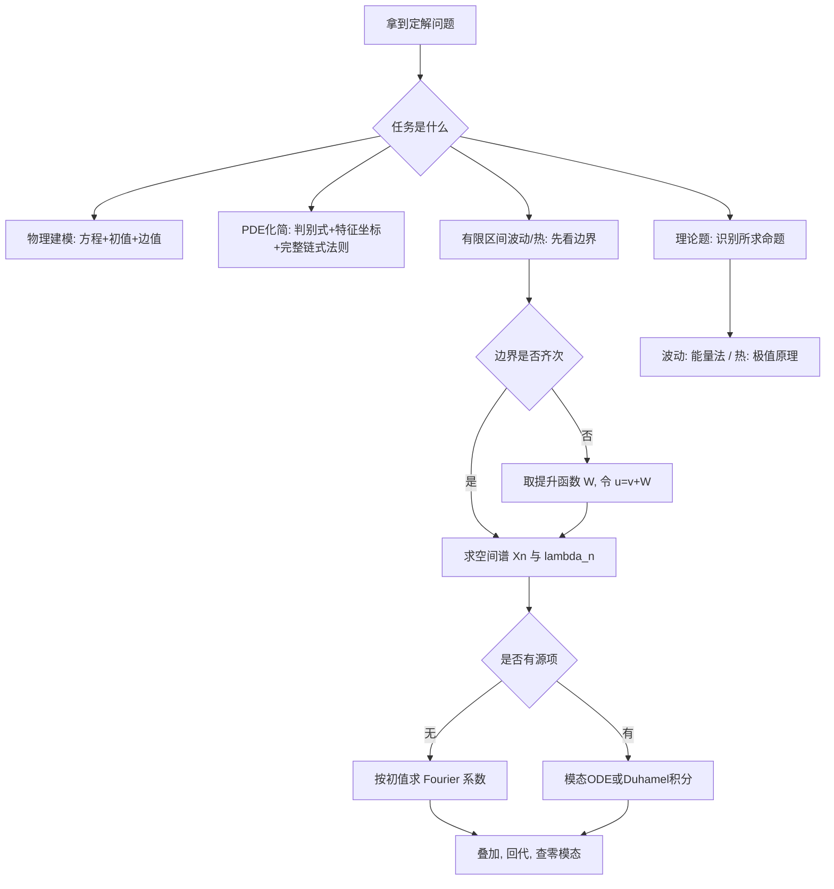

# 数学物理方程期中｜120 分钟考前复习

> [!abstract] 使用说明与范围
> **目标：2 小时主动回忆完整考点，而不是重新看完所有教材。**按 2026-10-14 课堂公布的**第 1～3 章**及 2026-10-28 考前板书组织；2026-11-04 考试 **100 分钟、5 道大题**。本轮按此前明确的范围安排，**不把第 4 章整线达朗贝尔、半直线奇偶延拓、三维球面平均列为必复习项目**；§3.7 也不占主计划时间。
> - **【命题】**是可用于判断/推导的数学结论；**【定理】**需记条件与证明机制；**【题型】**是见题后的操作步骤。
> - **⚠️ 我曾经迷糊**：根据本轮实际问答单列，并非“常见错误”都算你犯过。
> - 标记来源：**【课堂确认】**教师授课/考前宣讲明确；**【作业】**题目来源；**【补充整理】**为复习方便补上的数学解释；**【待定】**不能据此断言必考。
>
## 0. 两小时执行表（从这里开始）

| 时间 | 复习对象 | 必须现场做出的产物 | 完成 |
|---|---|---|---|
| **00–10 min** | [[#1. 全局框架和方法选择|全局框架]] + [[#9. 最后 8 分钟口述速查卡|公式速查]] | 不看答案，口述 5 类题的第一步 | [ ] |
| **10–30 min** | [[#2. 定解问题与边界翻译|定解建模]] + [[#3. 二阶 PDE 分类与化标准型|二阶 PDE 分类]] | 写出热流左右符号；三型各报判别式/坐标 | [ ] |
| **30–55 min** | [[#4. 有限区间分离变量与 Fourier 系数|分离变量]] | 白纸重写 **DD、DN、ND、NN** 的 $X_n,k_n$、零模态 | [ ] |
| **55–80 min** | [[#5. 非齐次边界的齐次化|齐次化]] + [[#6. 非齐次方程与 Duhamel 原理|强迫响应]] | 对 10.28 波动板书完整列出新方程/初值/模态式 | [ ] |
| **80–95 min** | [[#7. 定理、命题与证明|两条定理证明]] | 不看推导，口述波动能量证明与热最大值原理 | [ ] |
| **95–112 min** | [[#10. 自检题（考前只做这四道）|4 个小检验]] | 先独立答，再展开答案；只补错点 | [ ] |
| **112–120 min** | [[#8. 本轮实际出现的易错与辨析|易错登记]] + [速查卡](#9-最后-8-分钟口述速查卡) | 合上笔记，默写 6 条高风险公式 | [ ] |

> [!tip] 时间纪律
> 一道积分卡住超过 3 分钟，写对**投影积分式和时间核**即可继续；但有空时需练会基本分部积分。**不重新做已掌握的同构大题**。本次目标是 5 道大题都能起笔、有主链条。

---

## 1. 全局框架和方法选择

**五类高频题型：**①物理情境列定解问题；②二阶 PDE 判别与化简；③齐次边界波动/热方程；④非齐次边界、源项综合题；⑤唯一性、极值原理、稳定性证明。这是按课堂复习归类，**不是老师承诺每类各出一道**。

---

## 2. 定解问题与边界翻译

### 2.1 模型与必要数据【课堂确认】

| 类型 | 泛定方程（典型） | 初始条件个数 | 必会分辨 |
|---|---|---:|---|
| 弦/弹性杆振动 | $u_{tt}=a^2u_{xx}+f$ | **2** | 初位移 $u(x,0)=\varphi$；初速度 $u_t(x,0)=\psi$ |
| 热传导 | $u_t=a^2u_{xx}+f$ | **1** | 初始温度 $u(x,0)=\varphi$ |
| 竖直悬弦（变张力） | $\rho u_{tt}=[T(x)u_x]_x$ | **2** | $T(x)$ 随位置变，不能直接当常张力 |

**考试只需按情境列写定解问题；2026-10-28 老师明确不要求重复完整的物理微元推导。**

### 2.2 端点翻译【作业：9 月 21 日】

| 描述        | 数学边界                                                         |
| --------- | ------------------------------------------------------------ |
| 端点固定/温度固定 | $u(0,t)=h_1(t)$ 或 $u(L,t)=h_2(t)$（Dirichlet, **D**）          |
| 弹性杆自由端/绝热 | $u_x=0$（Neumann, **N**）                                      |
| 给定空间方向导数  | $u_x(0,t)=h_1(t)$、$u_x(L,t)=h_2(t)$                          |
| 与外界换热     | $-k\partial_n u=h(u-\theta)$（Robin, 第三类；$\partial_n$ 是外法向导数） |
|           |                                                              |

设 $x$ 从左到右、热导率 $k>0$，且**左右端分别有 $q_1,q_2>0$ 的热量流入**：

$$
\boxed{u_x(0,t)=-\frac{q_1}{k},\qquad u_x(L,t)=\frac{q_2}{k}}
$$

原因：傅里叶热流 $q_x=-ku_x$；左端流入沿 $+x$，右端流入沿 $-x$。

### 2.3 三道已复习的情境【作业】

- **均匀杆固定—自由，拉长 $b$ 后静止释放**：$u_{tt}=\frac{Y}{\rho}u_{xx}$；$u(0,t)=0$、$u_x(L,t)=0$；$u(x,0)=bx/L$、$u_t(x,0)=0$。
- **短促冲击/冲量**：停止冲击后按**初速度**（必要时分段或 $\delta$ 极限）表达；不要误写成持续外力或长期边界力。
- **竖直悬弦，自固定上端向下取 $x$**：$T(x)=\rho g(L-x)$，所以 $u_{tt}=g[(L-x)u_{xx}-u_x]$。

> [!warning] 易错：初边值相容性
> “突然放手”可能使 $u_x(L,0)$ 与 $t>0$ 的自由端条件不匹配。这是角点相容性问题，**不是可以随意更改题目初值**。考试列写定解问题时按物理条件正确写出即可。

---

## 3. 二阶 PDE 分类与化标准型

### 3.1 【命题】由主部判定类型【课堂确认】

$$
Au_{xx}+2Bu_{xy}+Cu_{yy}+Du_x+Eu_y+Fu=G
$$

$$
\boxed{\Delta=B^2-AC}\quad
\begin{cases}
\Delta>0&\text{双曲型},\\
\Delta=0&\text{抛物型},\\
\Delta<0&\text{椭圆型}.
\end{cases}
$$

若 $A\neq0$，特征斜率 $m=dy/dx$ 满足：

$$
\boxed{Am^2-2Bm+C=0}
$$

> [!danger] 易错：混合项的系数是 $2B$
> 例如 $u_{xx}+10u_{xy}+9u_{yy}=0$，对应 $B=5$，不是 $10$。特征斜率方程中间项为 **$-2Bm$**，与原 PDE 的 $+2Bu_{xy}$ 符号相反。若 $A=0$，可用特征微分式 $A(dy)^2-2B\,dx\,dy+C(dx)^2=0$，不要机械除以 $A$。

### 3.2 【方法】标准化四步

1. **分类**：提取 $A,B,C$ 与 $\Delta$；变系数须注明在哪个区域成立。
2. **特征积分**：由 $dy/dx=m$ 求 $y-mx=\text{const}$（常系数），取 $\xi,\eta$。
3. **合法性**：检查 $J=\xi_x\eta_y-\xi_y\eta_x\neq0$。
4. **变换**：令 $u(x,y)=U(\xi,\eta)$，变换**全部二阶与一阶**项，不能只看主部就宣布整个 PDE 的标准型。

矩阵快检（本轮已练）：

$$
K=\begin{pmatrix}A&B\\B&C\end{pmatrix},\quad
J=\begin{pmatrix}\xi_x&\xi_y\\\eta_x&\eta_y\end{pmatrix},\quad
\boxed{K_{\mathrm{new}}=JKJ^{\mathsf T}}
$$

它直接给出新**主部**；非线性坐标还可能产生 $U_\xi,U_\eta$ 等低阶项，需用链式法则补齐。

### 3.3 三种对照题

| 类型 | 题目与坐标 | 化简结果 | 限制 |
|---|---|---|---|
| **双曲型【9.28 作业】** | $u_{xx}+10u_{xy}+9u_{yy}=0$；$\xi=y-x,\eta=y-9x$ | $U_{\xi\eta}=0$，$u=F(y-x)+G(y-9x)$ | 在**变换后确实无低阶项**时，才能直接写 $F+G$ |
| **抛物型【课堂例】** | $x^2u_{xx}+2xyu_{xy}+y^2u_{yy}=0$；$\xi=y/x,\eta=x$ | $x^2U_{\eta\eta}=0$，故 $U_{\eta\eta}=0$ | 局限在 $x\neq0$；第二坐标要独立 |
| **椭圆型【本轮补充练习】** | $u_{xx}+4u_{xy}+5u_{yy}=0$；$\xi=y-2x,\eta=x$ | $U_{\xi\xi}+U_{\eta\eta}=0$ | 由复特征积分取实、虚部构造实坐标 |

> [!danger] ⚠️ 我曾经迷糊：抛物型与椭圆型的坐标看起来相似
> **抛物型**只有一个实特征不变量，要**另选独立坐标**。**椭圆型**没有两族实特征线，课程使用复特征积分的**实部/虚部**构造两实坐标。即使某个椭圆例子的第二坐标碰巧是 $x$，来源和判别逻辑也不同。

> [!danger] ⚠️ 我曾经迷糊：“化为标准型之后，$u$ 的结果是什么？”
> 考试问**化简/标准型**，写出 $U_{\xi\xi}+U_{\eta\eta}=0$ 已达到任务目标；没给边界或初值就**不能得到唯一的 $u$**。双曲型若化为 $U_{\xi\eta}=0$，才有 $F(\xi)+G(\eta)$ 这一直接通解。本轮曾额外讨论解析函数表示，但**不列入本次必背**。

### 3.4 【命题】线性叠加原理

若 $L$ 是**线性算子**，且 $Lu_i=f_i$，则 $L(\sum c_iu_i)=\sum c_if_i$。这支撑“初值响应 + 外力响应 + 边界提升”。**无穷级数**要逐项求导还需额外正则性与收敛论证。

---

## 4. 有限区间分离变量与 Fourier 系数

### 4.1 从乘积解推出空间谱【课堂要求写基本推导】

对 $u_{tt}=a^2u_{xx}$ 取 $u=XT$：

$$
\frac{T''}{a^2T}=\frac{X''}{X}=-\lambda
\ \Longrightarrow\
\begin{cases}
X''+\lambda X=0,\\
T''+a^2\lambda T=0.
\end{cases}
$$

热方程 $u_t=a^2u_{xx}$ 则变为 $T'+a^2\lambda T=0$。**共同的空间边界给相同的谱，时间阶数决定时间函数。**

### 4.2 必背：4 种端点谱（$0<x<L$）

| 左—右 | 空间特征函数 $X_n(x)$ | $k_n=\sqrt{\lambda_n}$ | 起始 $n$ |
|---|---|---|---|
| **D—D** | $\sin(k_nx)$ | $n\pi/L$ | $1$ |
| **D—N** | $\sin(k_nx)$ | $(n+\frac12)\pi/L$ | $0$ |
| **N—D** | $\cos(k_nx)$ | $(n+\frac12)\pi/L$ | $0$ |
| **N—N** | $\cos(k_nx)$ | $n\pi/L$ | **$0$，含常数模态** |

- 除 NN 的 $n=0$ 常数项外，$\|X_n\|^2=\int_0^LX_n^2dx=L/2$；NN 的 $X_0=1$，平方范数为 $L$。
- **D–N 推导 20 秒**：$X(0)=0\Rightarrow X=A\sin kx$，$X'(L)=0\Rightarrow\cos(kL)=0\Rightarrow kL=(n+\frac12)\pi$。
- **N–N 零模态**：$X_0=1,\lambda_0=0$，不可强行套入带 $1/\omega_0$ 的公式。

### 4.3 【命题】正交性与 Fourier 投影

在上述自伴的齐次边界下，不同固有值对应的特征函数相互正交。若 $f(x)=\sum f_nX_n(x)$，则：

$$
\boxed{f_n=\frac{\int_0^Lf(x)X_n(x)\,dx}{\int_0^LX_n(x)^2\,dx}}
$$

所以 NN 模态（$n\ge1$）$C_n=\frac2L\int_0^Lf\cos(n\pi x/L)dx$，零模态 $C_0=\frac1L\int_0^Lf dx$。

> [!danger] ⚠️ 我曾经迷糊：$C_n$ 是否为零？积分里应不应该写 $x-C_0$？
> 本轮题目 $f(x)=x$（$L=\pi$）。对 $n\ge1$：
> $$C_n=\frac2\pi\int_0^\pi x\cos(nx)dx$$
> **不是** $\frac2\pi\int\cos(nx)dx$；后者虽然为 0，却遗漏了初值函数 $x$。写成 $\frac2\pi\int_0^\pi(x-C_0)\cos(nx)dx$ **也正确**，因为 $C_0\int_0^\pi\cos(nx)dx=0$，正交投影会自动去除常数项。

### 4.4 齐次波动与热方程的统一时间公式

令 $\omega_n=a k_n$。对 $\lambda_n>0$：

$$
\boxed{\text{波动： }T_n(t)=T_n(0)\cos\omega_nt+\frac{T_n'(0)}{\omega_n}\sin\omega_nt}
$$

$$
\boxed{\text{热： }T_n(t)=T_n(0)e^{-a^2\lambda_nt}}
$$

初值模态由 $\varphi,\psi$ 投影：

$$
T_n(0)=\frac{\langle\varphi,X_n\rangle}{\|X_n\|^2},\qquad
T_n'(0)=\frac{\langle\psi,X_n\rangle}{\|X_n\|^2}.
$$

波动需要两项初值；热方程只需要一项。

### 4.5 零模态与额外 $-bu$【本轮作业 3.2-4】

若 NN，$k_0=0$：

- 无源波动：$T_0''=0\Rightarrow T_0=A_0+B_0t$。
- 无源热：$T_0'=0\Rightarrow T_0=C_0$（平均温度恒定）。
- **有 $-bu$ 的热方程**：$T_0'=-bT_0\Rightarrow T_0=C_0e^{-bt}$；非零模态 $T_n=C_ne^{-(a^2k_n^2+b)t}$。

**本轮真实作业：**

$$
u_t=a^2u_{xx}-bu,\quad u_x(0,t)=u_x(\pi,t)=0,\quad u(x,0)=x.
$$

$$
\boxed{u(x,t)=\frac\pi2e^{-bt}+\sum_{n=1}^\infty\left[\frac2\pi\int_0^\pi x\cos(ns)\,ds\right]e^{-(a^2n^2+b)t}\cos(nx)}
$$

系数也可算成 $C_n=2[(-1)^n-1]/(\pi n^2)$。

> [!danger] ⚠️ 我曾经迷糊：写成 $e^{-(a^2n^2+b^2)t}$
> 正确是 **$a^2n^2+b$**。$a^2n^2$ 来自 $u_{xx}$，$b$ 来自原方程的 $-bu$，**不能擅自平方**。
>
> **⚠️ 我曾经迷糊：$T_0'=-bT_0$ 怎么积分？**
> $$\frac{dT_0}{T_0}=-b\,dt\Rightarrow\ln|T_0|=-bt+C\Rightarrow T_0=C_0e^{-bt}.$$
> 速记：$y'=ky\Rightarrow y=Ce^{kt}$；含零解时令 $C=0$ 即可。

---

## 5. 非齐次边界的齐次化

### 5.1 【方法】先找 $W$ 承担边界，再设 $u=v+W$

已知 $u_{tt}=a^2u_{xx}+f$：

$$
\boxed{v_{tt}=a^2v_{xx}+\underbrace{f+a^2W_{xx}-W_{tt}}_{g}}
$$

$$
\boxed{v(x,0)=\varphi(x)-W(x,0),\quad v_t(x,0)=\psi(x)-W_t(x,0)}
$$

已知 $u_t=a^2u_{xx}+f$：

$$
\boxed{v_t=a^2v_{xx}+\underbrace{f+a^2W_{xx}-W_t}_{g}},\qquad
v(x,0)=\varphi(x)-W(x,0).
$$

> [!warning] 【课堂强调】齐次化是替换**整个未知函数**，不是只改边界。波动尤其容易漏改初速度 $\psi-W_t(x,0)$；热方程不能错用 $-W_{tt}$。

### 5.2 四种边界的最简提升函数（$h_1,h_2$ 依赖 $t$）

| 原边界 | 可取 $W(x,t)$ | 检查 |
|---|---|---|
| D—D：$u(0)=h_1,u(L)=h_2$ | $h_1+(h_2-h_1)x/L$ | 两端值 |
| D—N：$u(0)=h_1,u_x(L)=h_2$ | $h_1+h_2x$ | 左值右导 |
| N—D：$u_x(0)=h_1,u(L)=h_2$ | $h_1(x-L)+h_2$ | 左导右值 |
| N—N：$u_x(0)=h_1,u_x(L)=h_2$ | $h_1x+(h_2-h_1)x^2/(2L)$ | 两端导数 |

**NN 为什么通常要二次式？** 线性函数 $Ax+B$ 的导数恒为 $A$，无法匹配两个不相等的端点导数。

### 5.3 10 月 28 日板书原题：非齐次混合边界波动【课堂确认】

$$
\begin{cases}
u_{tt}=u_{xx}+e^t, &0<x<2,\\
u(x,0)=x^2,\quad u_t(x,0)=\cos x,\\
u(0,t)=0,\quad u_x(2,t)=e^t.
\end{cases}
$$

取 $W=xe^t$，$u=v+W$，逐项得：

$$
\boxed{\begin{cases}
v_{tt}=v_{xx}+(1-x)e^t,\\
v(0,t)=0,\quad v_x(2,t)=0,\\
v(x,0)=x^2-x,\\
v_t(x,0)=\cos x-x.
\end{cases}}
$$

**D–N 谱：**$k_n=(2n+1)\pi/4$，$X_n=\sin(k_nx)$，$n\ge0$；在 $[0,2]$ 上 $\|X_n\|^2=1$。

$$
\begin{aligned}
\alpha_n&=\int_0^2(x^2-x)\sin(k_nx)\,dx,\\
\beta_n&=\int_0^2(\cos x-x)\sin(k_nx)\,dx,\\
c_n&=\int_0^2(1-x)\sin(k_nx)\,dx
=\frac1{k_n}-\frac{(-1)^n}{k_n^2}.
\end{aligned}
$$

对应模态 $T_n''+k_n^2T_n=c_ne^t$：

$$
\boxed{T_n(t)=\alpha_n\cos(k_nt)+\frac{\beta_n}{k_n}\sin(k_nt)+\frac{c_n}{k_n}\int_0^t e^s\sin(k_n(t-s))\,ds}
$$

最后 $\boxed{u(x,t)=xe^t+\sum_{n=0}^{\infty}T_n(t)\sin(k_nx)}$。

> [!note] 角点相容性
> 原题在 $t=0$ 的右端有 $u_x(2,0)=4$，但边界要求 $u_x(2,0)=1$。按课堂采用的模态框架写出形式解，不要误称它在该角点满足所有导数的连续经典解条件。

> [!tip] 你习惯的记号
> 可直接写 $T_n(0),T_n'(0)$，不必额外起 $\alpha_n,\beta_n$ 的名字；**投影系数、模态 ODE、时间积分**写清楚即可。复杂积分可暂保留积分表达式；这不代表不用掌握分部积分。

---

## 6. 非齐次方程与 Duhamel 原理

### 6.1 初值响应与源项响应

**【命题】**边界已经齐次后，可用线性叠加 $v=p+q$：

- $p$ 只承担**初位移、初速度**，满足齐次 PDE；
- $q$ 只承担**源项 $g(x,t)$**，初值为零。

设 $g_n(t)=\langle g(\cdot,t),X_n\rangle/\|X_n\|^2$。

| 模型 | 模态方程（$\lambda_n>0$） | 完整模态解 |
|---|---|---|
| 波动 | $T_n''+\omega_n^2T_n=g_n(t)$ | $T_n(0)\cos\omega_nt+\frac{T_n'(0)}{\omega_n}\sin\omega_nt+\frac1{\omega_n}\int_0^t g_n(s)\sin(\omega_n(t-s))ds$ |
| 热 | $T_n'+a^2\lambda_nT_n=g_n(t)$ | $T_n(0)e^{-a^2\lambda_nt}+\int_0^te^{-a^2\lambda_n(t-s)}g_n(s)ds$ |

> [!danger] 易错：零模态的强迫公式单独写
> NN 波动 $T_0''=g_0(t)$，故
> $$T_0=T_0(0)+T_0'(0)t+\int_0^t(t-s)g_0(s)ds.$$
> NN 热 $T_0'=g_0(t)$，故
> $$T_0=T_0(0)+\int_0^tg_0(s)ds.$$
> **不能让 $\omega_0=0$ 直接代入 $1/\omega_n$ 的波动公式。**

### 6.2 Duhamel 辅助问题【课堂确认】

对齐次边界、零初值、源项 $g(x,t)$ 的**波动方程**：固定施力时刻 $\tau$，构造辅助齐次问题

$$
P_{ss}=a^2P_{xx},\quad P(x,0;\tau)=0,\quad P_s(x,0;\tau)=g(x,\tau).
$$

$$
\boxed{q(x,t)=\int_0^tP(x,t-\tau;\tau)\,d\tau}
$$

热方程对应的辅助问题则把 $g(x,\tau)$ 当作**初始温度**，不是初速度。所有辅助问题均继承原来的**齐次空间边界**。

**记忆图式：**$\tau$ 是“什么时候施力”，$t-\tau$ 是“施力后传播多久”。

### 6.3 10 月 28 日第二板书：NN 热方程与稳态【课堂确认】

**教师最终修改后的题目**：

$$
u_t=u_{xx}+x,\quad 0<x<2,\quad u(x,0)=0,\quad u_x(0,t)=1,\ u_x(2,t)=-1.
$$

取静态提升 $W(x)=x-x^3/6$，则 $W''=-x$，$W'(0)=1$，$W'(2)=-1$：

$$
v_t=v_{xx},\quad v_x(0,t)=v_x(2,t)=0,\quad v(x,0)=x^3/6-x.
$$

$$
\boxed{u=x-\frac{x^3}{6}-\frac23+\sum_{n=1}^\infty c_n e^{-(n\pi/2)^2t}\cos\frac{n\pi x}{2}}
$$

其中 $c_n=\int_0^2(x^3/6-x)\cos(n\pi x/2)dx$；常数模态 $c_0=-2/3$。

> [!note] 同样检查角点
> 本例零初温与端点非零导数在 $t=0$ 不相容；形式余弦展开应按 $t>0$ 的边界和初值极限理解。

> [!warning] 【命题】纯 Neumann 的稳态相容条件
> 对 $u_t=a^2u_{xx}+f(x)$、$u_x(0)=h_1,u_x(L)=h_2$，若想找**静态** $W$ 同时消源，必须满足
> $$\boxed{a^2(h_2-h_1)+\int_0^Lf(x)dx=0.}$$
> 原先课堂试过右端导数 **$0$**，对此题相容条件不成立；只能说明**这种稳态消源法不适用**，**不能说随时间演化的定解问题无解**。这是板书特意改成 $-1$ 的原因。

### 6.4 【待定】共振，不做专项练习

10 月 14 日**作业 3.5 第 3 题**确有 $T''+\Omega^2T=A\sin(\omega t)$，分别讨论 $\omega\ne\Omega$ 与 $\omega=\Omega$。然而检查第 1～11 节现有课堂笔记，**未找到老师单独点名“共振”必考**。在这 2 小时内只记：当 $\omega=\Omega$ 时，$A/(\Omega^2-\omega^2)$ 不能直接用；**Duhamel 积分仍可用**。不把共振闭式解作为优先任务。

---

## 7. 定理、命题与证明

### 7.1 【定理】波动方程的唯一性（必会证明）【课堂确认】

**条件**：同一线性波动方程，两个足够光滑的解具有**相同初始位移、初速度、源项**和相同的 DD/DN/ND/NN 边界数据。

**证明：**设 $z=u_1-u_2$，则 $z_{tt}=a^2z_{xx}$，$z(x,0)=z_t(x,0)=0$，两端差边界齐次。定义能量

$$
\boxed{E(t)=\frac12\int_0^L(z_t^2+a^2z_x^2)\,dx\ge0.}
$$

分部积分：

$$
\begin{aligned}
E'(t)&=\int_0^L(z_tz_{tt}+a^2z_xz_{xt})dx\\
&=a^2[z_tz_x]_0^L+\int_0^Lz_t(z_{tt}-a^2z_{xx})dx\\
&=0.
\end{aligned}
$$

**边界项为何为零？** D 端有 $z=0\Rightarrow z_t=0$，N 端有 $z_x=0$，所以无论四种组合端点乘积都是 0。初始 $E(0)=0$，故 $E(t)=0\Rightarrow z_t=0$；配合 $z(x,0)=0$ 得 $z\equiv0$。

> [!tip] ⚠️ 本轮你主动指出的精简证明
> 最后不必绕路证明“$z_x=0\Rightarrow z$ 为空间常数”；直接利用 **$z_t=0$ 加 $z(x,0)=0$** 就能得出零解。证明思路是正确的。

### 7.2 【定理】热方程最大值／最小值原理【课堂确认】

对足够光滑的 $u_t=a^2u_{xx}$，$a>0$，在有限时空柱 $[0,L]\times[0,T]$ 中，最大、最小值由**抛物边界**控制：

$$
\partial_pQ=([0,L]\times\{0\})\cup(\{0,L\}\times[0,T]).
$$

即 $\max_Q u\le\max_{\partial_pQ}u$，$\min_Q u\ge\min_{\partial_pQ}u$，同时反向包含关系保证最大、最小值相等。**这里要求相应的齐次热方程；任意外力 $f$ 不可不加处理直接套。**

**唯一性：**$z=u_1-u_2$ 满足齐次热方程，且相同 Dirichlet 初边值使 $z|_{\partial_pQ}=0$；最大值原理给 $z\le0$，最小值原理给 $z\ge0$，故 $z=0$。

**稳定性（最大范数）：**若两个解的初始及 Dirichlet 边值差的绝对值均 $\le\varepsilon$，且源项相同，则对差 $z$ 比较 $z-\varepsilon$ 与 $-z-\varepsilon$，得

$$
\boxed{|u_1(x,t)-u_2(x,t)|\le\varepsilon.}
$$

> [!warning] 易错边界
> 抛物边界是**下底 + 两侧**，**不是未来时刻 $t=T$ 顶边**。此处最大值原理证明唯一性的直接表述针对 Dirichlet 初边值；NN/DN/ND 的热方程唯一性可另用能量法。

### 7.3 【命题】热方程的能量耗散（补充备用证明）

若 $z_t=a^2z_{xx}$，两端齐次 D 或 N，则

$$
\frac12\frac d{dt}\int_0^Lz^2dx
=a^2[zz_x]_0^L-a^2\int_0^Lz_x^2dx
=-a^2\int_0^Lz_x^2dx\le0.
$$

若初值 $z(x,0)=0$，则 $z\equiv0$。与波动方程**守恒**不同，热方程的这项能量是**非增**的。

### 7.4 形式级数与经典解【课堂说明；存在性证明本次不要求】

写出 $\sum T_nX_n$ **不自动保证**它能逐项求两阶导数、在角点保持光滑。需足够正则性、适当初边值相容性等。10 月 28 日明确：**波动方程存在性证明不作本次考核要求**；把精力放在正确构造解和**唯一性**。

---

## 8. 本轮实际出现的易错与辨析

| 标记 | 实际迷糊点 | 一句话修正 |
|---|---|---|
| ⚠️ **已出现** | 椭圆型为什么看起来也像“一个特征坐标 + $x$”？ | 抛物型靠**实重特征 + 独立坐标**；椭圆型靠**复特征实部/虚部**，本轮例子的 $x$ 只是碰巧合适。 |
| ⚠️ **已出现** | 椭圆标准型写出后是不是必须给唯一的 $u$？ | 没有初边值一般**不唯一**；问题只问标准型就到此为止。 |
| ⚠️ **已出现** | $T'_0=-bT_0$ 怎么求？ | 分离变量 $dT_0/T_0=-b\,dt$，得 $Ce^{-bt}$。 |
| ⚠️ **已出现** | 写出 $e^{-(a^2n^2+b^2)t}$ | 原方程是 $-bu$，所以指数是 **$-(a^2n^2+b)t$**。 |
| ⚠️ **已出现** | NN 模态 $C_n$ 是不是全为 0？ | $\int\cos nx=0$ 不代表 $\int x\cos nx=0$；投影一定带初值函数。 |
| ⚠️ **已出现** | 求 $C_n$ 是否必须先减 $C_0$？ | **减也行、不减也行**：非零余弦模态与常数模态正交。 |
| ✅ **已解决** | 10.28 波动综合题是否要另造 $A_n,D_n$ 名称？ | 不要强制命名，直接用 $T_n(0),T_n'(0)$；清晰且合法。 |
| ✅ **已理解** | 波动能量证明结尾是否必须证明 $z_x=0$？ | 不必；$z_t=0$ 配合 $z(x,0)=0$ 已充分。 |
| **一般提醒** | NN 漏 $n=0$，或时间因子错误 | 常数模态范数 $L$；无源热为常数，含 $-bu$ 为 $e^{-bt}$；波动为 $A+Bt$。 |
| **一般提醒** | 只把边界变零，不更改源项/初值 | $u=v+W$ 后方程、所有初值、边界全部重算。 |
| **一般提醒** | 非线性换元只变主部 | $JKJ^\top$ 只解决主部；低阶项仍需链式法则。 |
| **一般提醒** | 源项先求稳态失败就说 PDE 无解 | 只说明**静态特解不适配**；演化解可仍存在。 |

---

## 9. 最后 8 分钟口述速查卡

> [!important] 不看上文，6 组公式全部能说出来就够了
> 1. **分类**：$\Delta=B^2-AC$；$Am^2-2Bm+C=0$；$J\neq0$。
> 2. **四种空间基**：DD 正弦整数；DN 正弦半整数；ND 余弦半整数；NN 余弦整数**含常数**。
> 3. **提升**：波动 $g=f+a^2W_{xx}-W_{tt}$，同时减 $W(x,0),W_t(x,0)$；热 $g=f+a^2W_{xx}-W_t$。
> 4. **时间响应**：波动 $\cos,\sin/\omega$；热 $e^{-a^2\lambda t}$；非齐次追加 Duhamel 时间积分。
> 5. **理论证明**：波动差解能量 $E'=a^2[z_tz_x]_0^L=0$；热最大值原理比较 $z$ 与 $\pm\varepsilon$。
> 6. **NN 零模态**：无源波动 $A+Bt$；无源热 $C$；有 $-bu$ 热为 $Ce^{-bt}$。

**整卷起笔规范：**先抄清 $0<x<L$、时间、方程、两项/一项初值、D/N/Robin 边界，再问“需不需要提升？”复杂计算不确定时，先写完整积分表达式而不是跳过整题。

---

## 10. 自检题（考前只做这四道）

> [!example] 题 1｜分类与特征（4 分钟）
> $u_{xx}+10u_{xy}+9u_{yy}=0$。写 $\Delta$、两族特征坐标及通解。
>
> > [!success]- 展开答案
> > $\Delta=5^2-1\cdot9=16>0$；$\xi=y-x,\eta=y-9x$；$u=F(y-x)+G(y-9x)$。坐标行列式非零。

> [!example] 题 2｜边界齐次化（5 分钟）
> $u_{tt}=u_{xx}+e^t$，$0<x<2$，$u(0,t)=0$，$u_x(2,t)=e^t$，$u(x,0)=x^2$，$u_t(x,0)=\cos x$。取 $W=xe^t$，只写**新方程、两项新初值与空间基**。
>
> > [!success]- 展开答案
> > $v_{tt}=v_{xx}+(1-x)e^t$；$v(x,0)=x^2-x$，$v_t(x,0)=\cos x-x$；$X_n=\sin((2n+1)\pi x/4)$，$n\ge0$。

> [!example] 题 3｜零模态（4 分钟）
> $u_t=a^2u_{xx}-bu$，$0<x<\pi$，两端 $u_x=0$，初温 $u(x,0)=x$。求 $T_0(t)$；给出 $T_n(t)$（$n\ge1$）与系数的投影式。
>
> > [!success]- 展开答案
> > $T_0(t)=\frac\pi2e^{-bt}$；$T_n(t)=C_ne^{-(a^2n^2+b)t}$；$C_n=\frac2\pi\int_0^\pi x\cos(nx)dx$。

> [!example] 题 4｜理论题（4 分钟）
> 设两个解满足相同波动方程和相同 D/N 端点条件、初值。用能量法写出：差解 $z$、$E$、$E'$、端点为什么消失、为何 $z\equiv0$。
>
> > [!success]- 展开答案
> > $z=u_1-u_2$；$E=\frac12\int(z_t^2+a^2z_x^2)dx$；$E'=a^2[z_tz_x]_0^L=0$；D 端 $z_t=0$，N 端 $z_x=0$；$E(0)=0\Rightarrow z_t=0$，再由 $z(x,0)=0$ 得 $z\equiv0$。

---

## 11. 范围之外与待定清单

- **【待定】共振**：10 月 14 日作业 3.5 第 3 题出现，但现有课堂笔记没有明确点名为必考；暂不做闭式特解专项。
- **【不占本次 120 分钟】**第 4 章整线达朗贝尔公式、依赖/决定/影响区域、半直线奇偶延拓、三维球面平均：分别见 10 月 23 日和 10 月 30 日授课，**不因课程讲过就自动视为此次第 1～3 章考试范围**。
- **【不深入】**波动方程形式级数存在性的严格证明（10 月 28 日老师明确本次不要求）。
- **【边界提醒】**上述四种简单 D/N 端点谱不直接等同于一般 Robin 特征值问题；遇到 Robin 要重新写 $X'(0)+\alpha X(0)=0$ 等条件求谱。

## 12. 原始资料导航（Obsidian 双链）

- **考前最高优先级：**[[03_Sources/Courses/数学物理方程/课堂笔记/2026-10-28-第10节-偏微分方程考前复习宣讲|10 月 28 日期中复习宣讲与两道板书]]。
- **考试范围：**[[03_Sources/Courses/数学物理方程/课堂笔记/2026-10-14-第7节-偏微分方程期中复习与考试安排|10 月 14 日期中安排]]。
- **物理列题：**[[03_Sources/Courses/数学物理方程/作业/9月21日数学作业|9 月 21 日作业]]。
- **分类与标准型：**[[03_Sources/Courses/数学物理方程/课堂笔记/2026-09-23-第3节-二阶PDE化简与理论授课|9 月 23 日课堂]]；[[03_Sources/Courses/数学物理方程/作业/9月28日数学作业|9 月 28 日作业]]。
- **四种空间谱与唯一性：**[[03_Sources/Courses/数学物理方程/课堂笔记/2026-10-09-第5节-偏微分方程分离变量法授课|10 月 9 日课堂]]。
- **极值原理与 Duhamel：**[[03_Sources/Courses/数学物理方程/课堂笔记/2026-10-10-第6节-偏微分方程解法课程|10 月 10 日课堂]]。
- **齐次化：**[[03_Sources/Courses/数学物理方程/课堂笔记/2026-10-21-第8节-偏微分方程非齐次边界条件授课|10 月 21 日课堂]]。
- **零模态与共振作业：**[[03_Sources/Courses/数学物理方程/作业/10月14日数学作业|10 月 14 日作业]]。
- **第 4 章界线：**[[03_Sources/Courses/数学物理方程/课堂笔记/2026-10-23-第9节-偏微分方程初值问题授课|10 月 23 日课堂]]；[[03_Sources/Courses/数学物理方程/课堂笔记/2026-10-30-第11节-波动方程半无界问题与高维推广课程|10 月 30 日课堂]]。

> [!note] 整理说明
> 本文件基于当前知识库课堂/作业和本轮对话中的实际学习反馈。练习中标为“本轮补充”的椭圆例子不是老师原题；个别原始小测记录与课堂录音存在题面差异，故优先采用已核对的 **10 月 28 日板书**，不拼接未经证实的题设。
