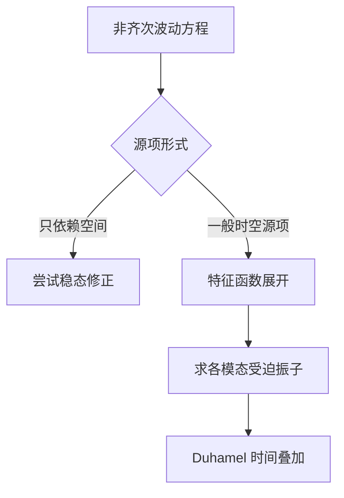

---
subject:
- 数学物理方程
type: lecture
class_no: 6
date: '2026-10-10'
source:
- 腾讯会议录制（偏微分方程解法课程）；03-分离变量法-知识梳理.md
- '[[03_Sources/Courses/数学物理方程/课堂笔记/raw/2026-10-10-偏微分方程解法课程-273472-逐字稿]]'
- '[[03_Sources/Courses/数学物理方程/课堂笔记/raw/2026-10-10-偏微分方程解法课程-273472-纪要]]'
- '[[03_Sources/Reviews/数学物理方程/知识点解析梳理/03-分离变量法-知识梳理]]'
meeting_code: null
start_time: '2026-10-10T10:26:46+08:00'
tags:
- 热方程
- 唯一性
- 稳定性
- 非齐次波动方程
- 特征函数展开
- Duhamel原理
aliases:
- 2026-10-10 第6节 热方程极值原理与非齐次波动方程
schema_version: 2
time: "2026-10-14T20:49:51+08:00"
legacy_status: 已完成
legacy_topics:
- 热方程
- 极值原理
- 唯一性
- 稳定性
- 非齐次波动方程
- 特征函数展开
- Duhamel原理
status: not done
polish_status: done
lecture_date: '2026-10-10'
---

# 2026-10-10 第6节 热方程极值原理与非齐次波动方程

## 资料来源

- 原始逐字稿：[[raw/2026-10-10-偏微分方程解法课程-273472-逐字稿.md]]
- 智能纪要：[[raw/2026-10-10-偏微分方程解法课程-273472-纪要.md]]
- 相关梳理：[[03_Sources/Reviews/数学物理方程/知识点解析梳理/03-分离变量法-知识梳理|分离变量法知识梳理]]
- 本节未发现可可靠匹配的独立 PPT，公式和方法以课堂录音为主。

## 一、热方程的极值原理

在区域

$$
Q_T=(0,L)\times(0,T]
$$

上考虑齐次热方程 $u_t-a^2u_{xx}=0$。其抛物边界为

$$
\Gamma_T=([0,L]\times\{0\})\cup(\{0,L\}\times[0,T]).
$$

极值原理说明：连续解在闭区域上的最大值与最小值由抛物边界控制。直观上，扩散会平滑内部温度分布，不会在内部凭空产生比初始值和边界值更高的新峰或更低的新谷。

### 唯一性

若 $u_1,u_2$ 满足同一方程及相同初边值条件，令 $w=u_1-u_2$，则 $w$ 满足齐次方程且抛物边界上为零。对 $w$ 和 $-w$ 分别应用极值原理，得到 $w\le 0$ 且 $w\ge 0$，所以 $w\equiv0$。

### 稳定性

若两个问题仅在初值或边界值上有小扰动，对差函数应用极值原理可得

$$
\|u_1-u_2\|_{\infty,Q_T}
\le \|u_1-u_2\|_{\infty,\Gamma_T}.
$$

因此输入数据的小变化不会在区域内部被任意放大。

## 二、非齐次波动方程

考虑

$$
u_{tt}-a^2u_{xx}=f(x,t),
$$

配合齐次边界条件。课堂介绍了三类处理思路。

### 1. 稳态修正

当外力只依赖空间，即 $f=f(x)$ 时，可先求一个只依赖 $x$ 的特解 $W(x)$，使其吸收非齐次项，再令 $v=u-W$ 将问题化为齐次方程。此方法依赖源项形式以及边界兼容性，不能机械用于一般的 $f(x,t)$。

### 2. 特征函数展开

对齐次 Dirichlet 边界，可设

$$
u(x,t)=\sum_{n=1}^{\infty}q_n(t)\sin\frac{n\pi x}{L},
$$

并展开

$$
f_n(t)=\frac{2}{L}\int_0^L f(x,t)\sin\frac{n\pi x}{L}\,dx.
$$

每个模态满足受迫振子方程

$$
q_n''(t)+\omega_n^2q_n(t)=f_n(t),
\qquad \omega_n=\frac{an\pi}{L}.
$$

零初值下

$$
q_n(t)=\frac{1}{\omega_n}\int_0^t f_n(\tau)
\sin\bigl(\omega_n(t-\tau)\bigr)\,d\tau.
$$

### 3. Duhamel 原理

Duhamel 原理把持续作用的源项看成各个时刻产生的瞬时响应之叠加：先求齐次方程对单位瞬时输入的响应，再对激励时刻积分。这与上述模态积分公式是同一叠加思想的两种表达。

## 三、方法选择

## 四、课堂安排

课堂布置了相关作业，并提示后续会围绕本节内容进行测验。复习时应能独立说明极值原理如何推出唯一性，以及三种非齐次处理方法各自的适用条件。

## 课堂疑惑与解答

当日日计划 `每日疑惑/2026-10-10.md` 未发现尚未回答且可匹配本课的问题。

## 课堂导航

- 上一课：[[03_Sources/Courses/数学物理方程/课堂笔记/2026-10-09-第5节-偏微分方程分离变量法授课|第5节 分离变量法]]
- 上级索引：[[README|数学物理方程课堂笔记]]
