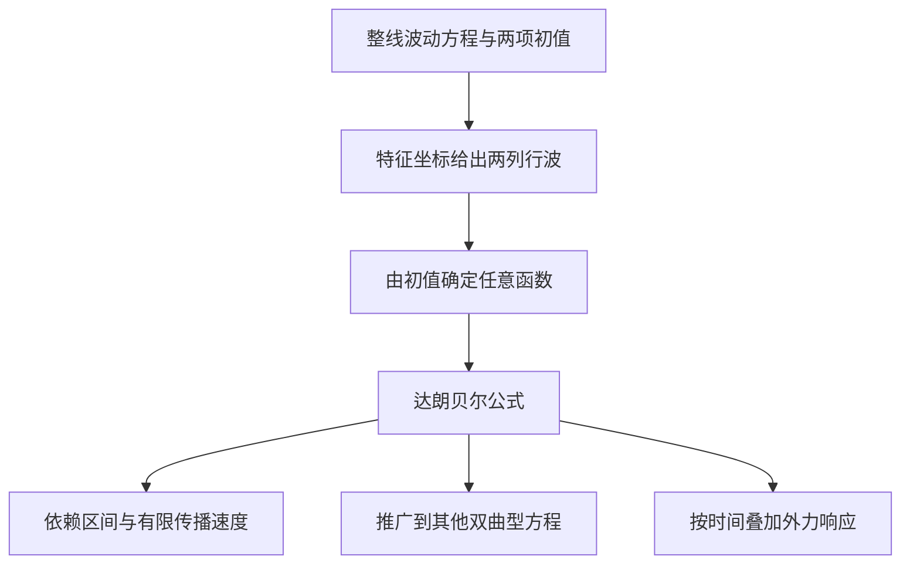
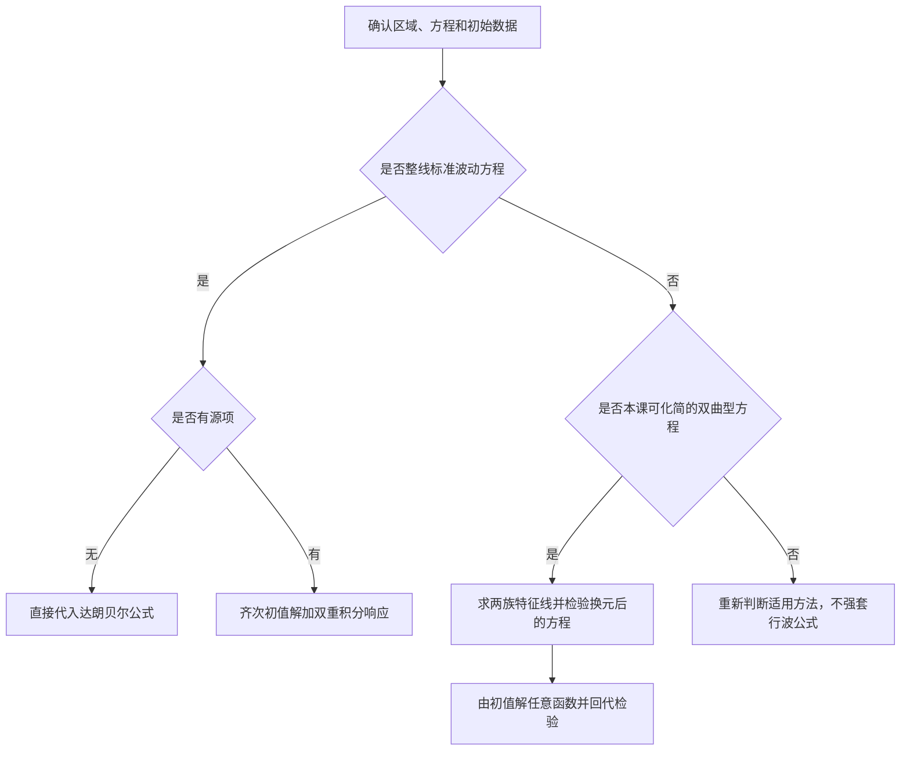

---
subject:
- 数学物理方程
type: lecture
class_no: 9
date: '2026-10-23'
teacher: 黎升好
source:
- 腾讯会议录制（偏微分方程初值问题授课）
- '[[03_Sources/Courses/数学物理方程/课堂笔记/raw/2026-10-23-偏微分方程初值问题授课-500544-逐字稿]]'
- '[[03_Sources/Courses/数学物理方程/课堂笔记/raw/2026-10-23-偏微分方程初值问题授课-500544-纪要]]'
- '[[03_Sources/Courses/数学物理方程/课本/数学物理方程 第2版 (李明奇，田太心主编, 主编李明_ (z-library.sk, 1lib/数学物理方程 第2版 (李明奇，田太心主编, 主编李明_ (z-library.sk, 1lib.]]'
meeting_code: null
start_time: '2026-10-23T14:30:42+08:00'
review_required: true
aliases:
- 2026-10-23 第9节 达朗贝尔公式、特征线法与非齐次初值问题
schema_version: 2
time: '2026-10-23T21:50:13+08:00'
tags: []
legacy_status: 已完成
legacy_topics:
- 达朗贝尔公式
- 行波法
- 依赖区间
- 决定区域
- 影响区域
- 特征线法
- 冲量初值
- 齐次化原理
status: not done
polish_status: done
lecture_date: '2026-10-23'
---

# 2026-10-23 第9节 达朗贝尔公式、特征线法与非齐次初值问题

## 课程信息与来源边界

- 课表：星期五第5—6节，14:30—16:05，教师黎升好。承接[[03_Sources/Courses/数学物理方程/课堂笔记/2026-10-21-第8节-偏微分方程非齐次边界条件授课|第8节]]；沿用已核对的既有课次，10月16日明确停课、不计课，故本次为第9节，修正自动归档的第10节。
- 原始逐字稿：[[03_Sources/Courses/数学物理方程/课堂笔记/raw/2026-10-23-偏微分方程初值问题授课-500544-逐字稿|完整录音转写]]。
- 智能纪要：[[03_Sources/Courses/数学物理方程/课堂笔记/raw/2026-10-23-偏微分方程初值问题授课-500544-纪要|纪要]]，只作定位，不将其误转写当成定理。
- 教材核对：[[03_Sources/Courses/数学物理方程/课本/数学物理方程 第2版 (李明奇，田太心主编, 主编李明_ (z-library.sk, 1lib/数学物理方程 第2版 (李明奇，田太心主编, 主编李明_ (z-library.sk, 1lib.|教材第4.1节]]，用于核对达朗贝尔公式、三种区域、特征线例2及齐次化公式。课程目录未发现可匹配本课的 PPT/PPTX、PDF 课件，故结合现有教材源 MD；不据此推断老师没有使用投影。
- 处理范围：00:00—01:21的新课，以及01:21之后的课堂测试要求。闲谈和识别噪声不作为课程知识。补充推导、转写勘误和题设未确认部分在相应位置标明；原始资料未改写。

## 一、本次课核心脉络

核心问题：空间为整条实线、只给初始位移与速度时，怎样求解波动方程？怎样从波动方程推广到其他双曲型方程及有外力的情形？

必要先修：

- 二阶时间方程需要初始位移 $\varphi$ 和初始速度 $\psi$ 两个条件；有限区间的初边值问题还要空间边值，见[[03_Sources/Reviews/数学物理方程/知识点解析梳理/02-定解问题与偏微分方程理论-知识梳理|定解问题与特征变换]]。
- 链式法则：$\partial_tF(x+at)=aF'(x+at)$，$\partial_tG(x-at)=-aG'(x-at)$。
- 线性叠加与齐次化的旧用法见[[03_Sources/Courses/数学物理方程/课堂笔记/2026-10-21-第8节-偏微分方程非齐次边界条件授课|上节边界提升与源项修正]]；本次不再处理有限端点边界。

阅读路线：先掌握达朗贝尔公式与两种初值的作用，再读依赖关系和行波例子；随后学习特征线换元，最后看非齐次项怎样按时间叠加。

## 二、达朗贝尔公式：先求通解，再用初值定函数（核心）

来源：00:02:24—00:09:07；教材第4.1节。

考虑 $a>0$，$x\in\mathbb R$、$t\ge0$：

$$
u_{tt}=a^2u_{xx},\qquad
u(x,0)=\varphi(x),\quad u_t(x,0)=\psi(x).
$$

其中 $a$ 是传播速度，$\varphi$ 是初始位移，$\psi$ 是初始速度。一组足够的经典解条件为 $\varphi\in C^2(\mathbb R)$、$\psi\in C^1(\mathbb R)$；不光滑或冲量数据须另外说明解的意义。

由特征坐标得到通解

$$
u(x,t)=F(x+at)+G(x-at).
$$

代入两项初值：

$$
F(x)+G(x)=\varphi(x),\qquad
aF'(x)-aG'(x)=\psi(x).
$$

第二式积分，设 $J(x)=\int_0^x\psi(s)\,\mathrm ds$，则

$$
F-G=\frac{J}{a}+C,\quad
F=\frac{\varphi}{2}+\frac{J}{2a}+\frac C2,\quad
G=\frac{\varphi}{2}-\frac{J}{2a}-\frac C2.
$$

代回 $u$，常数相消，两个变上限积分之差合并为

$$
\boxed{
u(x,t)=\frac{\varphi(x+at)+\varphi(x-at)}2
+\frac1{2a}\int_{x-at}^{x+at}\psi(s)\,\mathrm ds.
}
$$

> 一句话来说：初始位移分成左右两份平移，初始速度则通过两条特征线之间的积分进入解。

**为什么不能漏掉 $1/a$？** 它来自对 $t$ 求导时的链式系数 $a$。课堂00:08:06处主动补回这个系数，最终应以 $1/(2a)$ 为准。

**补充验证**：记速度项为 $V$。由变限积分求导，

$$
V_t(x,t)=\frac{\psi(x+at)+\psi(x-at)}2.
$$

于是 $V(x,0)=0$、$V_t(x,0)=\psi(x)$；位移项在 $t=0$ 等于 $\varphi(x)$，时间导数为零。两种初值的职责不应混淆。

> [!warning] 转写勘误：整线初值问题并不隐含“无穷远为零”
> 00:01附近及纪要把无界域描述成“隐含零边界、方程耗散”。这不是一般的整线波动方程条件。常数解 $u=1$、本课的正弦与多项式数据都不满足无穷远衰减，却可以满足初值问题。是否附加衰减、有限能量等条件取决于具体问题；无阻尼波动也不能直接称为耗散。这里保留课堂提及的物理直觉，但不将其作为达朗贝尔公式的假设。

## 三、三种区域：依赖、决定与可能影响（核心）

来源：00:09:31—00:14:27；教材第4.1节定义1、2及图4.2附近。

### 1. 固定一个未来点：它依赖哪段初值

对 $(x,t)$，依赖区间是

$$
I(x,t)=[x-at,x+at].
$$

公式中 $\varphi$ 只在两个端点取值，$\psi$ 使用整个区间的积分。统一说“依赖该区间上的初值”是安全表述，并不意味着区间内每点的位移都影响该点。

### 2. 已知初始区间：哪里能被完全确定

若只知道 $[\alpha,\beta]$ 上的两项初值，其决定区域满足

$$
0\le t\le\frac{\beta-\alpha}{2a},\qquad
\alpha+at\le x\le\beta-at.
$$

理由：未来点的整个依赖区间必须包含在已知区间内，即 $x-at\ge\alpha$、$x+at\le\beta$。这是向上收拢的三角形。

### 3. 只改变一段初值：哪里可能受影响

若扰动只发生在 $[\alpha,\beta]$，则可能影响的范围包含于

$$
t\ge0,\qquad \alpha-at\le x\le\beta+at.
$$

理由：要受到这段初值的影响，依赖区间至少要与它相交。该区域之外的解不变，体现速度 $a$ 的有限传播性。

> 一句话来说：决定区域问“只靠已知部分够不够”，影响区域问“改变这部分会不会传到这里”；前者向内收，后者向外扩。

**补充解释**：“可能影响”不等于每点都发生非零改变；特殊数据或相消可使解仍为零。$x$ 横轴、$t$ 纵轴时，特征线斜率是 $\pm1/a$，不是 $\pm a$。

## 四、课堂行波、直接代入与冲量例子

### 1. 三角形初始位移分裂成左右行波

来源：00:15:05—00:19:34，与教材三角形示例一致。$a=1$、$\psi=0$，

$$
\varphi(x)=
\begin{cases}
x,&0\le x\le1/2,\\
1-x,&1/2<x\le1,\\
0,&\text{其他}.
\end{cases}
$$

因此

$$
u(x,t)=\frac12\varphi(x-t)+\frac12\varphi(x+t).
$$

右行波支持在 $[t,t+1]$，左行波支持在 $[-t,1-t]$。$t=1$ 时两列波分别位于 $[1,2]$、$[-1,0]$，各自波峰高度为 $1/4$；初始波峰为 $1/2$。在尚有重叠的时刻，应先叠加，不能一概说总波形峰值永远减半。

> 一句话来说：减半是初值分解中每一列行波的系数，不是随时间持续衰减。

**补充解释**：$\varphi$ 有折点，因此这里的分段波形按分段经典/弱解理解，不宣称在所有特征线上都存在二阶连续导数。

### 2. 直接套公式：传播速度为2

来源：00:20:18—00:21:42。按转写中反复出现的 $a=2$、$\varphi=\sin x$、$\psi=x$ 还原：

$$
u_{tt}=4u_{xx},\quad u(x,0)=\sin x,\quad u_t(x,0)=x.
$$

$$
\begin{aligned}
u(x,t)
&=\frac{\sin(x-2t)+\sin(x+2t)}2
+\frac14\int_{x-2t}^{x+2t}s\,\mathrm ds\\
&=\boxed{\sin x\cos(2t)+xt}.
\end{aligned}
$$

**补充核算**：积分为 $4xt$，乘 $1/4$ 后是 $xt$。该例不同于教材例1的 $a=3,\psi=1$，不能机械用教材题设覆盖课堂变式。

### 3. 点冲量：阶跃函数的差

来源：00:22:06—00:25:22。课堂出现 $x_0$ 处冲量、$a=2$ 和前因子 $1/4$，未完整转写冲量强度。统一用一般强度 $I/\rho$ 写出教材例3，课堂单位强度是其特例：

$$
u(x,0)=0,\quad u_t(x,0)=\frac I\rho\delta(x-x_0).
$$

$$
\boxed{
u(x,t)=\frac{I}{2a\rho}
\left[H(x-x_0+at)-H(x-x_0-at)\right].
}
$$

$H$ 是阶跃函数；在波前以外，解为零，在 $\lvert x-x_0\rvert<at$ 内为 $I/(2a\rho)$。取 $a=2$、$I/\rho=1$ 得平台高度 $1/4$。波前点的函数值依阶跃取值约定，不改变分布意义。

> [!note] 补充解释：$\delta$ 不是普通的无穷大函数
> $H'=\delta$ 是分布导数关系，不是说 $H$ 在零点存在普通导数。用测试函数 $\eta$ 表示时，$\langle\delta_{x_0},\eta\rangle=\eta(x_0)$。本例使用广义解，不应套用上一节的 $C^2$ 数据条件。

## 五、特征线法：处理不是标准波动形式的方程（难点）

来源：00:25:48—01:05:50。转写“特征值法”应结合上下文校为“特征线法”；这里不是有限区间的固有值法。

### 1. 先看主部，不把所有方程都套成两个任意函数

对二阶主部 $Au_{xx}+2Bu_{xy}+Cu_{yy}$，特征方程为

$$
A(\mathrm dy)^2-2B\,\mathrm dx\,\mathrm dy+C(\mathrm dx)^2=0.
$$

当 $A\ne0$，令 $m=\mathrm dy/\mathrm dx$，得到 $Am^2-2Bm+C=0$。判别式 $B^2-AC>0$ 时有两族不同的实特征线。

> 一句话来说：特征线告诉我们沿哪些方向换坐标，能消去主部中的纯二阶项。

**边界（补充解释）**：特征线取决于主部，但低阶项不会自动消失。只有换元后确实得到 $U_{\xi\eta}=0$ 的本课类型，才能直接写 $U=F(\xi)+G(\eta)$。椭圆型没有两族实特征线，不能原封不动照搬；课堂末尾关于复变量形式的提示只是拓展，不能当作一般椭圆 Cauchy 问题适定性结论。

### 2. 例一：$u_{xx}+2u_{xy}-3u_{yy}=0$

来源：00:26:19—00:54:27，教材第4.1节例2核对题设：

$$
u(x,0)=3x^2,\qquad u_y(x,0)=0.
$$

特征斜率 $m^2-2m-3=0$，即 $m=-1,3$。取

$$
\xi=x+y,\qquad\eta=3x-y,\qquad u(x,y)=U(\xi,\eta).
$$

换元 Jacobian 为 $-4\ne0$。为避免录音中符号切换，以下固定 $\eta=3x-y$；取 $y-3x$ 也可以，但导数符号要同步调整。

**补充板书核算**：

$$
\begin{aligned}
u_{xx}&=U_{\xi\xi}+6U_{\xi\eta}+9U_{\eta\eta},\\
u_{xy}&=U_{\xi\xi}+2U_{\xi\eta}-3U_{\eta\eta},\\
u_{yy}&=U_{\xi\xi}-2U_{\xi\eta}+U_{\eta\eta}.
\end{aligned}
$$

所以原方程成为 $16U_{\xi\eta}=0$。若取 $\eta=y-3x$，则系数为 $-16$；它们给出同一个零右端方程，不存在解的冲突。

于是 $u=F(x+y)+G(3x-y)$，初值给出

$$
F(x)+G(3x)=3x^2,\qquad F'(x)-G'(3x)=0.
$$

第二式对 $x$ 积分时必须使用链式系数：

$$
F(x)-\frac13G(3x)=C.
$$

联立可得

$$
F(x)=\frac34x^2+\frac34C,\qquad
G(3x)=\frac94x^2-\frac34C,
$$

即 $G(z)=z^2/4-3C/4$，故

$$
\boxed{
u(x,y)=\frac34(x+y)^2+\frac14(3x-y)^2=3x^2+y^2.
}
$$

核对：$u_{xx}=6$、$u_{xy}=0$、$u_{yy}=2$，代回为 $6-3\times2=0$；两项初值也成立。课堂关于积分常数和系数的反复修正，应以最终相消并通过原问题检验为准。

### 3. 例二：$3u_{xx}+4u_{xy}+u_{yy}=0$

来源：01:00:50—01:04:59。初值按01:02:29明确口述为 $u(x,0)=0$、$u_y(x,0)=x$。

特征斜率为 $1,1/3$，取 $\xi=x-y$、$\eta=x-3y$，主部化为 $-4U_{\xi\eta}=0$。因此

$$
u=F(x-y)+G(x-3y).
$$

代入初值：

$$
F(x)+G(x)=0,\qquad -F'(x)-3G'(x)=x.
$$

第一式求导得 $F'+G'=0$，联立得 $G'=-x/2$、$F'=x/2$。常数相消，所以

$$
\boxed{
u(x,y)=\frac{(x-y)^2-(x-3y)^2}{4}=xy-2y^2.
}
$$

检验：$u_{xx}=0$、$u_{xy}=1$、$u_{yy}=-4$，故 $3u_{xx}+4u_{xy}+u_{yy}=0$，且 $u_y(x,0)=x$。

## 六、非齐次初值问题：齐次解加外力响应（核心）

来源：01:06:07—01:20:23，教材第4.1节例4。

考虑

$$
u_{tt}=a^2u_{xx}+f(x,t),\quad
u(x,0)=\varphi(x),\quad u_t(x,0)=\psi(x).
$$

令 $u=v+w$：

- $v_{tt}=a^2v_{xx}$，初值为 $\varphi,\psi$，直接用达朗贝尔公式。
- $w_{tt}=a^2w_{xx}+f$，两项初值为零，使用齐次化原理。

固定外力发生时刻 $\tau$，用 $r$ 表示辅助问题的演化时长：

$$
p_{rr}=a^2p_{xx},\qquad
p(x,0;\tau)=0,\quad p_r(x,0;\tau)=f(x,\tau).
$$

于是

$$
p(x,r;\tau)=\frac1{2a}\int_{x-ar}^{x+ar}f(s,\tau)\,\mathrm ds.
$$

再把每一时刻产生的响应叠加：

$$
\boxed{
w(x,t)=\int_0^tp(x,t-\tau;\tau)\,\mathrm d\tau
=\frac1{2a}\int_0^t\int_{x-a(t-\tau)}^{x+a(t-\tau)}
f(s,\tau)\,\mathrm ds\,\mathrm d\tau.
}
$$

> 一句话来说：时刻 $\tau$ 的外力被当作一次初速度冲量，让它传播 $t-\tau$，再把所有时刻的贡献相加。

注意 $p$ 的初始位移是零，初始速度一般不是零，而是 $f(x,\tau)$；纪要“辅助函数满足零初值”不能理解为两项都零。

**补充推导：为什么积分后得到源项？** 设数据足够光滑，允许求导与积分交换。由于 $p(x,0;t)=0$，

$$
w_t=\int_0^tp_r(x,t-\tau;\tau)\,\mathrm d\tau,
$$

再次求导时，上限项不再为零：

$$
w_{tt}
=p_r(x,0;t)+\int_0^tp_{rr}(x,t-\tau;\tau)\,\mathrm d\tau
=f(x,t)+a^2w_{xx}.
$$

$t=0$ 时 $w,w_t$ 都为零。这也说明“将源项放进初速度”不是随意记忆的规则。

### 课堂例子：源项为 $t$

来源：01:10:44—01:14:09。可辨认方程为 $u_{tt}=u_{xx}+t$，课堂求出齐次部分 $v=x$，故外力响应

$$
w(x,t)=\int_0^t\tau(t-\tau)\,\mathrm d\tau=\frac{t^3}{6},
$$

从而课堂最终形式为 $u=x+t^3/6$。

**题设边界**：转写对初速度识别为“等于a”，不能单凭这一处确定原板书。上式对应 $u(x,0)=x,u_t(x,0)=0$；若原初速度为常数 $b$，完整解应为 $x+bt+t^3/6$。此处保留条件化记录，待原板书核对，不把零初速写成已确认口述。

### 最后一道非齐次练习：题设待补

01:14:22—01:20:23只可靠听出系数“4”、某个三角函数项和初速度“1”，不足以唯一确定方程及初位移。已记录教师要求：拆成 $v+w$，写辅助问题，并用 $t-\tau$ 替换演化时间后积分。**不根据相似教材题自行补造本题。**

## 七、方法选择与公式速查

| 对象 | 公式/判据 | 条件或用途 |
|:--|:--|:--|
| 齐次整线波动 | $u=\{\varphi(x+at)+\varphi(x-at)\}/2+(2a)^{-1}\int_{x-at}^{x+at}\psi(s)\,\mathrm ds$ | $a>0$，两项初值 |
| 固定点依赖区间 | $[x-at,x+at]$ | 决定该点所需初值 |
| 区间决定区域 | $\alpha+at\le x\le\beta-at$ | $0\le t\le(\beta-\alpha)/(2a)$ |
| 可能影响区域 | $\alpha-at\le x\le\beta+at$ | $t\ge0$，不是保证处处非零 |
| 特征斜率方程 | $Am^2-2Bm+C=0$ | 主部为 $Au_{xx}+2Bu_{xy}+Cu_{yy}$，$A\ne0$ |
| 零初值外力响应 | $w=(2a)^{-1}\int_0^t\int_{x-a(t-\tau)}^{x+a(t-\tau)}f(s,\tau)\,\mathrm ds\,\mathrm d\tau$ | 时间、空间积分变量不能混用 |

## 八、易错点与课堂疑惑、待查

> [!warning] 本次重点
> 1. $\psi$ 前的系数为 $1/(2a)$；$a^2=4$ 意味着 $a=2$，不是4。
> 2. $F(x+at)$ 左行，$G(x-at)$ 右行；不把向内的决定区域画成向外的影响区域。
> 3. 对 $G(3x)$ 积分/求导要带系数3；任意函数求出后要回代原方程和全部初值。
> 4. 课堂“特征值法”“抛物方程”在上述两例中是转写/口误待辨，应按正判别式识别为双曲型的特征线法。
> 5. 初始速度项与源项响应不同；后者要保留两层积分和 $t-\tau$。
> 6. 初值问题并不一般要求无穷远趋零；$\delta$ 的导数关系只能按分布理解。

### 课堂疑惑与解答

当日日计划“每日疑惑/2026-10-23.md”不存在，未提取到可回写的个人疑惑。本节上方勘误属于资料核对与补充说明，不伪装成用户提出的问题。

### 待人工核对

- 01:10:44例的初速度原板书，以及01:14:22后最后一道非齐次练习的完整题设。
- 原始转写中“无穷远耗散”的物理限定是否还有未录出的条件；在核对前不采用为一般定理。
- 这些待查不阻止阅读已确认内容；“已完成”指本次可确认范围已梳理，不代表题设已全部恢复或学习者已掌握。

## 九、作业、课堂测试与独立练习

教师01:21:03后布置本次课堂测试，要求**展示拆分、展开与每项形式，不只给最后数值结果**，并提示与期中考试相关。题目已有独立记录，避免重复重建：

- [[03_Sources/Courses/数学物理方程/作业/10月23日课堂测试|当日课堂测试：混合边界热方程]]。该文件给出 $u_t=4u_{xx}+xe^{-t}$、$u(0,t)=t,u_x(1,t)=0,u(x,0)=0$，与录音末尾具体板书未完整转写分开标注，以已有题目记录为依据。
- 教材第4.1节习题是相关练习入口，录音没有可靠题号，不将整组都写成当日明确作业。

### 自测（新编）一：不依靠例题系数

求 $u_{tt}=a^2u_{xx}$、$u(x,0)=0,u_t(x,0)=x^2$ 的解，并检查初值。

> [!hint]- 提示
> 位移项为零；积分 $(2a)^{-1}\int_{x-at}^{x+at}s^2\,\mathrm ds$。

> [!solution]- 解析
> $u=x^2t+a^2t^3/3$。有 $u_{tt}=2a^2t$、$a^2u_{xx}=2a^2t$，且 $u(x,0)=0,u_t(x,0)=x^2$。

### 自测（新编）二：只给部分初值信息

$a=2$，只知道初始区间 $[0,4]$ 内的数据。求在 $t=1/2$ 时可被完全确定的 $x$ 范围，并判断该区间内的扰动可能影响哪里。

> [!hint]- 提示
> 分别写“依赖区间包含于已知区间”和“两区间有交”的不等式。

> [!solution]- 解析
> 决定范围为 $[1,3]$；可能影响范围为 $[-1,5]$。两者回答的是不同问题。

### 自测（新编）三：检验时间叠加

求零初值问题 $w_{tt}=a^2w_{xx}+t^2$ 的解，解释结果为何与 $x,a$ 无关。

> [!hint]- 提示
> 内层积分的长度是 $2a(t-\tau)$，源项仅依赖 $\tau$。

> [!solution]- 解析
> $w=\int_0^t(t-\tau)\tau^2\,\mathrm d\tau=t^4/12$。空间均匀的外力与零初值给出空间均匀响应；检验 $w_{tt}=t^2,w_{xx}=0$。

## 十、相关链接

- [[03_Sources/Courses/数学物理方程/课堂笔记/README|课堂索引]]：核对实际课次与前后内容。
- [[00_Inbox/待核实来源/数学物理方程/答疑/02-定解问题与偏微分方程理论/2.4-波动方程通解与特征坐标|波动通解与特征坐标]]：补特征换元先修。
- [[00_Inbox/待核实来源/数学物理方程/答疑/02-定解问题与偏微分方程理论/2.1-冲量初始条件与δ函数|冲量初值与δ函数]]：区分冲量和普通初始速度。
- [[03_Sources/Reviews/数学物理方程/知识点解析梳理/03-分离变量法-知识梳理|分离变量法]]：对比有限区间的固有函数展开，不混同本次整线行波法。
