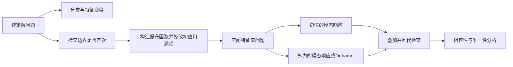
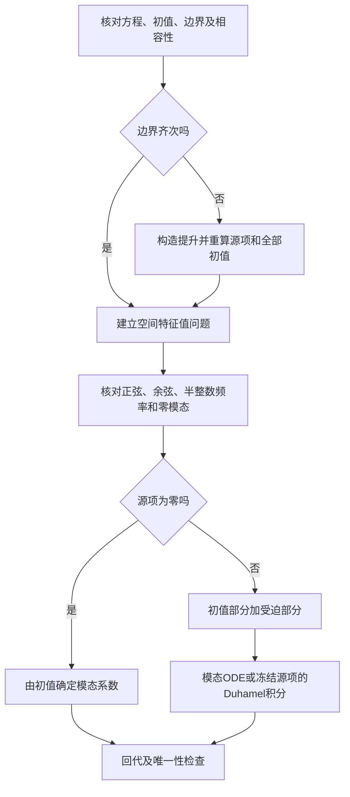

# 2026-10-28 第10节 期中复习：边界齐次化、分离变量与唯一性

> [!info] 本次范围与来源
> 对应第9周星期三第3—4节，教师黎升好，承接10月23日第9节。10月16日停课已在既有课次中扣除，本次第10节不变。依据完整逐字稿、纪要与[[03_Sources/Courses/数学物理方程/板书/数理方程期中复习课板书10.28.pdf|10页课堂板书]]交叉核对；板书页码按PDF页序。
> 本课是考试复习课堂，仍归lecture。新增推导与勘误标作“补充解释”，不冒充教师原话。润色完成只更新polish_status，status仍为not done；本次未提炼原子知识。

## 一、考试通知与阅读路线

### 1. 课堂明确通知

逐字稿01:19:15：**10月30日（本周五）正常上课；11月4日（下周三）考试，100分钟，中间不休息，共5道大题。** 日期由本课2026-10-28及“本周五、下周三”换算。未据此推定考场、精确开考时刻、分值或允许携带物品。

本次复习涉及第二章定解问题与方程分类、第三章有限区间分离变量、非齐次方程及解的理论分析。教师强调：

- 定解问题要会根据情境列写，不要求重演完整物理推导；作业题需独立过一遍。
- 分离变量要写出基本推导、空间特征值与时间方程，不能只报级数答案；无需在每次计算中重写全部正负特征值讨论。
- 傅里叶系数计算很复杂时，教师给出考场取舍建议，但这不等于数学解已经完整算出；平时仍需会用分部积分。
- 波动方程存在性证明本次不作考试要求，但要知道正则性、相容条件与级数论证的关系；**唯一性证明要会做**。
- 四种端点组合的分离过程需自行练习，不只会两端固定的正弦基。

### 2. 先修与主线

- [[03_Sources/Reviews/数学物理方程/知识点解析梳理/02-定解问题与偏微分方程理论-知识梳理|定解与特征变换]]：先区分方程、初值和边值；分类由二阶主部决定。
- [[03_Sources/Reviews/数学物理方程/知识点解析梳理/03-分离变量法-知识梳理|分离变量法]]：空间端点条件决定谱；时间阶数决定初值个数。
- [[03_Sources/Courses/数学物理方程/课堂笔记/2026-10-21-第8节-偏微分方程非齐次边界条件授课|前课边界提升]]：换元后必须同步改方程及初值。
- [[03_Sources/Courses/数学物理方程/课堂笔记/2026-10-23-第9节-偏微分方程初值问题授课|齐次化原理的前课说明]]：外力按冻结时刻的响应积分叠加。

先读二、三复核题设和换元，再读四、五建立统一求解流程；六给出两类方程的唯一性证明；七、八还原本次板书例题及其边界。

## 二、定解问题的列写与二阶方程分类

### 1. 物理情境怎样变成条件

课堂00:00—00:02回顾弦振动与热传导建模。**补充解释：** 弦振动常用形式为
$$
\rho u_{tt}=T u_{xx}-b u_t+F(x,t),
$$
其中 $\rho$ 为线密度、$T$ 为张力、$b\ge0$ 为阻尼系数，$F$ 为单位长度外力；无阻尼、无外力时令相应项为0。它需要初始位移、初始速度两项。这里是说明列写原则的常用模型，不把未确定的作业参数补成课堂题设。

热传导方程是一阶时间方程，只给一个初始温度。固定端、自由端、绝热端、给定温度、给定热流应分别翻译成相应边界；给热流时还须检查坐标方向与外法线方向的符号，不能把“隔热”写成“温度为零”。

> 一句话来说：先写清每个条件描述的是位移、速度、温度还是通量，再选择所需导数。

### 2. 分类与两种换元计算

板书第1—3页、逐字稿00:02—00:07：
$$
Au_{xx}+2Bu_{xy}+Cu_{yy}+Du_x+Eu_y+Fu=0,
\qquad \Delta=B^2-AC.
$$

| 判别式 | 类型 | 本课换元思路 |
|---|---|---|
| $\Delta>0$ | 双曲型 | 两族不同实特征积分，取两个独立新变量 |
| $\Delta=0$ | 抛物型 | 一族重合特征，另取独立变量，常选简单的 $x$ 或 $y$ |
| $\Delta<0$ | 椭圆型 | 课堂用复特征积分的实部、虚部构造实变量，需核对独立性 |

必须注意主部中混合项系数是 **$2B$**；若题目写成 $B u_{xy}$，判别式需按同一约定重新换算。转写把等于0与小于0的类型说乱，以上按板书核正。

设 $\xi=\xi(x,y),\eta=\eta(x,y)$，雅可比不为0才是有效局部坐标。可直接用链式法则展开，也可把主部写为矩阵合同变换。取
$$
K=\begin{pmatrix}A&B\\B&C\end{pmatrix},
\qquad
Q=\begin{pmatrix}\xi_x&\eta_x\\\xi_y&\eta_y\end{pmatrix},
$$
则新主部系数矩阵为 $Q^{\mathsf T}KQ$。课堂提醒矩阵法主要处理二阶主部；低阶项要另外变换。**补充解释：** 非线性换元还会产生新的一阶导数项，不可把二阶主部化简当成整个方程已经化简。

> 一句话来说：先识别主部的几何类型，再找可逆坐标；分类、坐标和完整回代是三个步骤。

## 三、边界齐次化：提升函数要改变整道题

### 1. 只随空间变化的特殊消源法

对
$$
u_{tt}=a^2u_{xx}+f(x),\qquad u(0,t)=h_1,\quad u(L,t)=h_2
$$
且 $h_1,h_2$ 为常数，可尝试 $u=w+v(x)$，使
$$
a^2v''+f=0,\qquad v(0)=h_1,\quad v(L)=h_2.
$$
这样方程和边界可同时齐次化；新初值为 $w(x,0)=\varphi(x)-v(x)$、$w_t(x,0)=\psi(x)$。这是板书第2页的特殊技巧，不适用于任意时间边界。

若源项和边界有 $e^t$、$\sin t$ 等结构，也可尝试相应分离形式的特解；须实际验证其ODE及边界有解，不凭外形相似断言可行。

### 2. 一般提升：方程、位移、速度同时更新

对
$$
u_{tt}=a^2u_{xx}+f(x,t),\quad
u(x,0)=\varphi(x),\quad u_t(x,0)=\psi(x),
$$
令 $u=w+v(x,t)$。则
$$
\boxed{w_{tt}=a^2w_{xx}+g,\qquad g=f+a^2v_{xx}-v_{tt}},
$$
$$
w(x,0)=\varphi(x)-v(x,0),\qquad
w_t(x,0)=\psi(x)-v_t(x,0).
$$
热方程相应变为
$$
\boxed{w_t=a^2w_{xx}+g,\qquad g=f+a^2v_{xx}-v_t},
\qquad w(x,0)=\varphi(x)-v(x,0).
$$

> 一句话来说：提升函数“吃掉”边界数据，但它的空间和时间导数会重新进入方程。

### 3. 本课四种端点组合

以下 $D$ 表示给函数值，$N$ 表示给 $u_x$；本课所谓四种常规组合，不应与某些教材“第三类Robin边界”的分类名称混同。设左、右端数据分别为 $h_1(t),h_2(t)$。

| 端点组合 | 可用的简单提升 $v$ | 核对 |
|---|---|---|
| $D$—$D$ | $h_1+(h_2-h_1)x/L$ | $v(0)=h_1,\ v(L)=h_2$ |
| $N$—$D$ | $h_1x+h_2-Lh_1$ | $v_x(0)=h_1,\ v(L)=h_2$ |
| $D$—$N$ | $h_1+h_2x$ | $v(0)=h_1,\ v_x(L)=h_2$ |
| $N$—$N$ | $h_1x+(h_2-h_1)x^2/(2L)$ | $v_x(0)=h_1,\ v_x(L)=h_2$ |

前三种可从 $A(t)x+B(t)$ 现场解系数；两端导数可能不同时，线性函数的导数相同，不够用，需加二次项。表内公式是把课堂构造法展开后的补充整理；教师要求理解代入，不建议死背 $A,B$。

### 自测（新编）

波动方程源项为0，$u(0,t)=t,\ u(L,t)=t^2$。取线性提升后，求新源项和两项新初值。

> [!hint]-
> 先取 $v=t+(t^2-t)x/L$，分别求 $v_{xx},v_{tt},v(x,0),v_t(x,0)$。

> [!solution]-
> $g=-2x/L$，$w(x,0)=\varphi(x)$，$w_t(x,0)=\psi(x)-(1-x/L)$。边界齐次不代表源项与初值也自动齐次。

## 四、齐次边界决定空间模态

### 1. 波动方程的标准推导

板书第4页。对齐次波动方程，代 $w=X(x)T(t)$：
$$
\frac{X''}{X}=\frac{T''}{a^2T}=-\lambda,
\quad X''+\lambda X=0,\quad T''+a^2\lambda T=0.
$$
分离式在非零因子处推导，最终以满足原方程的模态延拓，不是在节点处除以0。

两端Dirichlet时，
$$
X_n=\sin\frac{n\pi x}{L},\quad
\lambda_n=\left(\frac{n\pi}{L}\right)^2,\quad
\omega_n=a\sqrt{\lambda_n},\qquad n\ge1.
$$
于是
$$
w(x,t)=\sum_{n=1}^\infty
\left(A_n\cos\omega_nt+B_n\sin\omega_nt\right)X_n(x),
$$
$$
A_n=\frac2L\int_0^L\widetilde\varphi(x)X_n(x)\,dx,\qquad
B_n=\frac{2}{L\omega_n}\int_0^L\widetilde\psi(x)X_n(x)\,dx.
$$
这里 $\widetilde\varphi,\widetilde\psi$ 是提升后的初值。$B_n$ 中必须有 $1/\omega_n$，因为对时间正弦求导要产生 $\omega_n$。

> 一句话来说：空间边界给出允许的频率，初值决定每个频率的振幅。

### 2. 四种齐次端点的谱

**课堂要求的补充整理：**

| 齐次边界 | $X_n(x)$ 与波数 $k_n=\sqrt{\lambda_n}$ | 编号 |
|---|---|---|
| $X(0)=X(L)=0$ | $\sin(k_nx),\ k_n=n\pi/L$ | $n\ge1$ |
| $X'(0)=X(L)=0$ | $\cos(k_nx),\ k_n=(2n+1)\pi/(2L)$ | $n\ge0$ |
| $X(0)=X'(L)=0$ | $\sin(k_nx),\ k_n=(2n+1)\pi/(2L)$ | $n\ge0$ |
| $X'(0)=X'(L)=0$ | $\cos(n\pi x/L)$，另有常数模态 | $n\ge0$，$n=0$ 为零模态 |

正弦、非零余弦模态的平方范数为 $L/2$；常数模态平方范数为 $L$。不能在Neumann—Neumann中漏掉平均值，也不能把零频率代入含 $1/\omega_n$ 的公式。波动零模态的时间方程为 $T_0''=0$；热方程零模态为 $T_0'=0$（无源时）。

### 3. 热方程：同一空间谱，不同时间响应

板书第6页及课堂00:40—00:50使用 $X'(0)=0,\ X(L)=0$：
$$
X_n=\cos(k_nx),\qquad k_n=\frac{(2n+1)\pi}{2L},\quad n\ge0.
$$
时间方程与解为
$$
T_n'+a^2k_n^2T_n=0,\qquad T_n=C_ne^{-a^2k_n^2t},
$$
$$
C_n=\frac2L\int_0^L\widetilde\varphi(x)\cos(k_nx)\,dx.
$$
指数中是 $a^2k_n^2t$，不能把板书或转写中的平方丢掉，也不要把波动的三角时间函数照搬到热方程。

## 五、外力怎样进入解：两种等价路线

### 1. 固有函数展开

齐次边界下，将 $g(x,t)$ 按同一空间特征函数展开。记
$$
g_n(t)=\frac{\int_0^Lg(x,t)X_n(x)\,dx}
{\int_0^LX_n(x)^2\,dx}.
$$
波动的零初值受迫部分满足
$$
q_n''+\omega_n^2q_n=g_n(t),\qquad q_n(0)=q_n'(0)=0,
$$
对 $\omega_n>0$，
$$
q_n(t)=\frac1{\omega_n}\int_0^tg_n(\tau)
\sin\bigl(\omega_n(t-\tau)\bigr)\,d\tau.
$$
热方程对应为
$$
q_n'+a^2\lambda_nq_n=g_n(t),\qquad
q_n(t)=\int_0^te^{-a^2\lambda_n(t-\tau)}g_n(\tau)\,d\tau.
$$
这些积分由常数变易法给出，补足板书第5页仅列出的ODE。

### 2. Duhamel（齐次化、冲量）原理

课堂00:30—00:32、板书第5页。对每个固定 $\tau$，让 $P(x,s;\tau)$ 解齐次波动方程，保持原齐次边界，并给
$$
P(x,0;\tau)=0,\qquad P_s(x,0;\tau)=g(x,\tau).
$$
则零初值受迫响应为
$$
q(x,t)=\int_0^tP(x,t-\tau;\tau)\,d\tau.
$$
**冻结的是源项时刻 $\tau$；推进的是响应时间 $s=t-\tau$。** 不能把 $g(x,\tau)$ 也一并改成 $g(x,t-\tau)$，或把初速度误写成初位移。

热方程的对应齐次问题把 $g(x,\tau)$ 作为**初始温度**，不是初速度；积分叠加同理。

> 一句话来说：把持续外力拆成每个时刻的一次瞬时作用，再把响应叠加。

教师更推荐波动非齐次项用齐次化原理，因直接算二阶非齐次ODE可能繁琐；两种路线都可选，空间基始终由边界决定，不能无论何种边界都用 $\sin(n\pi x/L)$。

## 六、求出级数之后：存在性、唯一性与极值原理

### 1. 存在性不能只凭写出形式级数

课堂00:33—00:35提到足够高的光滑性和初边值相容性，借以保证级数及所需导数的收敛。教师以四阶连续可导作复习提示，不是对所有题型给出统一的必要充分条件。教材不同模型的假设不同，本笔记不把“数据属于 $C^4$”单独写成无条件存在定理。

### 2. 波动方程唯一性：能量守恒

设两个足够光滑的解具有相同方程、源项和定解条件，差 $z$ 满足
$$
z_{tt}=a^2z_{xx},\qquad z(x,0)=z_t(x,0)=0
$$
以及相应齐次边界。取
$$
E(t)=\frac12\int_0^L\left(z_t^2+a^2z_x^2\right)\,dx.
$$
由分部积分，
$$
\begin{aligned}
E'(t)
&=\int_0^Lz_tz_{tt}\,dx+a^2\int_0^Lz_xz_{xt}\,dx\\
&=a^2[z_tz_x]_0^L+
\int_0^Lz_t(z_{tt}-a^2z_{xx})\,dx=0.
\end{aligned}
$$
每端若为Dirichlet则 $z_t=0$，若为Neumann则 $z_x=0$，故本课四种组合都消掉边界项。由 $E(0)=0$ 得 $z_t=z_x=0$；所以差为常数，再用零初值得 $z\equiv0$。

> 一句话来说：同一数据的两个解之间没有初始能量，也没有外力或端点输入，差便始终为零。

**补充边界：** 两端Neumann只给导数，不能单靠边界值排除常数；上述证明靠共同初值确定常数。带Robin、阻尼或其他算子的模型需另检查能量形式。

### 3. 热方程最大值原理与唯一性

板书第6—7页、课堂00:52—00:56。对齐次热方程
$$
u_t=a^2u_{xx},\qquad a>0,
$$
在具有相应正则性的闭时空柱上，最大值、最小值受**抛物边界**控制。**补充解释：** 对有限区间，抛物边界为初始边 $t=0$ 以及两侧 $x=0,L$；不是要求预知未来顶边的数据。非齐次任意源项时不能原样套该结论。

对同一Dirichlet数据的两个解，差 $z$ 在抛物边界为0，故 $\max z\le0$、$\min z\ge0$，得 $z=0$。同理，初边值差不超过 $\varepsilon$ 时，齐次差方程的解差也不超过 $\varepsilon$，体现稳定性。

**补充推导：热方程也可用能量。** 对共同齐次差边界，
$$
\frac12\frac d{dt}\int_0^Lz^2\,dx
=a^2[zz_x]_0^L-a^2\int_0^Lz_x^2\,dx\le0.
$$
本课四种组合都能使边界项为0；初始平方范数为0，故差为0。此时是能量耗散，而不是照搬波动方程的守恒能量。

## 七、板书例一：混合边界的受迫波动方程

### 1. 原题与普通提升

板书第7—9页、课堂00:57—01:14，题设为
$$
\begin{cases}
u_{tt}=u_{xx}+e^t,&0<x<2,\ t>0,\\
u(x,0)=x^2,\quad u_t(x,0)=\cos x,\\
u(0,t)=0,\quad u_x(2,t)=e^t.
\end{cases}
$$
取 $v(x,t)=xe^t$、$u=w+v$，则
$$
w_{tt}=w_{xx}+(1-x)e^t,\qquad
w(x,0)=x^2-x,\quad w_t(x,0)=\cos x-x,
$$
$$
w(0,t)=0,\qquad w_x(2,t)=0.
$$
逐项检查：$v_{xx}=0,\ v_{tt}=xe^t$，所以新源项是 $(1-x)e^t$，不能漏掉提升的时间二阶导。

### 2. 模态、初值部分与受迫部分

空间问题
$$
X''+\lambda X=0,\qquad X(0)=X'(2)=0
$$
给出
$$
k_n=\frac{(2n+1)\pi}{4},\qquad
X_n(x)=\sin(k_nx),\qquad n\ge0.
$$
本区间长2，$\int_0^2X_n^2dx=1$，故
$$
A_n=\int_0^2(x^2-x)\sin(k_nx)\,dx,\qquad
B_n=\frac1{k_n}\int_0^2(\cos x-x)\sin(k_nx)\,dx.
$$
令
$$
c_n=\int_0^2(1-x)\sin(k_nx)\,dx,\qquad g_n(\tau)=c_ne^\tau.
$$
板书的Duhamel步骤补全为
$$
q_n(t)=\frac{c_n}{k_n}
\int_0^te^\tau\sin(k_n(t-\tau))\,d\tau.
$$
因此形式级数为
$$
u(x,t)=xe^t+\sum_{n=0}^\infty
\left(A_n\cos k_nt+B_n\sin k_nt+q_n(t)\right)\sin(k_nx).
$$
积分形式已将待算系数明确化。**补充解释：**
$$
q_n(t)=\frac{c_n}{1+k_n^2}
\left(e^t-\cos k_nt-\frac{\sin k_nt}{k_n}\right),
$$
可由 $q_n''+k_n^2q_n=c_ne^t$ 及零初值直接验证；此闭式不是教师原板书答案。

### 3. 课堂尝试与数学勘误

教师先试 $u=\widetilde w+W(x)e^t$。若同时消去源项，正确的ODE与边界为
$$
W''-W=-1,\qquad W(0)=0,\quad W'(2)=1.
$$
课堂尝试二次多项式不能满足这些条件，于是改用普通提升。**补充勘误：多项式试法失败不等于ODE边值问题无解。** 例如
$$
W(x)=1-\cosh x+\frac{1+\sinh2}{\cosh2}\sinh x
$$
确实满足全部三式；也可走这一更复杂的消源路线。正负号由代入得到 $W''-W+1=0$ 核定。保留课堂尝试过程，但不把纪要“无法满足所有边界导致无解”作为定理。

### 4. 题设相容性待确认

> [!warning] 原题不能直接宣称存在闭域光滑经典解
> 若初值和边界均要求光滑延伸到 $t=0$，应有 $\psi(0)=0$，但本题 $\cos0=1$；应有 $\varphi'(2)=e^0=1$，但本题 $(x^2)'_{x=2}=4$。板书与逐字稿均按上面题设计算，未交代这是故意使用广义/形式级数，还是题设漏改。
> 因此这里保留原题和形式求解流程，不改写数据凑相容性，也不声称上述级数在所有角点都有所需的经典正则性。需教师确认题设或解的意义。

## 八、板书例二：热方程、纯导数边界与零模态

### 1. 保留课堂改题过程

板书第10页、课堂01:14—01:18：
$$
u_t=u_{xx}+x,\quad 0<x<2,\qquad u(x,0)=0.
$$
左端 $u_x(0,t)=1$。教师先试右端导数0，随后改为 **$u_x(2,t)=-1$**。最终齐次化针对改后的题，不能把两种边界混成同一道题。

若想用静态 $u=v+w(x)$ 同时消去源项，需
$$
w''=-x,\qquad w'(0)=1.
$$
积分得到 $w'(x)=1-x^2/2$，强制 $w'(2)=-1$。所以右端导数0时这种静态消源方案不成立；它不表示原热方程整个初边值问题无解。右端改为 $-1$ 后可取
$$
w(x)=-\frac{x^3}{6}+x,
$$
加常数也可以，课堂取0。

> 一句话来说：纯导数边界能否容纳稳态，取决于两端通量差与内部源项的平衡。

**补充核对：** 对稳态方程积分，
$$
w'(2)-w'(0)=-\int_0^2x\,dx=-2.
$$
这就是本题必须从左端1配到右端 $-1$ 的原因。

### 2. 齐次化后不能漏常数模态

最终改后题化为
$$
v_t=v_{xx},\quad
v(x,0)=\frac{x^3}{6}-x,\quad
v_x(0,t)=v_x(2,t)=0.
$$
课堂在此让大家自行补上后续常规分离变量。**补充完成：**
$$
v(x,t)=c_0+\sum_{n=1}^\infty c_n
e^{-(n\pi/2)^2t}\cos\frac{n\pi x}{2},
$$
$$
c_0=\frac12\int_0^2\left(\frac{x^3}{6}-x\right)dx=-\frac23,\qquad
c_n=\int_0^2\left(\frac{x^3}{6}-x\right)
\cos\frac{n\pi x}{2}\,dx.
$$
最终 $u=w+v$。零模态来自绝热差边界下保持的平均温度，不能只写从 $n=1$ 开始的衰减项。

**补充边界：** 原始零初温的导数在两角点为0，与给定导数 $1,-1$ 不相容。若要求导数连续直到角点，需另处理相容性；上面的常规展开在 $t>0$ 求解、以适当初值极限解释，不能据此宣称所有角点都光滑。

## 九、解题选择流程

## 十、公式速查与易错点

| 对象 | 公式 | 必要核对 |
|---|---|---|
| 分类 | $\Delta=B^2-AC$ | 混合项写为 $2Bu_{xy}$ |
| 波动提升 | $g=f+a^2v_{xx}-v_{tt}$ | 位移、速度都更新 |
| 热提升 | $g=f+a^2v_{xx}-v_t$ | 只有一项初值 |
| 波动受迫模态 | $q_n=\omega_n^{-1}\int_0^tg_n(\tau)\sin(\omega_n(t-\tau))d\tau$ | 正频率、零初值 |
| 热受迫模态 | $q_n=\int_0^te^{-a^2\lambda_n(t-\tau)}g_n(\tau)d\tau$ | 边界对应的同一空间基 |
| 波动差能量 | $E=\frac12\int(z_t^2+a^2z_x^2)dx$ | 先检查端点项 |
| 静态纯Neumann提升 | $a^2(h_2-h_1)+\int_0^Lf(x)dx=0$ | 数据为坐标导数，稳态消源条件 |

> [!warning] 本课最容易丢失的步骤
> 提升不是只改边界；空间基不能一律用正弦；初速度系数和受迫波动核都带频率分母；纯Neumann必须考虑零模态。
> 多项式猜解失败不说明边值问题无解；稳态不存在不说明演化问题不存在；写出形式级数不证明角点光滑。热极值原理应核对源项及抛物边界。

### 综合自测（新编）

若 $u_t=u_{xx}+x$、$0<x<2$，边界改回 $u_x(0,t)=1,\ u_x(2,t)=0$，不求完整解，判断总量 $M(t)=\int_0^2u(x,t)\,dx$ 的变化率，并说明能否有静态解。

> [!hint]-
> 对方程在空间积分，边界导数差来自 $u_{xx}$ 的积分。

> [!solution]-
> $M'(t)=u_x(2,t)-u_x(0,t)+\int_0^2x\,dx=0-1+2=1$。总量随时间增长，因此不可能有静态解；这与演化方程可以存在随时间变化的解并不矛盾。

## 十一、课堂疑惑与解答、作业与待核实

- 当日“每日疑惑/2026-10-28.md”不存在，无个人疑惑可提取回写；以上辨析来自资料核对，不伪造问题及记录时间。
- 复习任务：独立列写第二章作业定解问题，复核类型与化简；推导四种端点组合的分离过程；补齐板书热例最后的余弦展开。教师未给新的可唯一定位习题编号。
- 待核实：波动例的初边值相容性及预期解的意义。保留原题；未将形式展开标成闭域光滑经典解的存在证明。
- 本课程既有第1—9节均已有资料和已润色记录，本次没有可可靠对应的新缺勤课回填；不因复习范围重复而覆盖前课。

## 十二、来源定位

- [[03_Sources/Courses/数学物理方程/课堂笔记/raw/2026-10-28-偏微分方程考前复习宣讲-684992-逐字稿|完整逐字稿]]：00:00—00:07定解与分类；00:07—00:32波动边界及受迫响应；00:33—00:57理论与热方程；00:57—01:18两例；01:19:15考试通知。原始资料不改写。
- [[03_Sources/Courses/数学物理方程/课堂笔记/raw/2026-10-28-偏微分方程考前复习宣讲-684992-纪要|纪要]]：辅助定位；数学定理、题设和勘误以逐字稿、板书及验算为准。
- [[03_Sources/Courses/数学物理方程/板书/数理方程期中复习课板书10.28.pdf|10月28日板书PDF]]：第1—3页分类与提升，第4—5页波动模态及齐次化，第6—7页热谱及理论，第7—9页波动综合题，第10页热例与边界改动。不是把“文本层为空”当成“没有内容”。
- [[03_Sources/Courses/数学物理方程/课本/数学物理方程 第2版 (李明奇，田太心主编, 主编李明_ (z-library.sk, 1lib/数学物理方程 第2版 (李明奇，田太心主编, 主编李明_ (z-library.sk, 1lib.|教材]]：§3.1能量积分、§3.2热方程极值原理、§3.5非齐次混合问题，用于核对唯一性和模态卷积因子，不采用源MD中的断裂公式。
- [[03_Sources/Courses/数学物理方程/课堂笔记/README|课堂索引]]：查看课次与独立润色状态。
