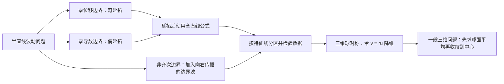
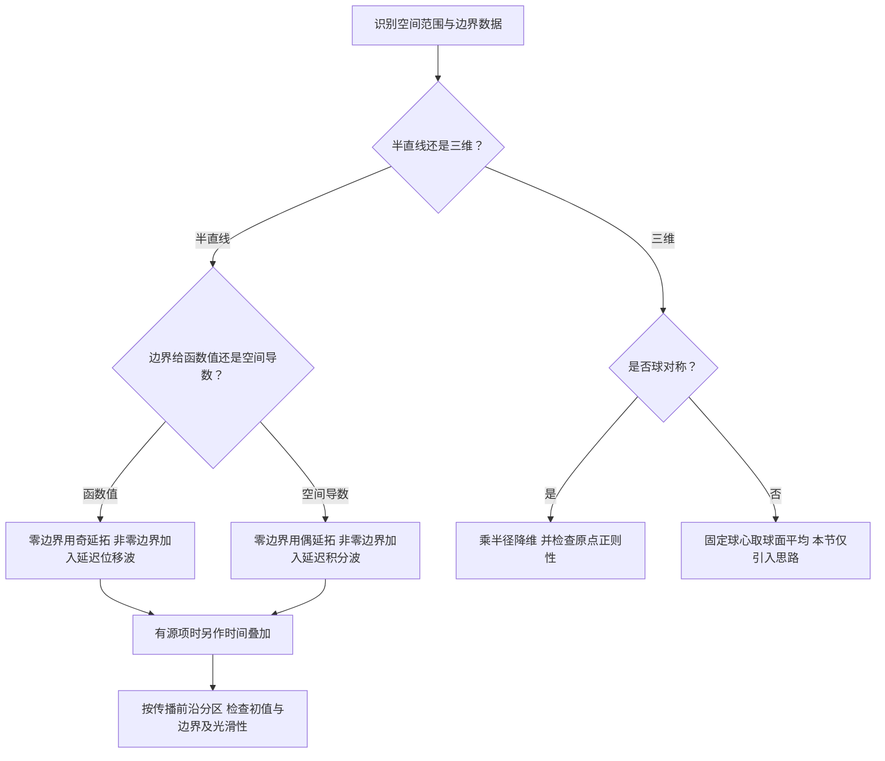

# 2026-10-30 第11节 数学物理方程：半无界波动方程与三维球面平均法导入

> [!info] 本节范围与来源边界
> 依据本节逐字稿、纪要及教材 §4.2、§4.3 开头整理。主线是“边界条件决定延拓方式 → 非齐次边界单独构造 → 球对称降维 → 球面平均法开头”。球面平均满足的方程及三维 Kirchhoff 公式尚未在本节完成推导。录音显示名不作为教师身份依据，课程匹配依据课表、时间及内容。
> 本地未发现本节对应 PPT、演示代码或新增板书；10月28日板书属于上一节复习，不能冒充本节题面。补充推导、自测及来源不确定项均在下文标明。

## 一、本节要解决什么问题

全直线有初始条件即可用 d’Alembert 公式；半直线 $x>0$ 还需要保证端点条件。核心问题是：怎样把“端点固定”“端点导数给定”写进解中？

必要先修：$u_{tt}=a^2u_{xx}$ 的波速是 $a>0$，不是 $a^2$；初位移 $\varphi(x)=u(x,0)$、初速度 $\psi(x)=u_t(x,0)$ 是两个不同数据。回看 [[03_Sources/Courses/数学物理方程/课堂笔记/2026-10-23-第9节-偏微分方程初值问题授课|行波通解与初值问题]]；需要比较有限区间的边界齐次化时，回看 [[03_Sources/Courses/数学物理方程/课堂笔记/2026-10-28-第10节-偏微分方程考前复习宣讲|上一节边界条件与分离变量复习]]。

### 定解问题的几种几何范围（00:00–04:00）

- 全空间 Cauchy 问题：初始数据在整条直线上给定。
- 周期情形：例如 $u(0,t)=u(L,t)$、$u_x(0,t)=u_x(L,t)$，可理解为环上问题，端点相互匹配。
- 有限区间：两端各有适当边界条件。
- 半无界区间：$x>0$，只在 $x=0$ 给一个边界条件，不能凭空增加“右端点”。本节采用延拓和行波构造；后续还会学 Laplace 变换。不能把“本节不采用离散分离变量”理解为半直线完全不能使用谱方法。

## 二、零 Dirichlet 边界：为什么要奇延拓（04:00–17:08）

考虑

$$
u_{tt}=a^2u_{xx},\quad x>0,\ t>0;\qquad
u(x,0)=\varphi(x),\quad u_t(x,0)=\psi(x),\quad u(0,t)=0.
$$

半直线数据没有给出负半轴取值。任意延拓后直接套全直线公式，不能保证边界为零。定义奇延拓

$$
\Phi_o(s)=\begin{cases}\varphi(s),&s>0,\\-\varphi(-s),&s<0,\end{cases}
\qquad
\Psi_o(s)=\begin{cases}\psi(s),&s>0,\\-\psi(-s),&s<0.\end{cases}
$$

奇延拓在零点取零；是否连续、可微，还要检查原数据在端点的相容性。构造

$$
\boxed{u(x,t)=\frac{\Phi_o(x-at)+\Phi_o(x+at)}2
+\frac1{2a}\int_{x-at}^{x+at}\Psi_o(s)\,ds.}
$$

在 $x=0$，前两项因奇性抵消，积分是奇函数在对称区间上的积分，故也为零。再限制到 $x>0$，初始条件仍是原来的 $\varphi,\psi$。

> 一句话来说：负半轴不是另给一组真实数据，而是人为构造出能自动满足固定端边界的“镜像”。

若 $x\ge at$，公式只用正半轴；若 $0<x<at$，需跨过零点拆积分。按教材 §4.2 换元后，后一区域可写成

$$
u(x,t)=\frac{\varphi(x+at)-\varphi(at-x)}2
+\frac1{2a}\int_{at-x}^{at+x}\psi(s)\,ds.
$$

分界 $x=at$ 表示从边界发出的影响刚到达该点，不能漏掉。

### 课堂例1：$a=1,\ \varphi(x)=x,\ \psi(x)=\cos x$

此时 $\Phi_o(s)=s$；$\cos s$ 在全直线上本来是偶函数，但这里要延拓的是它在正半轴的限制，所以 $\Psi_o(s)=\cos s$（$s>0$）、$-\cos s$（$s<0$）。不能直接沿用原有偶函数。

$$
u(x,t)=
\begin{cases}
x+\dfrac{\sin(x+t)-\sin(x-t)}2,&x\ge t,\\[4pt]
x+\dfrac{\sin(x+t)+\sin(x-t)}2,&0<x<t.
\end{cases}
$$

计算依据：$[\Phi_o(x-t)+\Phi_o(x+t)]/2=x$；第二段中

$$
\int_{x-t}^{x+t}\Psi_o(s)\,ds
=-\int_{x-t}^0\cos s\,ds+\int_0^{x+t}\cos s\,ds
=\sin(x-t)+\sin(x+t).
$$

两段在 $x=t$ 取值相同，$x=0$ 时第二段为零，$t=0$ 时第一段给出 $u=x$、$u_t=\cos x$。

> [!warning] 纪要勘误与解的光滑性
> 纪要将首项写成 $x/2$，不符合两项相加的计算及初位移，已依据逐字稿与公式校正为 $x$。
> **补充解释**：$\psi(0)=1$，但固定端要求 $u_t(0,0)=0$，角点一阶相容性不成立。上述解连续、分区满足方程，却不能据此宣称在整条 $x=t$ 上是经典光滑解；这里两侧的一阶导数存在跳变。“函数连续”与“所有阶导数连续”不同。

### 课堂平方初位移例题：保留可确认部分（23:20–25:00）

可确认波速 $a=2$、$\varphi(x)=x^2$、零位移边界；负半轴初位移应延拓为 $-s^2$。逐字稿还明确出现了初速度积分，但初速度具体幂次转写不清，纪要写成 $u_t(x,0)=0$ 缺乏可靠支持，暂不采用。

令待核初速度为 $\psi$，其奇延拓为 $\Psi_o$，本题目前可可靠还原为

$$
u(x,t)=
\begin{cases}
x^2+4t^2+\dfrac14\displaystyle\int_{x-2t}^{x+2t}\psi(s)\,ds,&x\ge2t,\\[6pt]
4xt+\dfrac14\displaystyle\int_{2t-x}^{2t+x}\psi(s)\,ds,&0<x<2t.
\end{cases}
$$

位移项分别来自 $[(x+2t)^2+(x-2t)^2]/2$ 和 $[(x+2t)^2-(x-2t)^2]/2$。只有确认 $\psi=0$ 后才可删除积分。待补本节原题照片/板书核实，不能用上一节题目替换。

## 三、非齐次位移边界：单独构造边界波（25:22–47:36）

当 $u(0,t)=h(t)$，先分成 $u=v+w$：$v$ 满足原初值、零边界；$w$ 满足零初值、给定边界。$v$ 用奇延拓。

对于 $w$，从行波通解 $F(x+at)+G(x-at)$ 出发，取 $F\equiv0$，并令 $G(s)=0$（$s>0$）。于是对每个固定 $x>0$，$w(x,0)=w_t(x,0)=0$。边界条件要求

$$
G(-at)=h(t)\quad\Longrightarrow\quad G(s)=h(-s/a)\quad(s<0).
$$

所以

$$
\boxed{w_D(x,t)=\begin{cases}0,&t<x/a,\\h(t-x/a),&t>x/a.\end{cases}}
$$

> 一句话来说：端点在时刻 $t-x/a$ 产生的信号，经过传播时间 $x/a$ 才到达位置 $x$。

这是构造一种满足所需零初值的解，不是说所有行波通解都必须取 $F=0$。$t=x/a$ 上的赋值与光滑性需按 $h(0)$ 等相容条件处理；$h(0)=0$ 时两侧连续，若还要一阶光滑通常需 $h'(0)=0$。

### 课堂具体边界：$a=1,\ h(t)=t^2$

本节将边界具体化为 $t^2$，得到附加边界波

$$
w_D(x,t)=\begin{cases}0,&x>t,\\(t-x)^2,&0<x\le t.\end{cases}
$$

原初值部分仍由相应 $v$ 处理。录音 47:36 明确补充了分段条件：不能在 $x>t$ 也加上 $(t-x)^2$。此波在传播前沿一阶连续、二阶导数可能跳变，不能把它当成处处 $C^2$ 的函数。

### 方程也非齐次时：拆成三部分（40:14–43:08）

对于 $u_{tt}=a^2u_{xx}+f(x,t)$，原初值 $\varphi,\psi$、边界 $h$，令

$$
u=v+w_D+p.
$$

| 分量 | 方程 | 初始条件 | 边界 |
|---|---|---|---|
| $v$ | $v_{tt}=a^2v_{xx}$ | 原初值 $\varphi,\psi$ | $v(0,t)=0$ |
| $w_D$ | 齐次波动方程 | 零初值 | $w_D(0,t)=h(t)$ |
| $p$ | $p_{tt}=a^2p_{xx}+f$ | 零初值 | $p(0,t)=0$ |

老师说明对源项作时间参数化的齐次初值问题，再延拓、积分还原。**补充展开**：把 $f$ 对空间变量作奇延拓为 $f_o$，相应 Duhamel 表达式是

$$
p(x,t)=\frac1{2a}\int_0^t\int_{x-a(t-\tau)}^{x+a(t-\tau)}f_o(s,\tau)\,ds\,d\tau.
$$

这里 $\tau$ 是激励时刻，每一份激励传播的时长为 $t-\tau$；不能在内层上下限都使用 $at$。资料中的“基岩法”等语音转写不作为新方法名称，应结合语境区分奇延拓与源项的时间叠加。

## 四、零 Neumann 边界：改用偶延拓（49:28–56:25）

现在给 $u_x(0,t)=0$，取

$$
\Phi_e(s)=\varphi(\lvert s\rvert),\qquad
\Psi_e(s)=\psi(\lvert s\rvert).
$$

仍代入同一个全直线公式。其导数在边界为

$$
u_x(0,t)=\frac{\Phi_e'(-at)+\Phi_e'(at)}2
+\frac{\Psi_e(at)-\Psi_e(-at)}{2a}=0.
$$

第一项用“可微偶函数的导数为奇函数”，第二项用偶性。教材此处某段沿用了“保持 $u(0,t)=0$”的措辞，结合本节标题及导数公式应读作“保持 $u_x(0,t)=0$”，不能把两种边界混同。

> 一句话来说：要让函数值在边界为零，用奇镜像；要让导数在边界为零，用偶镜像。

### 课堂对照例：$a=1,\ \varphi(x)=x,\ \psi(x)=\cos x$

偶延拓为 $\Phi_e(s)=\lvert s\rvert$、$\Psi_e(s)=\cos s$，得到

$$
u(x,t)=\frac{\lvert x-t\rvert+x+t}{2}
+\frac{\sin(x+t)-\sin(x-t)}2
=\begin{cases}
x+\cos x\sin t,&x\ge t,\\
t+\cos x\sin t,&0<x<t.
\end{cases}
$$

这是依据老师给出的延拓步骤补全的计算。对 $t>0$，$u_x(0,t)=0$；但 $\varphi'(0)=1$ 与零导数边界的角点条件不相容，$x=t$ 上仍有导数跳变。

## 五、非齐次 Neumann 边界：课后推导补全（57:06–59:49）

老师要求自行完成零初值、$w_x(0,t)=h(t)$ 的构造与积分换元。**下列为补充推导**，并用教材习题4.2第2题参考解核对。

取 $w=G(x-at)$，$G(s)=0$（$s>0$）；由

$$
w_x(0,t)=G'(-at)=h(t)
$$

知 $G'(s)=h(-s/a)$（$s<0$）。选 $G(0)=0$ 并积分：

$$
G(s)=\int_0^s h(-\xi/a)\,d\xi
=-a\int_0^{-s/a}h(\tau)\,d\tau.
$$

因此

$$
\boxed{w_N(x,t)=\begin{cases}0,&t<x/a,\\-a\displaystyle\int_0^{t-x/a}h(\tau)\,d\tau,&t>x/a.\end{cases}}
$$

核验：在已传播区域，$w_x=h(t-x/a)$，故边界导数恰为 $h(t)$；$w_{tt}=a^2w_{xx}$。负号与系数 $a$ 来自变量代换 $\tau=-\xi/a$，不能漏掉。这里给的是坐标导数 $u_x$；半直线左端的外法向导数是 $-u_x$，若题目改成给外法向导数，符号需跟着改变。

非零初值时，加上偶延拓得到的初值解；若另有源项，源项空间变量也作偶延拓，再用时间叠加。经典光滑解同样要检查端点相容性。

## 六、三维球对称：$v=ru$ 为什么能降到一维（01:01:02–01:12:49）

一般三维 Cauchy 问题为

$$
u_{tt}=a^2\Delta u,\qquad \Delta u=u_{xx}+u_{yy}+u_{zz},\qquad
u(M,0)=\varphi(M),\quad u_t(M,0)=\psi(M).
$$

时间仍是一维，三维指空间坐标。先考察关于原点球对称的情形 $u=U(r,t)$，$r=\sqrt{x^2+y^2+z^2}$。球面上距原点相同的点有相同函数值，不依赖角变量。

采用 $x=r\sin\theta\cos\phi$、$y=r\sin\theta\sin\phi$、$z=r\cos\theta$，$\theta\in[0,\pi]$、$\phi\in[0,2\pi)$。球坐标下

$$
\Delta u=\frac1{r^2}\partial_r(r^2u_r)
+\frac1{r^2\sin\theta}\partial_\theta(\sin\theta\,u_\theta)
+\frac1{r^2\sin^2\theta}u_{\phi\phi}.
$$

球对称使角度项消失，于 $r>0$ 有

$$
U_{tt}=a^2\left(U_{rr}+\frac2rU_r\right).
$$

关键恒等式是

$$
(rU)_{rr}=2U_r+rU_{rr},\qquad (rU)_{tt}=rU_{tt}.
$$

所以令 $v=rU$，就有 $v_{tt}=a^2v_{rr}$，从而

$$
\boxed{U(r,t)=\frac{F(r+at)+G(r-at)}{r},\qquad r>0.}
$$

> 一句话来说：乘上半径，恰好把三维径向 Laplace 算子中的 $2U_r/r$ 吸收到二阶导数里。

**补充边界说明**：分子中的两个函数须由初始条件及原点正则性约束，不能随意选取后就宣称是全空间光滑解。若 $U$ 在 $r=0$ 有界，则 $v(0,t)=0$；在径向光滑条件下，可把 $v$ 作奇延拓并用一维公式，再取极限恢复原点值。上式不能直接在 $r=0$ 作除法。这一简单代换有三维特性，不可不加修正推广为所有维度都用 $v=rU$。

## 七、一般三维解：球面平均法只讲到哪里（01:13:31–01:18:40）

一般解并非球对称。固定目标点 $M$，让 $S_r(M)$ 表示以它为球心、半径 $r$ 的球面。定义

$$
\overline u_M(r,t)=\frac1{4\pi r^2}\iint_{S_r(M)}u(M',t)\,dS
=\frac1{4\pi}\int_{\mathbb S^2}u(M+r\omega,t)\,d\Omega.
$$

$M'$ 是球面上的变点，$\omega$ 是单位方向，$dS=r^2d\Omega$，$d\Omega=\sin\theta\,d\theta\,d\phi$，单位球面总立体角是 $4\pi$。第二式改在单位方向球面上积分，避免把物理面积元与立体角混为一谈。

当 $u$ 关于空间连续时，

$$
\lim_{r\to0^+}\overline u_M(r,t)=u(M,t).
$$

**补充解释**：平均值与中心值的差不超过球面上 $\lvert u(M',t)-u(M,t)\rvert$ 的最大值，连续性使该上界趋零。这里不要求原函数本身球对称；我们是在每个固定球心周围取平均。

本节只建立了“求平均值满足的方程 → 解关于 $r,t$ 的问题 → $r\to0$ 恢复目标值”的思路。平均方程的严格推导、Kirchhoff 公式及其传播性质留到后续，不写成老师本节已讲完。

## 八、方法选择与公式速查

| 对象 | 核心表达式 | 使用条件/提醒 |
|---|---|---|
| 全直线初值解 | $[\Phi(x-at)+\Phi(x+at)]/2+(2a)^{-1}\int_{x-at}^{x+at}\Psi(s)\,ds$ | 半直线必须先选合适延拓 |
| 零位移边界 | $\Phi,\Psi$ 都奇延拓 | 检查角点相容性 |
| 零导数边界 | $\Phi,\Psi$ 都偶延拓 | 不能与零位移边界混用 |
| 零初值、位移边界 $h$ | $h(t-x/a)$ | 只在 $t>x/a$；未到达区域为零 |
| 零初值、导数边界 $h$ | $-a\int_0^{t-x/a}h(s)\,ds$ | 这里边界是 $u_x=h$ |
| 三维径向降维 | $v=rU,\ v_{tt}=a^2v_{rr}$ | $r>0$ 推导，原点另取正则极限 |
| 球面平均 | $(4\pi r^2)^{-1}\iint_{S_r(M)}u\,dS$ | 面积归一化，$r\to0$ 恢复中心值 |

> [!warning] 本节最容易漏的条件
> 1. 延拓的是初始数据及必要的源项，不是任意把最终解换成奇函数或偶函数。
> 2. $x-at$ 可能为负；边界波必须带上传播分区。
> 3. 非齐次导数边界要积分，不能照抄位移边界 $h(t-x/a)$。
> 4. 逐段满足 PDE、函数连续，并不自动代表整体经典解存在。
> 5. 球面平均趋于中心值靠连续性，不表示任意半径的平均值都等于中心值。

## 九、作业与自测

课堂 01:01:02 明确布置教材**习题4.2第1题**，另要求自行写出非齐次导数边界的积分构造并完整做一个例子。教材第1题为 $\varphi=\sin x,\psi=\cos x,u(0,t)=0$，与课堂首例 $\varphi=x$ 不同。题面与参考解见下方教材链接的“习题4.2”，不可相互替换。

另有用户当日上传的 [[03_Sources/Courses/数学物理方程/作业/10月30日课堂检测|10月30日课堂检测及解答]]，考查特征坐标化简；这是独立已存在的题目，不冒充本节录音内可辨识的完整板书。

### 自测（新编）1：边界信号何时到达

设 $a=2$，零初值，给定 $u_x(0,t)=t$。求 $u(x,t)$，并计算 $u(1,1)$、验证边界导数。

> [!hint]- 提示
> 先比较 $t$ 与 $x/2$；在已经传播的区域，把 $h(s)=s$ 代入导数边界波的积分式。

> [!solution]- 解析
> $t<x/2$ 时 $u=0$；$t\ge x/2$ 时 $u=-(t-x/2)^2$，故 $u(1,1)=-1/4$。已传播区域 $u_x=t-x/2$，在 $x=0$ 为 $t$；$u_{tt}=-2$、$u_{xx}=-1/2$，满足 $u_{tt}=4u_{xx}$。前沿两侧一阶连续，二阶不全连续。

### 自测（新编）2：辨认“镜像”和原点条件

同样的正半轴初位移 $\varphi(x)=x^2$、初速度零，在 $a=2$ 时，分别给零位移边界、零导数边界，写出两种解。再说明三维径向通解为何不能在 $r=0$ 直接除以 $r$。

> [!hint]- 提示
> $x^2$ 的奇延拓为 $s\lvert s\rvert$，偶延拓为 $s^2$；只需计算 d’Alembert 公式的位移项。

> [!solution]- 解析
> 零位移边界：$x\ge2t$ 时 $u=x^2+4t^2$，$0<x<2t$ 时 $u=4xt$。零导数边界：$u=x^2+4t^2$，满足 $u_x(0,t)=0$。前一种解的二阶导数在前沿有跳变，源于更高阶相容性问题。三维径向解若要原点有界，分子必须相应趋零；须检查正则性并取极限，不能直接用 $1/0$。本自测明确指定了零初速度，不能反向作为课堂待核平方例题的题面证据。

## 十、课堂疑惑与解答（待核项）

- **待核题面**：23:20–25:00 平方初位移例题的初速度具体是什么？保留已确认的 $a=2,\varphi=x^2$ 及通用积分式，待本节板书或题面确认。
- **考试安排**：本节末尾转写出现“204、205”等片段，但无法可靠辨识具体考场分配，不写成确定通知。上一节已确认的考试安排仍回看上一节，不用噪声更改。
- 今日「每日疑惑/2026-10-30.md」未找到，因此本次没有新增日计划问答，不虚构问题记录及时间。

## 十一、来源与后续衔接

- [[03_Sources/Courses/数学物理方程/课堂笔记/raw/2026-10-30-波动方程半无界问题与高维推广课程-311872-逐字稿.md|原始逐字稿]]：保留课堂步骤、例题、同学提醒补充分段及后续教学边界；录制时间14:31:09–16:07:45。
- [[03_Sources/Courses/数学物理方程/课堂笔记/raw/2026-10-30-波动方程半无界问题与高维推广课程-311872-纪要.md|智能纪要]]：仅辅助定位，公式与不清题面以逐字稿、教材及实际验算交叉检查。
- [[03_Sources/Courses/数学物理方程/课本/数学物理方程 第2版 (李明奇，田太心主编, 主编李明_ (z-library.sk, 1lib/数学物理方程 第2版 (李明奇，田太心主编, 主编李明_ (z-library.sk, 1lib.]]：§4.2核对奇偶延拓与习题4.2，§4.3开头核对球坐标、径向降维与球面平均定义。教材排版/OCR残留未照搬。
- 后续应接上球面平均函数满足的方程与三维初值公式，本节不预先标记为已完成内容。
