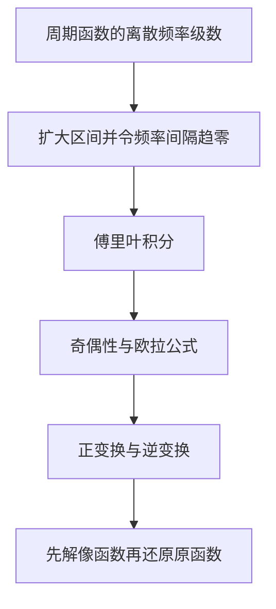

# 2026-11-06 第13节 数学物理方程：从傅里叶级数到傅里叶变换

## 一、本节范围与阅读路线

核心问题：周期函数可以用离散频率的傅里叶级数表示，整条实轴上的非周期函数怎样表示？本次由周期趋于无穷大引出傅里叶积分，再定义正、逆变换，解释为什么可以先求像函数来解方程。

必要先修：三角级数、黎曼和、奇偶函数积分、欧拉公式$e^{i\theta}=\cos\theta+i\sin\theta$。先看第二节回顾，再沿第三至第五节阅读推导和变换对；不熟悉边界问题时可回看[[03_Sources/Courses/数学物理方程/课堂笔记/2026-10-30-第11节-波动方程半无界问题与高维推广课程|上一份有录音的笔记]]，但它不能代替缺失课次。

> [!warning] 录制范围与来源边界
> 课表本日安排14:30—16:05，实际本段录制15:25:34—16:08:12，不能据此声称覆盖整堂课。开头已经在处理上文公式，相关前段推导不完整；00:00:52开始收束第四章，00:02:37转入第五章。00:20:50表示例题留待下课、开始检测，00:24:15补充复习要求；后段没有足够可用教学转写。不猜测前段内容、检测题或学生作答。

逐字稿与教材§5.1核对使用；当前未找到可靠匹配本次的PPT、转换课件或演示代码。既有10月28日板书是考前复习，不当作今日第五章课件。以下推导按课堂主线、教材校正；额外的严格条件、积分解释和自测均明确标出。

## 二、第四章收束与傅里叶级数回顾

### 2.1 本课保留的第四章信息

00:00:05提到把参数积分中的某个量变为$t$，但依赖未完整录入的前式，不能单据这句话写出完整推导。00:02:01概括已处理一维、三维波动方程，第三类边界的相关问题更复杂，本段不继续展开。“完成时态替”等纪要词语无数学意义，不能当作新概念保留。

作业原话位置00:00:52：§4.3第1题；§4.4“14”的读法不清，详见第八节待核项。第五章计划学习傅里叶与拉普拉斯变换。教材说明前者常用于全空间无界问题，后者常用于半无界变量、尤其时间方向；不能把两种变换机械分成“只处理初值/只处理边值”。

### 2.2 周期级数怎样取值

设$f$以$2L$为周期。在一个周期内分段光滑，是本节可用的一组充分条件（教材也列出有限第一类间断点和有限极值点的Dirichlet条件）。不是只要间断点有限就对任意函数自动保证全部收敛结论。

$$
\frac{a_0}{2}+\sum_{n=1}^{\infty}\left[a_n\cos\frac{n\pi x}{L}+b_n\sin\frac{n\pi x}{L}\right],
$$

$$
a_n=\frac1L\int_{-L}^{L}f(s)\cos\frac{n\pi s}{L}\,ds,\qquad
b_n=\frac1L\int_{-L}^{L}f(s)\sin\frac{n\pi s}{L}\,ds.
$$

用$s$作积分哑变量，$x$是要求函数值的位置。连续点级数收敛到$f(x)$；跳跃或可去间断点按两侧极限平均取值：

$$
f_*(x):=\frac{f(x-0)+f(x+0)}2.
$$

连续时$f_*(x)=f(x)$；可去间断点也不能直接用任意指定的点值。若只给$[-L,L]$内函数，可先作周期延拓；接缝处的两侧极限由延拓决定。课堂00:03:38—00:06:54重点区分了第一类间断点与无穷、振荡型间断，不据此承诺后两者也满足同一结论。

> 一句话来说：级数恢复的是合适的局部极限值，单点怎么另行赋值不会改变积分系数。

## 三、周期变大：离散频率怎样变成连续频率（核心）

课堂00:06:54—00:13:44。对实轴上的非周期$f$，先限制在$[-L,L]$，再作周期延拓。代入$a_n,b_n$，利用$\cos A\cos B+\sin A\sin B=\cos(A-B)$，得

$$
f_*(x)=\frac1{2L}\int_{-L}^{L}f(s)\,ds
+\frac1L\sum_{n=1}^{\infty}\int_{-L}^{L}f(s)\cos\frac{n\pi(s-x)}{L}\,ds.
$$

这里$f_*$对应区间内部取值，端点按周期延拓处理。设

$$
\Delta\omega=\frac\pi L,\qquad \omega_n=n\Delta\omega.
$$

当$L\to\infty$时，频率间隔$\Delta\omega\to0$，且$1/L=\Delta\omega/\pi$。因此级数项形如

$$
\frac1\pi\sum_{n=1}^{\infty}\Delta\omega
\int_{-L}^{L}f(s)\cos\big(\omega_n(s-x)\big)\,ds.
$$

课堂用黎曼和直觉将求和过渡到积分。教材在$f\in L^1(\mathbb R)$且每个有限区间分段光滑的条件下给出傅里叶积分结论：

$$
\boxed{f_*(x)=\frac1\pi\int_0^\infty
\left[\int_{-\infty}^{\infty}f(s)\cos\big(\omega(s-x)\big)\,ds\right]d\omega}.
$$

补充解释：$a_0/2$对应的第一项随$L\to\infty$趋零，因为其绝对值不超过$\lVert f\rVert_1/(2L)$。这不表示频率零附近的信息消失，而是单个离散频点的权重趋零。

此处是**结论与推导思路**，不是仅凭“看起来像黎曼和”就完成了所有极限交换的严格证明。外层积分可需按对称截断/广义积分理解；$f\in L^1$本身不保证$\hat f\in L^1$，不能随意对双积分使用绝对收敛的Fubini交换规则（补充理解）。

> 一句话来说：周期越长，频率点越密；整条实轴上的频谱要用连续频率积分表示。

## 四、奇偶性与欧拉公式怎样得到复指数

课堂00:13:44—00:16:42。

1. 对固定$x,s$，$\cos\big(\omega(s-x)\big)$关于$\omega$为偶函数，半轴积分变全轴时须补上$1/2$：

$$
f_*(x)=\frac1{2\pi}\int_{-\infty}^{\infty}
\left[\int_{-\infty}^{\infty}f(s)\cos\big(\omega(x-s)\big)\,ds\right]d\omega.
$$

2. 对应的正弦项关于$\omega$为奇函数，在对称截断$[-R,R]$上的积分为0。此时内部$s$积分由$f\in L^1$保证有意义，不需假定外层绝对可积。
3. 加上这个为零的虚部，再用欧拉公式，核变为

$$
\cos\big(\omega(x-s)\big)+i\sin\big(\omega(x-s)\big)
=e^{i\omega(x-s)}=e^{i\omega x}e^{-i\omega s}.
$$

这就把式子拆成“先对$s$变换，再对频率还原”的两步。转写中的“1/2”“1/200”应结合教材识别为$1/(2\pi)$，不能直接抄进公式。

## 五、傅里叶变换对与互逆性的边界

课堂00:17:13—00:20:09。本节沿用教材的角频率约定：

$$
\boxed{\hat f(\omega)=\mathcal F[f](\omega)
=\int_{-\infty}^{\infty}f(s)e^{-i\omega s}\,ds},
$$

$$
\boxed{\mathcal F^{-1}[\hat f](x)=\frac1{2\pi}
\int_{-\infty}^{\infty}\hat f(\omega)e^{i\omega x}\,d\omega=f_*(x)}.
$$

连续点还原$f(x)$，间断点在上述充分条件下还原左右极限平均值。逆积分不绝对收敛时，按相应对称截断极限解释。若还满足$\hat f\in L^1$，逆积分可以按通常绝对收敛积分处理。

> 一句话来说：正变换把函数编码成频率的像函数，逆变换按同一套符号和常数约定还原它。

### 5.1 三个必须校正的纪要表述

- $e^{\pm i\omega x}$在实变量下模长为1，是**振荡因子**，不是指数衰减或增长。拉普拉斯变换的实指数因子与此不同。
- 本约定逆变换系数是$1/(2\pi)$；也可正逆各放$1/\sqrt{2\pi}$，或换用普通频率$\nu$及核$e^{-2\pi i\nu x}$。可以换约定，不能在同一组公式中随意漏掉常数。课堂说理论分析有时暂忽略常数，不能理解为精确计算可无条件省略。
- 教师用“能变回去所以一一对应”解释可逆性。严格地说，在适当函数类及一致约定下有逆；对$L^1$函数通常按几乎处处相等识别。改变单个点值不会改变傅里叶变换，因此不应声称对任意逐点不同的函数都有不同频谱（补充理解）。

## 六、积分变换解PDE的思想（本次尚未做具体题）

教师00:19:21—00:20:50强调：不直接求原函数，先求像函数，再逆变换。教材章节导言补充说明，这常把偏微分方程变为关于剩余变量的常微分方程，也可能把常微分方程转为代数关系。

图中最后一步是补充的方法核查要求。教师本次把具体例子留待下一节，**没有在本段完成高斯热核例、导数变换公式、卷积性质或完整PDE求解**；不把教材后续内容机械并入本堂课。

## 七、核心公式速查与易错点

| 关系 | 公式或条件 |
|---|---|
| 频率网格 | $\omega_n=n\pi/L,\ \Delta\omega=\pi/L$ |
| 连续点与间断点 | 连续点取$f(x)$，合适间断点取$f_*(x)$ |
| 正变换 | $\hat f(\omega)=\int_{\mathbb R}f(s)e^{-i\omega s}\,ds$ |
| 逆变换 | $f_*(x)=(2\pi)^{-1}\int_{\mathbb R}\hat f(\omega)e^{i\omega x}\,d\omega$ |
| 本节可用充分条件 | $f\in L^1(\mathbb R)$，有限区间上分段光滑；逆积分按相应极限解释 |

> [!warning] 易错点
> 不漏掉级数的$a_0/2$，不把半轴积分改全轴而丢掉$1/2$，不把$1/(2\pi)$抄成$1/2$。正变换的负号和逆变换的正号须配套。积分哑变量$s$与求值点$x$不能混用。仅有绝对可积不能替代所有逐点反演条件，也不能推出频谱绝对可积。

## 八、作业、检测与自测

- **课堂作业**（00:00:52）：完成§4.3第1题。
- **待核作业**：同段转写是“4.4……考虑一下14”，自动纪要写“第14题”，也可能是“第1、4题”的连读。缺少板书或作业截图，不替用户确定编号，暂记“§4.4相关习题，编号待核”。
- **课堂检测**：00:20:50开始转入检测，未取得题面，不补造。00:24:15要求保留复习检测题作为期末复习资料，并表示期中题与检测内容联系紧密；这不是对未来考试原题或考点覆盖的保证。

### 自测1：计算一个简单变换（新编，补充例子）

令$f(x)=1$当$\lvert x\rvert<a$、否则为0，其中$a>0$。求$\hat f(\omega)$、$\hat f(0)$，并说明反演在$x=a$应取什么值。

> [!hint]- 提示
> 只需在$[-a,a]$积分；$\omega=0$单独计算，端点按左右极限平均。

> [!solution]- 解析
> $\omega\ne0$时$\hat f(\omega)=[e^{-i\omega s}/(-i\omega)]_{-a}^a=2\sin(a\omega)/\omega$；$\hat f(0)=2a$，也等于上述表达的连续延拓。在$x=a$反演取$(1+0)/2=1/2$，即使原定义点值为0也不变。这个频谱不绝对可积，提示逆积分的截断含义确有必要。

### 自测2：常数约定检查（新编）

若正变换前放常数$A$、逆变换前放常数$B$，核仍分别是$e^{-i\omega x}$与$e^{i\omega x}$，两者乘积应满足什么关系？

> [!hint]- 提示
> 与本节$A=1,B=1/(2\pi)$比较。

> [!solution]- 解析
> $AB=1/(2\pi)$。例如对称约定$A=B=1/\sqrt{2\pi}$。若两个都直接取1，复合结果多出$2\pi$，不能声称仍精确互逆。

## 九、课堂疑惑与解答

本次检查的11月6日日计划不存在，未补造个人疑惑。课堂关于“为何能先求像函数”的问题已在第五、六节说明；个人问答留待有原问题及时间后按对应记录回写。

## 十、来源、衔接与待补

- [[03_Sources/Courses/数学物理方程/课堂笔记/raw/2026-11-06-积分变换与傅里叶变换课程-409216-逐字稿.md|原始逐字稿]]：范围、作业和讲授顺序依据。
- [[03_Sources/Courses/数学物理方程/课堂笔记/raw/2026-11-06-积分变换与傅里叶变换课程-409216-纪要.md|原始纪要]]：辅助定位；已在正文纠正振荡因子、常数及作业编号不确定性。
- [[03_Sources/Courses/数学物理方程/课本/数学物理方程 第2版 (李明奇，田太心主编, 主编李明_ (z-library.sk, 1lib/数学物理方程 第2版 (李明奇，田太心主编, 主编李明_ (z-library.sk, 1lib..md]]：§5.1第一部分核对级数条件、傅里叶积分及变换对；后续性质、正余弦变换和例题未计为本次已讲内容。教材中的$i/j$均表示虚数单位，本笔记统一用$i$。
- [[00_Inbox/课堂录音/缺失记录/数学物理方程/2026-11-04-第12节-缺少逐字稿|11月4日资料缺失记录]]：原有考前宣讲明确安排期中考试，缺试题/讲评来源时不能还原题面。本次转入第五章不能用来推造考试内容。
- [[03_Sources/Courses/数学物理方程/课堂笔记/README|课堂索引]]：保留课次和资料范围。待补本日录制前段、§4.4习题编号及课堂检测题。
