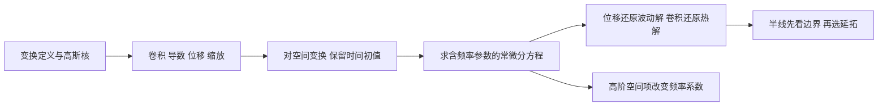
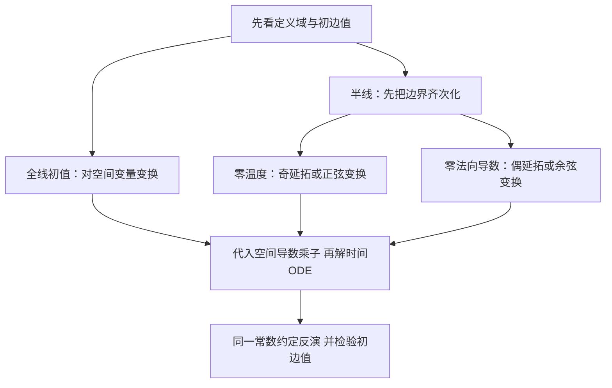

# 2026-11-11 第14节 数学物理方程：傅里叶变换的性质与初边值问题

> [!info] 资料与记号
> 依据本次完整逐字稿、纪要及本地教材§5.1、§5.2核对。正变换用负指数，逆变换用正指数与$1/(2\pi)$；$i^2=-1$，$a>0$。课堂账号名不作为教师身份依据。下文明确区分课堂论证、补足的严谨条件和新编自测；原始转写与纪要不改写。分段函数题的系数、末段高阶方程的完整原题没有可靠板书，不把教材另一题直接充作原题。

## 一、本节问题、先修与路线

核心问题：怎样把空间微分变为频率乘法，从而将偏微分方程变成关于时间的常微分方程？本次先建立高斯变换对、正余弦变换和基本性质，再完整求解全线波动、全线热传导，继而讨论反应项、半线边界和含四阶空间导数的方程。

先修是分部积分、积分换元、欧拉公式、常系数ODE与初值。回看 [[03_Sources/Courses/数学物理方程/课堂笔记/2026-11-06-第13节-积分变换与傅里叶变换课程|第13节的变换定义与反演条件]]：

$$
\hat f(\omega)=\mathcal F[f](\omega)=\int_{\mathbb R}f(x)e^{-i\omega x}\,dx,\qquad
f(x)=\frac1{2\pi}\int_{\mathbb R}\hat f(\omega)e^{i\omega x}\,d\omega.
$$

最后一式在相应反演条件下成立，间断点须按左右极限平均理解。

## 二、高斯核：这次求的是逆变换（00:45–10:36）

课堂目标与教材§5.1例1一致：

$$
\boxed{K_a(x,t):=\mathcal F^{-1}[e^{-a^2\omega^2t}](x)
=\frac1{2a\sqrt{\pi t}}e^{-x^2/(4a^2t)}},\qquad t>0.
$$

因此$\mathcal F_x[K_a](\omega,t)=e^{-a^2\omega^2t}$。纪要把前式称成正变换，方向需要校正。

课堂按配方和高斯积分推导：

$$
-a^2t\omega^2+i\omega x
=-a^2t\left(\omega-\frac{ix}{2a^2t}\right)^2-\frac{x^2}{4a^2t}.
$$

**补充严谨性**：配方里的“均值”是复数，不能直接当成实正态随机变量的均值套概率密度积分。无需复积分的验证如下。令$A=a^2t>0$，

$$
I(x)=\int_{\mathbb R}e^{-A\omega^2}e^{i\omega x}\,d\omega.
$$

高斯衰减允许积分下求导。分部积分且边界项为零给

$$
I'(x)=i\int\omega e^{-A\omega^2}e^{i\omega x}\,d\omega
=-\frac{x}{2A}I(x).
$$

又$I(0)=\sqrt{\pi/A}$，所以$I(x)=\sqrt{\pi/A}e^{-x^2/(4A)}$。再乘$1/(2\pi)$即得$K_a$，也核对了常数。

> 一句话来说：频域的高斯衰减因子反演成空间高斯核，它将成为热方程解的构件。

### 对“必须指数衰减”的校正

课堂09:09–10:36和纪要把直接变换的要求说得过强。通常绝对收敛定义只要求$f\in L^1(\mathbb R)$，不要求指数衰减。例如$f(x)=1/(1+x^2)$仅有多项式衰减，却绝对可积。$1/|x|$的无穷远尾部不可积，而$1/x^2$的无穷远尾部可积；后者若不修正零点奇性，仍会在零点不可积。不可把“无穷远衰减”与“全实轴可积”混同。

直接积分往往难算是实际困难，但不是所有傅里叶变换的存在性限制；$L^2$和广义函数也有相应理论，本课只在用到时注明范围。

## 三、正弦、余弦变换来自奇偶性（11:04–13:33）

对定义在$x>0$的函数，采用教材约定

$$
\hat f_c(\omega)=\int_0^\infty f(x)\cos(\omega x)\,dx,\qquad
f(x)=\frac2\pi\int_0^\infty\hat f_c(\omega)\cos(\omega x)\,d\omega,
$$

$$
\hat f_s(\omega)=\int_0^\infty f(x)\sin(\omega x)\,dx,\qquad
f(x)=\frac2\pi\int_0^\infty\hat f_s(\omega)\sin(\omega x)\,d\omega.
$$

偶延拓$f_e(x)=f(|x|)$有$\mathcal F[f_e]=2\hat f_c$，因为正弦项为奇函数积分为零。奇延拓$f_o(x)=\operatorname{sgn}(x)f(|x|)$有$\mathcal F[f_o]=-2i\hat f_s$。把这些关系代入全线逆变换即可得到$2/\pi$，不能只写原逆变换的$1/(2\pi)$。

课堂详细讲了余弦变换，并指出正弦变换按奇函数同理；正弦的完整公式在此由教材补齐。

> 一句话来说：正余弦变换把半线问题放进合适的奇偶全线函数中。

## 四、卷积为什么变成乘积（14:03–26:30）

### 1. 线性与卷积定义

积分的线性直接给$\mathcal F[\alpha f+\beta g]=\alpha\hat f+\beta\hat g$。卷积定义为

$$
(f*g)(x)=\int_{\mathbb R}f(y)g(x-y)\,dy.
$$

令$s=x-y$并调整积分方向，得到$f*g=g*f$。**补足条件**：对$f,g\in L^1$，卷积几乎处处定义且属于$L^1$，并有$\|f*g\|_1\le\|f\|_1\|g\|_1$。

### 2. 卷积定理的课堂证明

$$
\begin{aligned}
\mathcal F[f*g](\omega)
&=\int_{\mathbb R}\int_{\mathbb R}f(y)g(x-y)e^{-i\omega x}\,dy\,dx\\
&=\int_{\mathbb R}f(y)e^{-i\omega y}\,dy
\int_{\mathbb R}g(s)e^{-i\omega s}\,ds
=\hat f(\omega)\hat g(\omega).
\end{aligned}
$$

中间换元$s=x-y$，频率因子拆成$e^{-i\omega y}e^{-i\omega s}$。换序的依据不是“积分都在实轴上”，而是二重绝对值积分等于$\|f\|_1\|g\|_1<\infty$，可用Fubini定理。

### 3. 乘积定理别漏系数

在能使用反演并换序的条件下（例如$f,g$为Schwartz函数），

$$
\boxed{\mathcal F[fg]=\frac1{2\pi}(\hat f*\hat g)}.
$$

证明按课堂思路：将$g(x)=(2\pi)^{-1}\int\hat g(\mu)e^{i\mu x}d\mu$代入$\int f(x)g(x)e^{-i\omega x}dx$，换序后内部积分为$\hat f(\omega-\mu)$，故

$$
\mathcal F[fg](\omega)=\frac1{2\pi}\int_{\mathbb R}\hat g(\mu)\hat f(\omega-\mu)\,d\mu.
$$

> 一句话来说：原空间卷积对应频率乘积，原空间乘积对应频率卷积，并带$1/(2\pi)$。

## 五、求导、积分与位移的性质（26:30–38:03）

下表统一按本课负指数约定。为避免隐藏存在性问题，可先在Schwartz函数类验证多数公式；再按具体问题放宽条件。

| 操作 | 变换公式 |
|---|---|
| 原函数$n$阶求导 | $\mathcal F[f^{(n)}]=(i\omega)^n\hat f$ |
| 像函数求导 | $\partial_\omega\hat f=\mathcal F[-ixf]$ |
| 空间位移 | $\mathcal F[f(x-x_0)]=e^{-i\omega x_0}\hat f(\omega)$ |
| 调制 | $\mathcal F[e^{i\omega_0x}f(x)]=\hat f(\omega-\omega_0)$ |
| 缩放，$b\ne0$ | $\mathcal F[f(bx)]=(1/\vert b\vert)\hat f(\omega/b)$ |
| 能量恒等式 | $\int_{\mathbb R}\vert f\vert^2dx=(2\pi)^{-1}\int_{\mathbb R}\vert\hat f\vert^2d\omega$ |

### 1. 导数公式：边界项为何能去掉

$$
\begin{aligned}
\mathcal F[f']&=\int_{\mathbb R}f'(x)e^{-i\omega x}\,dx\\
&=[f(x)e^{-i\omega x}]_{-\infty}^{\infty}
+i\omega\int_{\mathbb R}f(x)e^{-i\omega x}\,dx=i\omega\hat f.
\end{aligned}
$$

**补充条件**：例如$f$局部绝对连续、$f,f'\in L^1$，可得$f(\pm\infty)=0$；高阶公式相应要求低阶导数边界项消失与可积性，或统一用Schwartz条件。单凭$f\in L^1$不能保证逐点$f(x)\to0$，也不能保证其导数自动快速衰减。转写中的这些口语推断不当作定理。

由归纳法得$n$阶公式，特别是$\mathcal F[f'']=-\omega^2\hat f$、$\mathcal F[f^{(4)}]=\omega^4\hat f$。这两处正负号决定后续PDE的性质。

像函数求导则直接对核求导：若$xf\in L^1$，$\partial_\omega\hat f=\int(-ix)f(x)e^{-i\omega x}dx$。

### 2. 位移、调制和缩放各改变什么

空间位移令$s=x-x_0$，核成为$e^{-i\omega(s+x_0)}$，给负号相位；调制把核合并为$e^{-i(\omega-\omega_0)x}$，故频谱向$\omega_0$平移。缩放令$s=bx$，当$b<0$还要交换上下限，所以系数是$1/|b|$而非$1/b$。

### 3. 积分性质的零频限制（35:06–36:33）

课堂把积分看成导数的逆运算，写出

$$
q(x)=\int_{-\infty}^xf(s)\,ds,\qquad
\hat q(\omega)=\frac{\hat f(\omega)}{i\omega}\quad(\omega\ne0).
$$

**必须补足**：只有当$q$也有可用的傅里叶变换，且导数公式适用时，才可由$q'=f$得到上式。经典$L^1$框架可要求$q\in L^1$、$f\in L^1$及相应正则性，特别要有$\int f=0$使$q$在两端均能趋零。即使总积分为零，也还要检查$q$的可积性。不能直接在$\omega=0$除以零；零频由极限或原定义确定。若$\int f\ne0$，$q$通常一端趋于非零常数，需广义函数框架及零频项，本文不把该情形塞进普通函数除法。

### 4. Parseval的常数

课堂37:05–38:03提到原函数与像函数的$L^2$模关系。按本约定$\|\hat f\|_2=\sqrt{2\pi}\|f\|_2$，不是两个范数直接相等。等距形式要把正变换再除以$\sqrt{2\pi}$。对复值函数必须写绝对值平方，不能一概用$f^2$。

> 一句话来说：空间求导变成乘$i\omega$，但积分、零频和边界项必须连同适用条件一起处理。

## 六、冲激与分段函数例题（38:23–49:49）

### 1. 冲激的变换

按抽样性质，在广义函数意义下

$$
\mathcal F[\delta(x)]=1,\qquad
\mathcal F[\delta(x-x_0)]=e^{-i\omega x_0}.
$$

因为$\int\delta(x-x_0)h(x)dx=h(x_0)$。冲激不是普通可积函数，不与前面的经典$L^1$定义混为一谈。

### 2. 分段奇函数：可恢复的计算与缺失题面

转写能确认：例题仅在$(-2,2)$内非零，课堂利用奇偶性约掉余弦项，再对$x\sin(\omega x)$分部积分。非零段的精确系数缺少可靠转写，故**不将教材§5.1例4的$2x,|x|<1$冒作本课原题**。

**按已确认结构作参数化补充解释**：设$h_c(x)=cx$当$|x|<2$、否则为零，$c$仅表示待核系数。则$\omega\ne0$时

$$
\begin{aligned}
\hat h_c(\omega)
&=-2ic\int_0^2x\sin(\omega x)\,dx\\
&=-2ic\left[-\frac{x\cos(\omega x)}\omega+\frac{\sin(\omega x)}{\omega^2}\right]_0^2\\
&=\frac{4ic\cos(2\omega)}\omega-\frac{2ic\sin(2\omega)}{\omega^2}.
\end{aligned}
$$

$\hat h_c(0)=\int h_c=0$；上式奇点可去。小频率展开为$-(16/3)ic\omega+O(\omega^3)$，与$\hat h_c'(0)=-i\int xh_c(x)dx$一致。这是对计算结构的核验，**不是已经确定$c$**。原题精确系数和教师最终板书值仍待原图或清晰音频。

## 七、全线波动方程：选对变换变量（49:56–01:04:06）

考虑

$$
u_{tt}=a^2u_{xx},\quad x\in\mathbb R,t>0;\qquad
u(x,0)=\varphi(x),\quad u_t(x,0)=\psi(x).
$$

课堂选择对$x$变换，因为$x$的定义域是全实轴，而且$t=0$的两个初值会保留下来。若直接对$t$作全线傅里叶变换，原问题却只给$t\ge0$，还需处理延拓、初值和端点项；不能简单认为已经获得可解的$x$方向初值问题。这不否认其他经过正确设置的时间变换方法。

令$U(\omega,t)=\mathcal F_x[u](\omega,t)$。在允许积分下对$t$求导的条件下（以下形式推导可先取充分光滑、空间衰减的数据），

$$
U_{tt}+a^2\omega^2U=0,\qquad U(\omega,0)=\hat\varphi(\omega),\quad
U_t(\omega,0)=\hat\psi(\omega).
$$

当$\omega\ne0$，特征根$\pm ia\omega$，故

$$
U=C_1e^{ia\omega t}+C_2e^{-ia\omega t},\qquad
C_1+C_2=\hat\varphi,\quad ia\omega(C_1-C_2)=\hat\psi.
$$

因此

$$
\boxed{U=\hat\varphi\cos(a\omega t)
+\hat\psi\frac{\sin(a\omega t)}{a\omega}}.
$$

$\omega=0$时连续延拓$\sin(a\omega t)/(a\omega)=t$，于是$U(0,t)=\hat\varphi(0)+t\hat\psi(0)$；不直接除以零。

### 按位移与积分性质反演

指数项的逆变换是$\varphi(x\pm at)$。课堂把速度项写成原函数积分的两个位移之差，得到

$$
\boxed{u(x,t)=\frac{\varphi(x+at)+\varphi(x-at)}2
+\frac1{2a}\int_{x-at}^{x+at}\psi(s)\,ds}.
$$

这与行波法的d’Alembert公式一致。**补足零频的安全解释**：不必分别给两个不一定可积的不定积分求经典变换。直接注意

$$
\frac1{2a}\int_{-at}^{at}e^{-i\omega y}\,dy
=\frac{\sin(a\omega t)}{a\omega},
$$

将速度项反演为$\psi$与$(2a)^{-1}\mathbf1_{[-at,at]}$的卷积即可，零频也自然有定义。

**验算**：$t=0$时平移平均为$\varphi$、积分区间长度为零；对$t$求导，平均项在$t=0$的导数相消，积分端点项给$\psi$。足够正则时再求导可验证$u_{tt}=a^2u_{xx}$。

> 一句话来说：对空间变换把每个频率变成一个振子，初位移与初速度决定它的两个常数。

## 八、热方程与零阶反应项（01:04:06–01:16:40）

### 1. 全线热方程的课堂解

$$
u_t=a^2u_{xx},\qquad u(x,0)=\varphi(x),\quad x\in\mathbb R.
$$

对$x$变换得到$U_t+a^2\omega^2U=0$，所以

$$
U(\omega,t)=\hat\varphi(\omega)e^{-a^2\omega^2t}.
$$

利用本节开头的高斯逆变换与卷积定理，

$$
\boxed{u(x,t)=(K_a(\cdot,t)*\varphi)(x)
=\frac1{2a\sqrt{\pi t}}\int_{\mathbb R}
\varphi(s)e^{-(x-s)^2/(4a^2t)}\,ds}.
$$

$K_a$是热方程基本解。**补充核验**：$\int K_a\,dx=1$、$\partial_tK_a=a^2\partial_{xx}K_a$；它在$t\downarrow0$时集中到原点，并不在每个$x$处趋于同一个普通函数初值。对例如$\varphi\in L^1$在连续点的常见条件，卷积恢复初值；也可在相应范数或弱意义下解释。

> 一句话来说：热解是初值与一个逐渐展宽的高斯核卷积，每个频率按$e^{-a^2\omega^2t}$衰减。

### 2. 课堂变化：加$2u$，系数$a=1$

01:10:46–01:15:43讨论加零阶项，随后像函数写成$\hat\varphi e^{-(\omega^2-2)t}$，与

$$
u_t=u_{xx}+2u
$$

一致，因此反演为

$$
\boxed{u(x,t)=e^{2t}(K_1(\cdot,t)*\varphi)(x)}.
$$

$e^{2t}$与$\omega$无关，逆变换时可提出。**补充统一表达**：若方程为$u_t=a^2u_{xx}+cu$，解为$e^{ct}K_a*\varphi$。不把“反应项不改变空间求导的变换规则”误写成“反应项不改变解”；它改变增长或衰减因子。

01:15:43–01:16:40进一步让学生思考加入$u_x$会怎样，转写未给定完整系数和初值，故不编造另一道课堂原题。最小解释是$u_x$会贡献$i\omega U$，需重新解频域ODE。

## 九、半线热方程：延拓由边界决定（01:17:01–01:25:59）

### 1. 齐次Dirichlet边界用奇延拓

$$
u_t=a^2u_{xx},\quad x>0;\qquad u(0,t)=0,\quad u(x,0)=\varphi(x).
$$

只在$x>0$定义的初值不能直接塞入全线积分；要先选能维持边界条件的延拓。课堂借前章波动方程的反射思路处理本问题。

$$
\varphi_o(x)=\begin{cases}\varphi(x),&x>0,\\-\varphi(-x),&x<0,\end{cases}
\qquad\varphi_o(0)=0.
$$

对可积的半线数据，$\varphi_o\in L^1(\mathbb R)$。更重要的是奇性使全线热解仍为奇函数，从而在$x=0$为零。纪要的“偶延拓”不适用于本处Dirichlet条件；偶延拓通常用于齐次Neumann边界$u_x(0,t)=0$。

奇延拓的变换是

$$
\widehat{\varphi_o}(\omega)
=\int_0^\infty\varphi(s)(e^{-i\omega s}-e^{i\omega s})\,ds
=-2i\hat\varphi_s(\omega).
$$

于是$U=\widehat{\varphi_o}e^{-a^2\omega^2t}$。课堂保留了这一形式解，强调有显式积分形式后可进一步数值计算。

**按已讲延拓方法补全反演**：将全线卷积分成正负半轴可得

$$
\boxed{u(x,t)=\int_0^\infty
[K_a(x-s,t)-K_a(x+s,t)]\varphi(s)\,ds}.
$$

亦等于$(2/\pi)\int_0^\infty\hat\varphi_s(\omega)e^{-a^2\omega^2t}\sin(\omega x)d\omega$。在$x=0$两核相消；如果改成偶延拓，会变成两核相加，不能给本题零温度边界。

### 2. 非零常数边界可以先平移未知量

课堂01:24:13–01:25:59给出$u(x,0)=0$、$u(0,t)=c$的情况。令$v=u-c$，则

$$
v_t=a^2v_{xx},\qquad v(0,t)=0,\qquad v(x,0)=-c\quad(x>0).
$$

方程不变，边界齐次化，初值也必须改写。之后对$-c$作奇延拓，而非在全线都取$-c$。

**补充解释**：此时延拓是有界非可积函数，不能声称它属于前述$L^1$框架。高斯核卷积仍绝对收敛，可直接使用热核表达或广义函数/极限解释。由核积分进一步得到教材§5.2例4的

$$
u(x,t)=c\,\operatorname{erfc}\left(\frac{x}{2a\sqrt t}\right),\qquad
\operatorname{erfc}(z)=\frac2{\sqrt\pi}\int_z^\infty e^{-r^2}\,dr.
$$

课堂只讲到代换及沿用前例，并未在本次转写中完整计算误差函数；此显式式标为教材补充。它满足$t>0$时$u(0,t)=c$和固定$x>0$时$t\downarrow0$趋于0。若$c\ne0$，角点$(0,0)$初边值不相容，不主张解在该角点连续。

> 一句话来说：先把边界齐次化，再用奇延拓保证温度为零；延拓同时要核对函数类，不能只看公式形式。

## 十、含四阶空间项的方程：时间仍是二阶（01:26:23–01:31:03）

末段明确说需要两个初值，并推到

$$
\boxed{U_{tt}+(\omega^4-\omega^2)U=0}.
$$

其中$u_{xx}$贡献$-\omega^2U$，$u_{xxxx}$贡献$\omega^4U$；这与$u_{tt}+u_{xx}+u_{xxxx}=0$的归一化模型相符。**原始范围说明**：完整板书系数和初值函数没有清晰转写，这个模型仅用于解释已辨认的像方程，不把它声称为已逐字恢复的完整原题。

**对纪要的校正**：空间四阶不等于时间四阶。对$x$作变换后，这是关于$t$的**二阶**ODE。教材§5.2例5是不含$u_{xx}$的纯梁模型，不能将其参数、特殊初速度直接拼入课堂这道题。

课堂强调不同$\omega$需要区别根的类型，并选择统一用指数形式表示。下列按可辨认像方程补全：令$q(\omega)=\omega^4-\omega^2$，为说明两个初值如何进入，暂记$U(\omega,0)=A(\omega)$、$U_t(\omega,0)=B(\omega)$。

- $|\omega|>1$时$q>0$，取$\lambda=\sqrt q$：$U=A\cos(\lambda t)+B\sin(\lambda t)/\lambda$。
- $0<|\omega|<1$时$q<0$，取$\mu=\sqrt{-q}$：$U=A\cosh(\mu t)+B\sinh(\mu t)/\mu$。
- $\omega=0,\pm1$时$q=0$：$U=A+tB$，不能在公式中直接除以零。

三者可用复根与连续延拓统一表示。原函数保持为$u(x,t)=(2\pi)^{-1}\int U(\omega,t)e^{i\omega x}d\omega$的形式，在适用的反演意义下理解。本次不把教材纯梁例的Fresnel核作为这道混合方程的已求显式解。

## 十一、解题决策与易错点

> [!warning] 计算前检查
> 逆变换的$1/(2\pi)$、正弦余弦逆变换的$2/\pi$不可混用；$\mathcal F[u_{xx}]=-\omega^2U$而$\mathcal F[u_{xxxx}]=\omega^4U$；导数边界项不能凭“绝对可积”一句话全部删去；不定积分性质不能忽略零频；先变换初值再确定常数；半线延拓要与边界匹配；形式解不自动证明一般数据下的全部正则性和唯一性。

## 十二、作业与自测

### 课堂作业（01:32:40）

末句按可辨认内容记录为**教材习题§5.1第1、第2、第3大题**；转写重复“5.1”，未清楚限定只做各题中的哪一小问，不擅自缩减。教材对应题面为：

1. 证明三条公式：$\mathcal F^{-1}[e^{-y|\omega|}]=y/[\pi(x^2+y^2)]$（$y>0$）；调制公式；缩放公式。
2. 求$e^{-|x|}$、$e^{-\pi x^2}$、$\cos(ax^2)$的变换。最后一项不是经典$L^1$函数，应按振荡积分或适当正则化解释，不能用“必须绝对可积”否定题目。
3. 解卷积积分方程$y(x)=a(x)+\int_{\mathbb R}y(s)r(x-s)ds$，其中$a,r$已知。变换后能否直接除以$1-\hat r$须检查其零点和函数类，不能无条件断言唯一可解。

以上是作业范围与题面核对，不冒充课堂已讲完的答案。上一课§4.4的“14/1、4”编号，本次没有新的明确回顾，继续待核。

### 自测1（新编）：平移符号与核归一化

求$\mathcal F[e^{-(x-b)^2/(4A)}/\sqrt{4\pi A}]$，其中$A>0$；若把空间平移$b$改成$-b$，相位因子怎样变？

> [!hint]- 提示
> 先认出高斯核，再使用$f(x-b)$的位移公式。

> [!solution]- 解析
> 结果为$e^{-i\omega b}e^{-A\omega^2}$；改成$-b$时相位为$e^{i\omega b}$。零频值为1，对应原函数积分为1。

### 自测2（新编）：热解的一步迁移

求全线方程$u_t=u_{xx}-3u$、$u(x,0)=e^{-x^2}$的解，并验证$t=0$取值。

> [!hint]- 提示
> 先提出反应因子，再用高斯与高斯卷积，方差相加。

> [!solution]- 解析
> $u(x,t)=e^{-3t}(1+4t)^{-1/2}\exp[-x^2/(1+4t)]$。$t=0$还原$e^{-x^2}$；对空间求导与时间求导可检验$u_t-u_{xx}=-3u$。

### 自测3（新编）：边界选择

设$\varphi(x)=e^{-x}$（$x>0$）。对半线热方程的$u(0,t)=0$条件，应选奇延拓还是偶延拓？写出核解，并直接验证边界。

> [!hint]- 提示
> 观察$x=0$时，$K_a(-s,t)$与$K_a(s,t)$是否相等。

> [!solution]- 解析
> 选奇延拓，$u(x,t)=\int_0^\infty[K_a(x-s,t)-K_a(x+s,t)]e^{-s}ds$。高斯核为偶函数，两项在$x=0$相消。此初值在$x\downarrow0$趋于1，与零边界在角点不相容，不要求$(0,0)$连续。

## 十三、疑惑、来源与缺失范围复核

原笔记为自动占位，没有已有个人批注或问答。当前原始资料不含可确认的个人学习疑惑，不虚构学生提问或掌握程度。

11月11日00:45只明确回顾“上一次最后引入了傅里叶变换”，这与11月6日已有录音的后段一致，**不能恢复11月6日缺失前段**。没有对11月4日期中试题或讲评的明确回顾；继续保留原考试资料缺失事实，不从第五章进度外推试题或授课范围。

- [[03_Sources/Courses/数学物理方程/课堂笔记/raw/2026-11-11-傅里叶变换与偏微分方程求解讲座-643776-逐字稿|本次完整逐字稿]]：教学主线、课堂证明、例题、边界处理和作业；时间段已在各节标注。
- [[03_Sources/Courses/数学物理方程/课堂笔记/raw/2026-11-11-傅里叶变换与偏微分方程求解讲座-643776-纪要|本次纪要]]：辅助定位；高斯方向、指数衰减、延拓奇偶性和时间阶数等已校核。
- [[03_Sources/Courses/数学物理方程/课本/数学物理方程 第2版 (李明奇，田太心主编, 主编李明_ (z-library.sk, 1lib/数学物理方程 第2版 (李明奇，田太心主编, 主编李明_ (z-library.sk, 1lib..md|本地教材]]：§5.1高斯逆变换、正余弦定义、变换性质及习题1–3；§5.2波动、热传导、常数边界及高阶空间模型。未找到匹配本节的PPT，既有10月28日考前板书不能充作本课课件。

## 课堂疑惑与解答

对应日计划不存在，未补造个人问题或记录时间。
