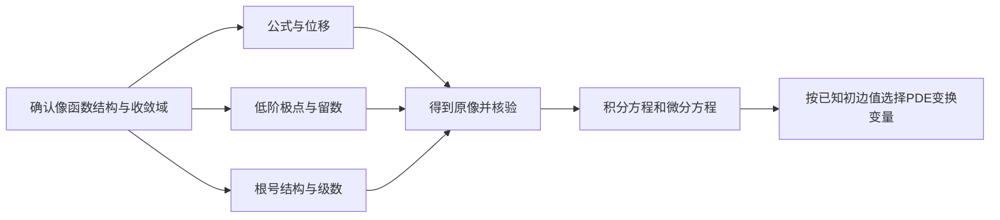

# 2026-11-18 第16节 拉普拉斯逆变换与方程求解

## 本节要解决的问题与阅读路线

本次录音覆盖约00:11–50:55：先复习逆变换的公式法和展开定理，再解积分方程、零初值常微分方程，最后用级数求一个含根号像函数的原像，并开始讨论半线热方程该对哪个变量作变换。末段录音在建立像方程处结束，未记录完整的PDE反演。

必要先修是单边拉普拉斯变换、阶跃函数、复数指数与留数。下文先给出最少的公式提醒，再逐题说明。公式、例题题面根据逐字稿与本地教材§5.3核对；语音含混或按教材补足的地方单独注明。未发现对应本次课的独立课件，10月28日考前板书不作本课课件。

## 一、逆变换的工具箱（00:11–05:27）

### 1. 基础公式与条件

统一用$t\ge0$表示原变量，$s$表示复变换变量，$F(s)=\mathcal L[f](s)$表示像函数：

$$
F(s)=\int_0^\infty e^{-st}f(t)\,dt.
$$

**教材补足条件**：若$f$在每个有限区间分段连续，且为指数阶，例如充分大$t$时$|f(t)|\le Me^{\sigma_0t}$，则在$\Re s>\sigma_0$绝对收敛。下面运用微分、卷积等公式时还需相应正则性及允许换序、积分下求导的条件。单边变换只使用$t\ge0$的数据，负半轴需要时取零延拓。

| 原函数 | 像函数 | 常用条件 |
|---|---|---|
| $t^n$ | $n!/s^{n+1}$ | $n=0,1,\ldots$，$\Re s>0$ |
| $e^{at}$ | $1/(s-a)$ | $\Re s>\Re a$ |
| $\sin bt$ | $b/(s^2+b^2)$ | 实数$b$，$\Re s>0$ |
| $\cos bt$ | $s/(s^2+b^2)$ | 实数$b$，$\Re s>0$ |

特别地，$\mathcal L^{-1}[1/s^{n+1}]=t^n/n!$。阶乘位于正变换的分子、逆变换的分母。

### 2. 两种“位移”要分清

设$H(t-c)$为阶跃函数，$c\ge0$。课堂03:32–04:37回顾：

$$
\boxed{\mathcal L[H(t-c)f(t-c)]=e^{-cs}F(s)},
\qquad
\boxed{\mathcal L[e^{at}f(t)]=F(s-a)}.
$$

第一式是原变量延迟；第二式是像变量平移。若原函数按负半轴为零约定，教材可简写$f(t-c)$，这里显式写出$H$，避免误用。

**补充解释：从定义核验符号。** 第一式令$r=t-c$，积分下限从$c$变为0，指数产生$e^{-cs}$；第二式合并$e^{-st}e^{at}=e^{-(s-a)t}$。所以$F(s+1)$对应$e^{-t}f(t)$。

> 一句话来说：像函数前乘$e^{-cs}$意味着等到$t=c$才启动；把$s$换成$s-a$意味着原函数乘$e^{at}$。

### 3. 展开定理与留数

课堂另一条主线是通过展开定理求留数，而非每次直接计算反演积分：

$$
f(t)=\sum_k\operatorname{Res}_{s=s_k}\bigl(e^{st}F(s)\bigr).
$$

**适用边界（教材补足）**：反演直线应位于奇点右侧；当$t>0$，向左闭合的围线积分余项需趋零，且留数和与极限应有意义。教材给出的是仅有极点、极点在某个左半平面、适当围线上$F\to0$以及反演直线积分绝对收敛的一组充分条件。不能只因“存在极点”便机械求和。分支点与延迟因子需要另作检查。

若$s_k$为单极点，$F=A/B$且$B'(s_k)\ne0$，有

$$
\operatorname{Res}_{s=s_k}(e^{st}F)=e^{s_kt}\frac{A(s_k)}{B'(s_k)}.
$$

若为$m$阶极点，则

$$
\operatorname{Res}_{s=s_k}(e^{st}F)=
\frac1{(m-1)!}\left[\frac{d^{m-1}}{ds^{m-1}}
\bigl((s-s_k)^me^{st}F(s)\bigr)\right]_{s=s_k}.
$$

课堂16:40的选择建议：低阶极点留数往往简便；阶数升高会增加求导，宜先看查表、平移和部分分式能否解决。这是计算建议，不是高阶极点禁止用留数。

## 二、延迟与指数衰减叠加的逆变换（05:27–16:40）

根据05:58的$e^{-s}$、随后$(s+1)^2+1$和08:18的$e^{-t}\sin t$，本题可一致整理为

$$
F(s)=\frac{e^{-s}}{(s+1)^2+1}.
$$

### 1. 公式法：从最里面开始识别

先用$\mathcal L[\sin t]=1/(s^2+1)$，像变量平移给出

$$
G(s)=\frac1{(s+1)^2+1},\qquad g(t)=e^{-t}\sin t.
$$

最后处理$e^{-s}$造成的单位延迟：

$$
\boxed{f(t)=H(t-1)e^{-(t-1)}\sin(t-1)}.
$$

即$0\le t<1$时为0，$t\ge1$时取后面的表达式；$t=1$处该式为0，阶跃在端点的取值不影响这里的结果。

### 2. 留数法：必须同时处理启动区间

课堂找出$s_\pm=-1\pm i$两个单极点。反演被积函数为

$$
\frac{e^{s(t-1)}}{(s+1-i)(s+1+i)}.
$$

当$t>1$，可向左闭合，两个留数分别为

$$
\frac{e^{(-1+i)(t-1)}}{2i},\qquad
-\frac{e^{(-1-i)(t-1)}}{2i}.
$$

相加并用$e^{iz}-e^{-iz}=2i\sin z$，得到$e^{-(t-1)}\sin(t-1)$。

**补充纠正适用范围**：当$t<1$时，$e^{s(t-1)}$向左会增长，不能继续无条件用上述左闭合。向右闭合不包围极点，结果为0。必须与公式法的$H(t-1)$一致，不能将两个留数的和当作所有$t\ge0$的答案。

> 一句话来说：先处理像变量平移得到衰减正弦，再把整个原函数延迟；留数计算也必须保留这一因果区间。

## 三、积分方程：卷积把积分变成乘法（17:45–20:27）

本节可辨认的$a t$、正弦卷积与最终$a/s^2+a/s^4$，与教材§5.3例6吻合。使用显式因果卷积写题面：

$$
f(t)=at+\int_0^t\sin(t-\tau)f(\tau)\,d\tau,\qquad t\ge0.
$$

**题面约定**：转写及教材写为上限$+\infty$；只有将正弦核理解为$H(r)\sin r$时，这才等于上面的$0$至$t$。如果把$\sin(t-\tau)$当作全实轴普通正弦且上限仍为$\infty$，便不是这里可用单边卷积定理的题目，不能忽略这项约定。

对具有共同绝对收敛右半平面的指数阶函数，单边卷积满足

$$
(g*f)(t)=\int_0^tg(t-\tau)f(\tau)d\tau,
\qquad\mathcal L[g*f]=G(s)F(s).
$$

**补充证明依据**：在$0\le\tau\le t$的积分区域令$r=t-\tau$，换成$r,\tau\ge0$后，$e^{-st}=e^{-sr}e^{-s\tau}$，二重积分分离为两个变换。换序依据是加权绝对可积性。

于是课堂的代数计算为

$$
\begin{aligned}
F(s)&=\frac a{s^2}+\frac1{s^2+1}F(s),\\
\frac{s^2}{s^2+1}F(s)&=\frac a{s^2},\\
F(s)&=\frac{a(s^2+1)}{s^4}=\frac a{s^2}+\frac a{s^4}.
\end{aligned}
$$

分别逆变换：

$$
\boxed{f(t)=a\left(t+\frac{t^3}{6}\right)}.
$$

**补充验算**：卷积项$I(t)$满足$I''+I=f$及$I(0)=I'(0)=0$。令$I=at^3/6$，有$I''+I=at+at^3/6=f$，且两个零初值均满足，故代回原方程成立。

> 一句话来说：识别出因果卷积后，未知函数的积分方程变成关于$F(s)$的一次代数方程。

## 四、常微分方程：初值进入导数公式（20:55–34:38）

课堂题目由可辨认的右端$e^{2t}$与随后二重极点$s=2$一致确定为

$$
y''-3y'+2y=e^{2t},\qquad y(0)=y'(0)=0.
$$

注意教材§5.3例5右端是$2e^{3t}$，与课堂此题不同；这里使用课堂条件，不套用教材例5的解。

### 1. 先写完整初值项

对足够光滑且相应导数为指数阶的$y$，分部积分给

$$
\mathcal L[y']=sY-y(0),\qquad
\mathcal L[y'']=s^2Y-sy(0)-y'(0).
$$

**补充推导**：$\int_0^\infty y'e^{-st}dt=[ye^{-st}]_0^\infty+sY=-y(0)+sY$，其中无穷端边界项因选择足够右侧的$s$而消失；再对$y'$使用同式得到二阶公式。只有零初值时才可省略这些项。

代入本题：

$$
(s^2-3s+2)Y=\frac1{s-2},\qquad
Y(s)=\frac1{(s-2)^2(s-1)}.
$$

### 2. 部分分式法

设

$$
Y=\frac A{s-2}+\frac B{(s-2)^2}+\frac C{s-1}.
$$

通分后$1=A(s-2)(s-1)+B(s-1)+C(s-2)^2$。取$s=2$得$B=1$，取$s=1$得$C=1$，比较$s^2$系数得$A=-1$。转写29:31附近的负号混乱，以此恒等式核对结果。

由$1/(s-2)^2=\mathcal L[te^{2t}]$，有

$$
\boxed{y(t)=-e^{2t}+te^{2t}+e^t}.
$$

### 3. 二阶极点的留数法

在$s=1$处留数为$e^t$；在$s=2$处需求导：

$$
\begin{aligned}
\operatorname{Res}_{s=2}\frac{e^{st}}{(s-2)^2(s-1)}
&=\left[\frac d{ds}\frac{e^{st}}{s-1}\right]_{s=2}\\
&=\left[e^{st}\left(\frac t{s-1}-\frac1{(s-1)^2}\right)\right]_{s=2}
=(t-1)e^{2t}.
\end{aligned}
$$

两留数相加与部分分式法一致。二重极点求的是去除极点因子后的导数，不能只把$s=2$直接代入剩余函数。

**补充验算**：$y(0)=-1+0+1=0$；$y'(0)=-2+1+1=0$。令$D=d/dt$，有$(D-1)(D-2)y=e^{2t}$。右端与特征根2共振，这也解释了为何解中出现$te^{2t}$。

> 一句话来说：先让初值进入变换公式，再分解像函数；二重极点正对应原函数中的一次多项式因子。

## 五、含根号的像函数：用级数逐项反演（35:12–39:46）

本段的二项式系数、$1/s^{2n+1}$和逆变换后的$(n!)^2$，与教材§5.3例8的核心像函数吻合：

$$
F(s)=\frac1{\sqrt{s^2+1}}.
$$

在右半平面选取与$s\to+\infty$时$\sqrt{s^2+1}\sim s$一致的解析分支。它在$s=\pm i$有分支点，不能当作一阶或“半阶”极点直接套只含极点的展开定理；这不排除更一般的割线围道法，本课采用的是级数法。

先对$|s|>1$写

$$
\begin{aligned}
F(s)&=\frac1s(1+s^{-2})^{-1/2}\\
&=\sum_{n=0}^\infty(-1)^n
\frac{(2n)!}{2^{2n}(n!)^2}\frac1{s^{2n+1}},
\end{aligned}
$$

所用二项式展开$(1+z)^{-1/2}=\sum_{n\ge0}(-1)^n(2n)!z^n/[2^{2n}(n!)^2]$要求$|z|<1$。逐项对应$\mathcal L^{-1}[s^{-(2n+1)}]=t^{2n}/(2n)!$，阶乘相消得到

$$
\boxed{f(t)=\sum_{n=0}^\infty
\frac{(-1)^nt^{2n}}{2^{2n}(n!)^2}
=1-\frac{t^2}{4}+\frac{t^4}{64}-\cdots}.
$$

课堂重点是：无法直接查到一个初等函数原像时，可以得到可计算的级数表示。教材把它放在$ty''+y'+ty=0$、$y(0)=1$、$y'(0)=0$的例题里；**本次转写只清楚记录像函数及其级数反演，不能据教材断言老师本次完整讲过该ODE的起始推导**。这个级数通常记作零阶第一类贝塞尔函数$J_0(t)$，名称为补充说明。

**补充严谨性：级数不是只靠形式配对。** 对固定$t$，相邻绝对值项之比为$t^2/[4(n+1)^2]\to0$，所以原函数级数对所有有限$t$收敛。对实数$s>1$，逐项绝对值积分之和为

$$
\sum_{n\ge0}\frac{(2n)!}{4^n(n!)^2s^{2n+1}},
$$

其比值趋于$1/s^2<1$，故可交换求和与拉普拉斯积分，得到上面的$F(s)$。级数的绝对值和还可用$\binom{2n}{n}\le4^n$控制为$\sum t^{2n}/(2n)!=\cosh t$，因而为指数阶。这样在$s>1$的共同区域内验证了所求逆变换；并非把“$s$很大”误解为“原函数只对很小$t$成立”。

> 一句话来说：把根号转为$1/s$的幂级数，再逐项逆变换；最终原像的级数可以对全部有限$t$收敛。

## 六、半线热方程：为什么通常对时间变换（40:47–50:55）

课堂开始考虑$u_t=a^2u_{xx}$的半无界问题，强调拉普拉斯导数公式会带入端点值。根据可辨认的零初值与教材§5.4开头，下面以一般已知边界$g(t)$表述已确认的变换结构：

$$
u_t=a^2u_{xx},\quad x>0,t>0;\qquad
u(x,0)=0,\quad u(0,t)=g(t),\quad a>0.
$$

**边界题面限制**：录音未清晰保留本例$g(t)$究竟为常数还是一般函数，故$g$是统一记号，不冒充已经恢复的教师原题完整边界函数。

### 1. 若对空间$x$作单边拉普拉斯变换

记$V(s,t)=\mathcal L_x[u](s,t)$，则

$$
V_t=a^2\bigl(s^2V-su(0,t)-u_x(0,t)\bigr).
$$

仅给$u(0,t)$时，$u_x(0,t)$未知，不能把它擅自设为0。课堂42:26–43:06以此说明当前问题选$x$变换不方便。**补充边界**：这不是“空间拉普拉斯永远不可用”的定理；若有更多边界信息或能用其他关系确定未知边界量，仍可能采用。

### 2. 对时间$t$作单边变换

令$U(x,s)=\mathcal L_t[u](x,s)$。在允许对$x$微分穿过积分的正则性和增长条件下，

$$
sU-u(x,0)=a^2U_{xx}.
$$

代入已知零初值，得到

$$
\boxed{U_{xx}-\frac{s}{a^2}U=0},\qquad
\boxed{U(0,s)=G(s)=\mathcal L[g](s)}.
$$

这正是录音48:54–50:55建立到的空间ODE与像边界条件。**本次记录到此结束**，没有足够转写证明老师在本次课已完整求出$U$并反演。

**教材衔接（非本次已讲完）**：§5.4例1–2随后还需结合无穷远有界/衰减条件排除增长的空间指数，得到$U=G(s)e^{-x\sqrt{s}/a}$，再用查表或卷积反演。无穷远条件是定解信息的一部分，不能只用一个边界就自动确定空间二阶ODE的两个常数。

> 一句话来说：变换变量要让导数公式带入已有数据；本题已知时间初值，却只给一个空间端点条件，所以对时间变换更直接。

## 七、公式速查与方法选择

| 结构 | 优先操作 | 必查条件 |
|---|---|---|
| $e^{-cs}G(s)$ | 对$g(t)$整体延迟$c$ | $c\ge0$，保留$H(t-c)$ |
| $G(s-a)$ | 原像乘$e^{at}$ | 同时平移收敛域 |
| 简单有理式 | 部分分式或单极点留数 | 留数对象为$e^{st}F(s)$ |
| 重复极点 | 表格与位移，或高阶留数 | $m$阶极点求$m-1$阶导数 |
| 因果卷积方程 | 变换后解关于$F$的代数方程 | 核的因果约定、共同收敛域 |
| $1/\sqrt{s^2+1}$ | 二项式展开后反演 | 分支选择与换序依据 |
| 半线PDE | 先检查哪个变量的端点数据已知 | 初值项、边界项、无穷远条件 |

> [!warning] 本节易错点
> $F(s+1)$对应$e^{-t}f(t)$；延迟作用于整个原函数；$1/s^4$对应$t^3/6$；常微分方程初值非零时不能省去导数公式的端点项；积分上限$\infty$只有配合零延拓才可按因果卷积处理；分支点不能冒充极点；空间二阶ODE需要足够的定解条件。

## 八、课堂作业与独立自测

### 课堂作业（39:46）

转写为“重点三的第四题、第七题第八题”，纪要照录为“重点三”。与本地教材本节结束位置及题型对应，**高度吻合教材习题5.3第4、7、8题**；节号仍保留待核标记，不把语音含混抹去。

- 第4题：求$\sin\omega t$、$e^{-\lambda t}\sin\omega t$的拉普拉斯变换。
- 第7题：求$(s+8)/(s^2+4s+5)$与$s/(s^2+a^2)^2$（$a>0$）的逆变换。
- 第8题：用拉普拉斯变换解$y(t)=1+\int_0^{+\infty}y(r)\sin(t-r)dr$。教材按零延拓卷积约定书写；按显式因果核等价写为积分上限$t$，不把普通正弦的全半线积分混入。

这里列出题面供定位，不将新编解答说成课堂已讲解的作业答案。

### 自测1（新编）：叠加两种位移

求$\mathcal L^{-1}[e^{-2s}/((s+3)^2+4)]$，并说明$t<2$时的取值。

> [!hint]- 提示
> 先识别频率为2的正弦，再依次处理$s+3$与$e^{-2s}$。

> [!solution]- 解析
> $1/(s^2+4)$对应$\tfrac12\sin2t$；$s+3$给衰减$e^{-3t}$。答案为$\tfrac12H(t-2)e^{-3(t-2)}\sin(2(t-2))$；$t<2$为0。

### 自测2（新编）：别丢初值项

对$y''-3y'+2y=e^{2t}$，若改为$y(0)=1$、$y'(0)=0$，写出$Y(s)$；不要求完整反演。

> [!hint]- 提示
> 二阶导数贡献$-s$，$-3y'$贡献$+3$。

> [!solution]- 解析
> $(s^2-3s+2)Y-s+3=1/(s-2)$，所以$Y=[1/(s-2)+s-3]/[(s-1)(s-2)]$。检查$s\to+\infty$时$sY\to1$，与初值一致。

### 自测3（新编）：辨认分支与级数

对$F(s)=1/\sqrt{s^2+4}$，在右半平面取$F(s)\sim1/s$的分支，写出原像的前三个非零项，并指出它的奇点类型。

> [!hint]- 提示
> 把$(1+4/s^2)^{-1/2}$展开；$s=\pm2i$附近不是整数阶极点。

> [!solution]- 解析
> $F=1/s-2/s^3+6/s^5-\cdots$，故$f(t)=1-t^2+t^4/4-\cdots=J_0(2t)$。$\pm2i$为分支点，不能当作单极点求留数。

## 九、来源与仍需核对的范围

- [[03_Sources/Courses/数学物理方程/课堂笔记/raw/2026-11-18-拉普拉斯变换课程讲座-767424-逐字稿.md|本次逐字稿]]：全段已读，课堂例题、方法选择和作业的主要依据；时间段见各节标题。
- [[03_Sources/Courses/数学物理方程/课堂笔记/raw/2026-11-18-拉普拉斯变换课程讲座-767424-纪要.md|本次智能纪要]]：辅助梳理结构；“定义法/流速”等表述按上下文改为反演/留数，并未以纪要代替公式核对。
- [[03_Sources/Courses/数学物理方程/课本/数学物理方程 第2版 (李明奇，田太心主编, 主编李明_ (z-library.sk, 1lib/数学物理方程 第2版 (李明奇，田太心主编, 主编李明_ (z-library.sk, 1lib..md|本地教材]]：§5.3定义、性质、展开定理、例6/8与习题4/7/8用于核对；§5.4开头用于界定PDE衔接。教材例5右端与课堂不同，未混用。

新增待核：作业节号“5.3”的原始清晰读音或板书；末段热方程边界$g(t)$的具体形式；积分题原板书是否显式注明因果零延拓。本次录音未含完整PDE反演，不按教材后续内容假装已讲完。

此前缺失范围已回查：11月18日只明确证明若干拉普拉斯基础和位移公式“此前讲过”，不能由此恢复11月13日整课例题、证明与作业；11月4日期中考试的具体试题、作答和讲评，本次没有新增证据，继续待补。

## 课堂疑惑与解答

对应日计划不存在；本次来源没有可确认的个人学习疑惑或实际作答记录。未虚构学生问题、答疑时间或掌握程度。上面的“补充解释”“自测（新编）”仅为整理时添加的学习支持。
