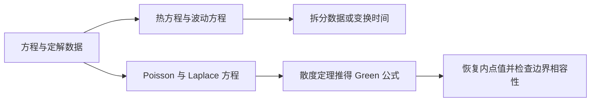

# 2026-11-20 第17节 数学物理方程｜半轴问题与 Green 公式

本节从半轴热方程和波动方程的解法回顾，转入稳态方程的边值问题。前半段要区分空间延拓、端点修正和时间移位。后半段要跟踪 Green 公式中的两个法向，理解挖去小球后怎样出现 $4\pi u(M_0)$。

## 一、逆 Laplace 变换怎样选择算法（00:38–04:38）

查表法先化为已知变换对。若有高阶极点，可先做部分分式分解。例如课堂在 $-2,-1$ 的分解结构中写出 $\frac A{s+2}+\frac B{s+1}+\frac C{(s+1)^2}+\frac D{(s+1)^3}$。三阶极点直接求留数时，要对 $(s+1)^3e^{st}\widetilde u(s)$ 求两次导数，在 $s=-1$ 代入并除以 $2!$。阶数高时先分解再查表通常更易检查。复习[[03_Sources/Courses/数学物理方程/课堂笔记/2026-11-18-第16节-拉普拉斯变换课程讲座|第16节的变换对、移位与展开定理]]。

对含 $\exp(-bs)$ 的项，先识别 $b\ge0$ 及对应的时间延迟，再决定如何用留数。这样可以避免把只在 $t>b$ 出现的信号写到所有时间上。

## 二、半轴热方程的叠加与端点修正（04:38–20:18）

考虑 $x>0,\ t>0$ 上 $u_t=a^2u_{xx}+f(x,t)$，$a>0$，初值 $u(x,0)=\phi(x)$，端点值 $u(0,t)=h(t)$。线性叠加把三个数据分别交给三个子问题：

| 分量 | 源项 | 初值 | 端点值 |
|:--|:--|:--|:--|
| $v$ | $0$ | $0$ | $h$ |
| $w$ | $0$ | $\phi$ | $0$ |
| $p$ | $f$ | $0$ | $0$ |

逐项代回算子、初值及端点值，就有 $u=v+w+p$。若要求解连续到角点且数据有连续极限，需满足 $\phi(0)=h(0)$。

### 1. 端点为零时用奇延拓

热核 $K_t(x)=(4\pi a^2t)^{-1/2}\exp[-x^2/(4a^2t)]$ 关于 $x$ 为偶。将 $\phi$ 奇延拓为 $\phi_o$，则全轴解 $K_t*\phi_o$ 为奇函数，限制到半轴就是 $w$，端点值自然为零。对源项也可逐时奇延拓为 $f_o(\cdot,\tau)$，零初值的解为

$$
p(x,t)=\int_0^t (K_{t-\tau}*f_o(\cdot,\tau))(x)\,d\tau,\quad x>0 .
$$

奇偶性在这里依赖方程的对称性和端点条件。

### 2. 零延拓后减去多出来的端点值

把初值零延拓为 $\phi_z$，在全轴得 $W=K_t*\phi_z$。在 $x>0$ 它满足所需方程与初值，但其端点值为 $q(t)=W(0,t)$。另取零初值、端点值为 $q(t)$ 的半轴齐次热方程解 $V$，就有 $w=W|_{x>0}-V$。课堂强调，当缺少可直接使用的奇偶结构时，这种先算出边界差额再修正的思路仍有用，前提是修正问题能够求解。

端点驱动的子问题可直接对时间作 Laplace 变换。零初值给 $a^2\widetilde V_{xx}=s\widetilde V$，在 $\operatorname{Re}s>0$ 取 $\operatorname{Re}\sqrt{s}>0$ 的分支，令随 $x$ 增长的指数项系数为零。设端点数据为 $q$，则

$$
\widetilde V(x,s)=\widetilde q(s)e^{-x\sqrt{s}/a}.
$$

教材 §5.4 例 2 给出相应的逆变换核
$\frac{x}{2a\sqrt{\pi}\,t^{3/2}}\exp[-x^2/(4a^2t)]$（$x,t>0$）。用它与 $q$ 作时间卷积即可恢复 $V$。

## 三、半轴波动方程与因果延迟（21:07–46:40）

### 1. 全轴公式与时间变换是两条路线

对固定端点 $u(0,t)=0$ 的半轴弦，适当把初值、初速度或源项作空间奇延拓，便可在全轴用 d’Alembert 公式和 Duhamel 原理。速度项的空间积分区间是 $[x-ct,x+ct]$。课堂在 $c=1$ 的计算中用到 $\int_{x-t}^{x+t}\sin y\,dy=2\sin x\sin t$，以及速度项公式外的 $1/2$。

零初始位移、零初始速度时，对 $u_{tt}=c^2u_{xx}+f(x,t)$ 作时间变换，得到

$$
\widetilde u_{xx}-(s/c)^2\widetilde u=-\widetilde f/c^2,
\qquad \widetilde u(0,s)=0 .
$$

齐次基解为 $y_1=e^{sx/c},\,y_2=e^{-sx/c}$，Wronskian $y_1y_2'-y_1'y_2=-2s/c$。可用常数变易求特解，再从无穷远条件除去增长模态，由端点值确定剩余常数。录音中的原始源项和部分系数无法逐字确认，下面用同方法的教材例题核对移位。

### 2. 教材 §5.4 例 4：端点引起的延迟项

源项为 $\cos(\omega t)$（$\omega>0$），波速为 $c>0$，零初值、零端点，且无穷远处空间导数趋于零。变换域的常数特解为 $1/[s(s^2+\omega^2)]$。舍去增长的齐次项后，由 $\widetilde u(0,s)=0$ 得

$$
\widetilde u(x,s)=\frac{1-e^{-sx/c}}{s(s^2+\omega^2)}.
$$

记 $g(t)=(1-\cos\omega t)/\omega^2$，其变换是 $1/[s(s^2+\omega^2)]$，故 $u(x,t)=g(t)-H(t-x/c)g(t-x/c)$，其中 $H$ 是单位阶跃。延迟的部分在 $t<x/c$ 为零。这个例子里有 $s=0,\pm i\omega$ 三个极点。课堂另讨论了含 $s=\pm i$ 的项，重点同样在 $e^{s(t-b)}$。在满足闭合弧贡献消失的条件下，$t-b>0$ 时向左闭合计入极点，$t-b<0$ 时向右闭合且无极点。$t=b$ 处可按原函数连续性或反演约定确定，无须把两边的留数公式直接混用。

## 四、Poisson 与 Laplace 方程的边界数据（49:49–53:27）

在空间区域 $\Omega$ 内，Poisson 方程为 $\Delta u=f$，取 $f=0$ 就是 Laplace 方程。这里没有时间初值，边界 $\Gamma=\partial\Omega$ 上的数据需要按类型阅读。记 $\partial_n u=\nabla u\cdot n$，$n$ 是外法向。

| 条件 | 在边界上给定的量 |
|:--|:--|
| Dirichlet | $u=\varphi$ |
| Neumann | $\partial_nu=\psi$ |
| 通常的 Robin 条件 | $\partial_n u+k u=g$，或更一般的线性组合 |

> [!note] 本课教材的命名
> 教材 §6.1–6.2 把同时给定 $u=\varphi$ 和 $\partial_nu=\psi$ 的问题称为 Robin 问题，课堂沿用该称呼。教材 §6.8 另给出热交换形式 $\partial_nu+k u=g$。下节公式用到的是两份边界迹，同时指定时须满足相容性。通常的线性组合只给一个方程，不能直接把两份迹当作已知量代入。

## 五、从散度定理推到第三 Green 公式（53:27–01:13:15）

### 1. 第一与第二公式

设边界分片光滑，$u,v$ 具有应用散度定理和分部积分所需的光滑性。取 $\mathbf A=u\nabla v$，用 $\nabla\cdot(u\nabla v)=\nabla u\cdot\nabla v+u\Delta v$，有

$$
\int_\Gamma u\,\partial_nv\,dS
=\int_\Omega (\nabla u\cdot\nabla v+u\Delta v)\,dV .
$$

交换 $u,v$ 后相减，梯度内积抵消，得到

$$
\int_\Gamma(u\,\partial_nv-v\,\partial_nu)\,dS
=\int_\Omega(u\Delta v-v\Delta u)\,dV .
$$

### 2. 取 $v=1/r$ 后为何要挖球

固定三维区域内一点 $M_0$，记 $r=|M-M_0|$。径向函数的三维 Laplace 算子为 $v''+2v'/r$，因此 $\Delta(1/r)=2/r^3-2/r^3=0$（$r>0$）。为避开奇点，在 $\Omega_\varepsilon=\Omega\setminus\overline{B_\varepsilon(M_0)}$ 上应用第二公式。内球面相对于 $\Omega_\varepsilon$ 的外法向指向球心，故 $\partial_n(1/r)=+\varepsilon^{-2}$。

- 球面项 $\int_{S_\varepsilon}u\,\partial_n(1/r)\,dS=4\pi\operatorname{Avg}_{S_\varepsilon}u\to4\pi u(M_0)$。
- 另一球面项的绝对值至多 $\varepsilon^{-1}(4\pi\varepsilon^2)\sup_{S_\varepsilon}|\nabla u|$，随 $\varepsilon\to0$ 趋于零。
- 体积分中剩 $-(1/r)\Delta u$。三维小球上的 $1/r$ 局部可积，若 $\Delta u$ 连续有界，挖去的体积分随 $\varepsilon$ 缩小而消失。

整理两侧符号可得

$$
u(M_0)=\frac1{4\pi}\int_\Gamma
\left(\frac1r\,\partial_nu-u\,\partial_n\frac1r\right)dS
-\frac1{4\pi}\int_\Omega \frac{\Delta u}{r}\,dV .
$$

体积分中的 $\Delta u$ 对 Poisson 问题换成 $f$，对 Laplace 问题取零。给定相容的 $(\varphi,\psi)$ 时可写出对应内点表示。这个公式适用于三维，二维需改用相应的对数基本解。

## 六、调和函数的通量与相容条件（01:14:13–01:17:23）

满足 $\Delta u=0$ 的光滑函数称为调和函数。在第二公式取 $v\equiv1$，得到 $\int_\Gamma\partial_nu\,dS=0$。于是 Laplace 方程的 Neumann 数据必须满足 $\int_\Gamma\psi\,dS=0$。若同时给边界值和法向导数，法向数据仍须满足该条件，且两份迹还要彼此相容。通常的 Robin 条件 $\partial_n u+k u=g$ 则给 $\int_\Gamma g\,dS=\int_\Gamma k u\,dS$。对 Poisson 方程，可用散度定理得到 $\int_\Gamma\psi\,dS=\int_\Omega f\,dV$。

## 七、自测（新编）

### 1. 延迟项在波到来前是什么

求 $\mathcal L^{-1}[e^{-3s}/(s^2+1)](t)$，分别写出 $t<3$ 和 $t>3$ 的结果。

> [!hint]- 提示
> 先找 $1/(s^2+1)$ 的原像，再识别时间平移。

> [!solution]- 解析
> 原像是 $\sin t$，乘 $e^{-3s}$ 后得到 $H(t-3)\sin(t-3)$，因此 $t<3$ 为零，$t>3$ 为 $\sin(t-3)$。

### 2. 检查通量数据

在三维单位球内求 $\Delta u=1$。若球面上 $\partial_nu=q$ 为常数，$q$ 必须取多少？

> [!hint]- 提示
> 用散度定理对 $\nabla u$ 积分，核对球体积与球面积。

> [!solution]- 解析
> $4\pi q=4\pi/3$，所以 $q=1/3$。可用 $u(x)=|x|^2/6$ 检查 $\Delta u=1$ 及球面上的法向导数。

## 八、资料与待核

- [[03_Sources/Courses/数学物理方程/课堂笔记/raw/2026-11-20-偏微分方程期末复习课程-724352-逐字稿|原始逐字稿]]保留课堂算法和推导，[[03_Sources/Courses/数学物理方程/课堂笔记/raw/2026-11-20-偏微分方程期末复习课程-724352-纪要|智能纪要]]用于对照主题。波动例题的原始源项及部分系数待板书核实。
- [[03_Sources/Courses/数学物理方程/课本/数学物理方程 第2版 (李明奇，田太心主编, 主编李明_ (z-library.sk, 1lib/数学物理方程 第2版 (李明奇，田太心主编, 主编李明_ (z-library.sk, 1lib.|本地教材《数学物理方程》第2版]] §5.3–5.4 核对逆变换和半轴例题，§6.1–6.2 对应三种边界数据和 Green 公式，§6.8 对应热交换形式的第三边值条件。

