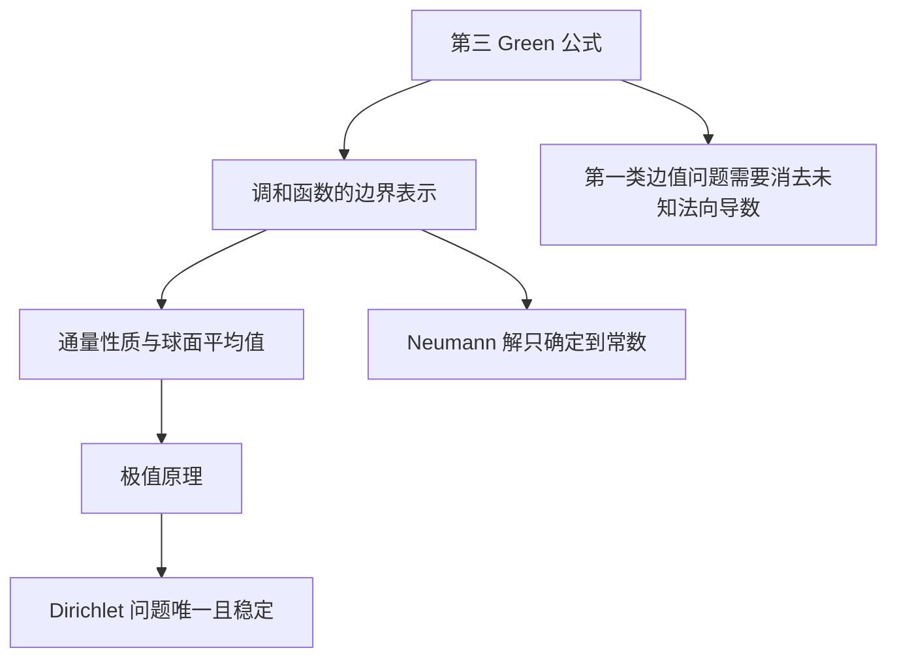

# 2026-11-25 第18节 数学物理方程：调和函数性质与边值问题适定性

> [!info] 录音范围与整理边界
> 逐字稿约 54 分钟：开头承接上节 Green 公式，结尾停在“回到第二 Green 公式”的推导开端，未录到第一类边值问题的具体构造。开头部分公式不完整，以下只整理能够从录音确认的结论与步骤。当前课程目录没有发现能可靠匹配本课的 PPT/PPTX、课件 Markdown、PDF 或板书；本地教材第 2 版 §6.2–§6.3 用于校核公式和补足推导，补充处已标明。转写署名与课表教师不一致，本文按课程及时间匹配录音，不据署名判定实际授课人。

本节主线是：第三 Green 公式给出调和函数的边界表示；由此得到平均值性质与极值原理；极值原理进一步证明 Dirichlet 问题的唯一性和稳定性。Neumann 问题的解则只能确定到一个常数。本节最后开始讨论如何从第三 Green 公式消去未知法向导数以求第一类边值问题，录音在方法展开前结束。

## 一、从第三 Green 公式读取内部值

### 1. 边界表示式

课堂开头承接上节推导了 Green 第三公式。为避免与积分变量混淆，记区域为 $\Omega\subset\mathbb R^3$，边界为 $\partial\Omega$，边界外法向为 $n$，固定内部点为 $P$，积分点为 $Q$，并令 $r=|Q-P|$。对足够光滑的 $u$，公式为

$$
u(P)=\frac{1}{4\pi}\int_{\partial\Omega}\left(\frac{1}{r}\frac{\partial u}{\partial n}-u\frac{\partial}{\partial n}\frac{1}{r}\right)\,dS-\frac{1}{4\pi}\int_{\Omega}\frac{\Delta u}{r}\,dV.\tag{1}$$

> [!warning] OCR 中的公式不能照抄
> 录音开头的系数和被积项残缺。式 (1) 按教材 §6.2 的第三 Green 公式校正；法向均为区域边界的外法向。公式来自对第二 Green 公式在 $P$ 周围挖去小球后取半径趋零的极限。

若 $u$ 在 $\Omega$ 内调和，即 $\Delta u=0$，则体积分消失：

$$
u(P)=\frac{1}{4\pi}\int_{\partial\Omega}\left(\frac{1}{r}\frac{\partial u}{\partial n}-u\frac{\partial}{\partial n}\frac{1}{r}\right)\,dS.\tag{2}$$

因此，对本课采用的足够光滑条件，区域内点的函数值可以由边界上的函数值和法向导数表示。这是边界表示，不意味着只给其中一种边界数据就能直接从 (2) 解出所有第一、第二类边值问题：若边界迹中含未知量，还需进一步构造或消去该项。

教材把同时指定 $u|_{\partial\Omega}$ 与 $\partial_nu|_{\partial\Omega}$ 的情形称作 Robin 问题；这与许多教材把 Robin 条件写成 $\partial_nu+ku=g$ 的约定不同。读本课程公式时应以本教材的命名和具体条件为准。

## 二、通量性质与球面平均值

### 1. 调和函数的零通量性质

若 $u$ 调和且在边界上满足应用散度定理的正则性，Gauss 定理给出

$$\int_{\partial\Omega}\frac{\partial u}{\partial n}\,dS=\int_{\Omega}\Delta u\,dV=0.\tag{3}$$

这说明总的有向法向通量为零；它不表示每一点的法向导数都为零。课堂随后用到这一性质推导球面平均值。

### 2. 球心值等于球面平均值

取以 $P$ 为球心、半径 $R$ 且完全位于调和区域内的球 $B_R(P)$。在其球面上，$r=R$ 为常数，外法向沿径向，故

$$\frac{\partial}{\partial n}\left(\frac1r\right)=-\frac1{R^2}.$$

将它代入 (2)：

$$u(P)=\frac{1}{4\pi R}\int_{\partial B_R(P)}\frac{\partial u}{\partial n}\,dS+\frac{1}{4\pi R^2}\int_{\partial B_R(P)}u\,dS.$$

由零通量性质，第一项为零，得到

$$\boxed{u(P)=\frac{1}{4\pi R^2}\int_{\partial B_R(P)}u(Q)\,dS_Q}.\tag{4}$$

> 一句话来说：调和函数在球心的值等于球面上的算术平均值，前提是整个球及其球面处于调和区域内。

课堂把“边界数据决定内部值”与这个球面平均值性质作为调和函数的基本性质；不要把球面平均换成球体积平均，也不要忽略公式中的球面积 $4\pi R^2$。

## 三、调和函数的极值原理

设 $\Omega$ 有界，$u\in C(\overline\Omega)\cap C^2(\Omega)$ 且 $\Delta u=0$。课堂给出的结论是：最大值和最小值都能在边界取得。若函数为常数，内部当然也会同时取到该值；因此更精确的说法是

$$\max_{\overline\Omega}u=\max_{\partial\Omega}u,\qquad \min_{\overline\Omega}u=\min_{\partial\Omega}u.$$

### 证明思路：构造一个拉普拉斯算子为正的辅助函数

课堂用球面直径估计构造辅助函数。设 $u$ 在内部点 $P$ 的值严格大于边界最大值 $M_1=\max_{\partial\Omega}u$，记 $u(P)=M_0>M_1$。选 $R$ 使 $|Q-P|\le 2R$ 对所有 $Q\in\partial\Omega$ 成立，定义

$$w(Q)=u(Q)+\frac{M_0-M_1}{8R^2}|Q-P|^2.\tag{5}$$

由于 $u$ 调和，且 $\Delta|Q-P|^2=6$，有

$$\Delta w=\frac{6(M_0-M_1)}{8R^2}>0.\tag{6}$$

在边界上由 $|Q-P|^2\le4R^2$ 得

$$w(Q)\le M_1+\frac{M_0-M_1}{2}=\frac{M_0+M_1}{2}<M_0=w(P).$$

所以 $w$ 在闭区域上的最大值不能只由边界取得，必在内部取得。但光滑函数在内部最大点处的 Hessian 半负定，因此 $\Delta w\le0$，与 (6) 矛盾。于是 $u$ 不可能在内部严格超过边界最大值。对 $-u$ 应用同一论证即可证明最小值结论。

> [!note] 证明中每一步的作用
> 二次项使辅助函数的 Laplacian 严格为正；系数 $1/(8R^2)$ 则保证它在边界增加量至多为 $(M_0-M_1)/2$。内部极大点的 Laplacian 非正，造成矛盾。

教材 §6.2 也指出该极值原理用于从平均值性质推出常数边界情形和唯一性。课堂证明的二次扰动法给出了直接的反证路线。

## 四、由极值原理得到 Dirichlet 问题适定性

考虑调和 Dirichlet 问题

$$\Delta u=0\quad\text{in }\Omega,\qquad u|_{\partial\Omega}=\varphi.$$

这里讨论的是在解存在且足够光滑的前提下的唯一性和对边界数据的稳定性，不是在本节证明解的存在性。

### 1. 唯一性

设 $u_1,u_2$ 有相同边界值，令 $v=u_1-u_2$。由线性性，$\Delta v=0$ 且 $v|_{\partial\Omega}=0$。极值原理分别应用于 $v$ 与 $-v$，给出 $v\le0$ 及 $v\ge0$，所以 $v\equiv0$，即 $u_1=u_2$。

### 2. 稳定性：边界误差不会在内部放大

若两个边界数据为 $\varphi_1,\varphi_2$，对应解为 $u_1,u_2$，定义边界误差

$$\varepsilon=\|\varphi_1-\varphi_2\|_{L^\infty(\partial\Omega)}.$$

差函数 $v=u_1-u_2$ 调和，且边界上 $|v|\le\varepsilon$。分别对 $v$ 与 $-v$ 使用极值原理，得到 $v\le\varepsilon$ 和 $-v\le\varepsilon$，所以

$$\boxed{\|u_1-u_2\|_{L^\infty(\overline\Omega)}\le\|\varphi_1-\varphi_2\|_{L^\infty(\partial\Omega)}}.\tag{7}$$

课堂直觉是“边界输入只改变一点，解不会在区域内无控制地变大”。式 (7) 给出对应的定量估计；稳定性依赖所选范数和解的正则性，不应脱离空间与范数空谈。

## 五、Neumann 问题：唯一性只到一个常数

Neumann 数据指定法向导数 $\partial_nu|_{\partial\Omega}=\psi$。若 $u$ 是解，则 $u+C$ 对任意常数 $C$ 也有同样的 Laplacian 和法向导数。因此一般不能得到逐点唯一的解。课堂用两个解之差说明其只能相差一个常数。

更直接的推导（补充解释，依据教材 §6.3 第一 Green 公式）：设 $v=u_1-u_2$，则 $\Delta v=0$ 且 $\partial_nv=0$。取第一 Green 公式中两个函数都为 $v$：

$$\int_{\partial\Omega}v\,\partial_nv\,dS=\int_{\Omega}\left(v\Delta v+|\nabla v|^2\right)dV.$$

左边与 $v\Delta v$ 均为零，故

$$\int_{\Omega}|\nabla v|^2dV=0.$$

被积函数非负且连续，所以 $\nabla v=0$；在连通区域上 $v$ 为常数。这证明 Neumann 解至多唯一到加法常数。另由 (3)，若 $\Delta u=0$ 且 $\partial_nu=\psi$，可解的必要条件为

$$\int_{\partial\Omega}\psi\,dS=0.$$

该相容条件是依据教材补充，本次录音片段未完整讲述。

> [!warning] 关于“Neumann 问题不稳定”的表述
> 课堂将 Neumann 问题称为不稳定，理由是两解可以相差任意常数。这个理由说明：若不固定常数代表，解没有绝对唯一的取值，无法直接比较两个任意选取的代表。它本身不等于“固定规范后的解对数据扰动也不稳定”。通常可在商空间中讨论，或附加 $\int_\Omega u\,dV=0$ 等规范来选定代表；若进一步讨论此规范下的稳定性，还需说明函数空间、范数及估计，不能只用任意常数自由度下结论。

**补充例子**：在任意连通区域中，$u_1=0$ 与 $u_2=7$ 都满足 $\Delta u=0$、$\partial_nu=0$。二者不同，但差恒为 $7$；施加零均值规范后，它们不再同时满足该规范。这说明非唯一性来自常数自由度。

## 六、课程进度与期末考试（课堂口头安排，待确认）

录音约 49:42 后，教师讨论结课与复习安排：口头提到“4号”左右结束新课、“9号”自习复习并讲两套往届试卷，最后一次课安排答疑。转写没有明确月份，日期说法有更正，因此这里只记录为暂定口头计划，不据此改写课表。

考试时间初步估计在 12 月底至 1 月初、圣诞节后；教师表示还要向学院上报并在班群通知。该说法不是正式考试通知，具体日期、形式和范围待后续确认。

## 七、第一类边值问题：本段只提出消项目标

第三 Green 公式含有边界上的 $u$ 和 $\partial_nu$ 两种迹。第一类边值问题已知 $u|_{\partial\Omega}$，但法向导数未知，故不能把式 (2) 直接当成只含已知量的解公式。课堂结尾提出回到第二 Green 公式寻找方法，目标是消去含未知法向导数的项；录音在具体构造和计算展开前结束。

> [!warning] 本节范围到此为止
> 教材 §6.4 继续用满足齐次 Dirichlet 边界条件的 Green 函数构造表示式，但该构造不在本次可用录音范围内，不能写成本节已讲完的内容。复习时可另行阅读 [[03_Sources/Courses/数学物理方程/课本/数学物理方程 第2版 (李明奇，田太心主编, 主编李明_ (z-library.sk, 1lib/数学物理方程 第2版 (李明奇，田太心主编, 主编李明_ (z-library.sk, 1lib..md#6.4 Poisson 方程 Dirichlet 问题 Green 函数法|教材 §6.4 的后续方法]]。

## 八、本节结论速查

| 问题 | 本节结论 | 必要提醒 |
|:--|:--|:--|
| 调和函数边界表示 | 内点值可由边界上的 $u$ 和 $\partial_nu$ 表示 | 同时含两种边界迹，不能直接替代第一、第二类问题的解法 |
| 球面平均值 | 球心值等于球面平均 | 球及球面须位于调和区域内 |
| 极值原理 | 最大、最小值可在边界取得 | 常数函数可在内部同时取到极值 |
| Dirichlet 唯一性 | 相同边界值给出同一调和解 | 讨论存在性需另证 |
| Dirichlet 稳定性 | 内部无穷范数误差不超过边界误差 | 依据极值原理，式 (7) |
| Neumann 唯一性 | 解只确定到加法常数 | 需要相容条件；稳定性讨论须先固定常数规范 |

## 九、自测（新编）

1. 设 $u_1,u_2$ 是同一区域上的调和函数，边界值分别为 $\varphi_1,\varphi_2$，且 $\|\varphi_1-\varphi_2\|_{L^\infty(\partial\Omega)}\le0.03$。能否断言内部任一点的解差绝对值不超过 $0.03$？写出所用差函数和定理。
2. 给出一对不同的调和函数，它们具有相同的 Neumann 边界数据，并说明还需要添加什么条件才能排除这类常数自由度。

> [!hint]- 提示
> 1. 对 $v=u_1-u_2$ 使用极值原理；分别看 $v$ 与 $-v$。
> 2. 给任一调和函数加常数不改变其法向导数。

> [!solution]- 解析
> 1. 有。$v$ 调和且 $|v|\le0.03$ 在边界成立，由极值原理，$|v|\le0.03$ 在整个闭区域成立。这就是式 (7) 的逐点形式。
> 2. 取常数函数 $u_1=0,u_2=7$，二者的法向导数均为零。可附加零均值条件 $\int_\Omega u\,dV=0$ 选定唯一代表；该规范是附加条件，不是原 Neumann 数据本身包含的信息。

## 课堂疑惑与解答

当日日计划 `每日疑惑/2026-11-25.md` 不存在，本次没有可可靠匹配的个人课堂疑惑，故不补造问题。

## 来源与导航

- 课堂记录：[[03_Sources/Courses/数学物理方程/课堂笔记/raw/2026-11-25-数学物理方程授课-155200-逐字稿|本节逐字稿]]（约 54 分钟，首尾不完整）；[[03_Sources/Courses/数学物理方程/课堂笔记/raw/2026-11-25-数学物理方程授课-155200-纪要|智能纪要]]（辅助定位主题，数学公式以教材校核）。
- 教材依据：本地《数学物理方程》第 2 版 §6.2（第三 Green 公式、调和函数性质）与 §6.3（Dirichlet/Neumann 唯一性和稳定性）。
- 衔接上一节：[[03_Sources/Courses/数学物理方程/课堂笔记/2026-11-20-第17节-偏微分方程期末复习课程|第17节复习中的 Green 公式与半轴问题]]。本次对应关系由逐字稿开头明确回顾 Green 公式确认。
- 继续学习：[[03_Sources/Courses/数学物理方程/课本/数学物理方程 第2版 (李明奇，田太心主编, 主编李明_ (z-library.sk, 1lib/数学物理方程 第2版 (李明奇，田太心主编, 主编李明_ (z-library.sk, 1lib..md#6.4 Poisson 方程 Dirichlet 问题 Green 函数法|教材 §6.4]] 展开如何构造 Dirichlet Green 函数以消去未知法向导数。
