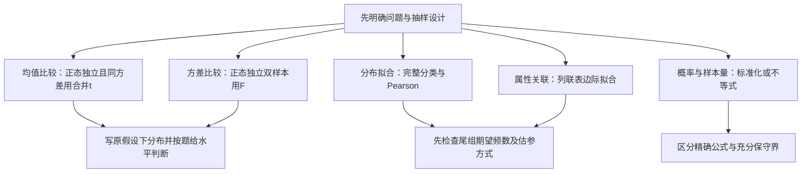

# 11.14数理统计作业

## 原作业与章节对应

第三章：1，2，3，4，5，7，8，9，10，14，15，18

尽量用课堂笔记中的方法完成

---

本次共 **12 题**，保留原题号。这里“第三章”按本课程学习顺序，对应库内教材**第八章《假设检验》**，不是全书第三章。对应依据：[[03_Sources/Courses/数理统计/作业/10月15日数理统计作业|前次作业]]已将课程“第二章”明确对应教材第七章《参数估计》；[[03_Sources/Courses/数理统计/课堂笔记/2026-10-15-第12节-假设检验的基本思想与检验步骤|10月15日课堂笔记]]也明确进入教材第八章。

**解题路线**：沿课堂“写假设 → 当原假设成立时构造统计量 → 确定拒绝域 → 代入并解释”的顺序。均值比较用合并 $t$ 检验，方差比较用 $F$ 检验；拟合与列联表使用课堂的 Pearson 统计量。以下逐题推导、数值验算和边界说明为本次整理，不冒充教师原话。

> [!important] 统一记号与条件
> 教材写 $N(a,\sigma)$ 时，第二个参数表示**标准差**。本文写 $\operatorname{Var}(X)=\sigma^2$，避免把标准差与方差混用。
> $$
> \bar X=\frac1n\sum_{i=1}^nX_i,\qquad
> S_*^2=\frac1{n-1}\sum_{i=1}^n(X_i-\bar X)^2.
> $$
> $S_*^2$ 为修正样本方差。上侧分位数满足 $P(Z>z_\gamma)=\gamma$，$t_\gamma(\nu)$、$F_\gamma(\nu_1,\nu_2)$、$\chi^2_\gamma(\nu)$ 同理；故小下标对应较大的分位点。所有检验分布都须同时满足所列抽样与模型条件。

> [!warning] 题面与书末答案的核对说明
> - 第1题题面有处理前、后**各10个**观测；书末却写 $10+12-2$，本解按题面取自由度18，不照抄该答案。
> - 第3、4题必须将稀疏尾组合并后再作 Pearson 近似检验；书末未合并的统计量和自由度不直接采用。第3、4、5题**未指定显著性水平**，下文统一约定以 $\alpha=0.05$ 演示，并报告近似 $p$ 值，绝不将此说成题给条件。
> - 第10题第三拒绝域中的“及”按**两个尾部的并集**理解；若理解为交集，则为空集。三个给定数值产生的水平只是约为0.05，不是精确相等。
> - 第15题只给符号 $\sigma,\alpha,L$，应得样本量通式；书末孤立的“$n=11$”缺少相应参数，不能据此确定本题数值答案。
> 上述按库内教材转换稿与书末答案对照发现；没有原版题面扫描页时，不声称已经查明排印错误的来源。

| 题号 | 内容与方法 |
|---|---|
| [[#习题 1\|1]] | 处理前后均值：独立双样本、同方差合并 $t$ |
| [[#习题 2\|2]] | 两机床加工方差：双侧 $F$ |
| [[#习题 3\|3]] | 电话次数：泊松拟合、尾组合并 |
| [[#习题 4\|4]] | 车辆数：泊松拟合、尾组合并 |
| [[#习题 5\|5]] | 数字频数：离散均匀拟合 |
| [[#习题 7\|7]] | 尼古丁均值：同方差合并 $t$ |
| [[#习题 8\|8]] | 吸烟量与患病：$2\times3$ 列联表 |
| [[#习题 9\|9]] | 固定两均值的两类错误随样本量趋零 |
| [[#习题 10\|10]] | 拒绝域概率与显著性水平 |
| [[#习题 14\|14]] | 切比雪夫不等式确定充分样本量 |
| [[#习题 15\|15]] | 已知方差正态均值区间的长度设计 |
| [[#习题 18\|18]] | 影片长度方差：1%水平双侧 $F$ |

---

## 习题 1

某化工原料在处理前后取样分析，测得其含脂率的数据如下表：

| 处理前 | 0.19 | 0.18 | 0.21 | 0.30 | 0.66 |
|---|---|---|---|---|---|
| 续 | 0.42 | 0.08 | 0.12 | 0.30 | 0.27 |
| 处理后 | 0.19 | 0.24 | 1.04 | 0.08 | 0.20 |
| 续 | 0.12 | 0.31 | 0.29 | 0.13 | 0.07 |

假定处理前后的含脂率都服从正态分布，且其标准差 $\sigma$ 不变。给定显著性水平 $\alpha=0.05$，问处理前后含脂率的平均值有无显著变化？

> [!hint]- 点击展开提示
> 未知公共方差，比较两个均值，可用合并 $t$。先确认这些数据是两次独立取样，而不是同一批对象的一一配对测量；两种设计不能混用自由度。

> [!solution]- 点击展开详细解析
> ```mermaid
> flowchart LR
> A["明确独立同方差模型"] --> B["计算两组均值和离差平方和"]
> B --> C["合并方差构造t统计量"]
> C --> D["双侧临界值比较并解释"]
> ```
>
> **1. 模型与假设。** 题面未给配对编号，本解按教材双样本路线，**补充假定两次取样相互独立**，各组内为独立同分布的正态样本，具有同一个未知方差 $\sigma^2>0$。若实际为同一样品处理前后配对测量，应改为差值的单样本 $t$ 检验，本解不把表中列位置强行认定为配对关系。
>
> 记处理前、后总体均值分别为 $a_1,a_2$，检验
> $$H_0:a_1=a_2,\qquad H_1:a_1\ne a_2.$$
>
> **2. 计算样本量、均值与离差平方和。** 两组各有10个观测：
> $$
> \begin{aligned}
> &\sum x_i=2.73,\quad \sum x_i^2=0.9983,\quad \bar x=0.273,\\
> &\sum y_j=2.67,\quad \sum y_j^2=1.4381,\quad \bar y=0.267.
> \end{aligned}
> $$
> 根据 $\sum(x_i-\bar x)^2=\sum x_i^2-n\bar x^2$，
> $$
> Q_x=0.9983-10(0.273)^2=0.25301,\qquad
> Q_y=1.4381-10(0.267)^2=0.72521.
> $$
> 所以 $S_{x*}^2=0.02811222$，$S_{y*}^2=0.08057889$，公共方差的合并估计为
> $$S_p^2=\frac{Q_x+Q_y}{10+10-2}=\frac{0.97822}{18}=0.05434556.$$
>
> **3. 当 $H_0$ 成立时，** 按课堂合并 $t$ 公式，
> $$T=\frac{\bar X-\bar Y}{S_p\sqrt{1/10+1/10}}\sim t(18).$$
> 双侧拒绝域为 $\lvert T\rvert>t_{0.025}(18)=2.100922$。代入得
> $$t=\frac{0.273-0.267}{\sqrt{0.05434556(0.2)}}\approx0.057551.$$
> 由于 $0.057551<2.100922$，不拒绝 $H_0$；双侧 $p\approx0.954740$。
>
> **答案**：按独立正态、公共方差模型，在 $\alpha=0.05$ 下，**未发现处理前后平均含脂率有显著变化**。
>
> **点评**：这里不需要先做 $F$ 检验来“证明”同方差，因为题目已经假定公共标准差。题面数据决定自由度18；不应为了迎合书末 $t(20)$ 而虚增两个样本。不拒绝也不等于证明处理绝无影响。$\square$

**相关课堂**：[[03_Sources/Courses/数理统计/课堂笔记/2026-10-20-第13节-参数假设检验方法授课#四、均值检验：U 与 t（核心）|合并t与独立性条件]]；同一笔记“配对t检验”用于区别真实配对设计。

---

## 习题 2

今有两台机床加工同一零件，分别取6个及9个零件测其口径，数据记为 $(x_1,x_2,\ldots,x_6)$ 及 $(y_1,y_2,\ldots,y_9)$，计算得：

$$
\sum_{i=1}^6x_i=204.6,\quad \sum_{i=1}^6x_i^2=6978.93,
$$
$$
\sum_{j=1}^9y_j=370.8,\quad \sum_{j=1}^9y_j^2=15280.173.
$$

假定零件口径 $\xi$ 服从正态分布，给定显著性水平 $\alpha=0.05$，问是否可认为这两台机床加工零件口径的方差无显著差异？

> [!hint]- 点击展开提示
> 用“平方和减去和的平方除以样本量”求离差平方和，再分别除以5和8。题目问有无差异，是双侧 $F$，不是只取上尾概率0.05。

> [!solution]- 点击展开详细解析
> ```mermaid
> flowchart LR
> A["由汇总量求修正方差"] --> B["固定方差比及自由度顺序"]
> B --> C["查双侧F临界值"] --> D["判定并回到加工精度问题"]
> ```
>
> **1. 假设。** 按两组相互独立的正态随机样本建模（组内独立同分布），检验
> $$H_0:\sigma_x^2=\sigma_y^2,\qquad H_1:\sigma_x^2\ne\sigma_y^2.$$
>
> **2. 求两组修正方差。**
> $$\bar x=204.6/6=34.1,\qquad \bar y=370.8/9=41.2.$$
> $$
> \begin{aligned}
> Q_x&=6978.93-\frac{204.6^2}{6}=2.07,\\
> Q_y&=15280.173-\frac{370.8^2}{9}=3.213.
> \end{aligned}
> $$
> 因而
> $$S_{x*}^2=\frac{2.07}{5}=0.414,\qquad S_{y*}^2=\frac{3.213}{8}=0.401625.$$
>
> **3. 当 $H_0$ 成立时，** 两个独立离差平方和除以公共方差后分别服从 $\chi^2(5),\chi^2(8)$，故
> $$F=\frac{S_{x*}^2}{S_{y*}^2}\sim F(5,8).$$
> 在 $\alpha=0.05$ 的等尾双侧检验中，拒绝域是
> $$F<F_{0.975}(5,8)=0.147991\quad\text{或}\quad F>F_{0.025}(5,8)=4.817276.$$
> 观测值
> $$f=\frac{0.414}{0.401625}=1.030812$$
> 位于两个临界值之间，故不拒绝 $H_0$；等尾双侧 $p=2\min\{P(F\le f),P(F\ge f)\}\approx0.920811$。
>
> **答案**：在 $\alpha=0.05$ 下，**未发现两台机床加工口径的总体方差有显著差异**。
>
> **点评**：本题比较方差，不比较均值34.1与41.2。书末采用的上尾0.05临界值不能代替这里规范的双侧各0.025；虽本题结论未变，检验水平与推导仍须正确。$\square$

**相关课堂**：[[03_Sources/Courses/数理统计/课堂笔记/2026-10-20-第13节-参数假设检验方法授课#六、方差检验：卡方与 F（核心）|F检验与双侧分位数]]。

---

## 习题 3

某电话站在一小时内接到电话用户的呼唤次数按每分钟记录得如下表：

| 呼唤次数 | 0 | 1 | 2 | 3 | 4 | 5 | 6 | $\ge7$ |
|---|---|---|---|---|---|---|---|---|
| 频数 | 8 | 16 | 17 | 10 | 6 | 2 | 1 | 0 |

试问这个分布能否看作为泊松分布？

> [!hint]- 点击展开提示
> 泊松参数可先用样本均值估计。尾部理论频数过小，要合并；泊松变量无上界，最后一组须覆盖所有剩余取值，不能停在6或7。

> [!solution]- 点击展开详细解析
> ```mermaid
> flowchart LR
> A["写泊松分布族假设"] --> B["估计参数并检查理论频数"]
> B --> C["合并为零一二三及至少四次"]
> C --> D["计算Pearson统计量与自由度"]
> D --> E["近似检验并说明抽样边界"]
> ```
>
> **1. 假设与检验水平。** 将60个分钟区间的计数按独立、同一分布的观测建模；若存在随时间变动的强度或序列依赖，这套简单拟合检验的校准不再直接适用。检验
> $$H_0:X\sim\operatorname{Pois}(\lambda)\text{，某个 }\lambda>0;\qquad H_1:\text{不是这样的泊松分布。}$$
> 题目未给水平，以下**约定** $\alpha=0.05$。
>
> **2. 参数估计。** $n=60$，全数据总呼唤数为
> $$\sum x_i=16+2(17)+3(10)+4(6)+5(2)+6(1)=120.$$
> 泊松分布满足 $EX=\lambda$，且全数据的矩估计与极大似然估计一致：$\hat\lambda=120/60=2$。
>
> **3. 合并尾组。** 按 $p_j=e^{-2}2^j/j!$ 求理论频数。为避免小理论频数，把4、5、6及所有更大取值合并为 $X\ge4$：
>
> | 类别 | 0 | 1 | 2 | 3 | $\ge4$ |
> |---|---|---|---|---|---|
> | 观察频数 $O_j$ | 8 | 16 | 17 | 10 | 9 |
> | 理论频数 $E_j=60p_j$ | 8.120117 | 16.240234 | 16.240234 | 10.826823 | 8.572592 |
>
> 最后一格使用 $60[1-\sum_{j=0}^3e^{-2}2^j/j!]$，故各理论频数合计60，且均大于5。
>
> **4. 课堂常用的 Pearson 近似计算。** 合并后 $m=5$ 组，拟合一个参数，课堂常用自由度为 $m-1-1=3$。统计量为
> $$
> \begin{aligned}
> Q&=\sum_{j=1}^5\frac{(O_j-E_j)^2}{E_j}\\
> &=\frac{(8-8.120117)^2}{8.120117}+\frac{(16-16.240234)^2}{16.240234}
> +\frac{(17-16.240234)^2}{16.240234}\\
> &\quad+\frac{(10-10.826823)^2}{10.826823}+\frac{(9-8.572592)^2}{8.572592}
> \approx0.125327.
> \end{aligned}
> $$
> 以 $\chi^2(3)$ 作课堂近似，$\chi^2_{0.05}(3)=7.814728$，$Q$ 远小于临界值；近似 $p\approx0.988634$。
>
> **5. 补充：严格的分组估参校准。** 一般地，先用未合并数据估参，再合并，并不能无条件获得严格的 $\chi^2(m-2)$ 渐近结论；该标准自由度要求与分组多项模型相容的有效参数拟合。若需此标准渐近检验，应对最终5组重新作分组极大似然估计。忽略与参数无关的常数，分组对数似然为
> $$\ell_g(\lambda)=-51\lambda+80\log\lambda+9\log P_\lambda(X\ge4)+C.$$
> 利用 $\frac{d}{d\lambda}P_\lambda(X\ge4)=P_\lambda(X=3)$，似然方程为
> $$-51+\frac{80}{\lambda}+9\frac{P_\lambda(X=3)}{P_\lambda(X\ge4)}=0.$$
> 数值解 $\hat\lambda_g\approx2.012870$，理论频数依次为 $8.016281,16.135731,16.239564,10.896044,8.712380$，重算 $Q_g\approx0.119965$。此时按分组拟合的 $\chi^2(3)$ 渐近检验，$p\approx0.989338$，同样不拒绝。这里的数值优化与估参条件辨析是补充，不说成课堂已讲的手算步骤。
>
> **答案**：按约定的5%水平，**没有证据拒绝泊松分布拟合**；估计每分钟平均呼唤次数约2。课堂常用计算 $Q\approx0.125327$，分组MLE校准 $Q_g\approx0.119965$，两者判断一致。
>
> **点评**：未拒绝不是证明电话流必定为泊松过程，也没有单凭频数表检验各分钟是否独立。原来的8组含理论频数过小的尾格，不能直接沿用书末“自由度6”。$\square$

**相关课堂**：[[03_Sources/Courses/数理统计/课堂笔记/2026-10-27-第15节-数理统计期末复习与新课讲授|Pearson拟合检验、参数个数与合并类别]]；教材§8.3补充。

---

## 习题 4

在某公路上50分钟之内，记录每15秒钟过路汽车的辆数，得到分布情况如下表：

| 辆数 | 0 | 1 | 2 | 3 | 4 | 5 |
|---|---|---|---|---|---|---|
| 频数 | 92 | 68 | 28 | 11 | 1 | 0 |

试问这个分布能否看作为泊松分布？

> [!hint]- 点击展开提示
> 样本量是 $50\times60/15$，不是50。最后合并组必须包含未观察到但理论上可能出现的大计数。

> [!solution]- 点击展开详细解析
> ```mermaid
> flowchart LR
> A["确定二百个计数区间"] --> B["样本均值估计泊松参数"]
> B --> C["合并至少三辆的尾组"]
> C --> D["计算统计量和近似显著性"]
> ```
>
> **1. 写假设与抽样条件。** 按200个区间计数独立同分布的模型，检验 $H_0:X\sim\operatorname{Pois}(\lambda)$（存在 $\lambda>0$）对非泊松分布的备择。题目未给水平，以下**约定** $\alpha=0.05$。
>
> **2. 全数据估计。**
> $$n=50\times\frac{60}{15}=200,\qquad \sum x_i=68+2(28)+3(11)+4=161.$$
> 所以 $\hat\lambda=\bar x=161/200=0.805$，单位是“辆/15秒”，不能误作每分钟0.805辆。
>
> **3. 合并并计算理论频数。** 保留0、1、2，合并 $X\ge3$，其观测频数为 $11+1=12$。按 $\hat\lambda=0.805$：
>
> | 类别 | 0 | 1 | 2 | $\ge3$ |
> |---|---|---|---|---|
> | 观察频数 | 92 | 68 | 28 | 12 |
> | 理论频数 | 89.417585 | 71.981156 | 28.972415 | 9.628843 |
>
> 理论概率分别为 $e^{-\hat\lambda},\hat\lambda e^{-\hat\lambda},\hat\lambda^2e^{-\hat\lambda}/2$ 和前三项之和的补数。4组理论频数均大于5。
>
> **4. 课堂常用近似。** 估计一个参数，按课堂常用 $d=4-1-1=2$：
> $$
> \begin{aligned}
> Q&=\frac{(92-89.417585)^2}{89.417585}+\frac{(68-71.981156)^2}{71.981156}\\
> &\quad+\frac{(28-28.972415)^2}{28.972415}+\frac{(12-9.628843)^2}{9.628843}
> \approx0.911321.
> \end{aligned}
> $$
> 与 $\chi^2_{0.05}(2)=5.991465$ 比较，不拒绝；按此近似 $p\approx0.634029$。
>
> **5. 补充分组MLE核验。** 与第3题同样区分全数据估参和最终分组估参。分组对数似然为
> $$\ell_g(\lambda)=-188\lambda+124\log\lambda+12\log P_\lambda(X\ge3)+C.$$
> 因为尾概率导数为 $P_\lambda(X=2)$，解
> $$-188+\frac{124}{\lambda}+12\frac{P_\lambda(X=2)}{P_\lambda(X\ge3)}=0$$
> 得 $\hat\lambda_g\approx0.813798$。对应理论频数为 $88.634334,72.130450,29.349810,9.885406$；$Q_g\approx0.878740$，按分组拟合的 $\chi^2(2)$ 渐近检验，$p\approx0.644442$。本补充使自由度校准的估参前提更明确，判断仍一致。
>
> **答案**：按约定的5%水平，**可以将泊松分布作为未被数据否定的拟合模型**；全数据估计每15秒平均约0.805辆，课堂近似 $Q\approx0.911321$，不拒绝 $H_0$。
>
> **点评**：未出现5辆并不意味着泊松模型的支持集可以截在5；尾概率必须完整计入。拟合边际频数还不能自动证明交通流强度恒定或各时段独立。$\square$

**相关课堂**：[[03_Sources/Courses/数理统计/课堂笔记/2026-10-27-第15节-数理统计期末复习与新课讲授|分布拟合的分组、参数与渐近条件]]。

---

## 习题 5

在数 $\pi=3.14159\cdots$ 的前800位小数中，数字0、1、2、$\ldots$、9出现的次数记录如下表：

| 数字 | 0 | 1 | 2 | 3 | 4 | 5 | 6 | 7 | 8 | 9 |
|---|---|---|---|---|---|---|---|---|---|---|
| 频数 | 74 | 92 | 83 | 79 | 80 | 73 | 77 | 75 | 76 | 91 |

试问这个分布能否看作为均匀分布？

> [!hint]- 点击展开提示
> 这里是10点离散均匀分布，不是连续均匀分布；每个数字的理论频数相同且无需估参。

> [!solution]- 点击展开详细解析
> ```mermaid
> flowchart LR
> A["设置十个等概率类别"] --> B["计算各格理论频数八十"]
> B --> C["求Pearson统计量及九个自由度"]
> C --> D["报告拟合结论及非随机数据边界"]
> ```
>
> **1. 模型说明。** 按题意作形式上的数字频数拟合检验：基准模型为800个独立、取值于 $\{0,\ldots,9\}$ 且等概率的观测，即
> $$H_0:p_0=\cdots=p_9=0.1;\qquad H_1:\text{至少一个概率不同。}$$
> 这是一种统计参照模型；$\pi$ 的800位数字本身是确定序列，不能仅由此题证明真实的独立随机抽样机制。题目未给水平，以下**约定** $\alpha=0.05$。
>
> **2. 统计量。** 总频数800，所有 $E_j=800\times0.1=80$，均满足通常的理论频数要求。没有从数据估计参数，故 $d=10-1=9$。
> $$
> \begin{aligned}
> Q&=\frac{(-6)^2+12^2+3^2+(-1)^2+0^2+(-7)^2+(-3)^2+(-5)^2+(-4)^2+11^2}{80}\\
> &=\frac{410}{80}=5.125.
> \end{aligned}
> $$
> 当基准多项抽样模型成立时，$Q$ 渐近服从 $\chi^2(9)$。$\chi^2_{0.05}(9)=16.918978$，且近似 $p=P(\chi^2_9\ge5.125)\approx0.823278$，故不拒绝 $H_0$。
>
> **答案**：按约定的5%水平，800位数字的**单个数字频数与十类等概率模型无显著不符**。
>
> **点评**：不能把此结论升级为“证明 $\pi$ 随机”“各位独立”或“证明 $\pi$ 正规”。正规性涉及任意长度数字块的极限频率，有限样本的一位数字检验远远不足。$\square$

**相关课堂**：[[03_Sources/Courses/数理统计/课堂笔记/2026-10-27-第15节-数理统计期末复习与新课讲授|完全给定模型的拟合检验与自由度]]。

---

## 习题 7

某香烟厂生产两种香烟，独立地随机抽取容量大小相同的烟叶标本测其尼古丁含量的毫克数，实验室分别作了六次测定，数据记录如下表：

| 甲 | 25 | 28 | 23 | 26 | 29 | 22 |
|---|---|---|---|---|---|---|
| 乙 | 28 | 23 | 30 | 25 | 21 | 27 |

试问这两种香烟的尼古丁含量有无显著差异？给定显著性水平 $\alpha=0.05$，假定含量服从正态分布并具有公共方差。

> [!hint]- 点击展开提示
> “六次对六次”不构成配对设计；题面明确独立抽样且公共方差，用合并 $t$，自由度10。

> [!solution]- 点击展开详细解析
> ```mermaid
> flowchart LR
> A["写两总体均值相等假设"] --> B["计算各组均值和平方和"]
> B --> C["合并方差求t值"] --> D["比较双侧临界值"]
> ```
>
> 设两组分别为独立正态随机样本，公共未知方差 $\sigma^2>0$，检验
> $$H_0:a_\text{甲}=a_\text{乙},\qquad H_1:a_\text{甲}\ne a_\text{乙}.$$
> **1. 样本统计量。**
> $$\bar x=153/6=25.5,\qquad \bar y=154/6=25.666667.$$
> 逐项计算离差平方和：
> $$
> \begin{aligned}
> Q_x&=(-0.5)^2+2.5^2+(-2.5)^2+0.5^2+3.5^2+(-3.5)^2=37.5,\\
> Q_y&=\sum y_j^2-\frac{154^2}{6}=4008-\frac{23716}{6}=\frac{166}{3}.
> \end{aligned}
> $$
> 因此 $S_{x*}^2=37.5/5=7.5$，$S_{y*}^2=(166/3)/5=11.066667$，
> $$S_p^2=\frac{37.5+166/3}{10}=\frac{557}{60}=9.283333.$$
>
> **2. 当 $H_0$ 成立时，**
> $$T=\frac{\bar X-\bar Y}{S_p\sqrt{1/6+1/6}}\sim t(10).$$
> 拒绝域为 $\lvert T\rvert>t_{0.025}(10)=2.228139$。代入
> $$t=\frac{-1/6}{\sqrt{(557/60)/3}}\approx-0.094745.$$
> $\lvert t\rvert<2.228139$，不拒绝；双侧 $p\approx0.926389$。
>
> **答案**：在 $\alpha=0.05$ 下，**未发现两种香烟的平均尼古丁含量有显著差异**。
>
> **点评**：统计结论仅是题给抽样模型下的均值比较，不涉及产品安全判断。不要把两个样本量相同误作“必须配对”，也不应把 $S_{x*}^2+S_{y*}^2$ 直接当成均值差的方差而漏除样本量。$\square$

**相关课堂**：[[03_Sources/Courses/数理统计/课堂笔记/2026-10-20-第13节-参数假设检验方法授课#四、均值检验：U 与 t（核心）|独立同方差双总体均值比较]]。

---

## 习题 8

为了研究慢性气管炎与吸烟量的关系，调查了385人，统计数字由下表所示：

| 类型 | $a$支/日 | $b$支/日 | $c$支/日 | 合计 |
|---|---|---|---|---|
| 患病者人数 | 26 | 147 | 37 | 210 |
| 健康者人数 | 30 | 123 | 22 | 175 |
| 合计 | 56 | 270 | 59 | 385 |

试问慢性气管炎与吸烟量是否有关？给定显著性水平 $\alpha=0.05$。

> [!hint]- 点击展开提示
> 属于 $2\times3$ 列联表。独立性下每格的理论频数是“行和乘列和除以总数”，自由度不是格数减1。

> [!solution]- 点击展开详细解析
> ```mermaid
> flowchart LR
> A["提出两分类属性独立假设"] --> B["由边际频数算六格期望"]
> B --> C["求Pearson统计量及自由度二"]
> C --> D["作关联判断而非因果判断"]
> ```
>
> **1. 模型与假设。** 按独立个体的同一总体分类调查模型，设患病类别与烟量类别的联合概率为 $p_{ij}$。检验
> $$H_0:p_{ij}=p_{i\cdot}p_{\cdot j}\text{（两属性独立）};\qquad H_1:\text{不独立。}$$
> $a,b,c$ 为题给的三个烟量类别；题面未给具体数值，不自行补定。
>
> **2. 当 $H_0$ 成立时，** 按课堂边际概率的极大似然估计，
> $$\hat p_{i\cdot}=\frac{n_{i\cdot}}n,\quad\hat p_{\cdot j}=\frac{n_{\cdot j}}n,\quad E_{ij}=\frac{n_{i\cdot}n_{\cdot j}}n.$$
> 得理论频数：
>
> | 类型 | $a$支/日 | $b$支/日 | $c$支/日 |
> |---|---|---|---|
> | 患病 | $210(56)/385=30.545455$ | $210(270)/385=147.272727$ | $210(59)/385=32.181818$ |
> | 健康 | $175(56)/385=25.454545$ | $175(270)/385=122.727273$ | $175(59)/385=26.818182$ |
>
> 六格均大于5，可采用通常的渐近近似。注意同一列的两格频数总和有约束，不能说六格计数互相独立。
>
> **3. 统计量与自由度。**
> $$
> \begin{aligned}
> Q&=\sum_{i=1}^2\sum_{j=1}^3\frac{(n_{ij}-E_{ij})^2}{E_{ij}}\\
> &=\frac{(26-30.545455)^2}{30.545455}+\frac{(147-147.272727)^2}{147.272727}
> +\frac{(37-32.181818)^2}{32.181818}\\
> &\quad+\frac{(30-25.454545)^2}{25.454545}+\frac{(123-122.727273)^2}{122.727273}
> +\frac{(22-26.818182)^2}{26.818182}\\
> &\approx3.076212.
> \end{aligned}
> $$
> 这里 $d=(2-1)(3-1)=2$。当 $H_0$ 及抽样条件成立时，$Q$ 渐近服从 $\chi^2(2)$。$\chi^2_{0.05}(2)=5.991465$，$Q<5.991465$，近似 $p\approx0.214788>0.05$，故不拒绝独立性假设。
>
> **答案**：在 $\alpha=0.05$ 下，**本调查未提供慢性气管炎患病与这三个烟量类别有关的显著统计证据**。
>
> **点评**：这不证明两者无关，更不构成“吸烟无害”的结论；未拒绝可能与样本量、分类方式等有关。即使拒绝独立性，也只是关联证据，不能单凭观察性列联表作因果断言。$\square$

**相关课堂**：[[03_Sources/Courses/数理统计/课堂笔记/2026-10-29-第16节-独立性检验与回归分析授课#二、列联表独立性：把似然完整推出来|由边际MLE到理论频数和自由度]]。

---

## 习题 9

设总体 $\xi$ 服从正态 $N(a,\sigma)$，考察如下检验问题：

$$H_0:a=a_0,\qquad H_1:a=a_1\ (\ne a_0).$$

证明当样本容量 $n$ 充分大时，可使犯两类错误的概率任意地小。

> [!hint]- 点击展开提示
> 把拒绝阈值放在两个固定均值的中点。两类错误都等于样本均值偏离其真实均值至少半个间距的概率，随 $\sigma/\sqrt n$ 缩小而趋零。

> [!solution]- 点击展开详细解析
> ```mermaid
> flowchart LR
> A["固定两个不同均值及有限方差"] --> B["以均值中点作决策阈值"]
> B --> C["分别在两假设下计算错误概率"]
> C --> D["给出同时趋零及充分样本量"]
> ```
>
> 设 $X_1,\ldots,X_n$ 为独立同分布样本，公共标准差 $0<\sigma<\infty$ 固定。记
> $$\delta=\lvert a_1-a_0\rvert>0,\quad c=\frac{a_0+a_1}{2},\quad s=\operatorname{sign}(a_1-a_0).$$
> **1. 构造检验。** 取拒绝域
> $$\mathcal R_n=\{s(\bar X-c)>0\}.$$
> 若 $a_1>a_0$，就是 $\bar X>c$ 时拒绝；若 $a_1<a_0$，就是 $\bar X<c$ 时拒绝。边界概率为零，等号如何归属不影响结果。
>
> **2. 第一类错误。** 在 $H_0$ 下，$\bar X$ 的均值是 $a_0$，标准差为 $\sigma/\sqrt n$。因为 $s(c-a_0)=\delta/2$，
> $$
> \begin{aligned}
> \alpha_n&=P_{a_0}\{s(\bar X-c)>0\}\\
> &=P_{a_0}\!\left\{\frac{s(\bar X-a_0)}{\sigma/\sqrt n}>\frac{\delta\sqrt n}{2\sigma}\right\}
> =1-\Phi\!\left(\frac{\delta\sqrt n}{2\sigma}\right).
> \end{aligned}
> $$
> 其中 $s(\bar X-a_0)/(\sigma/\sqrt n)\sim N(0,1)$。
>
> **3. 第二类错误。** 在 $H_1$ 下不拒绝时 $s(\bar X-c)\le0$；由于 $s(c-a_1)=-\delta/2$，
> $$
> \begin{aligned}
> \beta_n&=P_{a_1}\{s(\bar X-c)\le0\}\\
> &=P_{a_1}\!\left\{\frac{s(\bar X-a_1)}{\sigma/\sqrt n}\le-\frac{\delta\sqrt n}{2\sigma}\right\}
> =\Phi\!\left(-\frac{\delta\sqrt n}{2\sigma}\right)=\alpha_n.
> \end{aligned}
> $$
> 因为 $\delta>0$、$\sigma$ 固定，$\delta\sqrt n/(2\sigma)\to\infty$，故 $\alpha_n,\beta_n\to0$。
>
> **4. “任意小”的量化。** 任给 $0<\varepsilon<1/2$，令 $z_\varepsilon$ 为标准正态上侧 $\varepsilon$ 分位数，取
> $$n\ge\left\lceil\frac{4\sigma^2z_\varepsilon^2}{\delta^2}\right\rceil$$
> 即有 $\alpha_n=\beta_n\le\varepsilon$。也可不用正态表，直接用切比雪夫不等式得到
> $$\alpha_n,\beta_n\le P_a\{\lvert\bar X-a\rvert\ge\delta/2\}\le\frac{4\sigma^2}{n\delta^2},$$
> 再令 $n$ 足够大。
>
> **答案**：中点阈值检验满足 $\alpha_n=\beta_n=\Phi(-\delta\sqrt n/(2\sigma))\to0$，故两类错误可同时任意小。
>
> **点评**：这里允许检验的显著性水平随 $n$ 下降，不是固定 $\alpha$ 后再声称它趋零。结论针对**固定有限 $\sigma$、固定非零间距 $\delta$**；若 $\sigma$ 无上界，则不存在对所有 $\sigma$ 统一保证错误任意小的有限样本量。若 $\sigma$ 未知，中点检验本身不需要知道它，但上述样本量的数值保证需要其值或上界。$\square$

**相关课堂**：[[03_Sources/Courses/数理统计/课堂笔记/2026-10-20-第13节-参数假设检验方法授课#二、两类错误如何权衡（核心）|在真实备择下重新标准化、样本量与功效]]。

---

## 习题 10

设总体 $\xi$ 服从正态 $N(a,2)$，$\xi_1,\xi_2,\ldots,\xi_{16}$ 为其样本，样本平均

$$\bar\xi=\frac1{16}\sum_{i=1}^{16}\xi_i,$$

考虑如下检验问题：

$$H_0:a=0,\qquad H_1:a\ne0.$$

试证下述三个否定域有相同的显著性水平 $\alpha=0.05$：

1. $2\bar\xi\le-1.645$；
2. $1.50\le2\bar\xi\le2.125$；
3. $2\bar\xi\le-1.96$ 及 $2\bar\xi\ge1.96$。

> [!hint]- 点击展开提示
> 显著性水平是 $H_0$ 下落入拒绝域的概率；先确定 $2\bar\xi$ 的分布，分别计算左尾、区间、两尾概率。第三项必须理解为并集。

> [!solution]- 点击展开详细解析
> ```mermaid
> flowchart LR
> A["明确总体标准差为二"] --> B["在原假设下标准化样本均值"]
> B --> C["分别求左尾区间及两尾概率"]
> C --> D["区分约等水平与精确相等"]
> ```
>
> **1. 标准化。** 教材 $N(a,2)$ 的2为标准差，因此对独立正态样本
> $$E\bar\xi=a,\qquad \operatorname{Var}(\bar\xi)=\frac{2^2}{16}=\frac14.$$
> 当 $H_0:a=0$ 成立时，$Z=2\bar\xi\sim N(0,1)$。对简单原假设，显著性水平就是 $P_0(\mathcal R)$。
>
> **2. 三个拒绝域的概率。**
> $$\alpha_1=P(Z\le-1.645)=\Phi(-1.645)\approx0.04998491.$$
> $$\alpha_2=P(1.50\le Z\le2.125)=\Phi(2.125)-\Phi(1.50)\approx0.05001389.$$
> 第三项按“左尾**或**右尾”理解：
> $$\mathcal R_3=\{Z\le-1.96\}\cup\{Z\ge1.96\},$$
> 两事件不相交，所以
> $$\alpha_3=\Phi(-1.96)+1-\Phi(1.96)=2[1-\Phi(1.96)]\approx0.04999579.$$
> 若把原文的“及”当作同时满足，则 $Z\le-1.96$ 且 $Z\ge1.96$ 不可能，显著性水平为0，显然不是题目的意图。
>
> **3. 近似与精确。** 按常用正态表精度，三者均为0.05；但代入题给的有限小数，三者并非数学上严格相等。若要都精确为0.05，可将第一项阈值改成 $-z_{0.05}$，第三项改成 $\pm z_{0.025}$；第二项保留下端1.50，将上端改为
> $$b=\Phi^{-1}\!\bigl(\Phi(1.50)+0.05\bigr).$$
> 由于 $\Phi(1.50)+0.05<1$，该 $b$ 存在。
>
> **答案**：按正态表近似，三拒绝域的水平**均约为0.05**；精算依次约为 $0.04998491,0.05001389,0.04999579$。第三项须取两尾并集。
>
> **点评**：同水平仅约束原假设下的拒绝概率，并不保证功效相同，更不保证拒绝域合理。面对双侧备择，第1项只关注负向偏移，第2项甚至对足够大的正向偏移失去拒绝能力；不能据“同水平”认定三种检验同样好。$\square$

**相关课堂**：[[03_Sources/Courses/数理统计/课堂笔记/2026-10-15-第12节-假设检验的基本思想与检验步骤|拒绝域与原假设下的小概率]]；[[03_Sources/Courses/数理统计/课堂笔记/2026-10-20-第13节-参数假设检验方法授课|两类错误和功效]]。

---

## 习题 14

利用切比雪夫不等式，试说明均匀对称的钱币需抛掷多少次，才能使得样本平均值 $\bar\xi$ 落在0.4到0.6之间的概率至少为0.9？

> [!hint]- 点击展开提示
> 以正面记1、反面记0，公平硬币的均值为 $1/2$、方差为 $1/4$。先求平均值的方差，再把偏离0.5至少0.1的概率控制在0.1以内。

> [!solution]- 点击展开详细解析
> ```mermaid
> flowchart LR
> A["以独立伯努利变量表示抛币"] --> B["计算样本均值的方差"]
> B --> C["切比雪夫控制补事件概率"]
> C --> D["解出充分的整数样本量"]
> ```
>
> **1. 模型。** 设各次抛掷相互独立，正面 $X_i=1$、反面 $X_i=0$；均匀对称表示 $P(X_i=1)=P(X_i=0)=1/2$。于是
> $$EX_i=\frac12,\qquad \operatorname{Var}(X_i)=\frac14.$$
> 因独立性，
> $$E\bar X=\frac12,\qquad \operatorname{Var}(\bar X)=\frac{1}{n^2}\sum_{i=1}^n\frac14=\frac1{4n}.$$
>
> **2. 使用切比雪夫不等式。**
> $$P\!\left(\left\lvert\bar X-\frac12\right\rvert\ge0.1\right)
> \le\frac{\operatorname{Var}(\bar X)}{0.1^2}=\frac{25}{n}.$$
> 因而
> $$P(0.4<\bar X<0.6)=1-P\!\left(\left\lvert\bar X-\frac12\right\rvert\ge0.1\right)\ge1-\frac{25}{n}.$$
> 要使这个下界至少0.9，只需
> $$1-\frac{25}{n}\ge0.9\iff n\ge250.$$
> 若题目把端点也包括在内，相应概率更大，同一充分条件仍成立。
>
> **答案**：**抛掷250次即可由切比雪夫不等式保证所需概率至少0.9**；任意整数 $n\ge250$ 也都满足此保证。
>
> **点评**：250是由该不等式给出的充分样本量、也是使这个下界达标的最小整数，不能说成实际二项分布概率达标所必需的最小次数。切比雪夫界通常保守。$\square$

**相关方法**：切比雪夫不等式、独立样本均值的方差；教材本章习题14。

---

## 习题 15

对方差 $\sigma^2$ 为已知的正态总体来说，问需抽取容量 $n$ 为多大的样本，才能使得总体的数学期望 $a$ 的置信水平 $1-\alpha$ 的置信区间的长度不大于 $L$？

> [!hint]- 点击展开提示
> 沿课堂枢轴量法写出已知方差的双侧中心置信区间。长度是半宽的两倍；最后样本量必须向上取整。

> [!solution]- 点击展开详细解析
> ```mermaid
> flowchart LR
> A["构造已知方差正态枢轴量"] --> B["反解双侧中心置信区间"]
> B --> C["区间长度不超过L"] --> D["解不等式并向上取整"]
> ```
>
> 设 $X_1,\ldots,X_n$ 独立同分布于均值 $a$、已知方差 $\sigma^2>0$ 的正态总体，并有 $0<\alpha<1$、$L>0$。
>
> **1. 枢轴量。**
> $$Z=\frac{\bar X-a}{\sigma/\sqrt n}\sim N(0,1),\qquad P(-z_{\alpha/2}\le Z\le z_{\alpha/2})=1-\alpha.$$
> 乘以正数 $\sigma/\sqrt n$ 后移项，得到置信水平为 $1-\alpha$ 的常用双侧中心区间：
> $$\left[\bar X-z_{\alpha/2}\frac\sigma{\sqrt n},\quad\bar X+z_{\alpha/2}\frac\sigma{\sqrt n}\right].$$
>
> **2. 长度要求。** 此区间长度不依赖观察到的 $\bar X$，恒为
> $$\ell_n=2z_{\alpha/2}\frac\sigma{\sqrt n}.$$
> 要求 $\ell_n\le L$；两边均非负，等价于
> $$\sqrt n\ge\frac{2\sigma z_{\alpha/2}}L\iff n\ge\frac{4\sigma^2z_{\alpha/2}^2}{L^2}.$$
> 因而最小可选整数为
> $$\boxed{n_{\min}=\left\lceil\frac{4\sigma^2z_{\alpha/2}^2}{L^2}\right\rceil}.$$
> 若分式恰为整数，可直接取该整数；不是一律再加1。
>
> **答案**：采用课堂常用双侧中心正态置信区间时，取任意整数 $n\ge\lceil4\sigma^2z_{\alpha/2}^2/L^2\rceil$ 即可，最小值如上。题面没有足够数值参数，**不能确定为11**。
>
> **点评**：这里 $L$ 是全长，若误当半宽会差一个4倍因子。提高置信水平会增大 $z_{\alpha/2}$，同一长度要求下样本量随之增加。结论说明所采用的区间构造，不把“置信区间”当作唯一的一种随机区间。$\square$

**相关课堂**：[[03_Sources/Courses/数理统计/课堂笔记/2026-09-24-第8节-正态总体区间估计课程宣讲#四、单个正态总体的区间估计|已知方差时的正态均值区间]]。

---

## 习题 18

从两个电影制片公司 $A,B$ 生产的电影片中随机地抽出12部影片查看每部片长（min），得到如下数据：

- 公司 $A$：102，86，98，109，92；
- 公司 $B$：81，165，91，134，92，87，114。

分别以 $\sigma_A^2$ 和 $\sigma_B^2$ 记两个公司的影片长的方差，假定影片长服从正态分布，这两个样本相互独立。给定 $\alpha=0.01$，检验假设

$$H_0:\sigma_A^2=\sigma_B^2,\qquad H_1:\sigma_A^2\ne\sigma_B^2.$$

> [!hint]- 点击展开提示
> A、B两组样本量分别为5和7，不是各12。固定用 $S_{A*}^2/S_{B*}^2$ 后，左右临界值都按自由度 $(4,6)$；双侧1%要两端各0.005。

> [!solution]- 点击展开详细解析
> ```mermaid
> flowchart LR
> A["计算两组修正方差"] --> B["方差比对应四与六自由度"]
> B --> C["按百分之一双侧水平取临界值"]
> C --> D["比较并区分统计与数值差异"]
> ```
>
> **1. 样本量与方差。** $n_A=5,n_B=7$。由原数据，
> $$\sum x_i=487,\quad \sum x_i^2=47749,\quad\bar x=97.4,$$
> $$\sum y_j=764,\quad \sum y_j^2=89052,\quad\bar y=764/7=109.142857.$$
> 离差平方和为
> $$Q_A=47749-\frac{487^2}{5}=315.2,$$
> $$Q_B=89052-\frac{764^2}{7}=\frac{39668}{7}=5666.857143.$$
> 因而修正样本方差
> $$S_{A*}^2=315.2/4=78.8,\qquad S_{B*}^2=(39668/7)/6=944.476190.$$
>
> **2. 当 $H_0$ 成立时，** 正态独立样本的修正方差比
> $$F=\frac{S_{A*}^2}{S_{B*}^2}\sim F(4,6).$$
> 在题给 $\alpha=0.01$ 的等尾双侧检验中，拒绝域为
> $$F<F_{0.995}(4,6)=0.045507\quad\text{或}\quad F>F_{0.005}(4,6)=12.027530.$$
> 注意 $F$ 分布不对称，两个临界值不是正负一对数。
>
> **3. 代入判定。**
> $$f=\frac{78.8}{944.476190}\approx0.08343249.$$
> 因为
> $$0.045507<0.08343249<12.027530,$$
> 故在1%水平下不拒绝 $H_0$。等尾双侧 $p=2\min\{P(F_{4,6}\le f),P(F_{4,6}\ge f)\}\approx0.031022>0.01$。
>
> **答案**：在题给 $\alpha=0.01$ 下，**未发现两个公司影片长度总体方差存在显著差异**。
>
> **点评**：两样本方差数值相差较大不等于一定在1%水平显著；样本量很小，$F$ 的波动也很大。该 $p$ 值小于0.05但大于0.01，不能事后把题给水平换成0.05来反转答案。若倒置比值，必须同时交换自由度和临界值。$\square$

**相关课堂**：[[03_Sources/Courses/数理统计/课堂笔记/2026-10-20-第13节-参数假设检验方法授课#六、方差检验：卡方与 F（核心）|正态独立双样本方差比与双侧尾概率]]。

---

## 本次作业的方法总结

### 题型与方法选择



| 题型 | 本次题号 | 核心公式/定理 | 必须核对 |
|---|---|---|---|
| 独立同方差均值比较 | 1、7 | $(\bar X-\bar Y)/(S_p\sqrt{1/n_1+1/n_2})\sim t(n_1+n_2-2)$ | 正态、独立、公共方差；不是凭等长配对 |
| 方差齐性检验 | 2、18 | $S_{1*}^2/S_{2*}^2\sim F(n_1-1,n_2-1)$ | 方差分母与自由度；双侧各分配 $\alpha/2$ |
| 泊松拟合 | 3、4 | $\hat\lambda=\bar X$；$Q=\sum(O-E)^2/E$ | 尾组完整、理论频数、分组与全数据估参的区别 |
| 完全给定离散分布拟合 | 5 | Pearson渐近自由度 $m-1$ | 不凭有限频数证明随机性或极限频率 |
| 列联表独立性 | 8 | $E_{ij}=n_{i\cdot}n_{\cdot j}/n$；$d=(r-1)(s-1)$ | 独立个体、足够理论频数；关联不等于因果 |
| 两类错误随样本量变化 | 9 | 中点检验 $\alpha_n=\beta_n=\Phi(-\delta\sqrt n/(2\sigma))$ | 固定非零均值差、固定有限标准差 |
| 显著性水平定义 | 10 | $\alpha=P_{H_0}(\mathcal R)$ | 并集与交集；相同水平不等于相同功效 |
| 切比雪夫样本量 | 14 | $P(\lvert\bar X-EX\rvert\ge\varepsilon)\le\sigma^2/(n\varepsilon^2)$ | 独立有限方差；充分保证不等于精确最小值 |
| 均值区间长度设计 | 15 | $\ell_n=2z_{\alpha/2}\sigma/\sqrt n$ | 全长/半宽；样本量向上取整 |

### 关键命题与推导的连接

1. **正态抽样分布定理**：样本均值正态、正态样本均值与离差平方和独立、标准化离差平方和为卡方；由此得到合并 $t$ 与方差比 $F$。先看方差是已知、未知公共还是任意不等，不能只背统计量名称。
2. **Pearson拟合思想**：观察频数与理论频数比较，按理论频数标准化偏差平方后求和。自由度不仅取决于原表格数，还取决于最终有效分组、概率和约束、参数估计的方式与正则条件；卡方是渐近校准，不是任意小样本的精确结论。
3. **列联表的边际MLE**：独立性下 $p_{ij}=a_ib_j$，拟合行列概率后得到 $E_{ij}=n_{i\cdot}n_{\cdot j}/n$；扣除行列自由参数给出 $(r-1)(s-1)$。
4. **样本均值集中**：固定有限方差下，$\operatorname{Var}(\bar X)=\sigma^2/n$。正态模型可给精确尾概率，切比雪夫只需有限方差但通常更保守；它们分别支撑第9、14、15题的样本量设计。

### 易错点速查

- 先写“**当 $H_0$ 成立时**”，再写检验分布；在真实备择下要重新标准化。
- 不拒绝不等于证明相等、独立或分布正确；一次显著性检验也不等于因果证明。
- 正态分布第二参数先确认是标准差还是方差；修正样本方差用 $n-1$，不能与分母为 $n$ 的记号混搭。
- 双侧0.05要各尾0.025，双侧0.01要各尾0.005；$F$ 与卡方的左右端点不能用正负对称代替。
- 合并尾组后重算组数、期望频数和自由度；未观察到的可能类别仍须计入尾概率。估参后不能不加条件地机械扣自由度。
- 第3、4、5题没有给定 $\alpha$，所以本解的0.05是明确约定；第18题则必须尊重题给0.01。
- $L$ 若为区间全长，长度公式必须有2；结果取上整，不是取最近整数或一律加1。

## 真实来源与定位

- [[03_Sources/Courses/数理统计/课本/概率论与数理统计/概率论与数理统计|教材转换稿]]：第八章章末“习题”第1、2、3、4、5、7、8、9、10、14、15、18题；正文相关§8.1—§8.4；书末“第八章”答案仅用于交叉核对，不作为与题面矛盾时的优先依据。
- [[03_Sources/Courses/数理统计/作业/10月15日数理统计作业|前次作业]]：“作业范围与记号”，用于核对课程章序与教材章序的对应。
- [[03_Sources/Courses/数理统计/课堂笔记/2026-10-15-第12节-假设检验的基本思想与检验步骤|10月15日第12节]]：检验步骤、原假设下分布、双侧拒绝域与“不拒绝”的解释。
- [[03_Sources/Courses/数理统计/课堂笔记/2026-10-20-第13节-参数假设检验方法授课|10月20日第13节]]：两类错误、合并t、独立与配对之别、双侧F与上侧分位数。
- [[03_Sources/Courses/数理统计/课堂笔记/2026-10-27-第15节-数理统计期末复习与新课讲授|10月27日第15节]]：Pearson拟合、理论频数、分组与自由度的适用条件。
- [[03_Sources/Courses/数理统计/课堂笔记/2026-10-29-第16节-独立性检验与回归分析授课|10月29日第16节]]：“列联表独立性”，边际MLE、理论频数与自由度。
- [[03_Sources/Courses/数理统计/课堂笔记/2026-09-24-第8节-正态总体区间估计课程宣讲|9月24日第8节]]：已知方差的均值枢轴量和双侧置信区间。

**验算说明**：原始表格的合计、样本均值、离差平方和及手算公式均按题面重算；使用 SciPy 独立核对 $t/F/\chi^2$ 临界值、尾概率及第3、4题分组似然的数值解。软件数值用于复核推导，不代替列出检验假设和统计量。
