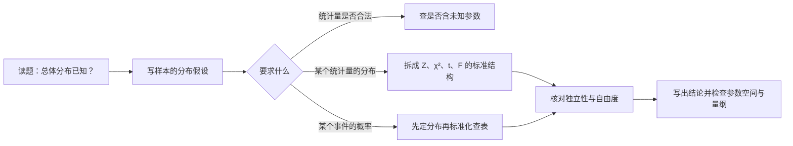
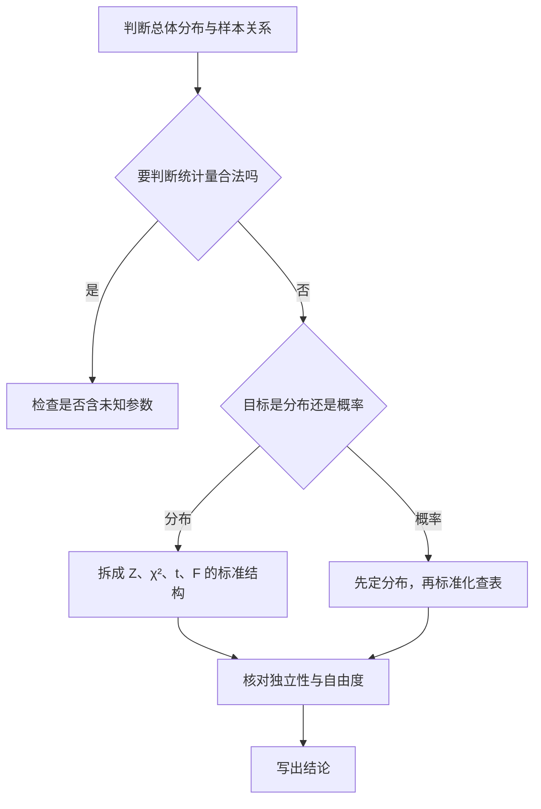

---
subject:
- 数理统计
date: '2026-09-15'
type: homework
source:
- 概率论及数理统计（第4版·下册）第六章 数理统计的基本概念
schema_version: 2
time: '2026-09-26T01:11:40+08:00'
aliases: []
tags: []
legacy_status: 已完成
legacy_topics:
- 统计量的判断
- 样本均值的精确分布
- 四大抽样分布判定
- 样本极值分布
- 指数分布与卡方分布
- 正态总体抽样分布定理
status: not done
---

# 9月15日数理统计作业

## 作业范围

- 第六章《数理统计的基本概念》习题：第 1—10 题、第 14 题。

## 使用的方法

本次解答严格按教材与课堂采用的方法完成：

1. **判断统计量用定义 6.1.2**：样本的函数中不含任何未知参数才是统计量。
2. **求统计量的精确分布用定理 6.3.1 与推论**：正态总体下 $\bar\xi$ 的分布、$\frac{nS^2}{\sigma^2}\sim\chi^2_{(n-1)}$、$\bar\xi$ 与 $S^2$ 独立，以及学生化 $t$ 统计量。
3. **识别四大分布用课堂的"结构识别口诀"**：正态线性组合 → 正态；独立标准正态平方和 → $\chi^2$；正态量除以独立卡方均方根 → $t$；两个独立卡方均方之比 → $F$。
4. **求极值/极差分布用教材 (6.2.10)、(6.2.11)**：$F_n^*(u)=[F(u)]^n$，$F_1^*(v)=1-[1-F(v)]^n$。
5. **指数分布样本均值用特征函数法（教材例 6.2.3）**：$n\bar\xi\sim\Gamma(n,\lambda)$，进而化为 $\chi^2$。
6. **查表统一使用课程的上侧分位数约定**：$P(Z>u_\alpha)=\alpha$，$u_{0.05}=1.645$，$u_{0.025}=1.960$。

> [!important] 记号约定（务必先看）
> 本课程教材中正态分布写作 $N(a,\sigma)$，**第二个参数是标准差 $\sigma$，不是方差**（见定理 6.3.1：$\bar\xi\sim N(a,\sigma/\sqrt n)$ 而 $\frac{nS^2}{\sigma^2}\sim\chi^2_{(n-1)}$）。
> 样本方差 $S^2=\frac1n\sum(\xi_i-\bar\xi)^2$（分母 $n$），修正样本方差 $S^{*2}=\frac{1}{n-1}\sum(\xi_i-\bar\xi)^2$（分母 $n-1$），$nS^2=(n-1)S^{*2}$。

---

## 习题 1

### 题目

设总体 $\xi$ 服从正态 $N(5,2)$，$\xi_1,\cdots,\xi_9$ 为其样本，试求样本的平均值 $\bar\xi$ 大于 $8$ 的概率。

> [!hint]- 点击展开提示
> 正态总体的样本均值仍是正态，标准差要除以 $\sqrt n$（定理 6.3.1，或教材例 6.2.1 的特征函数法）。

> [!solution]- 点击展开详细解析
> **解**：总体 $\xi\sim N(a,\sigma)$ 且 $a=5$、$\sigma=2$。由定理 6.3.1，
> $$
> \bar\xi\sim N\left(a,\frac{\sigma}{\sqrt n}\right)=N\left(5,\frac{2}{3}\right).
> $$
> 标准化
> $$
> U=\frac{\bar\xi-5}{2/3}\sim N(0,1),
> $$
> 于是
> $$
> P\{\bar\xi>8\}
> =P\left\{U>\frac{8-5}{2/3}\right\}
> =P\{U>4.5\}
> =1-\Phi(4.5).
> $$
> 查标准正态表得 $\Phi(4.5)\approx0.9999966$，所以
> $$
> \boxed{P\{\bar\xi>8\}\approx3.4\times10^{-6}\approx0.}
> $$
> **点评**：$4.5$ 已超出常用正态表的范围，其尾部概率近乎为零。这正是"$\bar\xi$ 的波动是 $\frac{\sigma}{\sqrt n}$ 量级"的直接体现：$n=9$ 时标准差只剩 $0.667$，偏离均值 $3$ 个原始单位相当于偏离 $4.5$ 个标准差。$\square$

---

## 习题 2

### 题目

设总体 $\xi$ 在 $\left(\theta-\frac12,\theta+\frac12\right)$ 上服从均匀分布，$\xi_1,\xi_2,\cdots,\xi_9$ 为其样本，试指出 $\bar\xi-\frac12$、$\bar\xi+\theta$ 中哪个是统计量。

> [!hint]- 点击展开提示
> 统计量是"不带未知参数的样本函数"（定义 6.1.2）。本题中哪个符号是未知的？

> [!solution]- 点击展开详细解析
> **解**：总体 $\xi\sim U\!\left(\theta-\frac12,\theta+\frac12\right)$ 中的 $\theta$ 是**未知参数**，它属于总体分布，不属于样本。

> [!important]- 判断标准
> 已知常数可以出现，未知参数不可以出现。

- 对 $\bar\xi-\frac12$：它就是样本的函数
  $$
  \bar\xi-\frac12=\frac1n\sum_{i=1}^{n}\xi_i-\frac12,
  $$
  其中 $\frac12$ 是已知常数，表达式中不含 $\theta$，所以**是统计量**。
- 对 $\bar\xi+\theta$：表达式中含有未知参数 $\theta$，代入任何一组样本观测值也**算不出确定数值**，所以**不是统计量**。

$$
\boxed{\bar\xi-\frac12\ \text{是统计量};\qquad \bar\xi+\theta\ \text{不是统计量}.}
$$

**点评**：判据不是"看起来像不像"，而是"能不能只用样本算出来"。$\theta$ 恰好又是均匀分布的**位置参数**，容易误当作已知中心位置，这是常见陷阱。$\square$

---

## 习题 3

### 题目

设总体 $\xi$ 服从正态 $N(0,\sigma)$，$\xi_1,\xi_2,\xi_3,\xi_4$ 为其样本，试问 $\eta=\dfrac{(\xi_1-\xi_2)^2}{(\xi_3+\xi_4)^2}$ 服从什么分布。

> [!hint]- 点击展开提示
> 先把分子、分母各整理成"标准正态量的平方"，再用 $\chi^2$ 与 $F$ 的结构。注意 $\sigma$ 会整体约掉。

> [!solution]- 点击展开详细解析
> **解**：总体均值为 $0$、标准差为 $\sigma$，故 $\xi_i\sim N(0,\sigma)$ 且相互独立。
>
> **第一步：求分子。** 正态变量的线性组合仍为正态（教材 §6.2 的结论），且
> $$
> E(\xi_1-\xi_2)=0-0=0,\qquad
> D(\xi_1-\xi_2)=\sigma^2+\sigma^2=2\sigma^2,
> $$
> 于是 $\xi_1-\xi_2\sim N(0,\sqrt2\,\sigma)$，从而
> $$
> \frac{\xi_1-\xi_2}{\sqrt2\,\sigma}\sim N(0,1)
> \quad\Longrightarrow\quad
> \frac{(\xi_1-\xi_2)^2}{2\sigma^2}\sim\chi^2_{(1)}.
> $$
>
> **第二步：求分母。** 同理 $E(\xi_3+\xi_4)=0$，$D(\xi_3+\xi_4)=2\sigma^2$，故
> $$
> \frac{(\xi_3+\xi_4)^2}{2\sigma^2}\sim\chi^2_{(1)}.
> $$
>
> **第三步：验证独立性。** 前两个统计量分别只用到互不重叠的样本子集 $\{\xi_1,\xi_2\}$ 与 $\{\xi_3,\xi_4\}$，而样本本身相互独立，所以这两个 $\chi^2_{(1)}$ 变量相互独立。
>
> **第四步：拼成 $F$。** 由 $F$ 的定义，
> $$
> \eta=\frac{(\xi_1-\xi_2)^2}{(\xi_3+\xi_4)^2}
> =\frac{\dfrac{(\xi_1-\xi_2)^2}{2\sigma^2}\Big/1}{\dfrac{(\xi_3+\xi_4)^2}{2\sigma^2}\Big/1},
> $$
> 分子分母同为"独立 $\chi^2_{(1)}$ 除以自由度 $1$"，于是
> $$
> \boxed{\eta\sim F_{(1,1)}.}
> $$
> **点评**：$\sigma$ 在上下同时出现被约掉，说明该统计量**不依赖未知的 $\sigma$**，这正是它能作为枢轴量的原因。判断题若把分子分母看成"两个独立的 $\chi^2_{(1)}$"，就一定要写出"独立性由样本子集互不重叠保证"这句话——这是课堂反复强调的失分点。$\square$

---

## 习题 4

### 题目

设总体 $\xi$ 服从正态 $N(1,2)$，$\xi_1,\xi_2,\xi_3,\xi_4$ 为其样本，记 $\eta=k\left[\sum_{i=1}^{4}\xi_i-4\right]^{2}$，试问 $k$ 取何值，使得 $\eta$ 服从 $\chi^2_m$ 分布，自由度 $m$ 是何值。

> [!hint]- 点击展开提示
> 先把 $\sum\xi_i$ 标准化：它的均值是 $4a$，标准差是 $\sqrt n\,\sigma$（不是 $\sigma$）。

> [!solution]- 点击展开详细解析
> **解**：总体 $\xi\sim N(1,2)$，即 $a=1$、$\sigma=2$，样本容量 $n=4$，且 $\xi_i$ 相互独立。
>
> $\sum_{i=1}^{4}\xi_i$ 是正态变量的线性组合，故仍为正态，且
> $$
> E\left(\sum_{i=1}^{4}\xi_i\right)=4\times1=4,
> $$
> $$
> D\left(\sum_{i=1}^{4}\xi_i\right)=4\times2^2=16,
> $$
> 即 $\sum_{i=1}^{4}\xi_i\sim N(4,4)$。因此
> $$
> \frac{\sum_{i=1}^{4}\xi_i-4}{4}\sim N(0,1),
> $$
> 由 $\chi^2$ 的定义（独立标准正态变量平方和），
> $$
> \left(\frac{\sum_{i=1}^{4}\xi_i-4}{4}\right)^{2}
> =\frac{1}{16}\left[\sum_{i=1}^{4}\xi_i-4\right]^{2}
> \sim\chi^2_{(1)}.
> $$
> 与 $\eta=k\left[\sum_{i=1}^{4}\xi_i-4\right]^{2}$ 对照，即得
> $$
> \boxed{k=\frac{1}{16},\qquad m=1.}
> $$
> **点评**：三类易错点——
> 1. 误把标准差当方差，取 $D(\sum\xi_i)=4\times2=8$；
> 2. 忘记方差在求和时按 $n$ 倍放大，直接写 $D(\sum\xi_i)=2^2=4$；
> 3. 误以为"$4$ 个样本就给自由度 $4$"。此处只有一个标准正态变量被平方，所以 $m=1$。$\square$

---

## 习题 5

### 题目

设总体 $\xi$ 服从正态 $N(3,2)$，$\xi_1,\xi_2,\cdots,\xi_{16}$ 为其样本，$\bar\xi$ 及 $S^2$ 分别为样本的均值与方差，试建立 $t$ 分布的统计量。

> [!hint]- 点击展开提示
> 用定理 6.3.1 的推论：**方差未知**时，把 $\sigma$ 换成样本标准差，自由度减一。

> [!solution]- 点击展开详细解析
> **解**：总体 $\xi\sim N(3,2)$，$n=16$。由定理 6.3.1，
> $$
> \bar\xi\sim N\left(3,\frac{2}{4}\right)=N\left(3,\frac12\right),\qquad
> \frac{16S^2}{2^2}=4S^2\sim\chi^2_{(15)},
> $$
> 且 $\bar\xi$ 与 $S^2$ **相互独立**。
>
> 于是
> $$
> Z=\frac{\bar\xi-3}{2/\sqrt{16}}=\frac{\bar\xi-3}{1/2}=2(\bar\xi-3)\sim N(0,1)
> $$
> 与上面的 $\chi^2_{(15)}$ 独立。按 $t$ 分布的构造
> $$
> T=\frac{Z}{\sqrt{\dfrac{4S^2}{15}}}
> =\frac{2(\bar\xi-3)}{\dfrac{2S}{\sqrt{15}}}
> =\sqrt{15}\,\frac{\bar\xi-3}{S}\sim t_{(15)}.
> $$
> 若改用修正样本方差 $S^{*2}=\frac{16}{15}S^2$，由 $nS^2=(n-1)S^{*2}$ 可写成等价形式
> $$
> T=\frac{\bar\xi-3}{S^*/\sqrt{16}}=\frac{4(\bar\xi-3)}{S^*}\sim t_{(15)}.
> $$
> 故所求统计量为
> $$
> \boxed{T=\sqrt{15}\,\frac{\bar\xi-3}{S}\sim t_{(15)},
> \qquad\text{或等价地}\quad
> T=\frac{4(\bar\xi-3)}{S^*}\sim t_{(15)}.}
> $$
> **点评**：这条正是教材定理 6.3.1 的推论 $T=\sqrt{n-1}\,\frac{\bar\xi-a}{S}\sim t_{(n-1)}$，代入 $n=16$ 即 $\sqrt{15}\,\frac{\bar\xi-3}{S}$。两个写法只差 $S$ 与 $S^*$ 的换算，**数值上完全一致**，考试写哪个都可以，但要保持分母与分子口径统一。$\square$

---

## 习题 6

### 题目

设总体 $\xi$ 服从正态 $N(5,6)$，$n$ 及 $\bar\xi$ 分别为样本容量及样本均值，试问 $n$ 至少应取多大，使得 $\bar\xi$ 位于区间 $(3,7)$ 的概率不小于 $0.90$。

> [!hint]- 点击展开提示
> $\bar\xi\sim N\!\left(5,\dfrac{6}{\sqrt n}\right)$，把"落在 $(3,7)$"化为"$|\bar\xi-5|<2$"，再用 $u_{0.05}=1.645$。

> [!solution]- 点击展开详细解析
> **解**：总体 $\xi\sim N(5,6)$，$a=5$、$\sigma=6$。由定理 6.3.1，
> $$
> \bar\xi\sim N\left(5,\frac{6}{\sqrt n}\right).
> $$
> 标准化 $U=\dfrac{\bar\xi-5}{6/\sqrt n}\sim N(0,1)$。注意 $(3,7)$ 关于 $5$ 对称，于是
> $$
> P\{3<\bar\xi<7\}
> =P\left\{|U|<\frac{2\sqrt n}{6}\right\}
> =2\Phi\!\left(\frac{\sqrt n}{3}\right)-1.
> $$
> 要求 $2\Phi\!\left(\frac{\sqrt n}{3}\right)-1\ge0.90$，即
> $$
> \Phi\!\left(\frac{\sqrt n}{3}\right)\ge0.95.
> $$
> 按上侧分位数约定 $P(Z>u_\alpha)=\alpha$，条件等价于
> $$
> \frac{\sqrt n}{3}\ge u_{0.05}=1.645,
> $$
> 所以
> $$
> \sqrt n\ge4.935,\qquad n\ge4.935^2\approx24.35.
> $$
> 因 $n$ 必须为整数，
> $$
> \boxed{n\ge25.}
> $$
> **验算**：取 $n=25$，
> $$
> P=2\Phi\!\left(\frac{5}{3}\right)-1=2\Phi(1.667)-1\approx2\times0.9522-1=0.9044>0.90.\ \checkmark
> $$
> 而 $n=24$ 时 $P=2\Phi(1.633)-1\approx0.8975<0.90$，确实不够。
> **点评**：这类题的关键有两点：一是"区间对称"要立刻翻译成 $|\bar\xi-a|<$ 常数；二是最后**必须向上取整**，取 $n=24$ 是典型失分。同时注意 $u_{0.05}=1.645$ 用的是上侧分位数记号，若查的是 $\Phi$ 表则应查 $0.95$ 处的 $z$ 值，两者数值一致。$\square$

---

## 习题 7

### 题目

设总体 $\xi$ 服从具有参数 $\lambda>0$ 的指数分布，$\xi_1,\xi_2,\cdots,\xi_n$ 为其样本，$\bar\xi$ 为样本均值：

(1) 试求 $\eta=2n\lambda\bar\xi$ 的分布；
(2) 若 $n=1$，试问 $P\{\eta>6\}$ 是何值（查表）。

> [!hint]- 点击展开提示
> 用教材例 6.2.3 的**特征函数法**求 $\bar\xi$ 的分布，再把 $\Gamma$ 分布与 $\chi^2$ 分布对上号：$\Gamma$ 分布的形状参数与 $\chi^2$ 的自由度有这样的对应——$2\lambda\times(\text{Gamma}(n,\lambda)\ \text{变量})\sim\chi^2_{(2n)}$。

> [!solution]- 点击展开详细解析
> **解**
>
> **(1)** 总体 $\xi$ 的密度为 $f(x)=\lambda\mathrm e^{-\lambda x}\,(x>0)$，特征函数为
> $$
> \varphi(t)=\frac{\lambda}{\lambda-jt}=\left(1-j\frac{t}{\lambda}\right)^{-1}.
> $$
> $\bar\xi=\frac1n\sum_{i=1}^n\xi_i$，利用独立随机变量和的特征函数等于特征函数之积，且 $\frac1n\xi_i$ 的特征函数为 $\varphi\!\left(\frac tn\right)$（教材 (6.2.9)），得
> $$
> \varphi_1(t)=\left[\varphi\!\left(\frac tn\right)\right]^{n}
> =\left(1-j\frac{t}{n\lambda}\right)^{-n}.
> $$
> 这正是 $\Gamma$ 分布的特征函数，即
> $$
> \bar\xi\sim\Gamma\left(n,\frac{1}{n\lambda}\right),
> $$
> 或等价地 $n\bar\xi\sim\Gamma(n,1/\lambda)$（教材例 6.2.3）。因此 $\sum_{i=1}^n\xi_i=n\bar\xi$ 是 $n$ 个独立同参数指数分布变量之和。
>
> 由 $\Gamma$ 分布与 $\chi^2$ 分布的关系：$X\sim\Gamma(n,\lambda)$ 时 $2\lambda X\sim\chi^2_{(2n)}$。取 $X=n\bar\xi\sim\Gamma(n,\lambda)$，得
> $$
> \eta=2n\lambda\bar\xi=2\lambda\,(n\bar\xi)\sim\chi^2_{(2n)}.
> $$
> 于是
> $$
> \boxed{\eta=2n\lambda\bar\xi\sim\chi^2_{(2n)}.}
> $$
>
> **(2)** 当 $n=1$ 时，由 (1) 知 $\eta\sim\chi^2_{(2)}$。自由度为 $2$ 的 $\chi^2$ 分布就是均值为 $2$ 的指数分布，其密度为
> $$
> f_\eta(y)=\frac12\mathrm e^{-y/2},\qquad y>0,
> $$
> 于是
> $$
> P\{\eta>6\}=\int_6^{\infty}\frac12\mathrm e^{-y/2}\,\mathrm dy
> =\mathrm e^{-3}\approx0.0498.
> $$
> $$
> \boxed{P\{\eta>6\}=\mathrm e^{-3}\approx0.0498.}
> $$
> **查表验算**：查 $\chi^2$ 分布表得 $\chi^2_{0.05}(2)=5.991$，$\chi^2_{0.025}(2)=7.378$。因为 $5.991<6<7.378$，所以
> $$
> 0.025<P\{\eta>6\}<0.05,
> $$
> 与 $\mathrm e^{-3}\approx0.0498$ 完全吻合。$\checkmark$
>
> **点评**：本题的两个关键工具是"**样本均值的特征函数法**（教材例 6.2.3）"和"**$\Gamma$ 分布与 $\chi^2$ 的换算**"。另外要记住结论：$n$ 个独立指数分布变量之和服从 $\Gamma(n,\lambda)$；特别地单个指数变量的 $2\lambda$ 倍服从 $\chi^2_{(2)}$。$\square$

---

## 习题 8

### 题目

设总体 $\xi$ 服从正态 $N(12,2)$，今抽取容量为 $5$ 的样本 $\xi_1,\cdots,\xi_5$，试问：

(1) 样本的平均值 $\bar\xi$ 大于 $13$ 的概率是多少？
(2) 样本的极小值小于 $10$ 的概率是多少？
(3) 样本的极大值大于 $15$ 的概率是多少？

> [!hint]- 点击展开提示
> (1) 用定理 6.3.1； (2)(3) 用教材 (6.2.10)、(6.2.11)：极大值、极小值的分布函数是 $[F(u)]^n$ 与 $1-[1-F(v)]^n$，并且**尽量用"求不发生的概率再取补"的方式算**。

> [!solution]- 点击展开详细解析
> **解**：总体 $\xi\sim N(12,2)$，即 $a=12$、$\sigma=2$，$n=5$。
>
> **(1) 样本均值。** 由定理 6.3.1，
> $$
> \bar\xi\sim N\left(12,\frac{2}{\sqrt5}\right).
> $$
> 标准化后
> $$
> P\{\bar\xi>13\}
> =1-P\{\bar\xi\le13\}
> =1-\Phi\!\left(\frac{13-12}{2/\sqrt5}\right)
> =1-\Phi\!\left(\frac{\sqrt5}{2}\right)
> =1-\Phi(1.118).
> $$
> 查表 $\Phi(1.118)\approx0.8682$，故
> $$
> \boxed{P\{\bar\xi>13\}\approx0.1318.}
> $$
>
> **(2) 样本极小值 $\xi_1^*=\min\{\xi_1,\cdots,\xi_5\}$。** 由教材 (6.2.11)，
> $$
> P\{\xi_1^*<10\}=1-P\{\xi_1^*\ge10\}
> =1-P\{\xi_1\ge10,\ \xi_2\ge10,\cdots,\xi_5\ge10\}.
> $$
> 样本相互独立，所以"五个都不小于 $10$"的概率是五者概率之积：
> $$
> P\{\xi_1^*\ge10\}=\bigl[P\{\xi\ge10\}\bigr]^5
> =\Bigl[1-\Phi\!\left(\frac{10-12}{2}\right)\Bigr]^5
> =\bigl[1-\Phi(-1)\bigr]^5
> =\bigl[\Phi(1)\bigr]^5.
> $$
> 查表 $\Phi(1)=0.8413$，$\Phi(1)^5\approx0.4216$，于是
> $$
> \boxed{P\{\xi_1^*<10\}=1-0.8413^5\approx1-0.4216=0.5784.}
> $$
>
> **(3) 样本极大值 $\xi_5^*=\max\{\xi_1,\cdots,\xi_5\}$。** 由教材 (6.2.10)，
> $$
> P\{\xi_5^*>15\}=1-P\{\xi_5^*\le15\}
> =1-P\{\xi_1\le15,\cdots,\xi_5\le15\}
> =1-\bigl[F(15)\bigr]^5.
> $$
> 而
> $$
> F(15)=\Phi\!\left(\frac{15-12}{2}\right)=\Phi(1.5)\approx0.9332,
> $$
> 于是
> $$
> \boxed{P\{\xi_5^*>15\}=1-0.9332^5\approx1-0.7078=0.2922.}
> $$
> **点评**：
> - 极值题的核心是把"**至少有一个**"转成"**一个都没有的反面**"，再用独立性把联合概率拆成乘积：$\max$ 用 $F^n$，$\min$ 用 $1-[1-F]^n$。
> - 不要写成 $P\{\xi_1\ge10,\dots,\xi_5\ge10\}=P\{\xi\ge10\}$；样本有 $5$ 个，必须取 $5$ 次方。
> - (2)(3) 的符号方向极易写反：$\min<10$ 与 $\max>15$ 都是"至少一个越界"，都用 $1-(\cdot)^5$。$\square$

---

## 习题 9

### 题目

设电子元件的寿命（时数）$\xi$ 服从以 $\lambda=0.0015$ 为参数的指数分布，即有密度函数 $f(x)=0.0015\mathrm e^{-0.0015x}\,(x>0)$。今测试 $6$ 个元件，并记录下它们各自失效的时间（单位：h）。试问：

(1) 至 $800$ 小时时没有一个元件失效的概率是多少？
(2) 至 $3000$ 小时时所有元件都失效的概率是多少？

> [!hint]- 点击展开提示
> 两个问题都是"$6$ 个独立事件的联合概率"。先写出单个元件在 $800$ 小时与 $3000$ 小时处的生存函数 $P\{\xi>t\}=\mathrm e^{-\lambda t}$ 与分布函数 $F(t)=1-\mathrm e^{-\lambda t}$。

> [!solution]- 点击展开详细解析
> **解**：$\xi$ 的分布函数为
> $$
> F(t)=P\{\xi\le t\}=1-\mathrm e^{-0.0015t},\qquad t>0,
> $$
> 生存函数为 $P\{\xi>t\}=\mathrm e^{-0.0015t}$。$6$ 个元件相互独立。
>
> **(1) 至 $800$ 小时没有一个失效**，即 $6$ 个元件的寿命都大于 $800$：
> $$
> P=\bigl[P\{\xi>800\}\bigr]^6
> =\left[\mathrm e^{-0.0015\times800}\right]^6
> =\left[\mathrm e^{-1.2}\right]^6
> =\mathrm e^{-7.2}.
> $$
> $$
> \boxed{P=\mathrm e^{-7.2}\approx7.47\times10^{-4}.}
> $$
>
> **(2) 至 $3000$ 小时所有元件都失效**，即 $6$ 个元件的寿命都不超过 $3000$：
> $$
> P=\bigl[P\{\xi\le3000\}\bigr]^6
> =\left[1-\mathrm e^{-0.0015\times3000}\right]^6
> =\left[1-\mathrm e^{-4.5}\right]^6.
> $$
> 由 $\mathrm e^{-4.5}\approx0.011109$ 得
> $$
> \boxed{P=(1-0.011109)^6=0.988891^6\approx0.9352.}
> $$
> **点评**：本题是"独立同分布样本的极值分布"的**应用版**：
> - (1) 求的是 $\min\{\xi_1,\dots,\xi_6\}>800$，恰好是极小值分布的直接形式 $[1-F(v)]^n$；
> - (2) 求的是 $\max\{\xi_1,\dots,\xi_6\}\le3000$，即 $[F(u)]^n$。
>
> 顺带看：样本最小值 $\xi_1^*$ 服从参数为 $n\lambda$ 的指数分布（教材例 6.2.5，式 (6.2.20)），所以 (1) 也可直接写成 $P\{\xi_1^*>800\}=\mathrm e^{-6\lambda\times800}=\mathrm e^{-7.2}$，两条路径结果一致。$\square$

---

## 习题 10

### 题目

设总体 $\xi$ 服从正态 $N(20,\sqrt3)$，今从中抽取容量为 $10$ 及 $15$ 的两个独立样本，试问这两个样本的平均值之差的绝对值大于 $0.3$ 的概率是多少？

> [!hint]- 点击展开提示
> 两个样本均值之差仍为正态；**独立**时方差**相加**（不要因为中间是减号就把方差相减）。注意本题 $\sigma=\sqrt3$。

> [!solution]- 点击展开详细解析
> **解**：设两个样本均值为 $\bar\xi$（容量 $n_1=10$）与 $\bar\eta$（容量 $n_2=15$）。总体 $\xi\sim N(20,\sqrt3)$，即 $\sigma=\sqrt3$、$\sigma^2=3$。由定理 6.3.1，
> $$
> \bar\xi\sim N\left(20,\frac{\sqrt3}{\sqrt{10}}\right),
> \qquad
> \bar\eta\sim N\left(20,\frac{\sqrt3}{\sqrt{15}}\right).
> $$
> 两组样本独立，故 $\bar\xi$ 与 $\bar\eta$ 独立，正态变量的差仍为正态，且
> $$
> E(\bar\xi-\bar\eta)=20-20=0,
> $$
> $$
> D(\bar\xi-\bar\eta)=\frac{\sigma^2}{n_1}+\frac{\sigma^2}{n_2}
> =\frac{3}{10}+\frac{3}{15}=0.3+0.2=0.5.
> $$
> 于是
> $$
> \bar\xi-\bar\eta\sim N\!\left(0,\sqrt{0.5}\right),
> \qquad
> \frac{\bar\xi-\bar\eta}{\sqrt{0.5}}\sim N(0,1).
> $$
> 所求为
> $$
> P\{|\bar\xi-\bar\eta|>0.3\}
> =2\left[1-\Phi\!\left(\frac{0.3}{\sqrt{0.5}}\right)\right]
> =2\bigl[1-\Phi(0.424)\bigr].
> $$
> 查表 $\Phi(0.424)\approx0.6643$，故
> $$
> \boxed{P\{|\bar\xi-\bar\eta|>0.3\}=2\times0.3357\approx0.6714.}
> $$
> **点评**：两条铁律——
> 1. **独立则方差相加**：$D(\bar\xi-\bar\eta)=\frac{\sigma^2}{n_1}+\frac{\sigma^2}{n_2}$，与"减号"无关（课堂易错点第 2 条）。
> 2. **对称区间要乘 $2$**：$P\{|U|>c\}=2[1-\Phi(c)]$，写成 $1-\Phi(c)$ 是最常见错误。
>
> 另外，"$N(20,\sqrt3)$" 按本课程约定第二个参数是**标准差**，故 $\sigma^2=3$，这是本题最容易看错的地方。$\square$

---

## 习题 14

### 题目

设总体 $\xi$ 服从正态 $N(a,\sigma)$，$\xi_1,\xi_2,\cdots,\xi_n$ 为其样本，$\bar\xi$ 及 $S_n^2$ 分别为样本的平均值及方差。又设 $\xi_{n+1}$ 服从正态 $N(a,\sigma)$，且与 $\xi_1,\cdots,\xi_n$ 相互独立。试求统计量

$$
\eta=\frac{\xi_{n+1}-\bar\xi}{S_n}\sqrt{\frac{n-1}{n+1}}
$$

的抽样分布。

> [!hint]- 点击展开提示
> 把 $\eta$ 看成"$Z/\sqrt{V/\nu}$"的样子：分子是 $\xi_{n+1}-\bar\xi$，它经过标准化后是 $N(0,1)$；分母来自 $\frac{nS_n^2}{\sigma^2}\sim\chi^2_{(n-1)}$。关键还是**说明二者独立**。

> [!solution]- 点击展开详细解析
> **解**：设 $S_n^2=\frac1n\sum_{i=1}^n(\xi_i-\bar\xi)^2$（本课程约定，分母为 $n$）。
>
> **第一步：分子的分布。** $\xi_{n+1}$ 与 $\xi_1,\cdots,\xi_n$ 独立，故与 $\bar\xi$ 独立，于是
> $$
> E(\xi_{n+1}-\bar\xi)=a-a=0,
> $$
> $$
> D(\xi_{n+1}-\bar\xi)=D(\xi_{n+1})+D(\bar\xi)
> =\sigma^2+\frac{\sigma^2}{n}
> =\sigma^2\cdot\frac{n+1}{n},
> $$
> 且它是正态变量的线性组合，所以
> $$
> Z=\frac{\xi_{n+1}-\bar\xi}{\sigma\sqrt{\dfrac{n+1}{n}}}\sim N(0,1).
> $$
>
> **第二步：分母的分布。** 由定理 6.3.1，
> $$
> V=\frac{nS_n^2}{\sigma^2}\sim\chi^2_{(n-1)}.
> $$
>
> **第三步：独立性。** $S_n^2$ 只由 $\xi_1,\cdots,\xi_n$ 决定，而 $\xi_{n+1}$ 与这 $n$ 个变量独立，故 $\xi_{n+1}$ 与 $S_n^2$ 独立；又由定理 6.3.1，$\bar\xi$ 与 $S_n^2$ 相互独立。因此 $\xi_{n+1}-\bar\xi$ 与 $S_n^2$ 相互独立，从而 $Z$ 与 $V$ 相互独立。
>
> **第四步：拼成 $t$。** 由 $t$ 分布的构造，
> $$
> \frac{Z}{\sqrt{V/(n-1)}}
> =\frac{\xi_{n+1}-\bar\xi}{\sigma\sqrt{\dfrac{n+1}{n}}}\cdot\frac{\sqrt{n-1}\,\sigma}{S_n\sqrt n}
> =\frac{\xi_{n+1}-\bar\xi}{S_n}\sqrt{\frac{n-1}{n+1}}
> =\eta.
> $$
> 因此
> $$
> \boxed{\eta\sim t_{(n-1)}.}
> $$
> **点评**：本题有三个值得记住的点——
> 1. **分子方差要加上 $\bar\xi$ 的方差**：$D(\xi_{n+1}-\bar\xi)=\sigma^2(1+\frac1n)$，漏掉 $\frac{\sigma^2}{n}$ 会得到错误的常数。
> 2. **自由度是 $n-1$ 而不是 $n$**：分母来自围绕**样本均值**的离差平方和，损失一个自由度。若题目改成围绕**已知真值** $a$ 的平方和，自由度才会是 $n$。
> 3. **独立性必须显式论证**：这里用了"$\xi_{n+1}$ 与旧样本独立" + "$\bar\xi$ 与 $S^2$ 独立（定理 6.3.1）"两步。$\eta$ 的统计意义是把一个**新观测**与已有样本的样本标准差作比较，属于预测型 $t$ 统计量，第八章区间预测会再次用到。$\square$

---

## 本次作业涉及内容总结

### 1. 统一解题框架

10 道题可以全部归入同一条主线：

### 2. 三类知识点归纳

| 类别 | 涉及题目 | 核心工具 |
|:--|:--|:--|
| 基本概念辨析 | 题 2 | 统计量定义 6.1.2（不含未知参数） |
| 正态总体抽样分布 | 题 1、4、5、6、10、14 | 定理 6.3.1 及推论、独立正态线性组合 |
| 四大分布的结构识别 | 题 3、4、5、7、14 | $\chi^2$ 平方和、$t$ 正态除卡方、$F$ 卡方之比 |### 3. 关键公式速查

| 内容 | 公式 | 出处 |
|:--|:--|:--|
| 样本均值分布 | $\bar\xi\sim N\!\left(a,\dfrac{\sigma}{\sqrt n}\right)$ | 定理 6.3.1 / 例 6.2.1 |
| 围绕样本均值的平方和 | $\dfrac{nS^2}{\sigma^2}=\dfrac{(n-1)S^{*2}}{\sigma^2}\sim\chi^2_{(n-1)}$ | 定理 6.3.1 |
| 围绕总体均值的平方和 | $\dfrac{1}{\sigma^2}\sum(\xi_i-a)^2\sim\chi^2_{(n)}$ | 定理 6.3.1 |
| 独立性 | $\bar\xi$ 与 $S^2$ 独立 | 定理 6.3.1 |
| 学生化 $t$ | $\sqrt{n-1}\dfrac{\bar\xi-a}{S}\sim t_{(n-1)}$ | 定理 6.3.1 推论 |
| 极大值分布 | $F_{\max}(u)=[F(u)]^n$ | (6.2.10) |
| 极小值分布 | $F_{\min}(v)=1-[1-F(v)]^n$ | (6.2.11) |
| 指数样本 | $n\bar\xi\sim\Gamma(n,\lambda)$，$2n\lambda\bar\xi\sim\chi^2_{(2n)}$ | 例 6.2.3 |
| 独立正态之差 | $D(\bar\xi-\bar\eta)=\dfrac{\sigma_1^2}{n_1}+\dfrac{\sigma_2^2}{n_2}$ | 定理 6.3.2 前段 |

### 4. 高频易错点

> [!warning] 本次作业暴露的易错点
> 1. **把 $N(a,\sigma)$ 的第二个参数当方差**（题 4、8、10、14 都会直接算错）。
> 2. **求和的方差忘记乘 $n$**：$D\!\left(\sum\xi_i\right)=n\sigma^2$（题 4）。
> 3. **自由度搞错**：围绕样本均值是 $n-1$，围绕已知真值是 $n$（题 4、5、14）。
> 4. **极值题漏取 $n$ 次方或符号写反**（题 8、9）。
> 5. **差（和）的方差相减**：独立时必须相加（题 10）。
> 6. **对称区间只乘一个尾巴**：$P\{|U|>c\}=2[1-\Phi(c)]$（题 10）。
> 7. **$n$ 求出来不向上取整**（题 6：$24.35\to25$）。
> 8. **构造 $t$、$F$ 时不写独立性依据**（题 3、5、14）。
> 9. **$S^2$ 与 $S^{*2}$ 混用**：本课程 $S^2$ 分母为 $n$（题 5 的两个等价写法）。

---

## 学习清单

### 一、必须掌握（能在 10 分钟内讲清）

- [ ] 能复述统计量定义（定义 6.1.2），并快速判断一个表达式是否是统计量（题 2）。
- [ ] 能写出 $N(a,\sigma)$ 下 $\bar\xi$ 的精确分布，并说清标准差是 $\frac{\sigma}{\sqrt n}$（题 1、6、10）。
- [ ] 能默写定理 6.3.1 的三条结论：$\bar\xi\sim N(a,\frac{\sigma}{\sqrt n})$、$\frac{nS^2}{\sigma^2}\sim\chi^2_{(n-1)}$、$\bar\xi$ 与 $S^2$ 独立。
- [ ] 能用"结构识别口诀"判定 $\chi^2$、$t$、$F$：平方和看 $\chi^2$，正态除卡方均方根看 $t$，两个卡方均方之比看 $F$（题 3、7、14）。
- [ ] 能由 $\bar\xi$ 与 $S^{*2}$ 构造 $t$ 统计量并写对自由度（题 5）。
- [ ] 能用 $F_{\max}(u)=[F(u)]^n$、$F_{\min}(v)=1-[1-F(v)]^n$ 解决极值概率问题（题 8、9）。
- [ ] 能记住 $n$ 个独立指数变量之和服从 $\Gamma(n,\lambda)$，并换算出 $\chi^2_{(2n)}$（题 7）。
- [ ] 能独立正态差（和）的方差相加而不是相减（题 10）。
- [ ] 会正确使用上侧分位数记号 $u_\alpha$，记住 $u_{0.05}=1.645$、$u_{0.025}=1.960$。

### 二、应该熟练（做完能一次做对）

- [ ] 正态线性组合的均值与方差速算：$E\!\left(\sum c_i\xi_i\right)=\sum c_ia_i$，$D\!\left(\sum c_i\xi_i\right)=\sum c_i^2\sigma_i^2$。
- [ ] 标准化"三步走"：减均值、除标准差、查表。
- [ ] 对称区间概率：$P\{|\bar\xi-a|<d\}=2\Phi\!\left(\frac{d\sqrt n}{\sigma}\right)-1$。
- [ ] 判断两个统计量是否独立：**样本子集是否互不重叠**（题 3、14）。
- [ ] 不定式结尾的处理：概率为 $n$ 的题目最后一定要检查 $n$ 是否必须为整数。

### 三、需要理解原理（不做题也要说得清）

- [ ] 为什么 $\bar\xi$ 与 $S^2$ 相互独立？（正交变换 + 多元正态不相关即独立，教材定理 6.3.1 的证明思路）
- [ ] 为什么自由度是 $n-1$？（$\sum(\xi_i-\bar\xi)=0$ 损失一个线性约束）
- [ ] 为什么可以用特征函数法求 $\bar\xi$ 的分布？（教材 (6.2.9)：$\varphi_{\bar\xi}(t)=[\varphi(t/n)]^n$）
- [ ] 为什么"正态 + 不相关 ⇒ 独立"？（多元正态的性质，教材 §6.3 反复使用）
- [ ] $\chi^2$、$t$、$F$ 的分子分母为什么必须独立？（否则结构定理不成立）

### 四、建议复盘动作

- [ ] 合上答案，把定理 6.3.1 及其推论**默写一遍**，再对照教材。
- [ ] 重做第 4、10 题，重点检查有没有把 $N(a,\sigma)$ 的第二个参数当成方差。
- [ ] 重做第 8、9 题，画出"至少一个"与"全部"的逻辑补集关系图。
- [ ] 用 $\chi^2$ 分布表复核题 7 的 $P\{\eta>6\}$ 落在 $(0.025,0.05)$ 内。
- [ ] 复盘第 14 题的独立性论证，写成三句话：谁与谁独立、依据是什么、结论是什么。
- [ ] 把本次作业的九条公式与 [[03_Sources/Reviews/数理统计/知识点解析梳理/06-抽样分布-知识梳理|第六章知识梳理]]中的"九条结论词典"逐一对应，确认没有遗漏。

### 五、与后续章节的衔接

- 第七章区间估计会**直接调用**本次作业的结论：构造枢轴量本质就是"选一条合适的抽样分布结论"。
- 第 14 题这类"新观测 vs 样本"的 $t$ 统计量，是后续**预测区间**的原型。
- 第 7 题的"指数分布 → $\chi^2_{(2n)}$"是后续**指数总体参数的区间估计与检验**的基础。

## 相关课程内容

- [[03_Sources/Reviews/数理统计/知识点解析梳理/06-抽样分布-知识梳理|第六章 抽样分布（知识梳理）]]
- [[03_Sources/Courses/数理统计/课件/C6_1/C6_1|C6.1 总体、样本与统计量]]
- [[03_Sources/Courses/数理统计/课件/C6_2(2)/C6_2(2)|C6.2 样本数字特征及其分布]]
- [[03_Sources/Courses/数理统计/课件/C6_3/C6_3|C6.3 抽样分布定理]]
- [[03_Sources/Courses/数理统计/课堂笔记/2026-09-03-第2节-总体样本统计量与经验分布|第2节 总体、样本、统计量与经验分布]]
- [[03_Sources/Courses/数理统计/课堂笔记/2026-09-08-第3节-四大抽样分布与分位数|第3节 四大抽样分布与分位数]]
- [[03_Sources/Courses/数理统计/课堂笔记/2026-09-15-第5节-抽样分布与矩估计方法授课|第5节 双正态总体抽样分布与矩估计]]
- [[03_Sources/Courses/数理统计/课本/概率论与数理统计/概率论与数理统计|教材：概率论及数理统计（第4版·下册）]]
- 下一章：[[03_Sources/Reviews/数理统计/知识点解析梳理/07-参数估计-知识梳理|第七章 参数估计]]
