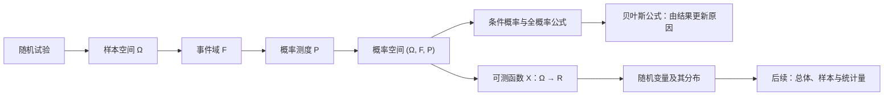

---
subject:
- 数理统计
type: lecture
class_no: 1
date: '2026-09-01'
source:
- 腾讯会议录制（概率论公理化体系与贝叶斯公式教学）
- '[[03_Sources/Courses/数理统计/课堂笔记/raw/2026-09-01-转写_电子科大王君豪的快速会议-373249-逐字稿]]'
- '[[03_Sources/Courses/数理统计/课堂笔记/raw/2026-09-01-转写_电子科大王君豪的快速会议-373249-纪要]]'
- '[[03_Sources/Courses/数理统计/课件/C6_1/C6_1]]'
courseware: C6_1.pdf（后续衔接）
meeting_code: 762175185
start_time: '2026-09-01T16:28:10+08:00'
tags:
- 概率空间
- σ代数
- 贝叶斯公式
- 随机变量
- 可测性
aliases:
- 2026-09-01 第1节 概率论基础回顾与贝叶斯思想
schema_version: 2
time: "2026-10-14T20:49:51+08:00"
legacy_status: 已完成
legacy_topics:
- 概率空间
- σ-代数
- 贝叶斯公式
- 随机变量
- 可测性
status: not done
polish_status: done
lecture_date: '2026-09-01'
---

# 2026-09-01 第1节 概率论基础回顾与贝叶斯思想

> [!abstract] 本节定位
> 本节是进入数理统计前的概率论基础回顾。课堂从概率空间的三要素出发，解释事件为什么要组成 $\sigma$-代数，再由全概率公式和贝叶斯公式说明“如何依据新信息修正判断”，最后落到随机变量的可测性，为后续“总体—样本—统计量”体系奠定基础。

## 资料来源

- 原始逐字稿：[[03_Sources/Courses/数理统计/课堂笔记/raw/2026-09-01-转写_电子科大王君豪的快速会议-373249-逐字稿|第1节逐字稿]]
- 智能纪要：[[03_Sources/Courses/数理统计/课堂笔记/raw/2026-09-01-转写_电子科大王君豪的快速会议-373249-纪要|第1节智能纪要]]
- 衔接课件：[[03_Sources/Courses/数理统计/课件/C6_1/C6_1|C6.1 总体、样本与统计量]]
- 会议号：762175185｜开始时间：2026-09-01 16:28

## 一、核心脉络

> [!info] 学习导读（补充解释）
> **本节问题**：怎样使“事件的概率”和“随机变量的分布”有严格定义，又怎样用新信息更新概率？
> **先修提醒**：$A^c$ 是补集，$A\cap B$ 表示同时发生；不熟悉时回看[[03_Sources/Reviews/概率论/知识点解析梳理/01a-随机事件的直观意义及其运算-知识梳理#六、随机事件的关系及运算|事件运算]]。
> **阅读路线**：先读概率空间三要素，再读贝叶斯公式及两个孩子例子，最后把可测性接到分布函数。
> **来源边界**：本节范围以所链接逐字稿及纪要为准；C6.1 仅作后续衔接。导读与自测为本次补充，不能视为教师原话。

> 一句话来说：概率论先规定“哪些事件可以谈概率”，再规定“概率怎样运算”；数理统计则在这套规则上利用数据反推未知规律。

## 二、概率空间的公理化结构

### 1. 为什么需要公理化

古典概型依赖“有限个等可能结果”，面对连续型或无限样本空间时不再够用。现代概率论因此把概率建立在集合与测度之上：

$$
(\Omega,\mathcal F,P).
$$

三部分分别回答三个问题：

| 对象 | 含义 | 回答的问题 |
|---|---|---|
| $\Omega$ | 样本空间，所有可能结果的集合 | 可能发生什么？ |
| $\mathcal F$ | 事件域，即 $\Omega$ 上的 $\sigma$-代数 | 哪些事件是我们要研究且能赋予概率的？ |
| $P$ | 定义在 $\mathcal F$ 上的概率测度 | 每个事件发生的可能性有多大？ |

### 2. $\sigma$-代数

事件域 $\mathcal F$ 必须满足：

1. $\Omega\in\mathcal F$；
2. 若 $A\in\mathcal F$，则 $A^c\in\mathcal F$；
3. 若 $A_1,A_2,\ldots\in\mathcal F$，则 $\bigcup_{i=1}^{\infty}A_i\in\mathcal F$。

由此也可推出 $\varnothing\in\mathcal F$，并且 $\mathcal F$ 对可列交封闭。

> 一句话来说：$\sigma$-代数不是把所有细节都保留下来，而是规定当前问题中“哪些信息值得区分”。

课堂用元件质检说明了这一点：样本空间可以包含每个元件的具体编号，但若问题只关心合格与不合格，事件域只需保留与质量状态有关的事件。这样既完成信息降维，也保证相关事件能被赋予概率。

### 3. 概率测度的三条公理

对任意 $A\in\mathcal F$，概率测度 $P$ 满足：

1. **非负性**：$P(A)\ge 0$；
2. **规范性**：$P(\Omega)=1$；
3. **可列可加性**：若 $A_1,A_2,\ldots$ 两两互斥，则

$$
P\left(\bigcup_{i=1}^{\infty}A_i\right)
=\sum_{i=1}^{\infty}P(A_i).
$$

其余常用公式，如 $P(A^c)=1-P(A)$，都可以从这三条公理推出。

## 三、从全概率公式到贝叶斯公式

设 $B_1,\ldots,B_m$ 构成样本空间的一个划分，且 $P(B_i)>0$。对事件 $A$，全概率公式为

$$
P(A)=\sum_{j=1}^{m}P(A\mid B_j)P(B_j).
$$

进一步得到贝叶斯公式：

这里还要求 $P(A)>0$，即分母非零。它描述条件概率更新，单凭该公式不能识别现实中的因果关系。

$$
\boxed{
P(B_i\mid A)
=\frac{P(A\mid B_i)P(B_i)}
{\sum_{j=1}^{m}P(A\mid B_j)P(B_j)}
}
$$

| 术语 | 数学对象 | 含义 |
|---|---|---|
| 先验概率 | $P(B_i)$ | 获得新信息前对原因 $B_i$ 的认识 |
| 似然 | $P(A\mid B_i)$ | 原因 $B_i$ 成立时观察到证据 $A$ 的可能性 |
| 后验概率 | $P(B_i\mid A)$ | 观察到 $A$ 后，对 $B_i$ 的更新认识 |

> 一句话来说：贝叶斯公式把“原因导致结果的概率”转化为“看到结果后原因成立的概率”。

课堂以外卖平台的个性化推荐为例：系统先根据一般用户形成初始偏好，再持续吸收点击、下单等新证据，更新对当前用户偏好的判断。贝叶斯思想的重点不只是一条计算公式，而是“信息到来后应当重新评估”。

### 课堂例子：两个孩子问题

在以下假设下：

- 每个孩子为男、女的概率均为 $1/2$；
- 两个孩子性别相互独立；
- 区分长幼次序；
- 获知信息的方式等价于条件“至少有一个男孩”；

原样本空间为

$$
\{BB,BG,GB,GG\}.
$$

已知至少一个男孩后排除 $GG$，条件样本空间变为

$$
\{BB,BG,GB\},
$$

因此两个都是男孩的条件概率为

$$
P(BB\mid \text{至少一个男孩})=\frac13.
$$

> [!warning] 条件信息的获得机制不能省略
> 若信息来自“随机遇到其中一个孩子且他是男孩”等不同抽样机制，条件概率可能改变。做条件概率题时，必须先明确样本空间、等可能性和信息产生方式，不能只凭自然语言直觉作答。

## 四、随机变量为什么必须可测

随机变量不是“随机变化的数”，而是定义在样本空间上的实值函数：

$$
X:\Omega\to\mathbb R.
$$

但不是任意函数都能称为随机变量。它必须满足可测性：对任意 $x\in\mathbb R$，

$$
\{\omega\in\Omega:X(\omega)\le x\}\in\mathcal F.
$$

这样才能定义

$$
F_X(x)=P\{X\le x\}.
$$

> 一句话来说：可测性保证“$X$ 不超过某个数”是一个可以计算概率的事件，因此随机变量的分布才有意义。

从映射角度看，随机变量把复杂的试验结果压缩成可计算的数值指标。例如，对产品样本点只记录“寿命”或“是否合格”，就能在实数轴上研究其分布。

## 五、与数理统计的衔接

课件 [[03_Sources/Courses/数理统计/课件/C6_1/C6_1|C6.1]] 将沿用本节的语言：

- **总体**可用一个随机变量及其分布表示；
- **样本**是来自总体的随机变量组；
- **样本观测值**是随机变量组的一次实现；
- **统计量**是样本的、不含未知参数的函数。

因此，概率论研究“已知分布时随机变量如何变化”，数理统计研究“观察到样本后如何推断未知分布或参数”。

## 六、核心公式速查

| 内容 | 公式 |
|---|---|
| 概率空间 | $(\Omega,\mathcal F,P)$ |
| 全概率公式 | $P(A)=\sum_j P(A\mid B_j)P(B_j)$ |
| 贝叶斯公式 | $P(B_i\mid A)=\dfrac{P(A\mid B_i)P(B_i)}{\sum_jP(A\mid B_j)P(B_j)}$ |
| 随机变量 | $X:\Omega\to\mathbb R$ |
| 可测性 | $\{\omega:X(\omega)\le x\}\in\mathcal F$ |
| 分布函数 | $F_X(x)=P(X\le x)$ |

## 七、易错点与课后思考

> [!warning] 易错点
> 1. $\sigma$-代数的元素是事件，不是单个概率值。
> 2. 贝叶斯公式中，$P(A\mid B)$ 与 $P(B\mid A)$ 通常不相等。
> 3. 随机变量是函数；它的观测值才是具体数字。
> 4. 条件概率题必须先明确“条件信息如何产生”。

1. 用自己的话解释：为什么事件域不一定取 $2^\Omega$？
2. 在医学检测或垃圾邮件识别场景中，分别指出先验、似然和后验。
3. 说明随机变量可测性与分布函数可定义性之间的关系。

## 自测（新编）

### 1. 信息是否足以定义随机变量

设 $\Omega=\{a,b,c,d\}$，$\mathcal F=\{\varnothing,\Omega,\{a,b\},\{c,d\}\}$。函数 $X$ 在 $a,b$ 上等于 $0$，在 $c,d$ 上等于 $1$。若把 $X(b)$ 改为 $1$，可测性是否改变？说明依据。

> [!hint]- 提示
> 检查阈值 $x=1/2$ 时的原像是否属于 $\mathcal F$。

> [!solution]- 解析
> 原函数的阈值原像只可能为 $\varnothing,\{a,b\},\Omega$，均在 $\mathcal F$ 中，因此可测。修改后 $\{X\le1/2\}=\{a\}\notin\mathcal F$，故不再可测。函数能写出来，并不保证其阈值事件可赋予概率。

### 2. 从结果反推来源

两台机器 A、B 分别生产 $60\%$、$40\%$ 的产品，次品率分别为 $1\%$、$3\%$。随机取到一件次品，求它来自 B 的概率。

> [!hint]- 提示
> 先用全概率公式求次品总概率，再计算贝叶斯公式的分子。

> [!solution]- 解析
> 次品概率为 $0.6\times0.01+0.4\times0.03=0.018$。后验概率为 $0.4\times0.03/0.018=2/3$；它与 B 的产量占比 $0.4$、次品率 $0.03$ 都不同。

## 课堂导航

- 下一节：[[03_Sources/Courses/数理统计/课堂笔记/2026-09-03-第2节-总体样本统计量与经验分布|第2节 总体、样本、统计量与经验分布]]
- 课件：[[03_Sources/Courses/数理统计/课件/C6_1/C6_1|C6.1 总体、样本与统计量]]
