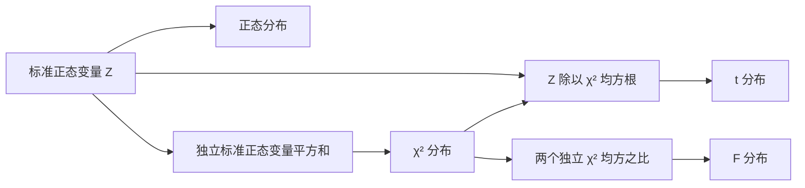
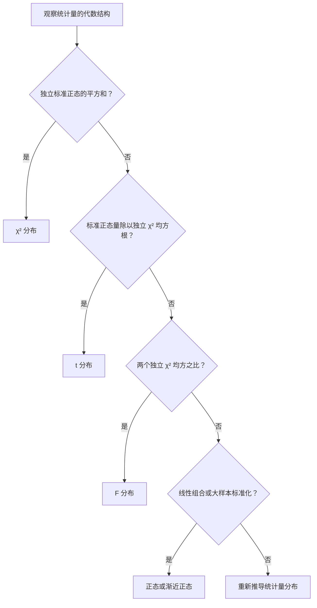

---
subject:
- 数理统计
type: lecture
class_no: 3
date: '2026-09-08'
source:
- 腾讯会议录制（数理统计四大分布讲座）
- '[[03_Sources/Courses/数理统计/课堂笔记/raw/2026-09-08-数理统计四大分布讲座-114176-逐字稿]]'
- '[[03_Sources/Courses/数理统计/课堂笔记/raw/2026-09-08-数理统计四大分布讲座-114176-纪要]]'
- '[[03_Sources/Courses/数理统计/课件/C6_3/C6_3]]'
courseware: C6_3.ppt
start_time: '2026-09-08T16:25:59+08:00'
tags:
- 卡方分布
- t分布
- F分布
- 自由度
aliases:
- 2026-09-08 第3节 四大抽样分布与分位数
schema_version: 2
time: "2026-10-14T20:49:51+08:00"
legacy_status: 已完成
legacy_topics:
- 标准正态分布
- 上侧分位数
- 卡方分布
- t分布
- F分布
- 自由度
status: not done
polish_status: done
lecture_date: '2026-09-08'
---

# 2026-09-08 第3节 四大抽样分布与分位数

> [!abstract] 本节定位
> 本节从“统计量也是随机变量”出发，集中学习标准正态分布、$\chi^2$ 分布、$t$ 分布和 $F$ 分布的构造、性质、上侧分位数与查表方法。重点不是背密度函数，而是识别统计量的结构，并据此判断它服从哪一种分布。

## 资料来源

- 原始逐字稿：[[03_Sources/Courses/数理统计/课堂笔记/raw/2026-09-08-数理统计四大分布讲座-114176-逐字稿|第3节逐字稿]]
- 智能纪要：[[03_Sources/Courses/数理统计/课堂笔记/raw/2026-09-08-数理统计四大分布讲座-114176-纪要|第3节智能纪要]]
- 对应课件：[[03_Sources/Courses/数理统计/课件/C6_3/C6_3|C6.3 抽样分布]]
- 开始时间：2026-09-08 16:25

## 一、核心脉络

> [!info] 学习导读（补充解释）
> **本节问题**：怎样从统计量的结构确定分布，再选对尾概率和自由度？
> **先修提醒**：$\bar X$ 与样本方差在抽样前都是随机变量；回看[[03_Sources/Courses/数理统计/课堂笔记/2026-09-03-第2节-总体样本统计量与经验分布#七、样本均值的分布|样本均值的分布]]。本节用 $\nu$ 表示自由度。
> **阅读路线**：正态上侧分位数 → 卡方平方和 → 独立量构造 $t$ 与 $F$ → 查表与结构识别。
> **来源边界**：与逐字稿、纪要及 C6.3 的四种分布部分核对；课件后续的单、双总体定理不整体归入本次课堂。导读与自测属于补充解释。

| 分布 | 典型结构 | 主要用途 |
|---|---|---|
| 标准正态 | 标准化后的线性统计量 | 已知方差时的均值标准化、大样本近似 |
| $\chi^2$ | 独立标准正态变量的平方和 | 刻画平方误差总量、研究总体方差 |
| $t$ | 标准正态量除以独立的方差估计量 | 正态总体方差未知时推断均值 |
| $F$ | 两个独立卡方均方之比 | 比较两个方差或两组平均平方扰动 |

> 一句话来说：看到“线性标准化、平方和、未知方差标准化、两个均方之比”，应依次联想到正态、$\chi^2$、$t$、$F$。

## 二、课前回顾：统计量也有分布

由上一节可知，样本均值、样本方差与样本矩都是样本的函数。因此在抽样前，它们都是随机变量，会随着抽到的样本不同而变化。

例如，若

$$
\xi_1,\ldots,\xi_n\overset{\mathrm{i.i.d.}}{\sim}N(\mu,\sigma^2),
$$

则

$$
\bar\xi\sim N\left(\mu,\frac{\sigma^2}{n}\right).
$$

而对一般具有有限均值和方差的总体，中心极限定理给出

$$
\frac{\bar\xi-\mu}{\sigma/\sqrt n}
\xrightarrow{d}N(0,1).
$$

本节的四类分布正是描述各种统计量抽样波动的基础工具。

## 三、标准正态分布与上侧分位数

设

$$
Z\sim N(0,1).
$$

对 $0<\alpha<1$，若 $u_\alpha$ 满足

$$
\boxed{P(Z>u_\alpha)=\alpha},
$$

则称 $u_\alpha$ 为标准正态分布的上侧 $\alpha$ 分位数。等价地，

$$
\Phi(u_\alpha)=1-\alpha.
$$

由于标准正态分布关于原点对称，

$$
\boxed{u_{1-\alpha}=-u_\alpha}.
$$

常用数值为

$$
u_{0.025}\approx1.960,
\qquad
u_{0.05}\approx1.645,
\qquad
u_{0.95}\approx-1.645.
$$

> 一句话来说：下标 $\alpha$ 表示“临界点右侧还剩多少概率”，下标越小，临界点越靠右。

### 查表步骤

1. 先看题目是否采用上侧分位数定义 $P(Z>u_\alpha)=\alpha$；
2. 若使用的表给出 $\Phi(x)=P(Z\le x)$，查找 $1-\alpha$；
3. 若 $\alpha>0.5$，先用对称性 $u_\alpha=-u_{1-\alpha}$ 转成小尾概率；
4. 画出数轴和阴影，最后核对临界点正负号。

> [!warning] 分位数下标不是累计概率
> 在本课程的“上侧分位数”约定中，$u_{0.95}$ 是左侧的负数，而不是常见的 $1.645$。混淆上尾概率与累计概率会直接导致符号错误。

## 四、$\chi^2$ 分布

### 1. 定义与自由度

若

$$
Z_1,\ldots,Z_\nu\overset{\mathrm{i.i.d.}}{\sim}N(0,1),
$$

则

$$
\boxed{Q=\sum_{i=1}^{\nu}Z_i^2\sim\chi^2(\nu)}.
$$

其中 $\nu$ 称为自由度，表示平方和中相互独立的标准正态变量个数。

> 一句话来说：$\chi^2$ 分布把多个带正负号的标准化误差平方后相加，用一个非负数表示总体波动量。

### 2. 图形与数字特征

- 取值范围为 $(0,+\infty)$；
- 小自由度时明显右偏；
- 自由度增大时，曲线整体右移并逐渐趋于对称；
- 若 $Q\sim\chi^2(\nu)$，则

$$
E(Q)=\nu,
\qquad
D(Q)=2\nu.
$$

![[03_Sources/Courses/数理统计/课件/C6_3/images/39b2aec866921445624e33db48c2eec5450e6b2786cc0b77307c39f192f23e86.jpg|430]]

*图：自由度为 5 的 $\chi^2$ 分布，取值非负且具有明显右偏。*

### 3. 可加性

若

$$
Q_1\sim\chi^2(\nu_1),
\qquad
Q_2\sim\chi^2(\nu_2),
$$

且 $Q_1,Q_2$ 相互独立，则

$$
\boxed{Q_1+Q_2\sim\chi^2(\nu_1+\nu_2)}.
$$

这里的独立性不可省略。

### 4. 上侧分位数与大自由度近似

上侧 $\alpha$ 分位数 $\chi_\alpha^2(\nu)$ 定义为

$$
\boxed{P\left(Q>\chi_\alpha^2(\nu)\right)=\alpha}.
$$

当自由度较大时，由中心极限定理，

$$
\frac{Q-\nu}{\sqrt{2\nu}}\approx N(0,1),
$$

因此可以粗略近似

$$
\boxed{\chi_\alpha^2(\nu)\approx \nu+\sqrt{2\nu}\,u_\alpha}.
$$

> [!warning] “多大算大”不是固定定理
> 课堂和课件给出的 30、45 等阈值与所用统计表及精度要求有关。能直接使用软件或完整分位数表时应优先使用精确值；只有缺表时才采用正态近似。

### 5. 课堂查表示例

对 $Q\sim\chi^2(15)$，按上侧分位数定义，

$$
\chi_{0.95}^2(15)\approx7.261,
\qquad
\chi_{0.05}^2(15)\approx24.996.
$$

所以

$$
P(7.261<Q<24.996)
=P\left(\chi_{0.95}^2(15)<Q<\chi_{0.05}^2(15)\right)
=0.95-0.05=0.90.
$$

做这类题时先把两个端点各自对应的上尾面积标在图上，比机械套数值更可靠。

## 五、$t$ 分布

### 1. 构造

若

$$
Z\sim N(0,1),\qquad Q\sim\chi^2(\nu),
$$

且 $Z$ 与 $Q$ 相互独立，则

$$
\boxed{T=\frac{Z}{\sqrt{Q/\nu}}\sim t(\nu)}.
$$

> 一句话来说：$t$ 分布是在标准化时用一个随机的方差估计替代真实方差，因此比标准正态分布具有更厚的尾部。

### 2. 图形与极限性质

- 密度曲线关于原点对称；
- 与标准正态相比尾部更厚，体现估计方差带来的额外不确定性；
- 自由度越大，$Q/\nu$ 越稳定地接近 $1$，因此

$$
t(\nu)\xrightarrow{\nu\to\infty}N(0,1).
$$

![[03_Sources/Courses/数理统计/课件/C6_3/images/bd91347bb06fd54b7114faf334d65d2662c6bea39c9735cff6a3f19c1917aa6f.jpg|430]]

*图：自由度为 10 的 $t$ 分布。曲线关于原点对称，尾部比标准正态分布更厚。*

### 3. 上侧分位数

定义

$$
P\left(T>t_\alpha(\nu)\right)=\alpha.
$$

由对称性，

$$
\boxed{t_{1-\alpha}(\nu)=-t_\alpha(\nu)}.
$$

课堂练习在该单侧定义下为

$$
t_{0.95}(20)\approx-1.7247,
\qquad
t_{0.95}(80)\approx-1.6641.
$$

随着自由度增加，它们逐渐接近

$$
u_{0.95}\approx-1.6449.
$$

### 4. 何时使用 $t$ 分布

$t$ 分布的典型场景不是笼统的“只要小样本就用 $t$”，而是：**正态总体、总体方差未知，并用样本方差对均值作标准化**。样本较小时，$t$ 与标准正态的尾部差异更明显；样本很大时二者数值接近。

> [!warning] 先检查统计表的定义
> 课堂要求优先使用群内发送的单侧表。教材若给出双侧临界值 $c$，其定义常是 $P(|T|>c)=\alpha$；换成本节的单侧记号就是 $c=t_{\alpha/2}(\nu)$，不能直接把同一个下标照抄过去。

## 六、$F$ 分布

### 1. 构造与两个自由度

若

$$
U\sim\chi^2(\nu_1),
\qquad
V\sim\chi^2(\nu_2),
$$

且 $U,V$ 相互独立，则

$$
\boxed{
F=\frac{U/\nu_1}{V/\nu_2}\sim F(\nu_1,\nu_2)
}.
$$

$\nu_1$ 是分子自由度，$\nu_2$ 是分母自由度，次序不能随意交换。

> 一句话来说：$F$ 分布比较两个独立“平均平方波动量”的相对大小。

### 2. 图形与用途

- 只取正值；
- 通常右偏；
- 常用于比较两个总体方差、方差分析以及回归模型的整体显著性检验。

### 3. 倒数性质

若

$$
F\sim F(\nu_1,\nu_2),
$$

则

$$
\boxed{\frac1F\sim F(\nu_2,\nu_1)}.
$$

设上侧分位数满足

$$
P\left(F>F_\alpha(\nu_1,\nu_2)\right)=\alpha,
$$

则倒数变换给出

$$
\boxed{
F_{1-\alpha}(\nu_1,\nu_2)
=\frac{1}{F_\alpha(\nu_2,\nu_1)}
}.
$$

当统计表只列小上尾概率时，可用这条关系计算大上尾概率对应的分位数。

> [!warning] 倒数时自由度也要交换
> $\frac1{F_\alpha(\nu_1,\nu_2)}$ 一般不是 $F_{1-\alpha}(\nu_1,\nu_2)$；必须同时把两个自由度的位置互换。

## 七、分布识别流程

识别时要同时检查三个条件：

1. 构成统计量的随机变量分别服从什么分布；
2. 题目是否明确给出独立性；
3. 自由度来自多少个独立成分，或估计过程中损失了多少约束。

## 八、核心公式速查

| 内容         | 公式                                                    |
| ---------- | ----------------------------------------------------- |
| 标准正态上侧分位数  | $P(Z>u_\alpha)=\alpha$                                |
| 正态分位数对称性   | $u_{1-\alpha}=-u_\alpha$                              |
| 卡方构造       | $\sum_{i=1}^{\nu}Z_i^2\sim\chi^2(\nu)$                |
| 卡方数字特征     | $E(Q)=\nu,\ D(Q)=2\nu$                                |
| 卡方可加性      | $\chi^2(\nu_1)+\chi^2(\nu_2)=\chi^2(\nu_1+\nu_2)$（独立） |
| 卡方大自由度近似   | $\chi_\alpha^2(\nu)\approx\nu+\sqrt{2\nu}\,u_\alpha$  |
| $t$ 构造     | $Z/\sqrt{Q/\nu}\sim t(\nu)$（独立）                       |
| $t$ 分位数对称性 | $t_{1-\alpha}(\nu)=-t_\alpha(\nu)$                    |
| $F$ 构造     | $(U/\nu_1)/(V/\nu_2)\sim F(\nu_1,\nu_2)$（独立）          |
| $F$ 倒数     | $1/F\sim F(\nu_2,\nu_1)$                              |
| $F$ 分位数关系  | $F_{1-\alpha}(\nu_1,\nu_2)=1/F_\alpha(\nu_2,\nu_1)$   |

> [!info] 课件后续内容（本节录音未展开）
> C6.3 后续还包括多元正态分布的线性变换不变性，以及正态总体下样本均值、样本方差、两样本均值差与方差比的抽样分布定理。它们会把本节四类分布真正接到统计推断中，宜在后续课堂学习后再补入对应笔记。

## 九、易错点与课后任务

> [!warning] 易错点
> 1. 上侧分位数的下标表示右尾面积，不是左侧累计概率。
> 2. $\chi^2$、$t$、$F$ 的结构定理都带有独立性条件。
> 3. $\chi^2$ 与 $F$ 只取正值，$t$ 分布可正可负且关于原点对称。
> 4. $t$ 分布的适用依据是方差未知的标准化结构，不只是“样本量小”。
> 5. $F(\nu_1,\nu_2)$ 的两个自由度有顺序；取倒数时必须交换。
> 6. 查表前必须确认是单侧表还是双侧表。

课后按课堂要求完成：

1. 熟悉群内发送的标准正态、$\chi^2$、$t$ 与 $F$ 分布表；
2. 完成自由度为 $10$ 和 $15$ 的卡方分布查表练习；
3. 复核 $t_{0.95}(20)\approx-1.7247$、$t_{0.95}(80)\approx-1.6641$，并与 $u_{0.95}\approx-1.6449$ 比较；
4. 每次查表都画出右尾阴影，注明所用分位数定义。

## 自测（新编）

### 1. 识别结构及自由度

设 $Z_1,\ldots,Z_6$ 独立且均为标准正态。求 $Q=\sum_{i=2}^6Z_i^2$、$T=Z_1/\sqrt{Q/5}$、$R=Z_1^2/(Q/5)$ 的分布。逐一指出所需独立性。

> [!hint]- 提示
> $Z_1$ 与其余五项独立，$Z_1^2$ 是自由度为 $1$ 的卡方量。

> [!solution]- 解析
> $Q\sim\chi^2(5)$；因 $Z_1$ 与 $Q$ 独立，$T\sim t(5)$；因 $Z_1^2\sim\chi^2(1)$ 与 $Q$ 独立，$R=(Z_1^2/1)/(Q/5)\sim F(1,5)$，也即 $T^2=R$。

### 2. 查表方向

已知 $t_{0.025}(10)=2.228$，求 $t_{0.975}(10)$。再把 $F_{0.95}(4,8)$ 改写为小上尾概率的分位数。

> [!hint]- 提示
> $t$ 用对称性，$F$ 用倒数并交换自由度。

> [!solution]- 解析
> $t_{0.975}(10)=-2.228$，$F_{0.95}(4,8)=1/F_{0.05}(8,4)$。两种转换依据不同，$F$ 分布不能使用关于零的对称性。

## 课堂导航

- 上一节：[[03_Sources/Courses/数理统计/课堂笔记/2026-09-03-第2节-总体样本统计量与经验分布|第2节 总体、样本、统计量与经验分布]]
- 对应课件：[[03_Sources/Courses/数理统计/课件/C6_3/C6_3|C6.3 抽样分布]]
