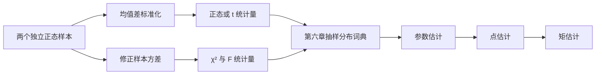
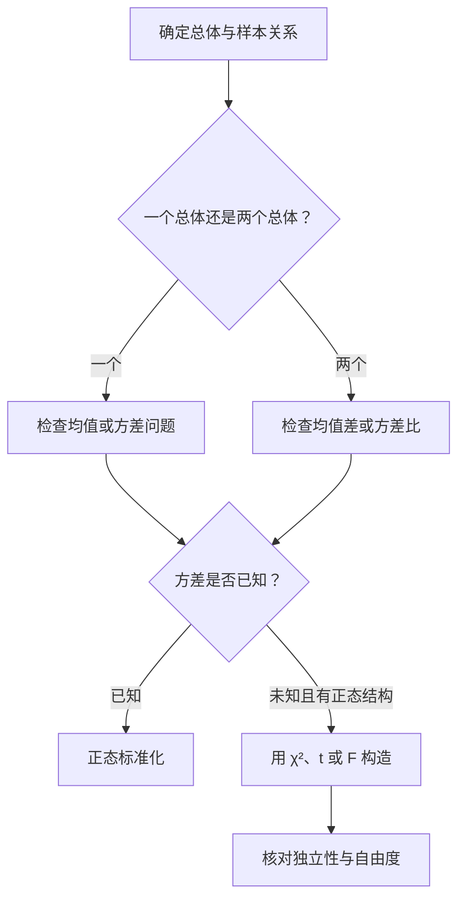

---
subject:
- 数理统计
type: lecture
class_no: 5
date: '2026-09-15'
source:
- C6_3.md；C7_1.md（矩估计部分）；腾讯会议录制（抽样分布与矩估计方法授课）
- '[[03_Sources/Courses/数理统计/课堂笔记/raw/2026-09-15-抽样分布与矩估计方法授课-866432-逐字稿]]'
- '[[03_Sources/Courses/数理统计/课堂笔记/raw/2026-09-15-抽样分布与矩估计方法授课-866432-纪要]]'
- '[[03_Sources/Courses/数理统计/课件/C6_3/C6_3]]'
- '[[03_Sources/Courses/数理统计/课件/C7_1/C7_1]]'
courseware:
- C6_3
- C7_1
meeting_code: null
start_time: '2026-09-15T16:27:55+08:00'
tags:
- t分布
- F分布
- 参数估计
- 点估计
- 矩估计
- 大数定律
- 样本矩
aliases:
- 2026-09-15 第5节 双正态总体抽样分布与矩估计
schema_version: 2
time: "2026-10-14T20:49:51+08:00"
legacy_status: 已完成
legacy_topics:
- 双正态总体
- 合并方差
- t分布
- F分布
- 参数估计
- 点估计
- 矩估计
- 大数定律
- 样本矩
status: not done
polish_status: done
lecture_date: '2026-09-15'
---

# 2026-09-15 第5节 双正态总体抽样分布与矩估计

## 资料来源

- 原始逐字稿：[[03_Sources/Courses/数理统计/课堂笔记/raw/2026-09-15-抽样分布与矩估计方法授课-866432-逐字稿|第5节逐字稿]]
- 智能纪要：[[03_Sources/Courses/数理统计/课堂笔记/raw/2026-09-15-抽样分布与矩估计方法授课-866432-纪要|第5节智能纪要]]
- 对应课件：[[03_Sources/Courses/数理统计/课件/C6_3/C6_3|C6.3 抽样分布]]
- 矩估计课件：[[03_Sources/Courses/数理统计/课件/C7_1/C7_1|C7.1 矩法和极大似然法]]，仅结合本节已讲的矩估计范围。
- 开始时间：2026-09-15 16:27

## 一、本节课核心脉络

> [!info] 学习导读（补充解释）
> **本节问题**：怎样用两组样本比较总体，又怎样把总体矩反解为参数？
> **先修提醒**：$S^{*2}$ 的分母为 $n-1$；$t$ 构造要求正态分子与卡方分母独立。可回看[[03_Sources/Courses/数理统计/课堂笔记/2026-09-08-第3节-四大抽样分布与分位数|四种分布]]和[[03_Sources/Courses/数理统计/课堂笔记/2026-09-10-第4节-缺少逐字稿#单正态总体的五条结论|单正态抽样结论（资料补全）]]。
> **阅读路线**：先还原拆样本例题，再读双总体四条结论；后半节从矩的大数定律进入参数方程与例题。
> **来源边界**：保留逐字稿中的例题、九条结论回顾及作业要求；新编自测、推理补充有独立标记。

本节课完成第六章并进入第七章。前半节从两个独立正态总体构造均值差与方差比统计量，把正态、$\chi^2$、$t$、$F$ 四类分布真正用于抽样推断；后半节建立参数估计框架，并用大数定律解释为什么可以用样本矩替代总体矩。

## 二、例题方法：先认结构，再核对独立性

课堂开头把一个正态样本拆成前六项与后三项，分别构造两个均值以及后三项的修正样本方差。处理这类统计量时应按三步走：

1. 判断分子经标准化后是否为 $N(0,1)$；
2. 判断分母能否写成独立卡方变量除以自由度后开方；
3. 单独说明独立性，再据结构认出 $t$ 分布。

若两个统计量由互不重叠的独立样本子集构成，它们通常独立；若都含同一个样本均值，则不能只凭“原样本独立”就断言独立。课堂提醒，拼出公式但漏写独立性，是抽样分布题的常见失分点。

## 三、两个独立正态总体的四个结论

### 拆样本课堂例题的公式还原

对应逐字稿 0:00:00—0:07:05：设 $X_1,\ldots,X_9$ 来自 $N(\mu,\sigma^2)$，定义

$$
Y_1=\frac16\sum_{i=1}^6X_i,\quad
Y_2=\frac13\sum_{i=7}^9X_i,\quad
S^{*2}=\frac12\sum_{i=7}^9(X_i-Y_2)^2.
$$

两段样本独立，因此 $Y_1-Y_2\sim N(0,\sigma^2/2)$；后三项的 $2S^{*2}/\sigma^2\sim\chi^2(2)$。$Y_2$ 与其自身样本方差独立，而前六项又与整个后三项样本独立，所以向量 $(Y_1,Y_2)$ 与 $S^{*2}$ 独立。于是

$$
\frac{\sqrt2(Y_1-Y_2)}{S^*}
=\frac{(Y_1-Y_2)/(\sigma/\sqrt2)}
{\sqrt{(2S^{*2}/\sigma^2)/2}}\sim t(2).
$$

这里同时用了正态样本均值—方差独立性与两段样本独立性，不能只写“两两独立”就跳到联合独立。

### 双总体的模型与记号

设

$$
X_1,\ldots,X_{n_1}\overset{\mathrm{i.i.d.}}{\sim}N(\mu_1,\sigma_1^2),
\qquad
Y_1,\ldots,Y_{n_2}\overset{\mathrm{i.i.d.}}{\sim}N(\mu_2,\sigma_2^2),
$$

两组样本相互独立。记样本均值为 $\bar X,\bar Y$，修正样本方差为

$$
S_X^{*2}=\frac{1}{n_1-1}\sum_{i=1}^{n_1}(X_i-\bar X)^2,
\qquad
S_Y^{*2}=\frac{1}{n_2-1}\sum_{j=1}^{n_2}(Y_j-\bar Y)^2.
$$

### 1. 总体方差已知：均值差服从标准正态

$$
\boxed{
\frac{(\bar X-\bar Y)-(\mu_1-\mu_2)}
{\sqrt{\sigma_1^2/n_1+\sigma_2^2/n_2}}
\sim N(0,1)
}.
$$

均值差仍为正态变量，其期望是期望之差，因两组独立，其方差是两个样本均值方差之和。

### 2. 方差未知但相等：合并方差与 $t$ 统计量

若 $\sigma_1^2=\sigma_2^2=\sigma^2$ 但共同方差未知，定义合并方差

$$
\boxed{
S_w^2=
\frac{(n_1-1)S_X^{*2}+(n_2-1)S_Y^{*2}}
{n_1+n_2-2}
}.
$$

则

$$
\boxed{
\frac{(\bar X-\bar Y)-(\mu_1-\mu_2)}
{S_w\sqrt{1/n_1+1/n_2}}
\sim t(n_1+n_2-2)
}.
$$

自由度来自两个独立卡方变量的自由度相加：$(n_1-1)+(n_2-1)=n_1+n_2-2$。

> 一句话来说：共同方差未知时，把两组样本的平方离差按自由度加权合并，再用它替换 $\sigma^2$。

### 3. 两总体方差之比：$F$ 统计量

$$
\boxed{
\frac{S_X^{*2}/\sigma_1^2}{S_Y^{*2}/\sigma_2^2}
\sim F(n_1-1,n_2-1)
}.
$$

这条结论用于比较两组波动程度。$F$ 分布的两个自由度有顺序，分子样本对应第一自由度，分母样本对应第二自由度。

### 4. 围绕已知总体均值的平方和之比

由

$$
\sum_{i=1}^{n_1}\frac{(X_i-\mu_1)^2}{\sigma_1^2}\sim\chi^2(n_1),
\qquad
\sum_{j=1}^{n_2}\frac{(Y_j-\mu_2)^2}{\sigma_2^2}\sim\chi^2(n_2),
$$

以及两者独立，可得

$$
\boxed{
\frac{\frac{1}{n_1}\sum_{i=1}^{n_1}(X_i-\mu_1)^2/\sigma_1^2}
{\frac{1}{n_2}\sum_{j=1}^{n_2}(Y_j-\mu_2)^2/\sigma_2^2}
\sim F(n_1,n_2)
}.
$$

它与上一条的区别在于：此处围绕真实均值 $\mu_1,\mu_2$ 作平方和，自由度不减一；修正样本方差围绕样本均值，分别损失一个自由度。

## 四、第六章回顾：九条结论是一部“词典”

单正态总体的五条结论与双正态总体的四条结论合在一起，构成后续区间估计和假设检验反复查用的抽样分布工具。做题时不要只背统计量外形，而应从以下线索选择结论：

总体在本课程中可理解为具有某种分布的随机变量。完整刻画总体需要知道分布类型及其参数；统计推断则通过样本构造统计量，用局部样本信息反推总体参数、区间或判断。

## 五、第七章参数估计框架

在总体分布类型已知、参数未知的前提下，参数估计主要包括：

- **点估计**：用一个统计量的观测值估计参数；本章包括矩估计与极大似然估计；
- **估计量优良性**：比较无偏性、有效性、一致性等性质；
- **区间估计**：用随机区间表达参数的不确定性；
- **充分统计量与完备统计量**：研究样本信息怎样被统计量有效压缩。

设参数空间为 $\Theta$，点估计量写作

$$
\hat\theta=T(X_1,\ldots,X_n),
$$

它是样本的函数，抽样前是随机变量；代入观测值 $x_1,\ldots,x_n$ 后，

$$
\hat\theta_{\mathrm{obs}}=T(x_1,\ldots,x_n)
$$

才得到本次样本对应的估计值。

> [!warning] 估计量与估计值
> 估计量是随机变量，估计值是代入一次具体样本后得到的数。二者不能混写。

## 六、矩估计为什么合理

定义样本 $k$ 阶原点矩

$$
A_k=\frac{1}{n}\sum_{i=1}^{n}X_i^k,
$$

总体 $k$ 阶原点矩为

$$
\mu_k'=E_\theta(X^k).
$$

只要相应矩存在，由独立同分布大数定律，

$$
A_k\xrightarrow{P}\mu_k'.
$$

因此可以把样本矩与相应总体矩配对，建立方程求未知参数。这是矩估计的数学基础，不是经验上的随意替换。

### 一般步骤

若总体有 $r$ 个未知参数 $\theta_1,\ldots,\theta_r$：

1. 计算 $r$ 个总体矩，并写成参数的函数；
2. 用对应的样本矩替代总体矩；
3. 解含 $r$ 个未知量的 $r$ 个方程；
4. 给解加帽子，得到矩估计量；
5. 代入样本观测值，得到矩估计值；
6. 检查结果是否落在参数空间内。

常见的两参数方程可以写成

$$
A_1=E_\theta(X),
\qquad
M_2=D_\theta(X),
$$

其中

$$
M_2=\frac{1}{n}\sum_{i=1}^{n}(X_i-\bar X)^2
$$

是样本二阶中心矩。也可用 $A_2=E(X^2)$，两种写法经 $D(X)=E(X^2)-[E(X)]^2$ 联系；对熟悉均值和方差公式的常见分布，使用 $A_1$ 与 $M_2$ 往往更简洁。

## 七、矩估计例题

### 1. Bernoulli 总体：不合格品率

令 $X_i=1$ 表示第 $i$ 件产品不合格，$X_i=0$ 表示合格，且 $X_i\sim\operatorname{Bernoulli}(p)$。因为 $E(X)=p$，故

$$
\boxed{\hat p_{\mathrm{MM}}=\bar X}.
$$

样本均值在这里就是不合格品的样本比例。

### 2. 均匀分布 $U(0,\theta)$

由 $E(X)=\theta/2$，可得

$$
\boxed{\hat\theta_{\mathrm{MM}}=2\bar X}.
$$

### 3. 二项分布的两个未知参数

若 $X\sim B(m,p)$ 且 $m,p$ 均未知，则

$$
E(X)=mp,
\qquad
D(X)=mp(1-p).
$$

令 $A_1=\bar X$、$M_2=n^{-1}\sum(X_i-\bar X)^2$，解得

$$
\boxed{
\hat p=1-\frac{M_2}{A_1},
\qquad
\hat m=\frac{A_1^2}{A_1-M_2}
}.
$$

由于真实 $m$ 应为正整数，矩估计的代数解还需检查参数空间；如何取整或处理越界结果，应由后续估计准则或题目要求决定。

> [!warning] 先检查矩方程是否有可用解
> 上式要求 $A_1>0$、$A_1>M_2$ 才能产生正的有限 $\hat m$；还要检查 $0\le\hat p\le1$。样本矩因抽样波动可能不满足这些条件，不能直接套公式输出负参数。

### 3a. 平移指数分布的两个参数

逐字稿 01:08—01:10 对应 C7.1 例7.1.2：若

$$
f(x;\mu,\theta)=\theta^{-1}e^{-(x-\mu)/\theta}\mathbf1_{\{x\ge\mu\}},
\qquad \theta>0,
$$

令 $Y=X-\mu$，则 $E(X)=\mu+\theta$、$D(X)=\theta^2$。用 $\bar X$ 与分母为 $n$ 的 $M_2$ 配对，得到

$$
\hat\theta_{\mathrm{MM}}=\sqrt{M_2},\qquad
\hat\mu_{\mathrm{MM}}=\bar X-\sqrt{M_2}.
$$

这展示了“均值加方差”比直接使用二阶原点矩更容易解方程。若样本给出 $M_2=0$，估计落在 $\theta=0$ 的边界，须说明不在原参数空间内。

### 4. Poisson 分布

若 $X\sim\operatorname{Poisson}(\lambda)$，因 $E(X)=D(X)=\lambda$，使用一阶矩得到

$$
\boxed{\hat\lambda=\bar X}.
$$

也可以用二阶中心矩构造另一个矩估计量。课堂强调，统计估计允许抽样误差；不同合理矩方程都可能产生估计量，后续要用优良性准则比较，而不是把与真值不完全相等视为计算错误。

### 5. 相关系数的矩替换

总体相关系数可写为

$$
\rho=
\frac{E(XY)-E(X)E(Y)}
{\sqrt{D(X)D(Y)}}.
$$

用样本混合原点矩、样本均值和二阶中心矩替换，可得到

$$
\hat\rho=
\frac{n^{-1}\sum_{i=1}^{n}X_iY_i-\bar X\bar Y}
{\sqrt{M_{2X}M_{2Y}}}.
$$

复杂参数看似没有直接公式时，应先把它展开为期望、方差和混合矩，再逐项进行对应的样本矩替换。

## 八、样本方差符号与使用边界

本课程教材区分：

$$
S^2=\frac{1}{n}\sum_{i=1}^{n}(X_i-\bar X)^2,
\qquad
S^{*2}=\frac{1}{n-1}\sum_{i=1}^{n}(X_i-\bar X)^2.
$$

$S^2$ 是样本二阶中心矩，$S^{*2}$ 是修正样本方差。许多其他教材直接用 $S^2$ 表示分母为 $n-1$ 的修正样本方差，所以跨教材阅读时必须先查定义。

按本课程约定，分母为 $n$ 的 $S^2$ 主要在矩估计中作为样本矩使用；抽样分布、区间估计和假设检验通常使用修正样本方差 $S^{*2}$。

## 九、矩存在性的边界

若某阶绝对矩 $E|X|^r<\infty$，则所有 $0<k\le r$ 的绝对矩也存在。原因是

$$
|x|^k\le 1+|x|^r,
$$

从而

$$
E|X|^k\le 1+E|X|^r<\infty.
$$

但并非所有总体都有一阶矩。例如 Cauchy 分布的期望不存在，不能直接用“样本均值估计总体期望”的普通矩估计路线。

## 十、易错点与课后任务

> [!warning] 易错点
> 1. 构造 $t$ 或 $F$ 统计量时必须说明组成部分的独立性。
> 2. 两样本均值差的方差在独立条件下相加，不因表达式中有减号而相减。
> 3. 合并方差公式只用于两个正态总体方差相等但未知的情形。
> 4. 围绕总体均值的平方和自由度为 $n$，围绕样本均值的平方离差自由度为 $n-1$。
> 5. 未知参数有几个，通常就要建立几个独立的矩方程。
> 6. 矩估计量是随机变量，代入样本后才是估计值。
> 7. 跨教材使用 $S^2$ 前先确认分母是 $n$ 还是 $n-1$。

- 完成第六章作业，将拍照内容整理成一个 Word 或 PDF 文件。
- 按群内发布的问卷星或群收集入口提交。
- 复习单、双正态总体共九条抽样分布结论，重点记忆 $S_w^2$ 的定义与适用条件。

## 自测（新编）

### 1. 选结构并写出条件

两组独立正态样本容量为 $6,8$，总体方差未知但相等。写出均值差的标准化量和自由度；若不再假定方差相等，原式是否仍服从该精确 $t$ 分布？

> [!hint]- 提示
> 合并平方离差的自由度为两个 $n_i-1$ 之和。

> [!solution]- 解析
> $S_w^2=(5S_X^{*2}+7S_Y^{*2})/12$，且 $[(\bar X-\bar Y)-(\mu_1-\mu_2)]/[S_w\sqrt{1/6+1/8}]\sim t(12)$。去掉等方差假设，合并卡方结构失效，不能沿用这一精确结论。

### 2. 反解两个未知参数

平移指数模型的样本满足 $\bar x=5$、$M_2=4$，求 $\mu,\theta$ 的矩估计值，并说明若误用修正样本方差会改变哪一步。

> [!hint]- 提示
> 先从方差方程求尺度，再由均值方程求位置。

> [!solution]- 解析
> $\hat\theta=2$、$\hat\mu=5-2=3$。矩方程使用 $M_2=n^{-1}\sum(X_i-\bar X)^2$；直接换成修正样本方差等于更换了所用估计方程。

## 课堂导航

- 上一节：[[03_Sources/Courses/数理统计/课堂笔记/2026-09-10-第4节-缺少逐字稿|第4节 单正态抽样分布（部分补全）]]
- 对应课件：[[03_Sources/Courses/数理统计/课件/C6_3/C6_3|C6.3 抽样分布]]
- 上级索引：[[03_Sources/Courses/数理统计/课堂笔记/README|数理统计课堂笔记]]
