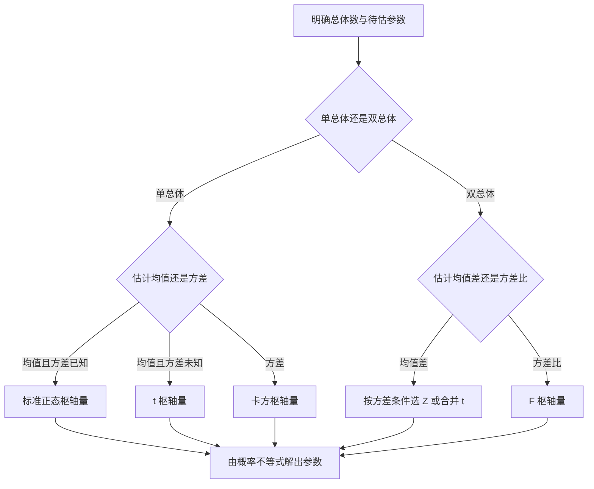

---
subject:
- 数理统计
type: lecture
class_no: 8
date: '2026-09-24'
source:
- C7_4(1).md；腾讯会议录制（正态总体区间估计课程宣讲）
- '[[03_Sources/Courses/数理统计/课堂笔记/raw/2026-09-24-正态总体区间估计课程宣讲-515648-逐字稿]]'
- '[[03_Sources/Courses/数理统计/课堂笔记/raw/2026-09-24-正态总体区间估计课程宣讲-515648-纪要]]'
- '[[03_Sources/Courses/数理统计/课件/C7_4(1)/C7_4(1)]]'
courseware: C7_4(1)
meeting_code: null
start_time: '2026-09-24T10:26:14+08:00'
tags:
- 置信区间
aliases:
- 2026-09-24 第8节 枢轴量法与正态总体区间估计
schema_version: 2
time: "2026-10-14T20:49:51+08:00"
legacy_status: 已完成
legacy_topics:
- 置信区间
- 枢轴量法
- 正态总体
- 均值区间估计
- 方差区间估计
- 双总体参数
- 单侧置信区间
- 大样本估计
status: not done
polish_status: done
lecture_date: '2026-09-24'
---

# 2026-09-24 第8节 枢轴量法与正态总体区间估计

## 资料来源

- 原始逐字稿：[[03_Sources/Courses/数理统计/课堂笔记/raw/2026-09-24-正态总体区间估计课程宣讲-515648-逐字稿]]
- 智能纪要：[[03_Sources/Courses/数理统计/课堂笔记/raw/2026-09-24-正态总体区间估计课程宣讲-515648-纪要]]
- 对应课件：[[03_Sources/Courses/数理统计/课件/C7_4(1)/C7_4(1)|第 7.4 节 区间估计]]
- 开始时间：2026-09-24 10:26

## 一、本节课核心脉络

> [!info] 学习导读（补充解释）
> **本节问题**：已知覆盖概率的枢轴量，怎样反解为待估参数的上下限？
> **先修提醒**：上侧分位数下标表示右尾概率；卡方量为正，取倒数会反转不等号。回看[[03_Sources/Courses/数理统计/课堂笔记/2026-09-08-第3节-四大抽样分布与分位数|分布与分位数]]及[[03_Sources/Courses/数理统计/课堂笔记/2026-09-22-第7节-参数估计与区间估计讲座#六、置信区间与置信水平|覆盖率解释]]。
> **阅读路线**：枢轴量统一方法 → 单总体均值/方差 → 双总体 → 单侧 → 非正态精确或渐近区间。
> **来源边界**：以逐字稿与 C7.4 已讲范围为主；Welch、额外推理与自测为补充解释，不视为教师原话。

本节从点估计无法表达误差和可靠程度出发，完整建立置信区间的枢轴量法。随后分别处理单个正态总体的均值与方差、两个独立正态总体的均值差与方差比，并延伸到单侧置信区间和非正态总体的大样本近似。课堂反复强调：重点是根据条件选择正确的抽样分布，再从概率不等式中解出参数，而不是孤立背诵最终公式。

## 二、置信区间的含义

设未知参数为 $\theta$，由样本构造统计量 $T_1<T_2$，若

$$
\mathbb P_\theta\{T_1\le \theta\le T_2\}=1-\alpha,
$$

则随机区间 $[T_1,T_2]$ 称为 $\theta$ 的置信水平为 $1-\alpha$ 的置信区间，$\alpha$ 称为显著性水平。

参数 $\theta$ 是固定但未知的，随机性来自样本和区间端点。因此频率学派的严格解释是：若重复抽样并按同一规则构造区间，长期来看约有 $100(1-\alpha)\%$ 的区间覆盖真参数。对一次已经观察到的固定区间，不再把“参数落入该区间”理解为一次随机事件。

置信水平与区间长度通常存在权衡：

- 样本量固定时，提高置信水平通常会加宽区间；
- 置信水平固定时，增加样本量通常会缩短区间；
- 不能只追求区间短而忽略覆盖可靠性。

## 三、枢轴量法

枢轴量是样本与参数的函数，其抽样分布不依赖任何未知参数。例如 $(\bar X-\mu)/(\sigma/\sqrt n)$ 的表达式含 $\mu$，但在正态模型下分布恒为 $N(0,1)$。枢轴量表达式可以含未知参数，最终区间端点则必须能用数据与已知常数计算。构造区间的一般步骤为：

> 一句话来说：先找到“参数怎样变化都服从同一个已知分布”的量，再把参数从概率不等式里解出来。

1. 明确要估计的参数以及题目给出的已知条件；
2. 从抽样分布定理中选择能包含该参数的枢轴量；
3. 找到概率为 $1-\alpha$ 的分位数区间；
4. 对不等式进行同向或反向变形，把待估参数单独留在中间；
5. 检查最终端点只含样本统计量和已知常数。

下文采用“上侧分位数”记号：$z_\gamma$ 满足 $\mathbb P(Z>z_\gamma)=\gamma$；$\chi^2_\gamma(\nu)$、$t_\gamma(\nu)$ 和 $F_\gamma(\nu_1,\nu_2)$ 同理。于是 $\chi^2_{\alpha/2}(\nu)>\chi^2_{1-\alpha/2}(\nu)$。

## 四、单个正态总体的区间估计

设

$$
X_1,\ldots,X_n\overset{\mathrm{i.i.d.}}{\sim}N(\mu,\sigma^2),
$$

并记修正样本方差为

$$
S_*^2=\frac{1}{n-1}\sum_{i=1}^{n}(X_i-\overline X)^2.
$$

### 1. $\sigma^2$ 已知，估计 $\mu$

枢轴量

$$
Z=\frac{\overline X-\mu}{\sigma/\sqrt n}\sim N(0,1).
$$

因为

$$
P\left(-z_{\alpha/2}\le
\frac{\bar X-\mu}{\sigma/\sqrt n}\le z_{\alpha/2}\right)=1-\alpha,
$$

乘上正的 $\sigma/\sqrt n$ 并移项，置信水平为 $1-\alpha$ 的区间为

$$
\boxed{
\left[
\overline X-z_{\alpha/2}\frac{\sigma}{\sqrt n},
\overline X+z_{\alpha/2}\frac{\sigma}{\sqrt n}
\right]}.
$$

课堂例题中，$\sigma=0.3$，样本为 $12.6,13.4,12.8,13.2$，所以 $\overline x=13$、$n=4$。取 $z_{0.025}=1.96$，得到

$$
[13-1.96\times0.15,\ 13+1.96\times0.15]
=[12.706,\ 13.294].
$$

### 2. $\sigma^2$ 未知，估计 $\mu$

用 $S_*$ 替换未知标准差后，

$$
T=\frac{\overline X-\mu}{S_*/\sqrt n}\sim t(n-1).
$$

相应区间为

$$
\boxed{
\left[
\overline X-t_{\alpha/2}(n-1)\frac{S_*}{\sqrt n},
\overline X+t_{\alpha/2}(n-1)\frac{S_*}{\sqrt n}
\right]}.
$$

> [!warning] 先统一样本方差记号
> 课件同时使用分母为 $n$ 的样本方差 $S^2$ 和分母为 $n-1$ 的修正样本方差 $S_*^2$。若使用 $S^2=n^{-1}\sum(X_i-\overline X)^2$，则标准误写成 $S/\sqrt{n-1}$；若使用本笔记的 $S_*^2$，则写成 $S_*/\sqrt n$。两种写法等价，不能混用。

### 3. 估计 $\sigma^2$

若 $\mu$ 未知，

$$
\frac{(n-1)S_*^2}{\sigma^2}\sim\chi^2(n-1),
$$

从而

$$
\boxed{
\left[
\frac{(n-1)S_*^2}{\chi^2_{\alpha/2}(n-1)},
\frac{(n-1)S_*^2}{\chi^2_{1-\alpha/2}(n-1)}
\right]}.
$$

若 $\mu$ 已知，令

$$
Q=\sum_{i=1}^{n}(X_i-\mu)^2,
\qquad
\frac{Q}{\sigma^2}\sim\chi^2(n),
$$

则

$$
\boxed{
\left[
\frac{Q}{\chi^2_{\alpha/2}(n)},
\frac{Q}{\chi^2_{1-\alpha/2}(n)}
\right]}.
$$

均值已知时应使用这一已知信息，而不是仍用 $\overline X$ 代替 $\mu$；前者具有 $n$ 个自由度。

## 五、为什么常取两侧各 $\alpha/2$

在正态分布和 $t$ 分布这类对称分布中，对称截取两端尾概率通常能在给定覆盖率下得到最短的中心区间，也便于统一查表。对偏斜的 $\chi^2$ 或 $F$ 分布，对称分配尾概率主要是约定俗成且便于查表，并不自动保证所有意义下区间最短。

因此“置信水平相同”不意味着置信区间唯一；必须同时说明采用的构造原则。

## 六、两个独立正态总体

设两组样本分别来自

$$
X\sim N(\mu_1,\sigma_1^2),
\qquad
Y\sim N(\mu_2,\sigma_2^2),
$$

且两组样本相互独立。

### 1. 估计均值差 $\mu_1-\mu_2$

若 $\sigma_1^2,\sigma_2^2$ 已知，

$$
\frac{(\overline X-\overline Y)-(\mu_1-\mu_2)}
{\sqrt{\sigma_1^2/n_1+\sigma_2^2/n_2}}
\sim N(0,1).
$$

因此区间为

$$
(\overline X-\overline Y)
\pm z_{\alpha/2}
\sqrt{\frac{\sigma_1^2}{n_1}+\frac{\sigma_2^2}{n_2}}.
$$

若方差未知但可假设相等，使用合并方差

$$
S_p^2=
\frac{(n_1-1)S_{1*}^2+(n_2-1)S_{2*}^2}
{n_1+n_2-2},
$$

枢轴量为

$$
\frac{(\overline X-\overline Y)-(\mu_1-\mu_2)}
{S_p\sqrt{1/n_1+1/n_2}}
\sim t(n_1+n_2-2).
$$

课堂稻种例中，$\overline x=140.6$、$\overline y=126.8$、$S_p\approx6.667$、$n_1=n_2=10$，95% 区间约为

$$
[7.54,\ 20.06].
$$

下限大于零，说明在模型假设下可认为甲稻种平均产量高于乙稻种。

> [!warning] 课件稻种例题的模型边界
> C7.4 原题写“两种稻种在同一块田中各占一半”，数据有天然配对结构；上述数值是课件按独立双样本、等方差模型得到的解。课堂资料未给出田内相关性，不能据题干就断言两组独立。若按配对设计建模，应先取每块田的差值 $D_i=X_i-Y_i$，再对 $D_i$ 作单总体 $t$ 区间。保留原课件解以便对照，但实际使用前必须确认独立样本还是配对样本。

> [!warning] 方差未知且不等时
> 合并方差公式不能直接使用。应采用 Welch 区间等适合异方差的方法。配对 $t$ 方法只适用于数据天然一一配对的情形，不能靠从较大样本中随机删去若干观测来人为制造配对。

### 2. 估计方差比 $\sigma_1^2/\sigma_2^2$

当两总体均值未知时，

$$
F=
\frac{S_{1*}^2/\sigma_1^2}
{S_{2*}^2/\sigma_2^2}
\sim F(n_1-1,n_2-1).
$$

所以

$$
\boxed{
\left[
\frac{S_{1*}^2/S_{2*}^2}
{F_{\alpha/2}(n_1-1,n_2-1)},
\frac{S_{1*}^2/S_{2*}^2}
{F_{1-\alpha/2}(n_1-1,n_2-1)}
\right]}.
$$

若区间包含 $1$，现有样本不足以说明两总体方差不同；若整个区间大于 $1$，则支持 $\sigma_1^2>\sigma_2^2$。这类解释应表述为统计证据，而不是绝对证明。

## 七、单侧置信区间

单侧区间只给参数的一个有限界。仍以 $\sigma$ 已知时估计 $\mu$ 为例：

- 置信下限为

$$
L=\overline X-z_\alpha\frac{\sigma}{\sqrt n},
\qquad
\mathbb P_\mu\{L\le\mu\}=1-\alpha;
$$

- 置信上限为

$$
U=\overline X+z_\alpha\frac{\sigma}{\sqrt n},
\qquad
\mathbb P_\mu\{\mu\le U\}=1-\alpha.
$$

单侧问题使用尾概率 $\alpha$，而不是双侧区间中的 $\alpha/2$。课堂建议不要死记上下限公式，而应从枢轴量的一侧概率事件出发，移项后判断得到的是上限还是下限。

## 八、非正态总体

### 1. 利用精确分布

若 $X_i$ 独立同分布于率参数为 $\lambda$ 的指数分布，则

$$
2n\lambda\overline X\sim\chi^2(2n).
$$

由此可直接构造 $\lambda$ 的精确置信区间：

$$
\left[
\frac{\chi^2_{1-\alpha/2}(2n)}{2n\overline X},
\frac{\chi^2_{\alpha/2}(2n)}{2n\overline X}
\right].
$$

### 2. 大样本近似

若总体不服从正态分布，但均值 $a$ 和有限方差 $\sigma^2$ 存在，则由中心极限定理，

$$
\frac{\overline X-a}{\sigma/\sqrt n}
\overset{d}{\longrightarrow}N(0,1).
$$

样本量充分大时，可据此近似构造均值区间。需要明确这是渐近近似，不应与正态总体下的有限样本精确结论混为一谈。

## 九、解题决策流程

## 十、易错点

> [!warning] 检查顺序
> 先检查总体分布、独立/配对结构、已知参数与单/双侧，再选择公式；下面任一条件改变，都可能改变枢轴量。

1. 把固定参数说成“以 $1-\alpha$ 的概率落在已经得到的区间里”。
2. 混用分母为 $n$ 与 $n-1$ 的两种样本方差记号。
3. 查表时不先确认教材使用的是上侧分位数还是累计分位数。
4. 对 $\chi^2$ 或 $F$ 不等式取倒数时忘记反向。
5. 双总体均值差在方差未知时，无条件套用合并方差公式。
6. 把“区间包含 0 或 1”解释成参数必然相等。
7. 单侧区间仍错误使用 $\alpha/2$。
8. 非正态总体的大样本近似未说明样本量和矩条件。

## 十一、课堂要求

- 掌握“选择枢轴量—查分位数—解出参数”的统一方法，不孤立背诵最终区间。
- 熟悉标准正态、$t$、$\chi^2$ 和 $F$ 分布的上侧分位数表。
- 期末计算题需自备计算器；题目会给出必要的分位数候选值，仍需判断应选哪一个。

## 十二、课堂疑惑与解答

本次检查未发现当日日计划中的待回答疑惑。

## 自测（新编）

### 1. 从概率事件反解方差

正态样本容量 $n=10$，均值未知，修正样本方差为 $4$。已知上侧分位数 $\chi^2_{0.025}(9)=19.023$、$\chi^2_{0.975}(9)=2.700$，构造 $\sigma^2$ 的 $95\%$ 区间，写出不等式变形。

> [!hint]- 提示
> $2.700\le36/\sigma^2\le19.023$，所有量为正。

> [!solution]- 解析
> 解得 $36/19.023\le\sigma^2\le36/2.700$，即约 $[1.892,13.333]$。大的卡方分位数成为下限的分母；自由度为 $9$，不是 $10$。

### 2. 同一数据的单侧与双侧区间

已知 $\sigma=2$、$n=25$、$\bar x=10$。给定 $z_{0.025}=1.96$、$z_{0.05}=1.645$，求 $95\%$ 双侧区间和 $95\%$ 单侧置信下限。

> [!hint]- 提示
> 标准误为 $2/5$；双侧每边 $\alpha/2$，单侧只留一个 $\alpha$。

> [!solution]- 解析
> 双侧区间为 $10\pm1.96(0.4)=[9.216,10.784]$。单侧下限为 $L=10-1.645(0.4)=9.342$，对应区间 $[9.342,\infty)$。

## 十三、课堂导航

- 上一节：[[03_Sources/Courses/数理统计/课堂笔记/2026-09-22-第7节-参数估计与区间估计讲座|第7节 估计量的相合性与置信区间引入]]
- 章节梳理：[[03_Sources/Reviews/数理统计/知识点解析梳理/07-参数估计-知识梳理|第7章 参数估计]]
- 上级索引：[[03_Sources/Courses/数理统计/课堂笔记/README|数理统计课堂笔记]]
