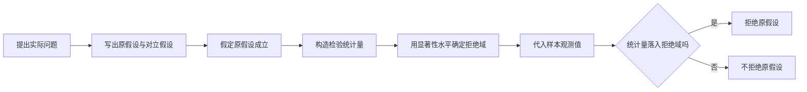

---
subject:
- 数理统计
type: lecture
class_no: 12
date: '2026-10-15'
source:
- 概率论与数理统计.md（第八章 §8.1）；腾讯会议录制（假设检验原理与方法授课）
- '[[03_Sources/Courses/数理统计/课堂笔记/raw/2026-10-15-假设检验原理与方法授课-255552-逐字稿]]'
- '[[03_Sources/Courses/数理统计/课堂笔记/raw/2026-10-15-假设检验原理与方法授课-255552-纪要]]'
- '[[03_Sources/Courses/数理统计/课本/概率论与数理统计/概率论与数理统计]]'
- '[[03_Sources/Reviews/数理统计/知识点解析梳理/06-抽样分布-知识梳理]]'
- '[[03_Sources/Reviews/数理统计/知识点解析梳理/07-参数估计-知识梳理]]'
courseware: 概率论与数理统计（第八章 §8.1）
meeting_code: null
start_time: '2026-10-15T10:25:35+08:00'
tags:
- U检验
aliases:
- 2026-10-15 第12节 假设检验的基本思想与检验步骤
schema_version: 2
time: "2026-10-16T19:42:18+08:00"
legacy_status: 已完成
legacy_topics:
- 假设检验
- 小概率事件原理
- 原假设
- 对立假设
- 显著性水平
- 拒绝域
- 双侧检验
- U检验
status: not done
polish_status: done
lecture_date: '2026-10-15'
---

# 2026-10-15 第12节 假设检验的基本思想与检验步骤

## 资料来源

- 原始逐字稿：[[03_Sources/Courses/数理统计/课堂笔记/raw/2026-10-15-假设检验原理与方法授课-255552-逐字稿|第12节逐字稿]]
- 智能纪要：[[03_Sources/Courses/数理统计/课堂笔记/raw/2026-10-15-假设检验原理与方法授课-255552-纪要|第12节智能纪要]]
- 对应教材：[[03_Sources/Courses/数理统计/课本/概率论与数理统计/概率论与数理统计#第八章假设检验|第八章 假设检验]]
- 相关前置：[[03_Sources/Reviews/数理统计/知识点解析梳理/06-抽样分布-知识梳理|抽样分布知识梳理]]、[[03_Sources/Reviews/数理统计/知识点解析梳理/07-参数估计-知识梳理|参数估计知识梳理]]
- 课次说明：10 月 6 日为国庆假期，不计入实际授课次数；自动生成的第 13 节已校正为第 12 节。

## 一、本节课核心脉络

> [!info] 学习导读（补充解释）
> **本节问题**：观察到的偏离，是否大到难以用原假设下的随机波动解释？
> **先修提醒**：标准误 $\sigma/\sqrt n$ 衡量样本均值的抽样波动。回看[[03_Sources/Courses/数理统计/课堂笔记/2026-09-08-第3节-四大抽样分布与分位数#三、标准正态分布与上侧分位数|上侧分位数]]和[[03_Sources/Courses/数理统计/课堂笔记/2026-09-24-第8节-正态总体区间估计课程宣讲#四、单个正态总体的区间估计|均值标准化]]。
> **阅读路线**：小概率思想 → 写假设 → 在 $H_0$ 下构造量 → 预设拒绝域 → 代入数据并解释。
> **来源边界**：保留课堂咖啡与工件直径例题，结合教材 §8.1 校正条件与用语；单侧延伸和新编自测标注为补充。

本节从彩票中奖和“女士品咖啡”两个例子引出小概率事件原理，再用工件直径问题把假设检验整理为一套可执行的流程：先提出原假设与对立假设，在原假设成立的条件下构造分布已知的检验统计量，再用显著性水平划定拒绝域，最后把样本观测值代入并作出统计判断。

## 二、小概率事件原理

假设检验的基本逻辑不是“证明某个假设绝对正确”，而是先暂时承认原假设 $H_0$ 成立，再考察当前样本是否会导致一个在 $H_0$ 下概率很小的事件。

若

$$
P(A\mid H_0)=\alpha
$$

很小，而一次实际试验中事件 $A$ 却发生了，就有理由怀疑使其成为小概率事件的前提 $H_0$，从而拒绝 $H_0$。

> [!important] 课堂强调
> 解答假设检验题时，写出 $H_0$、$H_1$ 后必须明确写出“当 $H_0$ 成立时”。检验统计量的分布和拒绝域都是在这一条件下建立的。

### 女士品咖啡：把直觉变成量化判断

设一位女士判断 8 杯咖啡中牛奶与其他成分的加入顺序，并正确判断至少 7 杯。令 $X$ 为判断正确的杯数，建立

$$
H_0:p=\frac12 \quad\text{（没有鉴别能力，只是随机猜测）},
$$

$$
H_1:p>\frac12 \quad\text{（具有正向鉴别能力）}.
$$

课堂采用每杯判断相互独立、随机猜测成功概率为 $1/2$ 的二项模型。在这些假设下，当 $H_0$ 成立时，$X\sim\operatorname{Bin}(8,1/2)$，于是

$$
\begin{aligned}
P(X\ge 7\mid H_0)
&=\binom87\left(\frac12\right)^8
 +\binom88\left(\frac12\right)^8\\
&=\frac9{256}\approx0.0352.
\end{aligned}
$$

预先取 $\alpha=0.05$ 时，“至少正确 7 杯”的概率小于 $\alpha$，因此这一结果落入拒绝域，可拒绝“没有鉴别能力”的原假设。若实验预先固定两类杯数且要求按组分配标签，判断之间不独立，就应重新建立组合抽样模型，不能直接套这条二项计算。

> 一句话来说：拒绝域是在原假设下事先规定的小概率区域；观测进入该区域后，结论仍带有犯错风险。

课堂还提醒：如果一个人总是系统地给出相反答案，也说明结果中可能存在信息。这里只研究“正确率高于 $1/2$”这一正向能力，因此把备择假设写成 $p>1/2$。

## 三、假设检验的四个步骤

### 第一步：提出假设

把实际问题翻译成参数命题：

$$
H_0:\theta\in\Theta_0,
\qquad
H_1:\theta\in\Theta_1.
$$

课堂使用的实用规则是：本节正态均值检验的**等号或边界值放在原假设一侧**。对简单原假设可代入该参数；对 $H_0:\mu\le\mu_0$ 这样的复合假设，还要验证拒绝概率在边界 $\mu_0$ 达到最大，不能把整个原假设都当成 $\mu=\mu_0$。双侧问题常写成

$$
H_0:\mu=\mu_0,
\qquad
H_1:\mu\ne\mu_0.
$$

单侧问题则按研究目的写成 $H_1:\mu>\mu_0$ 或 $H_1:\mu<\mu_0$；相应的拒绝域只放在分布的一侧。

### 第二步：构造检验统计量

检验统计量必须是样本的函数，并且在 $H_0$ 成立时具有已知分布、不能含未知参数。它与区间估计中的枢轴量通常是同一个结构。

例如，总体服从正态分布且方差 $\sigma^2$ 已知时，对总体均值检验可取

$$
U=\frac{\bar X-\mu_0}{\sigma/\sqrt n}.
$$

当 $H_0:\mu=\mu_0$ 成立时，

$$
U\sim N(0,1).
$$

### 第三步：由显著性水平确定拒绝域

显著性水平 $\alpha$ 是事先给定的小概率，常取 $0.05$ 或 $0.01$。对于双侧检验，把总概率 $\alpha$ 分到两个尾部，拒绝域为

$$
\lvert U\rvert>u_{\alpha/2}.
$$

当 $\alpha=0.05$ 时，$u_{\alpha/2}=1.96$，因此

$$
\mathcal R=\{\lvert U\rvert>1.96\}.
$$

课堂把拒绝域解释为“拒绝 $H_0$ 的区域”：样本均值比假设值过大或过小，都可能说明差异不再像随机波动。

### 第四步：代入样本并作出判断

用样本观测值算出检验统计量：

- 若观测值落入拒绝域，拒绝 $H_0$；
- 若没有落入拒绝域，不拒绝 $H_0$。

> [!warning] 用语要准确
> 课堂讲解中为了直观使用了“接受域”和“接受原假设”。教材更严谨的表述是“不拒绝 $H_0$”：样本证据不足以推翻 $H_0$，并不等于已经证明 $H_0$ 必然为真。

## 四、工件直径例题：已知方差的双侧 U 检验

已知新工艺生产的工件直径服从正态分布，原标准均值为 $2\,\mathrm{cm}$，总体标准差为 $0.1\,\mathrm{cm}$。抽取 $n=100$ 个工件，得到样本均值

$$
\bar x=1.978\,\mathrm{cm}.
$$

要判断新工艺是否使平均直径发生显著变化，取

$$
H_0:\mu=2,
\qquad
H_1:\mu\ne2.
$$

当 $H_0$ 成立时，

$$
U=\frac{\bar X-2}{0.1/\sqrt{100}}\sim N(0,1).
$$

在显著性水平 $\alpha=0.05$ 下，拒绝域为

$$
\lvert U\rvert>1.96.
$$

代入观测值：

$$
u=\frac{1.978-2}{0.1/10}=-2.2,
\qquad
\lvert u\rvert=2.2>1.96.
$$

因此观测值落入拒绝域，拒绝 $H_0$，认为新工艺使工件平均直径发生了显著变化。

> [!important] 判断“差异显著”不能只看数值差
> $1.978$ 与 $2$ 的差仅为 $0.022$，但是否显著还取决于总体波动 $\sigma$ 和样本量 $n$。标准化统计量同时考虑了差异大小、噪声水平和样本量。

## 五、显著性水平如何影响结论

在检验统计量不变时：

- $\alpha$ 越大，拒绝域越大，越容易拒绝 $H_0$；
- $\alpha$ 越小，拒绝域越小，越不容易拒绝 $H_0$。

因此 $\alpha$ 必须在看数据之前确定，不能为了得到想要的结论而事后调整。

> [!note] 教材补充：第一类错误
> 即使 $H_0$ 真的成立，小概率事件也不是绝对不会发生。若此时错误地拒绝 $H_0$，就犯了第一类错误；显著性水平 $\alpha$ 控制的正是这类错误的概率上限。

## 六、双侧检验与单侧检验

| 研究问题 | 对立假设 | 拒绝域位置 |
|:--|:--|:--|
| 是否发生变化 | $H_1:\mu\ne\mu_0$ | 两侧 |
| 是否显著增大 | $H_1:\mu>\mu_0$ | 右侧 |
| 是否显著减小 | $H_1:\mu<\mu_0$ | 左侧 |

本节完整推导的是双侧检验；单侧检验的思想相同，只是拒绝域的位置和临界值发生变化。

## 七、解题模板与易错点

1. 根据题意写出 $H_0$ 与 $H_1$；
2. 明确写出“当 $H_0$ 成立时”；
3. 根据总体分布、方差是否已知和样本量选择检验统计量；
4. 写出统计量在 $H_0$ 下的分布；
5. 由 $\alpha$ 和单侧或双侧类型确定拒绝域；
6. 代入样本，计算统计量观测值；
7. 判断是否落入拒绝域，并用题目语境解释结论。

> [!warning] 易错点
> - 只凭样本均值与假设值的绝对差判断“显著”；
> - 没有说明统计量的分布是在 $H_0$ 成立时得到的；
> - 把双侧检验的 $\alpha$ 全放在单侧；
> - 把“不拒绝 $H_0$”写成“证明 $H_0$ 正确”；
> - 先看数据再选择 $\alpha$ 或检验方向。

## 课堂疑惑与解答

当日日计划 `每日疑惑/2026-10-15.md` 尚未生成，本次无可回写的课堂疑惑。

## 自测（新编）

### 1. 完成一次检验

设正态总体标准差已知为 $4$，抽样 $n=64$，$\bar x=21.2$。检验 $H_0:\mu=20$ 对 $H_1:\mu\ne20$。给定 $\alpha=0.05$、$u_{0.025}=1.96$，写出统计量、拒绝域和结论。

> [!hint]- 提示
> 标准误为 $4/\sqrt{64}=0.5$，不是总体标准差 $4$。

> [!solution]- 解析
> 当 $H_0$ 成立时，$U=(\bar X-20)/0.5\sim N(0,1)$。拒绝域为 $|U|>1.96$；观测值 $u=1.2/0.5=2.4$，因此拒绝 $H_0$，有显著变化的证据。不能据此断言新工艺必然改善或误判概率为零。

### 2. 同一观测、不同预设水平

课堂工件例的 $u=-2.2$。若事先选 $\alpha=0.01$，给定 $u_{0.005}=2.576$，作何判断？“不拒绝”的含义是什么？

> [!hint]- 提示
> 重新比较绝对值与更严格的临界值。

> [!solution]- 解析
> $2.2<2.576$，故在 $1\%$ 水平下不拒绝 $H_0$，表示证据不足，不能解释为证明均值等于 $2$。水平必须事前确定，不能看结果后选择想要的判断。

## 课堂导航

- 上一课：[[03_Sources/Courses/数理统计/课堂笔记/2026-10-13-第11节-充分完备统计量讲座|第11节 充分完备统计量与最小方差无偏估计]]
- 上级索引：[[03_Sources/Courses/数理统计/课堂笔记/README|数理统计课堂笔记]]
