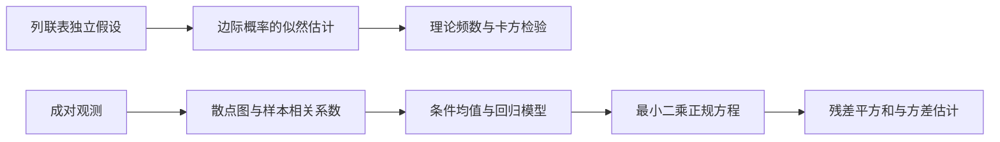
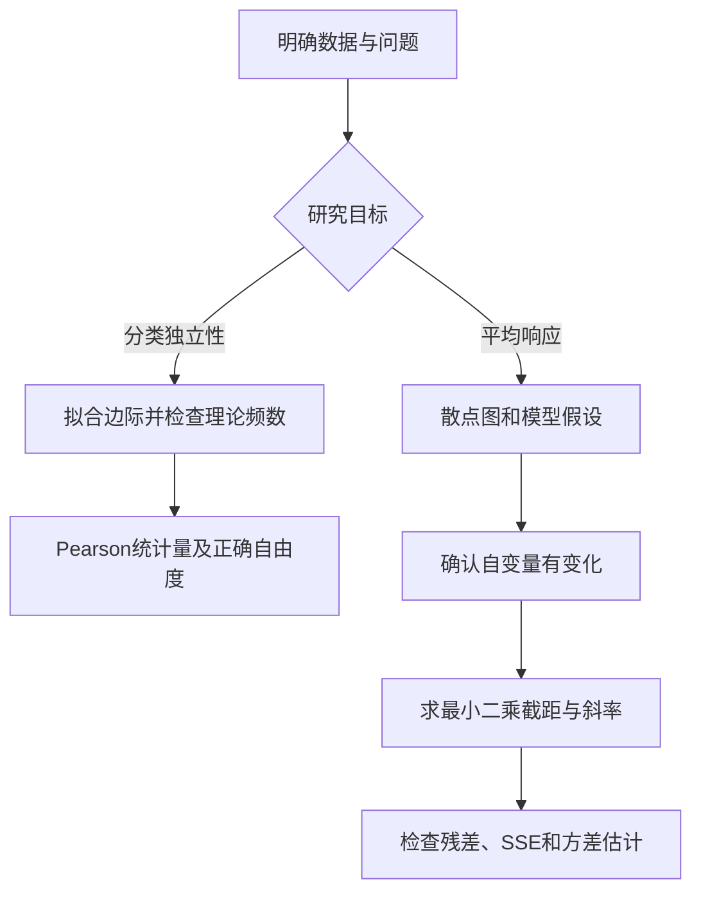

# 2026-10-29 第16节 列联表检验与一元线性回归

> [!info] 范围与来源
> 承接10月27日第15节。前约29分钟完成列联表检验，之后讲样本相关系数、回归函数、一元线性模型、最小二乘与残差方差估计。结合本地教材§8.3、§9.1—§9.2核对；未发现此次独立配套课件。原始逐字稿及纪要不改写。
> 教师特别指出教材第116页似然公式的求和范围、末项指数与乘积括号有错；以下统一用r行s列重新推导，不复制排版错误。补充解释和新编自测与原课内容区分。

## 一、先修与学习路线

[[03_Sources/Courses/数理统计/课堂笔记/2026-10-27-第15节-数理统计期末复习与新课讲授|上节]]已建立Pearson统计量和列联表似然。本节解决两类问题：分类属性是否独立；有连续成对数据时怎样估计平均响应关系。

先修提醒：频数之和固定，不能把格频数当独立变量；无偏方差估计需要正确自由度；最小二乘是对参数优化，不是要求直线通过所有点。

## 二、列联表独立性：把似然完整推出来

### 1. 假设、约束与参数个数（00:00—00:10）

记r行s列频数 $n_{ik}$、行和 $n_{i\cdot}$、列和 $n_{\cdot k}$，总数n。令行概率 $a_i$、列概率 $b_k$，原假设
$$
H_0:p_{ik}=a_ib_k\quad\text{对所有 }i,k,
\qquad \sum_ia_i=\sum_kb_k=1.
$$
备择为至少一个格不满足乘积关系。未知自由参数共有 $(r-1)+(s-1)$ 个，不是r+s个。

在独立同分布的分类观测模型下，忽略不含参数的多项式系数，
$$
L(a,b)\propto\prod_{i=1}^r\prod_{k=1}^s(a_ib_k)^{n_{ik}}
=\prod_{i=1}^ra_i^{n_{i\cdot}}\prod_{k=1}^sb_k^{n_{\cdot k}}.
$$
指数合并依据是对固定行/列累加频数，不能把各个不同指数搬到整个乘积外。若消去末概率，行部分应写
$$
\prod_{i=1}^{r-1}a_i^{n_{i\cdot}}
\left(1-\sum_{i=1}^{r-1}a_i\right)^{n_{r\cdot}},
$$
列部分同理，最后指数为 $n_{\cdot s}$。这是教材勘误所需的结构，不依赖转写中混乱的r/s命名。

> 一句话来说：联合格概率在独立假设下拆成行概率乘列概率，似然也随之按边际计数拆开。

### 2. 拉格朗日乘数求MLE（00:10—00:19）

对数似然加约束：
$$
\ell=\sum_in_{i\cdot}\log a_i+\sum_kn_{\cdot k}\log b_k
-\lambda(\sum_ia_i-1)-\delta(\sum_kb_k-1).
$$
在正边际计数的情形，
$$
\frac{n_{i\cdot}}{a_i}=\lambda,\qquad
\frac{n_{\cdot k}}{b_k}=\delta.
$$
求和并用概率和为1，得 $\lambda=\delta=n$，所以
$$
\hat a_i=\frac{n_{i\cdot}}n,\quad
\hat b_k=\frac{n_{\cdot k}}n,\quad
E_{ik}=n\hat a_i\hat b_k=\frac{n_{i\cdot}n_{\cdot k}}n.
$$
补充解释：零边际整行/列需剔除并按有效类别重算，不能直接对0取对数、除以0。

### 3. 统计量、自由度与判定（00:19—00:29）

$$
Q=\sum_{i=1}^r\sum_{k=1}^s\frac{(n_{ik}-E_{ik})^2}{E_{ik}},
\qquad d=rs-1-(r+s-2)=(r-1)(s-1).
$$
在固定有效类别、独立抽样与足够理论频数等条件下，H0下Q的极限分布为卡方d。给定显著性水平α，与该分布的上尾临界值比较；大于临界值拒绝。**未拒绝仅为证据不足，不是证明独立；Q不是直接与α比较。**

2×2表记为 $\begin{pmatrix}A&B\\C&D\end{pmatrix}$，常用简式为
$$
Q=\frac{n(AD-BC)^2}{(A+B)(C+D)(A+C)(B+D)},\qquad d=1.
$$
教师要求记住这一常用公式。它是Pearson未作连续性校正的形式；理论频数太小不应机械使用大样本近似。

课堂以吸烟/患病构造练习表，明确说数值为临时拼凑。录音前后有600/400与700/300等调整，完整四格不可靠；保留题型和公式，不编造唯一原表或作医学因果结论。

### 自测（新编）

表为 $\begin{pmatrix}30&20\\20&30\end{pmatrix}$，用一般式与简式各求Q，确认一致。

> [!hint]-
> 四个理论频数均25；n为100。

> [!solution]-
> 一般式为 $4\times25/25=4$；简式为 $100(900-400)^2/(50^4)=4$。这是计算核对，不自动证明任何因果关系。

## 三、样本相关系数：描述线性程度（00:29—00:40）

总体相关系数为
$$
\rho=\frac{\operatorname{Cov}(X,Y)}{\sqrt{\operatorname{Var}X\operatorname{Var}Y}}.
$$
只有观测对 $(x_i,y_i)$ 时，用样本矩替代总体矩，得到
$$
l_{xx}=\sum_i(x_i-\bar x)^2,\quad
l_{yy}=\sum_i(y_i-\bar y)^2,\quad
l_{xy}=\sum_i(x_i-\bar x)(y_i-\bar y),
$$
$$
r=\frac{l_{xy}}{\sqrt{l_{xx}l_{yy}}}\quad(l_{xx}>0,l_{yy}>0).
$$
其数值不因用n或n-1对三个样本矩作同样归一化而改变。

> 一句话来说：r用标准化后的共同变化衡量样本的线性趋势，不能代表所有非线性依赖。

绝对值近1表示样本线性趋势强，但不构成总体显著性检验，也不能以r近0断言独立。存在零方差时r未定义；不随意填0。教师提到后续还可通过相关检验/F检验讨论模型有效性，本课没有完整推导这些检验，不提前套用缺失条件的检验结论。

## 四、回归函数与模型假设（00:40—01:15）

### 1. 从“有关联”到“条件均值”

圆半径与面积属于确定函数关系；森林覆盖与水量、施肥量与产量、价格与需求等是课堂用来说明“有联系却不能唯一决定”的例子，不把这些口头例子当成实证因果规律。

若条件期望存在，
$$
m(x_1,\ldots,x_k)=E(Y\mid X_1=x_1,\ldots,X_k=x_k)
$$
称回归函数。回归方程描绘平均响应，单个Y还存在波动：
$$
Y=m(X)+\varepsilon,\qquad E(\varepsilon\mid X)=0.
$$
最后一式为补充准确表述；仅无条件 $E\varepsilon=0$ 不足以保证某个指定函数就是条件均值。

教师以高尔顿父子身高讨论回归到平均数。这里保留其教学动机，不从模糊转写确定历史样本数，也不将平均趋势说成每个子女都必须高/矮于父母。

### 2. 选变量、选函数、估参数是三步

散点图可以启发线性、二次或其他模型，不能唯一确定真实回归函数。课堂身高体重、氮肥与土豆产量先升后降、磷肥散点等例子均服务于模型选择；不从不完整曲线抄出唯一参数式。线性化例 $Y=a/X+b+\varepsilon$ 可令Z=1/X，但要求X非零，变换还要检查误差假设，不是任意非线性函数都能这样处理。

### 3. 固定设计的一元线性模型

统一a为截距、b为斜率：
$$
Y_i=a+bx_i+\varepsilon_i,\quad
E\varepsilon_i=0,\quad\operatorname{Var}(\varepsilon_i)=\sigma^2,
$$
本课假定各误差相互独立；再加 $\varepsilon_i\sim N(0,\sigma^2)$ 才是一元正态线性回归。待估参数有a、b、σ²。

不同 $x_i$ 对应不同均值 $a+bx_i$，所以 $Y_i$ 独立但一般不同分布；误差仍可同分布。正态假设不是求最小二乘点估计的必要条件，主要用于进一步分布推断。
“方差尽可能小”是模型解释力目标，**不是等方差定义的一部分**；等方差指各观测的误差方差相同。

## 五、最小二乘：目标、正规方程与唯一极小值（01:15—01:26）

### 1. 为什么平方、对谁优化

$$
Q(a,b)=\sum_{i=1}^n(y_i-a-bx_i)^2.
$$
直接求偏差和会正负抵消。绝对偏差也是可用准则，但优化性质不同；平方和不是唯一正确的误差度量。这里数据已知，a、b是待优化变量；拟合值为 $\hat y_i=\hat a+\hat bx_i$，残差为 $e_i=y_i-\hat y_i$。

令两偏导为0：
$$
\sum_i(y_i-\hat a-\hat bx_i)=0,\qquad
\sum_ix_i(y_i-\hat a-\hat bx_i)=0.
$$
第一式给出 $\hat a=\bar y-\hat b\bar x$；代入第二式得
$$
\boxed{\hat b=\frac{l_{xy}}{l_{xx}},\qquad
\hat a=\bar y-\hat b\bar x}\quad(l_{xx}>0).
$$

> 一句话来说：带截距的拟合线通过样本均值点，斜率由共同变化除以自变量变化给出。

便算式为
$$
l_{xy}=\sum_ix_iy_i-n\bar x\bar y,\quad
l_{xx}=\sum_ix_i^2-n\bar x^2,\quad
l_{yy}=\sum_iy_i^2-n\bar y^2.
$$

### 2. 补充证明：不是只把驻点当最小值

对任意a、b，利用正规方程消去交叉项：
$$
Q(a,b)=Q(\hat a,\hat b)+
n[(a-\hat a)+(b-\hat b)\bar x]^2+(b-\hat b)^2l_{xx}.
$$
故当 $l_{xx}>0$ 时是唯一全局极小值。若所有x相同，则 $l_{xx}=0$，截距和斜率不能分别唯一识别；不能照除以0。该条件是课堂公式的适用边界。

## 六、误差方差估计与自由度（01:26—01:32）

残差平方和
$$
\operatorname{SSE}=\sum_ie_i^2
=l_{yy}-\frac{l_{xy}^2}{l_{xx}}
=l_{yy}-\hat b^2l_{xx}.
$$
在模型假设成立、$l_{xx}>0$ 且n>2时，
$$
\boxed{\hat\sigma^2=\frac{\operatorname{SSE}}{n-2}}.
$$
正规方程给出两个独立约束 $\sum e_i=0,\sum x_ie_i=0$，残差所在空间维数为n-2。教师本课先给公式和约束直觉，详细无偏证明留后续。

补充解释：在等方差、不相关误差和满秩设计下，$E(\mathrm{SSE})=(n-2)\sigma^2$，所以此估计无偏；正态模型的方差MLE为SSE/n，两者不同。不是为任何残差平方和一律减2；减的是实际估计的独立回归参数数目。

### 自测（新编）

取观测对(0,1)、(1,2)、(2,2)，求拟合线、SSE与无偏方差估计。

> [!hint]-
> $\bar x=1,\bar y=5/3,l_{xx}=2,l_{xy}=1$；最后检查两个正规方程。

> [!solution]-
> $\hat b=1/2,\hat a=7/6$。残差为 $(-1/6,1/3,-1/6)$，SSE=1/6；n-2=1，故 $\hat\sigma^2=1/6$。残差和与按x加权残差和均为0。

## 七、方法选择与速查

| 问题 | 公式 | 前提 |
|---|---|---|
| 列联表理论频数 | $E_{ik}=n_{i\cdot}n_{\cdot k}/n$ | 独立性原假设 |
| 列联表自由度 | $(r-1)(s-1)$ | 有效行列及渐近条件 |
| 样本相关 | $r=l_{xy}/\sqrt{l_{xx}l_{yy}}$ | 两变量非零变异 |
| 回归斜率 | $\hat b=l_{xy}/l_{xx}$ | $l_{xx}>0$ |
| 回归截距 | $\hat a=\bar y-\hat b\bar x$ | 模型含截距 |
| 无偏残差方差 | $\hat\sigma^2=\mathrm{SSE}/(n-2)$ | n>2、正确满秩等方差模型 |

> [!warning] 课堂勘误与边界
> 检验量与临界值比较，不直接与显著性水平比较；未拒绝不证明独立。r只刻画线性趋势，回归不自动表示因果。斜率截距记号不能互换，零变异不可除。误差方差与残差样本方差不是同一个对象。

## 八、课堂疑惑、旧缺失回查与来源

当日“每日疑惑/2026-10-29.md”不存在，无个人疑惑可提取回写。课堂补充辨析不冒充个人提问。

- [[03_Sources/Courses/数理统计/课堂笔记/raw/2026-10-29-独立性检验与回归分析授课-441344-逐字稿|逐字稿]]：上述时间段为核对依据；末尾闲谈排除。
- [[03_Sources/Courses/数理统计/课堂笔记/raw/2026-10-29-独立性检验与回归分析授课-441344-纪要|纪要]]：用于定位，不把“方差尽可能小”纳入等方差定义。
- [[03_Sources/Courses/数理统计/课本/概率论与数理统计/概率论与数理统计|教材]]：§8.3列联表、§9.1回归模型、§9.2最小二乘及性质；公式重建以一致指标和维数为准。
- 9月10日旧缺失课的完整课堂范围及10月22日考试原始资料仍不能由今天新课恢复；保留既有待核，不重复复制推测内容。10月27日暴雨原表仍未获得，今天未新增可靠数值依据。
- 最优检验部分教师表示本期暂不要求、若有时间再回看，不算今天已讲完；本次没有可唯一定位的新作业题号。
- [[03_Sources/Courses/数理统计/课堂笔记/README|课堂索引]]。
