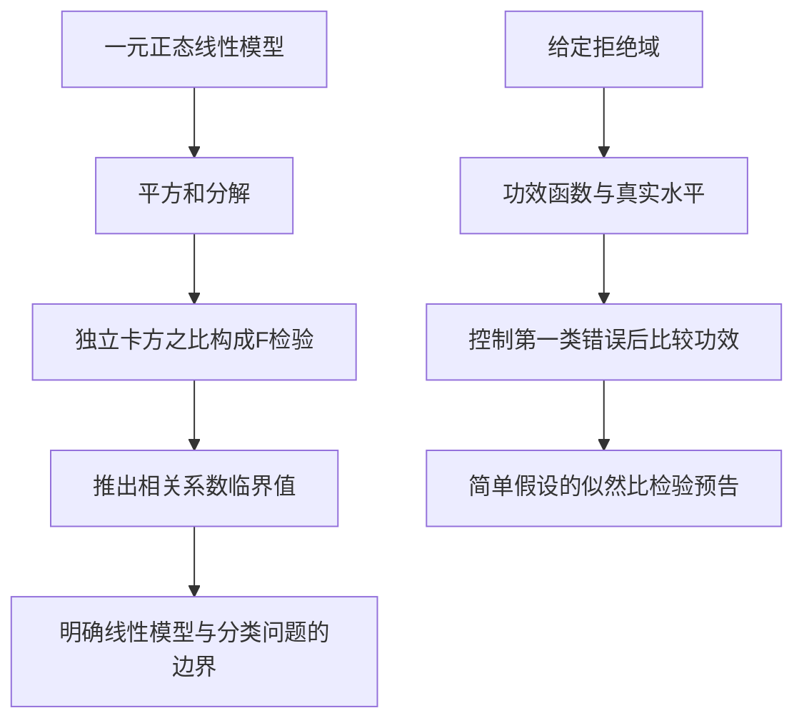
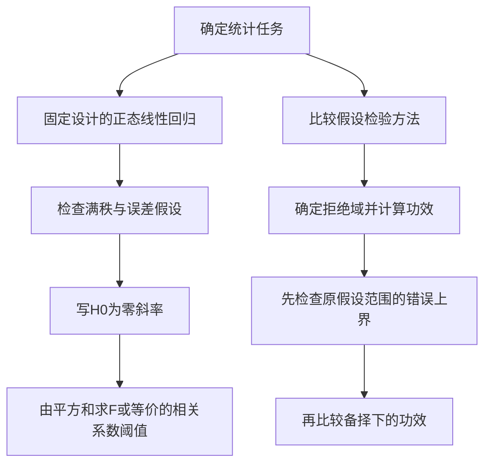

# 2026-11-05 第18节 数理统计：回归显著性与最佳检验导入

## 一、本节问题、先修与来源边界

本课先完成第九章：为什么样本相关系数可以检验线性关系？再回到第八章：两个检验都控制第一类错误时，怎样比较谁更好？路线为“最小二乘回顾 → 平方和分解 → F检验与相关系数 → 非线性与分类边界 → 功效函数 → 似然比检验预告”。

必要先修：固定设计点的一元回归、正态标准化、卡方与F分布、两类错误。[[03_Sources/Courses/数理统计/课堂笔记/2026-10-29-第16节-独立性检验与回归分析授课|10月29日笔记]]可回看最小二乘方程及残差方差；[[00_Inbox/课堂录音/缺失记录/数理统计/2026-11-03-第17节-缺少逐字稿|11月3日缺失记录]]仅部分恢复，不能当作完整课堂来源。

本课逐字稿00:00—01:35为教学主体；课间与课后闲谈不纳入知识正文。转写始终使用同一说话人标签，不能据此将所有声音归为教师。01:35以后主要是非教学谈话。开头提到后续贝叶斯统计与经典统计的思想差别，本次尚未展开其具体估计与检验。

来源优先级：逐字稿核定讲授范围，纪要辅助定位；教材§9.2、§9.4及§8.4校正公式。当前课件主要覆盖第六、七章，未找到可靠对应本课回归与最佳检验的PPT或演示代码，不以无关课件补写。补充证明、新编例子与课堂尚未完成的内容分别标明。

## 二、最小二乘估计量与分布回顾

课堂00:00:37—00:07:40明确回顾“上一节课”的工作。设固定实数设计点$x_i$不全相同，$n>2$，

$$
Y_i=a+bx_i+\varepsilon_i,\qquad
\varepsilon_i\overset{\mathrm{iid}}\sim N(0,\sigma^2),\quad\sigma^2>0.
$$

本文$N(\mu,v)$的第二参数统一表示**方差**；教材有些位置以标准差记第二参数，不能机械照抄。记

$$
l_{xx}=\sum_i(x_i-\bar x)^2>0,\quad
l_{xy}=\sum_i(x_i-\bar x)(Y_i-\bar Y),\quad
l_{yy}=\sum_i(Y_i-\bar Y)^2.
$$

$$
\hat b=\frac{l_{xy}}{l_{xx}},\qquad
\hat a=\bar Y-\hat b\bar x,\qquad
\hat Y_i=\hat a+\hat b x_i,\qquad
\hat\sigma^2=\frac{\sum_i(Y_i-\hat Y_i)^2}{n-2}.
$$

在上述正态模型下，

$$
\hat b\sim N\!\left(b,\frac{\sigma^2}{l_{xx}}\right),\qquad
\hat a\sim N\!\left(a,\sigma^2\left(\frac1n+\frac{\bar x^2}{l_{xx}}\right)\right),
\qquad\frac{(n-2)\hat\sigma^2}{\sigma^2}\sim\chi^2_{n-2}.
$$

因此两系数估计均无偏。教师说明残差方差的卡方分布尚留有严格证明任务，可借助正交变换；本笔记第四节提供标明来源的补充推导，不将其写成课堂已完成的证明。

> 一句话来说：数值上能拟合直线，与在统计模型下能证明估计量服从什么分布，是两个层次。

## 三、总波动怎样拆成回归与残差（核心）

课堂00:08:22—00:33:29以点、拟合直线和均值水平线的距离作解释，并演示强、中等线性及非线性样本的平方和变化；未取得演示源程序或精确样本，不反推其数值。

定义总离差、残差和回归平方和：

$$
Q_T=\sum_i(Y_i-\bar Y)^2=l_{yy},\quad
Q_e=\sum_i(Y_i-\hat Y_i)^2,\quad
Q_R=\sum_i(\hat Y_i-\bar Y)^2.
$$

先把每个偏差写成$Y_i-\bar Y=(Y_i-\hat Y_i)+(\hat Y_i-\bar Y)$。**长度相加不等于平方直接相加**，展开后还须消除交叉项。因为$\hat Y_i-\bar Y=\hat b(x_i-\bar x)$，

$$
\begin{aligned}
\sum_i(Y_i-\hat Y_i)(\hat Y_i-\bar Y)
&=\hat b\sum_i\big[(Y_i-\bar Y)-\hat b(x_i-\bar x)\big](x_i-\bar x)\\
&=\hat b(l_{xy}-\hat b l_{xx})=0.
\end{aligned}
$$

于是

$$
\boxed{Q_T=Q_R+Q_e},\qquad
Q_R=\hat b^2l_{xx}=\frac{l_{xy}^2}{l_{xx}},\qquad Q_e=l_{yy}-\frac{l_{xy}^2}{l_{xx}}.
$$

> 一句话来说：最小二乘让拟合部分与残差正交，所以总平方波动恰好分成两部分。

解释边界：在正确线性模型下，残差用于估计随机误差；模型设定错误时，残差还可能包含遗漏的曲线结构。不能把$Q_e$无条件认作“纯随机噪声”，也不能仅从$Q_T$的绝对大小判断线性强弱。课堂用$Q_R$与$Q_e$相对占比引出检验，正式结论仍需下一节的模型条件。

## 四、F检验：为什么必须先写原假设

课堂00:33:29—00:59:49。问题是**在线性模型内检验斜率是否为零**：

$$
H_0:b=0,\qquad H_1:b\ne0.
$$

教师00:40前后口头表述有反复，随即纠正为上式；不能沿用“原假设有线性关系”的中间口误。$b=0$表示条件均值$a+bx$不随$x$改变，并非$Y$没有随机波动。

当$H_0$成立时，

$$
\frac{Q_R}{\sigma^2}=\left(\frac{\hat b}{\sigma/\sqrt{l_{xx}}}\right)^2\sim\chi^2_1,
\qquad\frac{Q_e}{\sigma^2}\sim\chi^2_{n-2}.
$$

此外$Q_R$与$Q_e$独立，才能按F分布定义得到

$$
\boxed{F=\frac{Q_R/1}{Q_e/(n-2)}=\frac{(n-2)Q_R}{Q_e}\sim F(1,n-2)}\quad(H_0).
$$

这里自由度1是拟合均值随$x$变化的一个斜率方向，$n-2$是扣除截距与斜率后的残差维数。定义上尾临界值$c_\alpha$使$P\{F(1,n-2)>c_\alpha\}=\alpha$，拒绝域为$F>c_\alpha$。未拒绝只表示当前证据不足。$b\ne0$时上述分子通常是非中心卡方，不能继续称其为中心$\chi^2_1$。

> 一句话来说：F检验比较单位自由度的“拟合变化”与“剩余波动”，且这个比较的参考分布是在零斜率假设下建立的。

> [!note]- 补充解释：正交变换给出独立性及卡方分布（非课堂已完成证明）
> 依据教材§9.2的正态回归性质，作一元模型的具体展开。取$u_0=(1,\ldots,1)^T/\sqrt n$、$u_1=(x_i-\bar x)_{i=1}^n/\sqrt{l_{xx}}$，再补成$\mathbb R^n$的正规正交基$u_0,\ldots,u_{n-1}$。令$Z_j=u_j^T\varepsilon/\sigma$，则各$Z_j$独立且服从$N(0,1)$：正交变换后仍为联合正态、协方差为单位矩阵。
>
> $\hat b=b+\sigma Z_1/\sqrt{l_{xx}}$，而残差向量恰为$\sigma\sum_{j=2}^{n-1}Z_j u_j$，所以$Q_e/\sigma^2=\sum_{j=2}^{n-1}Z_j^2\sim\chi^2_{n-2}$，并且独立于$\hat b$，从而独立于$Q_R=\hat b^2l_{xx}$。在$H_0$下，$Q_R/\sigma^2=Z_1^2$。同一展开也证明$E\hat\sigma^2=\sigma^2$；不是仅凭“不相关”就在任意分布下推断独立。

## 五、相关系数临界值从哪里来

当$l_{yy}>0$，定义样本相关系数

$$
R=\frac{l_{xy}}{\sqrt{l_{xx}l_{yy}}},\qquad
\frac{Q_R}{Q_T}=R^2,\qquad
F=\frac{(n-2)R^2}{1-R^2}.
$$

在非退化情形$\lvert R\rvert<1$，由$F>c_\alpha$移项得

$$
(n-2+c_\alpha)R^2>c_\alpha,
\qquad\boxed{\lvert R\rvert>r_\alpha(n-2):=\sqrt{\frac{c_\alpha}{n-2+c_\alpha}}}.
$$

这解释了相关系数表与F分布表的联系，$r_\alpha$不是凭空引入的“第五种基本分布”。教师表示本课程考试若采用相关系数法，会给相应临界值；仍需正确计算$R$及自由度。

补充边界：$l_{yy}=0$时$R$无定义，不能硬套公式；样本恰好完全共线时$Q_e=0$，常规比值不能作为有限数计算。低相关也不能排除非线性关系，例如对称设计下$Y=x^2$的线性相关可能为零。

## 六、从线性化到分类问题（课堂扩展）

课堂01:01:23—01:10:33。

1. 若均值关系为$Y=a+b/x$，且$x\ne0$，令$z=1/x$，再对$(z_i,Y_i)$作线性回归。先变换自变量，估计完成后回到原式。不能据此断言任意非线性模型都可线性化；变换因变量时还须重新审视误差模型（补充解释）。
2. 教师提出二分类标签$Y\in\{0,1\}$，用肿瘤大小作抽象横坐标，先试拟合直线，再以0.5阈值分类。一个极大的横坐标观测可能改变斜率与阈值位置，使原来分类正确的点被误分。这是课堂示意，未提供真实数据或临床判断规则。
3. 教师由此引出逻辑回归和机器学习迭代参数（如梯度下降），**本课没有写出sigmoid、交叉熵、训练代码或完整优化推导**。不要把“直线输出加0.5阈值”直接称为已完成逻辑回归，也不能认为逻辑回归天然消除了所有异常值影响。
4. 多元回归中的变量选择、后续回归分析只作方向提示，本课仍以一元模型为主。

## 七、功效函数：同一个拒绝域在不同参数下怎样表现

课堂01:10:57—01:28:59回到第八章遗留的最佳检验问题。确定拒绝域$W$就确定一个非随机检验：样本向量$X\in W$时拒绝$H_0$，否则未拒绝。

若$H_0:\theta\in\Theta_0$，$H_1:\theta\in\Theta_1$，定义功效函数（势函数）

$$
M_W(\theta)=P_\theta\{X\in W\}.
$$

| 参数实际位置 | $M_W(\theta)$的意义 | 希望怎样 |
|---|---|---|
| $\theta\in\Theta_0$ | 第一类错误概率 | 控制在给定上界内 |
| $\theta\in\Theta_1$ | 正确拒绝概率，等于$1-\beta(\theta)$ | 在同等错误约束下尽量大 |

这里$P_\theta$表示在参数为$\theta$的抽样分布下计算概率，不是在经典检验里给未知参数本身赋予一个先验概率。

### 7.1 课堂正态均值右侧检验例

设$X_i\overset{\mathrm{iid}}\sim N(\mu,\sigma_0^2)$，$\sigma_0$已知，检验$H_0:\mu=\mu_0$对$H_1:\mu=\mu_1>\mu_0$。令$u_\alpha$满足$P\{Z>u_\alpha\}=\alpha$，$Z\sim N(0,1)$，

$$
W=\left\{\frac{\bar X-\mu_0}{\sigma_0/\sqrt n}>u_\alpha\right\}.
$$

在真实均值$\mu$下，应减去真实的$\mu$才能标准化：

$$
\begin{aligned}
M_W(\mu)
&=P_\mu\!\left\{\frac{\bar X-\mu}{\sigma_0/\sqrt n}>u_\alpha-\frac{\sqrt n(\mu-\mu_0)}{\sigma_0}\right\}\\
&=1-\Phi\!\left(u_\alpha-\frac{\sqrt n(\mu-\mu_0)}{\sigma_0}\right).
\end{aligned}
$$

所以$M_W(\mu_0)=\alpha$，在$\mu_1$处第二类错误概率为

$$
\beta(\mu_1)=1-M_W(\mu_1)=\Phi\!\left(u_\alpha-\frac{\sqrt n(\mu_1-\mu_0)}{\sigma_0}\right).
$$

固定$\alpha$与正的均值差时，增加$n$使功效上升。转写01:23附近把“原假设成立/第二类错误”混在一起，以定义校正：第二类错误只能在备择成立时讨论。教材§8.4还讨论双侧例，本课这里用右侧例，不能混用临界值$u_{\alpha/2}$。

### 7.2 检验水平与真实水平

若对所有$\theta\in\Theta_0$有$M_W(\theta)\le\alpha$，称该检验水平不超过$\alpha$。同一检验满足这个约束，也满足任何更大的上界；它的**真实水平（大小）**为

$$
\alpha_*(W)=\sup_{\theta\in\Theta_0}M_W(\theta).
$$

教师说“找最大的功效”与“找最小水平”并不矛盾：前者是在原假设参数范围内取上确界，后者是找能够约束所有这些概率的最小上界。不保证上确界一定取到。

> 一句话来说：先限制误报，再比较在备择下真正识别出来的概率。

开头提出的复合原假设$\mu\ge\mu_0$对$\mu<\mu_0$为什么可用边界校准，课堂留待最佳检验理论解释；不能推广成“任意复合假设都等价于一个点”。

## 八、似然比与最优势检验（本课只作导入）

课堂01:29:34—01:35:22。对简单假设$H_0:\theta=\theta_0$与$H_1:\theta=\theta_1$，似然函数$L(\theta;x)$把已经观测到的样本$x$固定，比较不同参数对该数据的支持程度。

$$
\Lambda(x)=\frac{L(\theta_1;x)}{L(\theta_0;x)},\qquad W_* = \{x:\Lambda(x)>c\}.
$$

教师预告奈曼—皮尔逊定理：若阈值能使$P_{\theta_0}(W_*)=\alpha$，则在所有水平不超过$\alpha$的检验中，$W_*$在$\theta_1$处的功效最大。本课解释定理用途，**尚未完成证明**。阈值由零假设分布和水平校准，不能随意定为1。转写中的“水平大于α的任一检验”与错误控制冲突，按定理应为“不超过α”。

补充理解：连续型数据的似然由密度构成，不能把某个精确样本点的密度称为该点的正概率；若似然比分界处有正概率质量，为精确达到指定水平可能需要在等号边界随机化。对复合备择，要对每一个备择参数同时最优才是一致最优势，不能从简单假设的结论直接推出其存在。完整后续证明可查教材§8.4“三、最佳检验”。

## 九、方法选择与公式速查

| 对象 | 公式 | 条件或用途 |
|---|---|---|
| 波动分解 | $Q_T=Q_R+Q_e$ | 含截距的最小二乘 |
| 回归平方和 | $Q_R=\hat b^2l_{xx}$ | $l_{xx}>0$ |
| 检验统计量 | $F=(n-2)Q_R/Q_e$ | 正态模型、$H_0:b=0$下参照$F(1,n-2)$ |
| 相关系数形式 | $F=(n-2)R^2/(1-R^2)$ | 非退化分母 |
| 临界相关系数 | $r_\alpha=\sqrt{c_\alpha/(n-2+c_\alpha)}$ | $c_\alpha$为F上尾临界值 |
| 功效函数 | $M_W(\theta)=P_\theta(X\in W)$ | 先固定拒绝域 |
| 真实水平 | $\sup_{\Theta_0}M_W(\theta)$ | 最小的统一错误上界 |

> [!warning] 易错点
> 平方和分解与F分布结论的条件不同；“F显著”检验的是线性模型中的零斜率，不能证明直线是所有模型中最合适者。未拒绝不等于证实原假设。功效在原假设下代表第一类错误，在备择下才是希望增大的正确拒绝概率。原假设概率质量的约束必须先固定，不能为了提高功效任意扩大拒绝域。

## 十、作业线索与自测（新编）

课堂明确任务：00:49:53—00:51:26要求课下思考用正交变换证明$Q_R$与$Q_e$独立；残差卡方结论也在回顾中指出未严格证明。未听到本次新增的教材习题编号，不补造。

### 自测1：三个点的平方和与统计量

取$x=(0,1,2)$、$y=(1,2,2)$，计算$\hat a,\hat b,Q_T,Q_R,Q_e,R^2,F$，验证两种F表达一致。没有临界值时，能否直接宣称显著？

> [!hint]- 提示
> 先算$\bar x=1$、$\bar y=5/3$，再算三个中心化和。

> [!solution]- 解析
> $l_{xx}=2,l_{xy}=1,l_{yy}=2/3$，故$\hat b=1/2,\hat a=7/6$。$Q_R=1/2,Q_e=1/6$，相加为$2/3$；$R^2=3/4$，$F=(3-2)(1/2)/(1/6)=3$，亦等于$(3-2)(3/4)/(1/4)=3$。需给定模型条件和显著性水平后比较临界值，不能仅凭3判断显著。

### 自测2：上界与功效不要混淆

右侧正态均值检验若$u_\alpha=1.645$，且$\sqrt n(\mu_1-\mu_0)/\sigma_0=2$，写出备择处功效及第二类错误概率，并说明原假设下的拒绝概率。

> [!hint]- 提示
> 真正标准化时中心为真实均值。代入第七节公式。

> [!solution]- 解析
> 功效$1-\Phi(-0.355)=\Phi(0.355)$约0.639，第二类错误约0.361；原假设下拒绝概率为$1-\Phi(1.645)$约0.05。功效0.639不是第一类错误概率。

## 十一、课堂疑惑与解答

11月5日及本次检查日11月6日的日计划均不存在，未补造个人疑惑或作答记录。课堂提出的“独立性如何证明”“相关系数临界值从哪里来”已在第四、五节展开，保留其课堂提问性质，不冒充个人记录。

## 十二、依据与后续待补

- [[03_Sources/Courses/数理统计/课堂笔记/raw/2026-11-05-一元线性回归与假设检验讲座-951872-逐字稿.md|原始逐字稿]]：回归00:00:37—01:10:33；功效与最佳检验01:10:57—01:35:22。
- [[03_Sources/Courses/数理统计/课堂笔记/raw/2026-11-05-一元线性回归与假设检验讲座-951872-纪要.md|原始纪要]]：仅辅助定位，不覆盖逐字稿与公式核对。
- [[03_Sources/Courses/数理统计/课本/概率论与数理统计/概率论与数理统计|教材]]：§9.2核对分布、独立性与无偏性；§9.4核对回归检验；§8.4核对功效及奈曼—皮尔逊定理。教材记号已统一到本课一元模型，不把教材全部内容计作本课讲授。
- [[03_Sources/Courses/数理统计/课堂笔记/README|课堂索引]]：保留第17节缺失事实和本节衔接。11月3日只可由本次明确回顾恢复部分分布结论，其完整范围、例题和作业仍待原资料。
