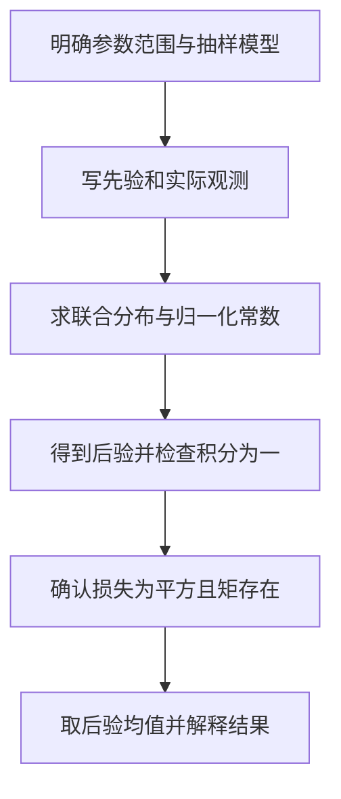

# 2026-11-10 第19节 数理统计：先验后验与平方损失下的贝叶斯估计

> [!info] 本节来源与范围
> 本课录制于2026年11月10日16:26:47–18:10:47，文件ID为2120070652506828800，长度104分钟。完整逐字稿的教学主体为00:00–37:22、43:32–01:28:31；中间为课间，01:29:45以后的片段没有可确认的新增教学内容。按逐字稿核定讲授范围，以本地教材第十章导言、§10.2“一、贝叶斯估计”校核公式。
> 课堂确实使用PPT及互动模拟，但本地现有课件主要是第六、七章，未找到对应本节的PPT、模拟源程序或屏幕记录。以下数学符号经统一；补全计算、必要条件及新编自测分别标明，不冒充板书逐字抄录。

## 一、本节要解决什么问题

新店只有1条评价且为好评，老店100条中有96条好评。表面好评比例分别为100%与96%，怎样把样本量和先前认识一起考虑？若要用一个数估计真实好评率，为什么最终会用到后验均值？

先修提醒：条件密度等于联合密度除以边缘密度；边缘密度由联合密度积分得到；给定$X$后，$X$的函数可以从关于另一变量的条件期望中提出。前次[[03_Sources/Courses/数理统计/课堂笔记/2026-11-05-第18节-一元线性回归与假设检验讲座|11月5日课堂笔记]]以固定未知参数下的回归和检验为主，本节转入用分布量化参数的不确定性。

先读第二、三节理解参数为何有分布，再读第四节推导更新公式，最后读第六、七节理解平均损失及最优性。

## 二、经典统计与贝叶斯统计的区别（00:00–14:07、27:29–37:22）

### 1. 从事件的贝叶斯公式到参数更新

课堂回顾：若$B_j$构成原因事件的划分，观察到结果$A$后，

$$
P(B_j\mid A)=\frac{P(A\mid B_j)P(B_j)}{\sum_i P(A\mid B_i)P(B_i)}.
$$

$P(B_j)$是观察$A$前的先验概率，$P(B_j\mid A)$是观察后的后验概率。这里“已知结果寻找原因”是更新信息的直觉解释，不意味着只凭相关数据已经证明因果关系；$B_j$是事件，不能把事件本身叫作一个概率。

### 2. 参数是未知常数，还是用分布表达未知

| 观点 | 参数 | 随机性及信息 |
|---|---|---|
| 本课所说的经典统计 | 未知但固定的$p$ | 样本随抽样而变化，利用总体模型和样本推断参数 |
| 贝叶斯统计 | 以随机变量$P$描述对$p$的不确定性 | 给定先验，结合抽样模型与观测数据更新分布 |

> 一句话来说：贝叶斯方法给“我不知道参数是多少”一个概率分布，再让数据改变这个分布。

参数赋有分布，不是在声称同一家店的真实好评率每天随机跳动。本课用大写$P$表示随机参数，小写$p$表示它可能的取值；一般参数写作$\Theta$和$\theta$。

在经典模型中，固定参数落在一个已经固定的区间里是真或假，不能在该模型内直接给参数本身赋概率；这与由随机样本构造的置信区间具有覆盖概率不同。贝叶斯模型则可计算$P(P\in I\mid X=x)$。

### 3. 均匀先验也有具体含义

课堂先假定$P\sim U(0,1)$：密度为1，等长区间获得相同概率，先验均值为$1/2$。连续分布每一个精确单点的概率仍为零，不应说“每个点都有同样的正概率”。均匀分布表达一种特定的先前认识，不是完全取消了建模选择。

**补充解释（参数范围）**：好评率和次品率必须在$[0,1]$内，先验支持也应与之相容。课堂为比较分布形状提及正态等分布，不应直接把未截断、取遍实数的正态分布当作概率$p$的严格先验；正态先验可适用于正态总体均值等实参数。参数变换后“均匀”一般也不再保持均匀。

### 4. 三类信息与本课的安排

贝叶斯推断利用总体信息、样本信息、先验信息。课堂回顾皮尔逊卡方检验比较实测与理论频数，费希尔信息量用于方差下界；区间估计先规定可靠程度再考虑精确程度，检验先控制第一类错误再努力降低第二类错误。这些是经典方法的回顾，不是本课新增证明。

先验信息来自抽样前的实践经验、历史资料。课堂35:19举次品率约在0.05到0.15间均匀分布的例子；教材导言出现的区间不同，本文保留课堂原记录，不用教材数字替换。课堂37:22明确：本阶段习题会给定先验，现实任务则还要论证先验如何确定。历史上提及贝叶斯及瓦尔德的决策论框架，具体估计方法仍由数学定义决定。

## 三、两个案例：同样的点估计不等于同样的信息量

### 1. 好评率与似然（01:16–06:48、11:58–13:41）

用$X_i=1$表示好评，$X_i=0$表示差评；给定真实好评率$p$，按本课模型把评价视作独立的伯努利试验。令$K=\sum_iX_i$，观察到$n$条、$k$个好评时，

$$
P(K=k\mid P=p)=\binom nk p^k(1-p)^{n-k}.
$$

固定数据$(n,k)$后，把这个式子看作$p$的函数，就是似然。课堂通过比较$p=0.2,0.5,0.9$时产生同一结果的可能性，引出极大似然思想。

| 课堂对象 | $n$ | $k$ | 比例$k/n$ | 极大似然估计（允许边界） |
|---|---:|---:|---:|---:|
| 新店A | 1 | 1 | 1 | 1 |
| 老店B | 100 | 96 | 0.96 | 0.96 |
| 另一个新店示例 | 10 | 9 | 0.9 | 0.9 |

**校核说明**：课堂同时提到老店评分4.87，但评分与96条好评之间的换算规则没有完整提供，不能由4.87独立推出96。计算采用后续反复明确的“100条中96条好评”。

**勘误**：03:14提到$p=1$可能有较高似然，但老店含4条差评，$p=1$的似然实际为零；应在$p=0.96$处最大。若严格参数空间只取$(0,1)$，新店$k=n=1$的似然仅在$p\to1$时趋近上确界，不在开区间内取得极大值。这些校核不改变原始逐字稿。

### 2. 三个工厂都“零次品”（29:27–34:21）

课堂以有放回抽查产品构造伯努利样本。三个工厂分别检查100、500、5000件，均未发现次品，极大似然点估计都为0。随后口语又提到降低抽样数，具体改成几件不清楚，不另补数字。

同为0的点估计掩盖了样本量不同带来的证据差别。**补充解释**：这不是经典统计无法区分信息量——经典置信上限也会随样本量变化；本例只是指出只看这一个极大似然数值不足以表达不确定性。即使贝叶斯后验显示某工厂更可能具有低次品率，也不能据此断言真实次品率的绝对排序。

## 四、由先验和样本推导后验（14:49–22:34、52:28–56:34）

> 一句话来说：先验乘上数据对参数的支持程度，再归一化，就是后验。

### 1. 先区分三个分布

设$X=(X_1,\ldots,X_n)$是样本向量，参数$\Theta\in\Omega$有先验密度$\pi(\theta)$。给定$\Theta=\theta$，样本条件独立同分布，因此

$$
f(x\mid\theta)=\prod_{i=1}^{n}f_0(x_i\mid\theta),\qquad
q(x,\theta)=f(x\mid\theta)\pi(\theta).
$$

$f$是给定参数的样本条件密度，$q$是样本与参数的联合密度；将参数积掉，得到样本的边缘密度

$$
g(x)=\int_{\Omega}f(x\mid u)\pi(u)\,\mathrm du.
$$

**补充解释**：条件独立不代表将随机参数积掉后样本仍无条件独立；它们共享同一个随机参数。不能在未给定参数的情况下机械套乘积。

### 2. 后验公式与归一化

对$0<g(x)<\infty$的观测$x$，

$$
\boxed{h(\theta\mid x)=\frac{q(x,\theta)}{g(x)}
=\frac{\pi(\theta)f(x\mid\theta)}{\int_{\Omega}\pi(u)f(x\mid u)\,\mathrm du}}.
$$

分母对$\theta$是常数，使后验密度对参数积分为1。课堂称$f(x\mid\theta)/g(x)$为调整因子，即$h(\theta\mid x)=\pi(\theta)\times\text{调整因子}$。连续数据中$g(x)$是密度，不是精确点事件的正概率。

若某些量为离散型，对相应变量求和；好评数$K$离散而参数$P$连续时，分子使用$P(K=k\mid P=p)\pi(p)$，分母对$p$积分。先验、似然与后验不是可以随意互换的三个名字。

### 3. 用均匀先验算出本课模拟中的公式（补全计算）

以下据教材例10.2.1补全课堂21:15–24:34的二项似然与后验均值；“Beta”名称和积分步骤不声称已在课堂逐步写出。

取$\pi(p)=1$，$0<p<1$，则

$$
h(p\mid n,k)=\frac{p^k(1-p)^{n-k}}{\int_0^1u^k(1-u)^{n-k}\,\mathrm du},\qquad 0<p<1.
$$

二项系数与$p$无关，已在分子分母抵消。对整数$0\le k\le n$，归一化积分为$k!(n-k)!/(n+1)!$。这称为$\operatorname{Beta}(k+1,n-k+1)$分布。后验均值由两个积分之比得到

$$
E(P\mid n,k)
=\frac{\int_0^1p^{k+1}(1-p)^{n-k}\,\mathrm dp}{\int_0^1p^k(1-p)^{n-k}\,\mathrm dp}
=\boxed{\frac{k+1}{n+2}}.
$$

**补充解释**：对$n>0$，该均值还可写成

$$
\frac{k+1}{n+2}=\frac{n}{n+2}\frac{k}{n}+\frac{2}{n+2}\frac12.
$$

它将经验比例向先验均值$1/2$收缩，小样本时先验作用更明显。它不是对任意先验或损失函数都成立的通式。

## 五、模拟与案例的数值核对（23:17–25:35）

课堂模拟先设真实好评率0.75，用新店的1条好评初始化，再增加随机抽取的评价。记录中能确认的两行是：

| 总评论$n$ | 好评$k$ | 样本比例 | 后验均值 |
|---:|---:|---:|---:|
| 1 | 1 | 1 | $2/3\approx0.667$ |
| 11 | 9 | $9/11\approx0.818$ | $10/13\approx0.769$ |

课堂观察样本比例与后验均值围绕真实值波动，增加样本不是每一步都更接近真值。25:35重置参数部分出现“降低”“0.9”以及0.54、0.52等互不协调片段；没有屏幕数据，无法确定第二轮真实参数和累计样本量，不将这些数拼成可验证模拟记录。

**补充解释**：在给定真实$p$的独立同分布伯努利抽样模型下，$K_n/n\to p$几乎必然，而

$$
\frac{K_n+1}{n+2}-\frac{K_n}{n}=\frac{n-2K_n}{n(n+2)}\longrightarrow0,
$$

因此这里的后验均值也收敛到$p$。这说明长期趋势，不保证有限样本路径单调，更不是仅凭课堂动画就证明了任意模型的一致性。

代入同一均匀先验，**补全计算**：新店A均值$2/3$，老店B均值$97/102\approx0.951$，另一个新店$10/12=5/6$；三工厂零次品例的后验均值分别为$1/102,1/502,1/5002$。此处均值比较依赖共同的模型和先验，不替代实际就餐选择中的成本、口味等效用因素。

## 六、损失、风险与贝叶斯风险（43:32–51:59）

> 一句话来说：分布说明“可能是多少”，损失函数说明“估错多少有多糟”，两者共同决定用哪个估计量。

决策规则$d(X)$是样本的函数，与经典点估计一样。抽样前它是随机变量；观察$x$后$d(x)$是具体数。课堂先考虑估计误差，再用平方避免正负抵消：

$$
L(\theta,d(x))=(\theta-d(x))^2.
$$

绝对误差等也可以作损失，平方是本节选用的形式，不是唯一合法形式。要区分以下三层平均：

| 量 | 定义 | 在谁上平均 |
|---|---|---|
| 风险函数 | $R(\theta,d)=E[L(\Theta,d(X))\mid\Theta=\theta]$ | 固定参数后，对样本平均 |
| 贝叶斯风险 | $B(d)=\int_{\Omega}R(\theta,d)\pi(\theta)\,\mathrm d\theta$ | 再对先验参数平均 |
| 后验风险 | $r_x(a)=E[L(\Theta,a)\mid X=x]$ | 固定已见样本，对后验参数平均 |

由全期望公式，$B(d)=E[L(\Theta,d(X))]$。若规则$d^*$使所有允许规则中的$B(d)$最小，就称$d^*$为给定先验、模型和损失下的贝叶斯估计量。

**勘误说明**：智能纪要将“差的平方的条件期望”直接叫作贝叶斯风险，遗漏外层先验平均；又把证明概括为求导。逐字稿实际是建立风险的两层平均，随后展开平方、处理交叉项。本文按该实际推导整理。

## 七、核心证明：平方损失下为什么用后验均值（57:35–01:26:57）

设$E(\Theta^2)<\infty$，允许规则为具有有限平方风险的可测函数，且决策空间允许取后验均值。上述可积性与可测性是**补充的充分条件**。结论是

$$
\boxed{d^*(X)=E(\Theta\mid X)}.
$$

### 第一步：改变积分顺序，显出固定数据后的问题

记$x$代表整个$n$维样本，$\mathrm dx=\mathrm dx_1\cdots\mathrm dx_n$。由损失非负可交换相应积分，再用联合密度的另一种分解：

$$
\begin{aligned}
B(d)
&=\int_{\Omega}\int_{\mathcal X}(\theta-d(x))^2f(x\mid\theta)\pi(\theta)\,\mathrm dx\,\mathrm d\theta\\
&=\int_{\mathcal X}g(x)\left[\int_{\Omega}(\theta-d(x))^2h(\theta\mid x)\,\mathrm d\theta\right]\mathrm dx.
\end{aligned}
$$

方括号就是给定$x$后的平均平方损失。$g(x)\ge0$不依赖决策，故对几乎每个$x$选取使内部最小的$d(x)$，即可使整体最小。不能因$d$是函数就随意把整个函数当标量求导；本课采用逐个固定$x$后的平方分解。

### 第二步：加减后验均值，展开三项

固定$x$，令$m(x)=E(\Theta\mid X=x)$，则

$$
\theta-d(x)=[\theta-m(x)]+[m(x)-d(x)].
$$

于是

$$
\begin{aligned}
r_x(d(x))
={}&\int_{\Omega}[\theta-m(x)]^2h(\theta\mid x)\,\mathrm d\theta\\
&+[m(x)-d(x)]^2\int_{\Omega}h(\theta\mid x)\,\mathrm d\theta\\
&+2[m(x)-d(x)]\int_{\Omega}[\theta-m(x)]h(\theta\mid x)\,\mathrm d\theta.
\end{aligned}
$$

### 第三步：交叉项为何为零

关键不是要求$m(x)-d(x)=0$来“强行消项”，而是后面的积分对任意规则$d$本来就等于零：

$$
\int_{\Omega}[\theta-m(x)]h(\theta\mid x)\,\mathrm d\theta
=m(x)-m(x)\times1=0.
$$

用条件期望写法也可清楚看出：给定$X$，$m(X)-d(X)$是$X$的函数，可以提出，

$$
\begin{aligned}
E\{[\Theta-m(X)][m(X)-d(X)]\mid X\}
&=[m(X)-d(X)]\{E(\Theta\mid X)-m(X)\}\\
&=0.
\end{aligned}
$$

### 第四步：剩下非负平方，得到最小值

因此

$$
r_x(d(x))=\operatorname{Var}(\Theta\mid X=x)+[m(x)-d(x)]^2.
$$

第一项与$d$无关，第二项在$d(x)=m(x)$时取最小值0。对样本再平均得

$$
B(d)=E[\operatorname{Var}(\Theta\mid X)]
     +E\bigl[(m(X)-d(X))^2\bigr]\ge B(m).
$$

这证明后验均值在平方损失下是贝叶斯估计量，并且在样本边缘分布的几乎处处意义下唯一。

> 一句话来说：任何估计规则的平方风险，都等于后验自身的不确定性，加上它偏离后验均值所付出的额外代价。

### 课堂纠错过程应记住什么

01:07–01:21间围绕交叉项反复讨论；01:21:58–01:24:42教师指出密度写法有误，改为“样本边缘密度乘参数后验密度”，之后才可按给定样本的条件期望提出$X$的函数。本课最终修正与上述证明一致。

若在内层仍误用先验$\pi(\theta)$，不能直接宣称其均值是后验均值；必须先完成$q(x,\theta)=g(x)h(\theta\mid x)$的分解。先验、后验混用正是此次板书纠错的实质。离散情形换积分为求和，同样的平方分解仍成立。

## 八、选择估计量的流程与易错点

| 需要记住的量 | 公式 | 边界 |
|---|---|---|
| 后验 | $h(\theta\mid x)\propto\pi(\theta)f(x\mid\theta)$ | 归一化常数需有限且为正 |
| 平方损失的贝叶斯估计 | $d^*(X)=E(\Theta\mid X)$ | 适当可积性、允许的决策空间 |
| 后验风险分解 | $r_x(a)=\operatorname{Var}(\Theta\mid x)+(a-m(x))^2$ | 固定$x$后比较$a$ |
| 均匀先验好评率估计 | $(k+1)/(n+2)$ | 条件伯努利模型、平方损失 |

> [!warning] 易错点
> 似然是固定数据后关于参数的函数，不自动就是参数密度。样本比例、后验均值和真实参数是三个不同的对象。新店1次好评不证明真实好评率为1；零次品也不证明次品率为0。后验均值的最优性依赖平方损失，不能改了损失还机械沿用。贝叶斯风险是先验和抽样两层平均，不等于固定数据后的后验风险。

## 九、自测（新编）

### 1. 从密度到估计

沿用本课模型，均匀先验下观察2次评价，一好一差。写出后验密度与后验均值，并计算取固定决策$a=0.4$而不取后验均值时，多付出的后验平方损失。

> [!hint]- 提示
> 先归一化$p(1-p)$；最后不必重新算两次风险，使用平方分解。

> [!solution]- 解析
> $\int_0^1p(1-p)\,\mathrm dp=1/6$，故$h(p\mid x)=6p(1-p)$，均值为$1/2$。额外损失为$(0.4-0.5)^2=0.01$。后验方差为$1/20$，所以最小后验风险为0.05，取0.4时为0.06。

### 2. 检查证明中错误的一行

有人在交叉项中写$\int[\theta-m(x)]\pi(\theta)\,\mathrm d\theta=0$，理由是$m(x)$为后验均值。这一步是否总对？应改哪一处？

> [!hint]- 提示
> 检查$m(x)$到底是相对于哪一个分布取的平均。

> [!solution]- 解析
> 不总对。该积分实际为先验均值减后验均值，二者一般不同。应将先验密度改为后验密度$h(\theta\mid x)$；这是在联合密度已分解为$g(x)h(\theta\mid x)$后才成立的步骤，而不是孤立替换一个符号。

## 十、下节安排、补传关联与资料边界

01:27:55–01:28:31预告下节研究正态总体：总体方差已知，均值参数给定先验后，观察样本所得后验是否仍为正态、参数怎样调整。本节没有完成该例的计算，不把教材后续正态例、区间估计、贝叶斯检验或共轭先验专节记成本课已讲。未确认新增考试日期、提交截止时间或具体作业题号。

昨日[[00_Inbox/课堂录音/缺失记录/数理统计/2026-11-10-第19节-缺少逐字稿|11月10日第19节历史缺失记录]]记录的是11月10日当时尚未找到资料。现补传材料同课程、同日期、同第19节，开始16:26:47与[[课表|周二16:20–17:55排课]]相符；前次11月5日已预告贝叶斯内容，也与本课主题衔接。当前正文按真实补传逐字稿整理，属于原始材料补齐，不再仅靠课件重建；历史缺失记录仍可保留原路径与当时事实，并关联本来源。

### 来源回链

- [[03_Sources/Courses/数理统计/课堂笔记/raw/2026-11-10-贝叶斯统计理论授课-828800-逐字稿|本节完整逐字稿]]：教学范围、案例数字、推导与当场纠错的主要依据。
- [[03_Sources/Courses/数理统计/课堂笔记/raw/2026-11-10-贝叶斯统计理论授课-828800-纪要|智能纪要]]：辅助定位；风险定义和证明方式已经逐字稿与数学核查校正。
- [[03_Sources/Courses/数理统计/课本/概率论与数理统计/概率论与数理统计|本地教材]]：第十章导言、§10.2定义10.2.1、定理10.2.1及例10.2.1；用于符号、证明和均匀先验计算校核。教材OCR漏掉的幂号及重复公式标签未照搬。
- [[03_Sources/Courses/数理统计/课堂笔记/README|课堂索引]]：查前后课及本次原始来源。

## 课堂疑惑与解答

对应日计划不存在，未补造个人问题或记录时间。

## 资料补传与历史记录

11月11日检查确认本课逐字稿、纪要已归档，对应11月10日第19节，解除当时资料缺失标记；本笔记依据实际录音整理。[[00_Inbox/课堂录音/缺失记录/数理统计/2026-11-10-第19节-缺少逐字稿|原缺失记录]]继续保留为历史，不代表当前仍缺失。
