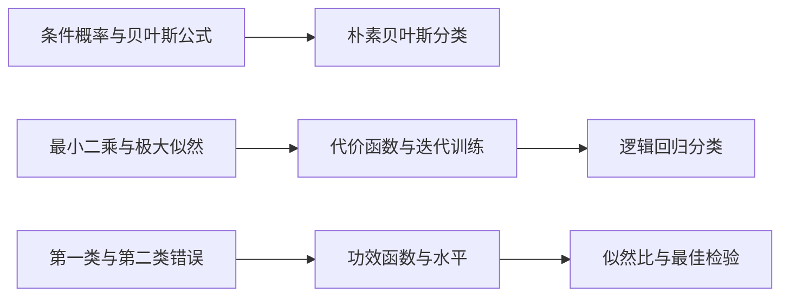

# 2026-11-17 第21节 数理统计：分类、回归与最佳检验

> [!info] 资料范围与整理口径
> 依据本次归档逐字稿与纪要整理。录制时间为16:20:50—18:03:55；有效讲授延续至相对时间01:38:27，末尾01:41:34的零散闲聊不作为课程知识或考核通知。转写中的“自然函数”“股票函数”等按数学上下文分别规范为“似然函数”“功效函数”。以下新增推导细节、校正与练习均明确标识；未取得课堂投影原表，不补造八条外卖记录。

## 一、本次解决什么问题

本节把以前学过的贝叶斯公式、参数估计和假设检验连接到机器学习：怎样由特征预测类别？怎样用损失函数训练参数？在同样控制第一类错误的条件下，怎样证明一个检验更有效？

最小先修：条件概率与贝叶斯公式；独立样本的联合分布；极大似然法；偏导数与梯度；正态样本均值的分布。回归的最小二乘背景可查[[03_Sources/Courses/数理统计/课件/C9_2(1)(1)/C9_2(1)(1)|§9.2课件]]；分类导入与功效函数的前课背景可查[[03_Sources/Courses/数理统计/课堂笔记/2026-11-05-第18节-一元线性回归与假设检验讲座|11月5日课堂笔记]]。

前约67分钟是统计与AI应用，后半部分回到第八章最佳检验的遗留证明。统计决策论的统一框架、多总体均值比较属于课堂预告，未在本次系统讲完。

## 二、外卖下单预测：为什么要比较后验概率（00:02—00:13）

### 1. 把实际问题写成分类问题

课堂给出8条历史下单记录，每条含店铺价位、口味、距离及“下单/不下单”标签。新推荐是“价位低、口味偏甜、距离远”，要预测是否下单。

统一记号：$Y=1$表示下单，$Y=0$表示不下单；$X_1$为价位，$X_2$为口味，$X_3$为距离。按课堂编码，新特征为$x=(0,0,1)$：低价记0、偏甜记0、距离远记1。口味共有偏甜、清淡、偏辣三种；数字是类别编码，不表示口味之间存在数值大小关系。

比较

$$
P(Y=1\mid X=x)\quad\text{与}\quad P(Y=0\mid X=x).
$$

由贝叶斯公式（当$P(X=x)>0$），

$$
P(Y=c\mid X=x)=\frac{P(Y=c)P(X=x\mid Y=c)}{P(X=x)}.
$$

两个类别的分母相同，故只需比较分子。课堂强调的重点是**不必先求公共分母，便可决定哪个类别更可能**。

> [!note] 补充解释：并非原则上不能求概率
> 模型及参数给定后，可把各类分子除以分子总和得到归一化后验。课堂“不算具体概率”的语境是比较类别时可省略分母，不能理解成分类模型绝对不能输出概率。

### 2. “朴素”是假设给定类别后特征条件独立

模型假定

$$
P(X=x\mid Y=c)=\prod_{j=1}^3P(X_j=x_j\mid Y=c).
$$

因此分类得分为

$$
s_c=P(Y=c)\prod_{j=1}^3P(X_j=x_j\mid Y=c),\qquad
\widehat Y=\arg\max_c s_c.
$$

> 一句话来说：先把“属于某类”的概率与该类内各项特征的匹配概率相乘，再选择得分最大的类。

**条件不能省略**：这不是无条件声称“价位、口味、距离互不相关”，而是给定下单类别后的建模假设。真实数据未必完全满足它。

### 3. 课堂频数计算与资料边界

逐字稿可辨认：8条中下单和不下单各4条；下单类内低价3条、偏甜3条、距离远1条；不下单类内低价1条、偏甜1条、距离远3条。按这些口述频数恢复，

$$
s_1=\frac12\cdot\frac34\cdot\frac34\cdot\frac14=\frac9{128},\qquad
s_0=\frac12\cdot\frac14\cdot\frac14\cdot\frac34=\frac3{128}.
$$

故课堂结论为“下单”。**该计算是按口述可辨认频数恢复**：00:11:28距离项后存在分数转写混乱，原始8行数据表与板书未取得，逐行记录仍待核。不能从这些边缘频数反向虚构完整原表。

## 三、零频数为什么危险：拉普拉斯平滑（00:13—00:25）

### 1. 教师修改距离数据的用意

教师把下单类中的距离改成全部“近”。此时新对象“距离远”在下单类中未出现，经验估计为$0/4$，整个$s_1$随之变为0。其他特征再支持下单，也被一个零因子全部消去。

这说明“有限样本中未出现”不等于“真实发生概率为零”。课堂由此讨论给频数加1，并联想到前课贝叶斯估计把极端样本比例向内部拉回的思想。教师还回顾三家工厂分别抽20、50、100件、各发现1件次品：经典比例估计分别为$1/20,1/50,1/100$；贝叶斯估计还依赖先验。录音提到的“分母加12、分子加7”只作为前课回顾，不在缺乏完整模型时认作本例统一平滑公式。

### 2. 准确公式与必须校正的分母

设类别$c$中有$N_c$条记录，特征$X_j$有$K_j$个可能取值，$N_{jvc}$为该类别中特征取$v$的条数。加一平滑为

$$
\widehat P(X_j=v\mid Y=c)=\frac{N_{jvc}+1}{N_c+K_j}.
$$

**分母加的是这个特征的可能取值数，不是标签类别数。**外卖例中价位与距离各两种，故分母为$4+2$；口味三种，故分母为$4+3$。不能把本例所有条件概率一律写成“分母加2”。这项校正依据[Berkeley CS188朴素贝叶斯课程的平滑公式](https://inst.eecs.berkeley.edu/~cs188/textbook/ml/naive-bayes.html)。

> 一句话来说：每种可能取值都补一个伪计数，既避免零概率，也保证同一特征各取值概率加起来仍为1。

> [!note] 补充解释：为什么不只修改零项
> 若只把零项改为正数，其他项保持原值，同一条件分布的概率总和通常超过1。统一分母$N_c+K_j$才能规范化。对$K_j$类概率取对称Dirichlet$(1,\ldots,1)$先验时，上式是后验均值；二元情况对应Beta$(1,1)$。不要把它不加条件地称为同一先验下的后验众数。

### 3. 其他课堂应用

- 天气、温度、湿度、风力作为特征，判断能否比赛。录音只提出问题，没有完整频数表，不编造数值答案。
- 邮件提取词语等特征，判断垃圾邮件或正常邮件。课堂讲的是分类思想，没有指定完整词表、训练规模或模型评测结果。
- 对多个类别，朴素贝叶斯可直接对每类计算$s_c$并取最大值；不必先转换成多个二分类问题。

## 四、线性回归：从求解析式到最小化代价（00:25—00:34）

### 1. 与以前最小二乘法是同一个目标

对已观测数据$(x_i,y_i)$，课堂回顾

$$
Q(a,b)=\sum_{i=1}^n[y_i-(a+bx_i)]^2.
$$

$x_i,y_i$固定，未知的是参数$a,b$。当$\sum_i(x_i-\bar x)^2>0$时，通常可求出

$$
\widehat b=\frac{\sum_i(x_i-\bar x)(y_i-\bar y)}{\sum_i(x_i-\bar x)^2},\qquad
\widehat a=\bar y-\widehat b\bar x.
$$

课堂为了引出机器学习训练，设想不直接解出参数，而是给定初值、逐步减小代价。**并非说普通线性最小二乘没有解析解**；这是求解途径的比较。上述背景与§9.2课件相互校核。

### 2. 课堂过原点直线小例

教师固定截距为0，拟合$y=bx$，讨论$(1,1),(2,2),(3,3)$三点；原点即使加入，对该模型的平方和也无贡献。

$$
Q(b)=(1-b)^2+(2-2b)^2+(3-3b)^2=14(1-b)^2.
$$

因此$Q(0)=14$，$Q(1/2)=3.5$，$Q(1)=0$。由$b=0$改成$b=1/2$，预测更贴近数据，代价下降。课堂中“$2-1/2$”等口头算式随后已修正为代入$bx$，这里保留修正后的表达式。

### 3. 梯度下降的含义与步长边界

一般迭代为

$$
b_{t+1}=b_t-\eta Q'(b_t),\qquad \eta>0.
$$

> 一句话来说：梯度指出函数增长最快的方向，减去适当大小的梯度，用来寻找较小代价。

> [!warning] 补充校正：步长不能任意
> 录音用二次函数在最小值附近变平来说明迭代，但不能据此推出步长“大也可以、小也可以”。本例$Q'(b)=28(b-1)$，所以$b_{t+1}-1=(1-28\eta)(b_t-1)$；固定步长收敛需$0<\eta<1/14$。若把目标缩放为$Q/(2n)$，相应导数和步长条件也随之改变。

## 五、为什么分类要引入逻辑回归（00:34—01:07）

### 1. 肿瘤大小的课堂示意

教师回顾用大小预测良恶性：六个横坐标为1.2、2.1、2.8、3.5、4.2、5.0，前三个标0，后三个标1；再把最后一个横坐标5.0改成15，比较对拟合直线的影响。问题是判断3厘米对象的类别。

课堂用图说明：若直接对0、1标签拟合直线，再以0.5为阈值，极端横坐标可能拉动拟合线，使原先正确分类的点变成误判。录音没有报出两组拟合系数和每个预测值，故不把示意图叙述补成教师已经算出的数值结果。该例承接11月5日的分类导入；它是教学模型，不是实际医学判定规则。

### 2. Sigmoid把实数映射成概率

课堂定义S型函数（逻辑函数）

$$
g(z)=\frac1{1+e^{-z}},\qquad z\in\mathbb R.
$$

其性质为$0<g(z)<1$、$g(0)=1/2$，且

$$
g'(z)=\frac{e^{-z}}{(1+e^{-z})^2}=g(z)[1-g(z)]>0.
$$

课堂着重演算导数的等价写法：先按复合函数求导，再把结果识别为原函数与$1-g$的乘积。严格说有限$z$时不取到0或1，它们只是两端极限。

对$d$个特征，令$x=(1,x_1,\ldots,x_d)^{\mathsf T}$，$\theta=(\theta_0,\ldots,\theta_d)^{\mathsf T}$，将截距统一放进第一维，则

$$
h_\theta(x)=g(\theta^{\mathsf T}x)=P_\theta(Y=1\mid X=x).
$$

> 一句话来说：线性部分产生一个实数分数，S型函数把它变成模型中的类别1概率，再由阈值产生离散标签。

按课堂0.5阈值，$h_\theta(x)>1/2$等价于$\theta^{\mathsf T}x>0$，预测1；小于时预测0；等于时需约定平局规则。**概率输出并不是只有0、1两个值**。阈值步骤才给出类别。

### 3. 代价为何是负对数

课堂先给出两种情形，并从函数图像说明：

$$
\ell(y,p)=
\begin{cases}
-\log p,&y=1,\\
-\log(1-p),&y=0.
\end{cases}
$$

真标签为1时，预测概率$p$越接近1代价越小，趋近0则代价趋向无穷；真标签为0时结论反过来。因此“非常自信地预测错误”受到很大惩罚。

**按课堂极大似然思路展开（补充推导细节）**：给定独立训练样本$(x_i,y_i)$，$y_i\in\{0,1\}$，设$p_i=h_\theta(x_i)$，则条件分布可统一写为

$$
P_\theta(Y_i=y_i\mid X_i=x_i)=p_i^{y_i}(1-p_i)^{1-y_i}.
$$

于是

$$
L(\theta)=\prod_{i=1}^n p_i^{y_i}(1-p_i)^{1-y_i},
$$

$$
\log L(\theta)=\sum_i[y_i\log p_i+(1-y_i)\log(1-p_i)].
$$

对数严格递增，最大化似然等价于最大化对数似然，再乘负号变成最小化问题：

$$
J(\theta)=-\frac1n\sum_i[y_i\log h_\theta(x_i)+(1-y_i)\log(1-h_\theta(x_i))].
$$

这里$1/n$不改变极值点。二元交叉熵即平均负对数似然，这条连接由[Stanford STATS202逻辑回归课程](https://web.stanford.edu/class/stats202/notes/Classification/Logistic-regression.html)校核。

### 4. 参数训练与多分类方向

课堂提出先初始化参数，再求导、沿负梯度迭代。补充写成

$$
\nabla J(\theta)=\frac1n\sum_i[h_\theta(x_i)-y_i]x_i,\qquad
\theta_{t+1}=\theta_t-\eta\nabla J(\theta_t).
$$

求导用到$g'=g(1-g)$，相消后剩下“预测概率减标签”乘特征。课堂没有给训练代码、学习率数值或停止标准，不补造训练结果。

教师以鸢尾花的多个品种引出多分类：可构造多个二分类器，再按投票等规则作决策，未系统指定哪一种组合算法。补充边界：朴素贝叶斯本身能直接多分类；逻辑回归也有多项模型扩展，投票并非唯一方法。课堂对鸢尾花特征为泛指，不据录音认定标准数据集含“花瓣数量”这个变量。

## 六、功效函数与检验水平：先明确比较标准（01:08—01:14）

设样本向量为$X$，拒绝域为$W$，当$X\in W$时拒绝$H_0$。若$H_0:\theta\in\Theta_0$，$H_1:\theta\in\Theta_1$，定义

$$
M_W(\theta)=P_\theta(X\in W),\qquad\theta\in\Theta_0\cup\Theta_1.
$$

这是**整个参数空间上的函数**，不是只在备择下定义：

- $\theta\in\Theta_0$时，它是第一类错误概率；
- $\theta\in\Theta_1$时，它是检验功效，等于$1-\beta(\theta)$，其中$\beta$为第二类错误概率。

> 一句话来说：拒绝域固定以后，换不同的真实参数，观察“拒绝原假设”的概率怎样变化。

水平为$\alpha$的约束是

$$
\sup_{\theta\in\Theta_0}M_W(\theta)\le\alpha.
$$

教师强调：若$\alpha$是上界，更大的数也能作为上界。因此真实大小（最小可用上界）为

$$
\alpha_W=\sup_{\theta\in\Theta_0}M_W(\theta).
$$

简单原假设只有一个$\theta_0$时才简化为$M_W(\theta_0)$。比较最佳检验时，应在同一水平约束内使备择下的功效尽可能大，不能把“备择下功效也小于等于$\alpha$”当作目标。以上按教材§8.4定义8.4.2校核，纠正纪要的简化表述。

## 七、似然比为什么给出最佳检验（01:14—01:27）

### 1. 本次证明的适用范围

考虑两个简单假设

$$
H_0:\theta=\theta_0,\qquad H_1:\theta=\theta_1.
$$

令$f_0(x)=L(\theta_0;x)$、$f_1(x)=L(\theta_1;x)$为样本联合密度（离散时为概率质量函数）。在可取比值处，似然比$f_1/f_0$越大，样本越支持$H_1$。取

$$
W^*=\{x:f_1(x)>cf_0(x)\},\qquad c>0,
$$

并假定$P_{\theta_0}(W^*)=\alpha$。那么任意满足$P_{\theta_0}(W)\le\alpha$的检验都有

$$
P_{\theta_1}(W)\le P_{\theta_1}(W^*).
$$

这就是本节使用的奈曼—皮尔逊思想：控制误拒真原假设的概率之后，优先把相对更支持备择的样本放入拒绝域。

### 2. 课堂反复解释的关键：消去交集

对任意两个事件$A,B$，

$$
P(A)-P(B)=P(A\setminus B)-P(B\setminus A).
$$

因为$A\cap B$在两边各算一次，相减即消去；不需要假设两事件互相包含。

把$A=W,B=W^*$代入，得到

$$
M_W(\theta_1)-M_{W^*}(\theta_1)
=\int_{W\setminus W^*}f_1(x)\,\mathrm dx
-\int_{W^*\setminus W}f_1(x)\,\mathrm dx.
$$

### 3. 完整比较证明（课堂思路的规范重写）

在$W\setminus W^*$上不属于$W^*$，故$f_1\le cf_0$；在$W^*\setminus W$上属于$W^*$，故$f_1>cf_0$。第二项前有负号，替换后两项整体均向上估计：

$$
\begin{aligned}
M_W(\theta_1)-M_{W^*}(\theta_1)
&\le c\int_{W\setminus W^*}f_0\,\mathrm dx
-c\int_{W^*\setminus W}f_0\,\mathrm dx\\
&=c[M_W(\theta_0)-M_{W^*}(\theta_0)]\\
&\le c(\alpha-\alpha)=0.
\end{aligned}
$$

最后一行才使用水平约束。证明不是只凭“似然比大”作直觉判断，而是用两个差集上的密度比较，把备择下的差转换成原假设下的差。

### 4. 边界条件（补充校正）

- 不能保证任意分布、任意$\alpha$都存在一个严格不等号阈值使大小恰为$\alpha$；离散情形尤其要注意。
- 若阈值边界有正概率，可以在$f_1=cf_0$处以适当概率随机拒绝，使大小达到$\alpha$；连续正态例中边界概率为0，$>$与$\ge$不影响结果。
- 课堂把$c=0$视作显然情形。用严格比值时，“似然非负”不能直接推出“比值严格大于0处是全空间”；还需检查支持。以$f_1>cf_0$表述可避免直接除以零；本节主证明采用$c>0$、大小恰为$\alpha$的情形。
- 简单对简单的最优性不能直接外推到任何复合备择；同一个拒绝域对每个备择参数都最佳时，才称一致最佳。

证明主线与[[03_Sources/Courses/数理统计/课本/概率论与数理统计/概率论与数理统计|教材§8.4最佳检验]]对应。教材OCR的差集积分行有集合重复等错误，本文按差集恒等式重写，没有照抄损坏公式，也没有改原始教材文件。

## 八、正态均值例：为什么备择大，拒绝域就朝右（01:27—01:35）

课堂对应教材例8.4.4。统一写$X_i\overset{\mathrm{iid}}\sim N(a,\sigma_0^2)$，$\sigma_0>0$已知；本文第二参数表示方差。先检验

$$
H_0:a=a_0,\qquad H_1:a=a_1>a_0.
$$

### 1. 把似然比整理成标准化均值

按课堂所指的计算补全中间代数：

$$
\begin{aligned}
\frac{L(a_1)}{L(a_0)}
&=\exp\left\{-\frac1{2\sigma_0^2}\sum_i[(x_i-a_1)^2-(x_i-a_0)^2]\right\}\\
&=\exp\left\{\frac{n(a_1-a_0)\bar x}{\sigma_0^2}-\frac{n(a_1^2-a_0^2)}{2\sigma_0^2}\right\}\\
&=\exp\{kU-k^2/2\},
\end{aligned}
$$

其中

$$
U=\frac{\sqrt n(\bar X-a_0)}{\sigma_0},\qquad
k=\frac{\sqrt n(a_1-a_0)}{\sigma_0}>0.
$$

在$H_0$下$U\sim N(0,1)$。

### 2. 选常数把似然比条件变成尾概率条件

定义$u_\alpha$为标准正态**上尾**分位点，即$P(Z\ge u_\alpha)=\alpha$。令

$$
c=\exp\{ku_\alpha-k^2/2\}.
$$

因指数严格递增且$k>0$，

$$
\frac{L(a_1)}{L(a_0)}\ge c
\iff kU-k^2/2\ge ku_\alpha-k^2/2
\iff U\ge u_\alpha.
$$

所以最佳拒绝域为

$$
W^*=\left\{\bar X\ge a_0+\frac{\sigma_0}{\sqrt n}u_\alpha\right\}.
$$

在$H_0$下恰有$P(W^*)=\alpha$。这补上了过去只记“右尾拒绝”的数学理由。

### 3. 若备择在左边，符号怎样改变

当$a_1<a_0$时，$k<0$。选$c=\exp\{-ku_\alpha-k^2/2\}$，再除以负数$k$，不等号反向，得到

$$
W^*=\{U\le -u_\alpha\}.
$$

> 一句话来说：拒绝域朝哪边，来自似然比对样本均值的增减方向；$k$的符号是课堂强调的关键。

**复合情形的衔接（按教材补足条件）**：右尾拒绝域与$a_1>a_0$的具体数值无关，故对$H_0:a=a_0,H_1:a>a_0$一致最佳。若$H_0:a\le a_0$，还需检查原假设范围内的最大拒绝概率确实在$a_0$取得；不能只说“把等号改成小于等于也一样”就省略水平核验。左侧情形对称。本节未据此证明双侧问题也存在相同意义的一致最佳检验。

## 九、课堂疑惑与解答

当日日计划不存在，未取得用户个人疑惑或实际作答记录。以下仅整理教师课堂提问与讲解，不标成个人已解决的问题。

| 课堂问题 | 对应解答 |
|---|---|
| 比较两种下单选择，是否必须先算后验分母？ | 不必；同一特征下公共分母相同，比较分类得分即可。见第二节。 |
| 为什么一个零频数能盖过其他特征？ | 朴素贝叶斯把条件概率相乘，任何零因子都会令整类得分为零；平滑减弱有限样本的极端估计。见第三节。 |
| 为什么负对数能表达分类代价？ | 真标签为1而预测概率趋近0时，负对数代价趋于无穷；它同时来自伯努利模型的负对数似然。见第五节。 |
| 两个拒绝域互不包含，积分差怎么处理？ | 消去交集，改成两个差集上的积分之差，再分别利用似然比不等式。见第七节。 |
| 为什么均值备择变小，拒绝域改成左尾？ | $k<0$，从似然比条件解出$U$时不等号反向。见第八节。 |

## 十、自测（新编，未验证掌握）

### 1. 三种口味的平滑

某类有4条记录，三种口味计数为$(3,1,0)$。做加一平滑后概率是什么？为什么分母不能加2？

> [!hint]- 提示
> 分母需加上给每个可能取值补入的伪计数总量。

> [!solution]- 解析
> 概率为$(4/7,2/7,1/7)$，和为1。该特征有3种可能取值，应加3；若分母加2，总和成为$7/6$。

### 2. 从概率写代价

某二分类样本真实标签为0，模型预测类别1概率为0.8。写出该样本的负对数似然；再说明为何不使用$-\log0.8$。

> [!hint]- 提示
> 似然应取模型分配给真实标签的概率。

> [!solution]- 解析
> 真实类别0的概率为$1-0.8=0.2$，故损失为$-\log0.2=\log5\approx1.609$。$-\log0.8$对应真实标签为1的情形。

### 3. 独立确定拒绝方向

$X_i\sim N(a,4)$独立，$n=16$，检验$H_0:a=10$对$H_1:a=9$，取$\alpha=0.05$，已知$u_{0.05}\approx1.645$。写出最佳拒绝域，并指出决定方向的量。

> [!hint]- 提示
> 先明确标准差，再看$a_1-a_0$的符号。

> [!solution]- 解析
> $\sigma_0=2$，$k=4(9-10)/2=-2<0$。拒绝域为$U\le-1.645$，即$\bar X\le10-(2/4)1.645=9.1775$。方向来自$k$的负号。

## 十一、课堂安排、待核事项与来源

**课堂安排**：开头预告今天讨论AI应用，周四处理最佳检验等遗留问题，并提出多组均值能否用逐对检验、有没有更好方法的问题；后半段实际已提前完成最佳检验主要证明。教师还提出后续可从决策论统一点估计、区间估计、假设检验与贝叶斯统计。本节没有讲完多总体均值比较或完整决策论，也没有可确认的新增作业题号、考试日期、提交要求。

**待核资料**：外卖8行原表及距离项原板书；天气比赛例的完整特征与频数；本次AI展示课件；若要保留教师肿瘤示意图的精确预测结果，仍需原图。本文未用图像缺失来阻断已明确的原理整理。

**以往缺失课次核查**：9月10日第4节、10月22日第14节、11月3日第17节，以及11月12日已有录音之外的后半节，本次没有获得能把新增知识可靠归属到具体缺失日期的证据。“之前”“有一次课”等回顾不能独立确定日期；逻辑回归导入已能对应11月5日的现有笔记。因此不据本次章节进度补造旧课堂或把部分恢复改成整堂完成。

- [[03_Sources/Courses/数理统计/课堂笔记/raw/2026-11-17-数理统计与AI应用讲座-243520-逐字稿|今日逐字稿]]：主来源，保留教师例题、问题和证明主线；时间均为此文件相对时间。
- [[03_Sources/Courses/数理统计/课堂笔记/raw/2026-11-17-数理统计与AI应用讲座-243520-纪要|今日纪要]]：辅助核对主题；概念和公式以逐字稿结合可靠教材校核后的表述为准。
- [[03_Sources/Courses/数理统计/课本/概率论与数理统计/概率论与数理统计|教材]]：§8.4定义8.4.2、最佳检验证明与例8.4.4，校核功效、水平和正态似然比。
- [[03_Sources/Courses/数理统计/课件/C9_2(1)(1)/C9_2(1)(1)|§9.2课件]]：校核一元回归与最小二乘背景，不作为今日AI展示原投影。
- [[03_Sources/Courses/数理统计/课堂笔记/2026-11-05-第18节-一元线性回归与假设检验讲座|11月5日笔记]]：对应分类导入和本次补讲的最佳检验背景。
- [Berkeley CS188：Naive Bayes](https://inst.eecs.berkeley.edu/~cs188/textbook/ml/naive-bayes.html)：核对条件独立及按特征取值数规范化的平滑。
- [Stanford STATS202：Logistic regression](https://web.stanford.edu/class/stats202/notes/Classification/Logistic-regression.html)：核对条件伯努利似然及数值拟合。
