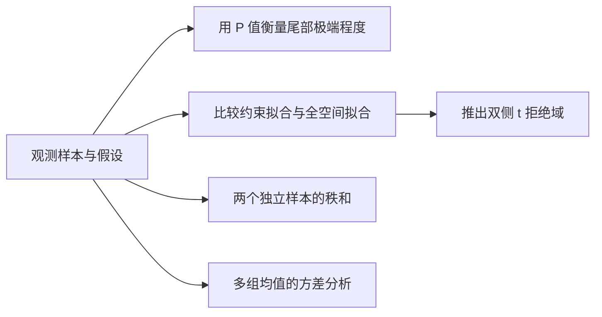

# 2026-11-19 第22节 数理统计｜P 值、似然比检验与估计量评价

本次录制于 10:24 开始。笔记整理到录制相对时间 01:32:49 的课程安排，时间标记可在[[03_Sources/Courses/数理统计/课堂笔记/raw/2026-11-19-假设检验与参数估计讲座-939520-逐字稿|原始逐字稿]]中核对。

## 一、本节问题与先修

两组观测都导致拒绝原假设，怎样比较它们支持拒绝的程度？方差未知时，为什么正态均值的双侧拒绝域恰好使用绝对值和 $t$ 临界值？先看 P 值如何确定尾部，再通过约束似然推导拒绝域，最后看两店和多店比较、参数函数估计与均方误差。

- [[03_Sources/Courses/数理统计/课堂笔记/2026-11-17-第21节-数理统计与AI应用讲座|第21节的最佳检验]]用简单假设之间的似然比排序样本。本节把拟合比较扩展到含未知参数的假设集合。
- [[03_Sources/Courses/数理统计/课件/C8_2(1)(1)/C8_2(1)(1)|课件 §8.2]]给出单样本与双样本 $t$ 检验。样本标准差的分母约定会影响统计量的写法，本节在推导中统一说明。

## 二、同样拒绝时怎样解读两个 P 值（00:00–07:17）

对给定的样本与检验，**P 值是在原假设模型下，得到至少和本次观测同样极端的检验统计量的概率**。极端方向由对立假设和统计量的构造决定。右尾检验取 $P_{H_0}(T\ge t_{\rm obs})$，左尾取 $P_{H_0}(T\le t_{\rm obs})$。以 $\lvert T\rvert$ 衡量极端程度的对称双尾检验，取 $P_{H_0}(\lvert T\rvert\ge\lvert t_{\rm obs}\rvert)$。

### 课堂例：样本均值为 3 和 3.75

已知方差的正态右尾检验用 $Z=(\bar X-\mu_0)/(\sigma_0/\sqrt n)$，其中课堂取 $\mu_0=2$。录音给出两次观测的 $z$ 值分别为 $2$、$3.5$。下表用 $\Phi$ 复核录音近似值。

| 样本均值 | $z_{\rm obs}$ | 右尾 $p=1-\Phi(z_{\rm obs})$ |
|:--|:--|:--|
| $3$ | $2$ | $0.02275$ |
| $3.75$ | $3.5$ | $0.0002326$ |

在 $\alpha=0.05$ 下两次都拒绝 $H_0$。后一组在原假设下更极端，因而提供了更强的拒绝证据。记录 $p$ 可以保留这个差别。

> [!warning] 概率的条件
> P 值的概率是对原假设模型下还可能抽到的样本而言。这里的计算没有引入先验，不能从 $p$ 读出 $H_0$ 为真的概率。复合原假设还需控制整个原假设参数空间内的拒绝概率。给定 $\alpha$，按相配套的规则在 $p\le\alpha$ 时拒绝。

## 三、广义似然比怎样构造（07:31–19:43）

独立同分布样本的似然是 $L(\theta;x)=\prod_{i=1}^n f_\theta(x_i)$。固定观测 $x$ 后，似然是参数的函数。极大似然估计找出使这个函数最大的参数值。课堂提到 Neyman 与 Pearson 提出的似然比思想，并回顾经典统计把未知参数当作固定值。[[03_Sources/Courses/数理统计/课堂笔记/2026-11-10-第19节-贝叶斯统计理论授课|第19节的贝叶斯处理]]另行给参数指定先验，由后验衡量参数落在某集合中的概率。

在 $H_0:\theta\in\Theta_0$、$H_1:\theta\in\Theta_1$ 且 $\Theta=\Theta_0\cup\Theta_1$ 时，记 $M_0=\sup_{\Theta_0}L$、$M_1=\sup_{\Theta_1}L$。各取上确界能比较两个集合各自能达到的最佳拟合。简单假设下，两个上确界分别是两点的似然。采用课堂所用的较大值拒绝的方向，在 $M_0>0$ 时写作

$$
R=\frac{\sup_{\Theta}L}{M_0}=\max\left(1,\frac{M_1}{M_0}\right).
$$

取 $c>1$，则 $R>c$ 与 $M_1/M_0>c$ 描述同一拒绝域。另一种常见写法是 $\Lambda=1/R$，此时从小值端拒绝。**临界值用原假设下的抽样分布校准**。单靠两个拟合值的大小只能排序，显著性水平还需要校准后的阈值。

## 四、为什么双侧正态均值检验用绝对值（20:07–56:32）

设 $X_1,\ldots,X_n$ 独立同分布于 $N(\mu,\sigma^2)$，$n\ge2$，$\sigma^2>0$ 未知。检验 $H_0:\mu=\mu_0$ 对 $H_1:\mu\ne\mu_0$。课堂先回顾单侧拒绝域只能看一边的问题，再从似然比推出两侧同时看。虽然 $H_0$ 固定了 $\mu$，方差在 $H_0$ 下仍是待拟合参数。

### 1. 受限与不受限拟合

令 $Q(m)=\sum_{i=1}^n(x_i-m)^2$，$Q_0=Q(\mu_0)$，$Q_*=Q(\bar x)$。对实际有样本波动的情形 $Q_*>0$，

$$
\begin{aligned}
L(m,\sigma;x)&=(2\pi)^{-n/2}\sigma^{-n}\exp\!\left[-\frac{Q(m)}{2\sigma^2}\right],\\
\frac{\partial}{\partial\sigma}\log L(m,\sigma;x)&=-\frac{n}{\sigma}+\frac{Q(m)}{\sigma^3}.
\end{aligned}
$$

导数的符号由 $Q(m)-n\sigma^2$ 决定，先正后负，因此固定 $m$ 时最大值在 $\widehat\sigma^2(m)=Q(m)/n$ 取得。代回后指数因子是 $e^{-n/2}$，于是 $\sup_{\sigma>0}L(m,\sigma;x)=(2\pi e\,Q(m)/n)^{-n/2}$。这也给出课堂中 $\sigma^{-n}e^{-a/\sigma^2}$ 在 $a>0$ 时的求极值办法，取 $a=Q(m)/2$ 即可。

- 受 $H_0$ 约束时，$m=\mu_0$，方差极大似然估计为 $Q_0/n$。
- 在全空间内，固定 $\sigma$ 时最大化似然等同于最小化 $Q(m)$。由 $Q'(m)=2n(m-\bar x)$ 且 $Q''(m)=2n>0$，得 $\widehat\mu=\bar x$，再得 $\widehat\sigma^2=Q_*/n$。

### 2. 利用离差平方和化简

课堂在展开时调整了中心。对 $x_i-\mu_0$ 加减 $\bar x$，交叉项含 $\sum_i(x_i-\bar x)=0$，于是

$$
Q_0=Q_*+n(\bar x-\mu_0)^2.
$$

若先绕 $\mu_0$ 展开 $\sum_i(x_i-\bar x)^2$，其中 $\sum_i(x_i-\mu_0)$ 一般有值，不能把交叉项删去。取修正样本方差 $S^2=Q_* /(n-1)$，两个最大似然中的公共因子约去，得到

$$
R=\left(\frac{Q_0}{Q_*}\right)^{n/2}
=\left(1+\frac{n(\bar x-\mu_0)^2}{Q_*}\right)^{n/2}
=\left(1+\frac{t_{\rm obs}^2}{n-1}\right)^{n/2},
\qquad
t_{\rm obs}=\frac{\bar x-\mu_0}{S/\sqrt n}.
$$

因此，大 $R$ 与大 $\lvert t_{\rm obs}\rvert$ 等价。若按课件记未修正方差为 $S_0^2=Q_*/n$，标准误也可写成 $S_0/\sqrt{n-1}$，数值相同。估计方差时用到的 $Q_*/n$ 和构造统计量时记的 $S^2$ 各有用途。

### 3. 用原假设下的分布确定阈值

在 $H_0$ 下，$Z=\sqrt n(\bar X-\mu_0)/\sigma\sim N(0,1)$，$V=(n-1)S^2/\sigma^2\sim\chi^2_{n-1}$，且 $Z,V$ 独立。根据 $t$ 分布的定义，$T=Z/\sqrt{V/(n-1)}\sim t_{n-1}$。令 $t_{\alpha/2}(n-1)$ 表示上尾概率为 $\alpha/2$ 的临界点，则

$$
\lvert T\rvert>t_{\alpha/2}(n-1)
$$

就是水平为 $\alpha$ 的拒绝域。方差已知时固定 $\sigma=\sigma_0$，同一个平方和分解给出 $R=\exp\{n(\bar x-\mu_0)^2/(2\sigma_0^2)\}$，此时用标准正态双尾临界点。其他检验仍需按照各自模型求抽样分布。本节完整展开的是上述单样本问题。

## 五、两家分店的销量如何比较（56:32–01:09:54）

课堂例题有两组月销量，样本量分别为 $9$、$6$。如果目标是比较两个独立正态总体的均值，且共享未知方差，可用合并方差的双样本 $t$ 检验，自由度为 $9+6-2=13$。课堂还回顾了正态条件下的方差比检验与配对 $t$ 检验。配对必须有真实的对应单位，例如同一个月份的两店销量，配对设计决定差值，凑齐样本量本身不能建立对应关系。

### 1. 从排序得到秩和

课堂用单次 $15\,000$ 件的大订单说明样本均值会受极端值牵动。秩和按相对顺序衡量典型大小。把两组合并从小到大排序，从 $1$ 编到 $15$。相同的值平分所占秩次，例如两个 $260$ 占第 $9$、$10$ 位，各记 $9.5$。全体秩次加总仍为 $15\times16/2=120$。课堂选样本较小的第二组加总为 $R_2$。若备择方向为第二组整体偏小，就看 $R_2$ 的下尾，方向相反时看上尾，双侧看两端。

录音口述 $R_2$ 约为 $47.5$，并将它与课堂所查区间比较，结论是未拒绝。原始 15 个观测的完整板书和临界值表目前未找到，因此这两个量只保留可听清的计算过程与口述结果。原假设下第二组的期望秩和为 $6(15+1)/2=48$，可用来核对 $47.5$ 接近秩和分布的中心。

### 2. 补充理解：秩和检验的边界

经典 Wilcoxon 秩和检验以两组样本独立、在共同分布的原假设下标签可交换为依据。在共同形状的位置平移模型下，可以把结论解释为位置差异。一般分布下，秩和并不能直接检验算术均值是否相等。涉及并列值时，临界值或 P 值应采用相应的条件置换分布，或使用处理并列值的近似。课堂只提到符号检验，未展开。 [R stats 的 Wilcoxon 秩和检验说明](https://search.r-project.org/R/refmans/stats/html/wilcox.test.html)

## 六、三家分店为何要做整体检验（01:10:38–01:21:07）

把第三家分店的 $7$ 个观测加入后，问题变成检验 $H_0:\mu_1=\mu_2=\mu_3$。如果每对都按水平 $0.05$ 检验，就有三次产生假阳性的机会。在三个原假设均为真、各次精确水平为 $0.05$ 且拒绝事件独立的示意情形下，至少一次误拒绝的概率为 $1-0.95^3=0.142625$。真实的分店两两检验共享样本，独立乘法不能直接用来确定整体错误率。无独立假设时，由并集上界可得这三个水平 $0.05$ 的检验整体第一类错误概率至多 $0.15$。

课堂借用[[03_Sources/Courses/数理统计/课堂笔记/2026-11-05-第18节-一元线性回归与假设检验讲座|第18节回归 F 检验的平方和分解]]来解释整体比较。组内离差描述在各自组均值附近的波动，组间离差描述各组均值偏离总均值的程度。三家分店是一个因子的三个水平。

### 教材补充：从平方和分解写出统计量

记第 $i$ 组第 $j$ 个观测为 $x_{ij}$，各组样本量 $n_i$，总样本量 $N=\sum_i n_i$，共有 $k$ 组。组均值为 $\bar x_i$，总均值为 $\bar x=\sum_i n_i\bar x_i/N$。因为每组 $\sum_j(x_{ij}-\bar x_i)=0$，展开 $x_{ij}-\bar x=(x_{ij}-\bar x_i)+(\bar x_i-\bar x)$ 得

$$
\underbrace{\sum_{i,j}(x_{ij}-\bar x)^2}_{SS_{\rm total}}
=\underbrace{\sum_{i,j}(x_{ij}-\bar x_i)^2}_{SS_{\rm within}}
+\underbrace{\sum_i n_i(\bar x_i-\bar x)^2}_{SS_{\rm between}}.
$$

在独立正态观测、各组共用未知方差且 $N>k\ge2$ 的模型下，$H_0$ 成立时

$$
F=\frac{SS_{\rm between}/(k-1)}{SS_{\rm within}/(N-k)}\sim F_{k-1,N-k}.
$$

分子与分母分别是组间和组内均方，$F$ 大到超过右尾临界值时拒绝，表示至少一组总体均值有差异。课堂将详细推导留给后续学习，教材 §9.5 给出单因子模型与临界值。方差分析关注本题的总体均值，利用的是两类波动的比较。 [[03_Sources/Courses/数理统计/课本/概率论与数理统计/概率论与数理统计|教材 §9.5 单因子方差分析]]

## 七、点估计的均方误差和函数估计（01:21:07–01:32:49）

### 1. 为什么误差需要平方

固定未知参数 $\theta$，记估计量 $\widehat\theta=\widehat\theta(X)$，偏差 $b=E_\theta[\widehat\theta]-\theta$。直接求平均误差只能看到 $b$，正负误差会抵消。平方误差的期望同时反映离散程度和系统偏差。

$$
\begin{aligned}
\operatorname{MSE}_\theta(\widehat\theta)
&=E_\theta[(\widehat\theta-\theta)^2]\\
&=E_\theta[(\widehat\theta-E_\theta\widehat\theta)^2]
  +2b E_\theta[\widehat\theta-E_\theta\widehat\theta]+b^2\\
&=\operatorname{Var}_\theta(\widehat\theta)+b^2 .
\end{aligned}
$$

交叉项为零，因为中心化估计量的期望为零。两个估计量都无偏时，均方误差随方差比较。允许有偏时，小偏差可以换取更大的方差下降，此时仍按总均方误差评价。教材 §7.2 与课件的估计量比较采用这套思路。课堂也指出平方误差可作为一种损失，点估计、区间估计和检验都能从统计决策的角度讨论，本次未展开完整决策论。

### 2. 极大似然估计的不变性

已知 $\widehat\theta$ 是 $\theta$ 的一个极大似然估计，求 $g(\theta)$ 时用 $g(\widehat\theta)$。补充推理是对每个候选值 $\eta$ 定义剖面似然 $L_g(\eta;x)=\sup_{\theta:g(\theta)=\eta}L(\theta;x)$。在 $\eta=g(\widehat\theta)$ 的集合内已达到全空间最大似然，因此即使 $g$ 多对一，$g(\widehat\theta)$ 仍是一个最大点。

- 课堂提示可能要求估计 $\lambda^2$、$1/\lambda$、$\lambda^3$。先按分布求 $\widehat\lambda$，再代入对应函数，倒数要求估计值在定义域内。
- 要估计 $P_\theta(X>1)$ 时，先从总体分布把它写成 $g(\theta)=1-F_\theta(1)$，再代入模型参数的极大似然估计。若题目要求矩法，先由矩方程求 $\widetilde\theta$，再以 $g(\widetilde\theta)$ 作代入估计。
- 课堂提到最后一次课会安排复习题共同讨论。这段录制没有给出具体题目。

## 八、自测（新编）

### 1. 从平方和判断拒绝方向

某正态样本有 $n=10$、$\bar x=4$、$S^2=9$，总体方差未知。检验 $H_0:\mu=2$ 对 $H_1:\mu\ne2$。求 $Q_*$、$Q_0$、$R$，并决定在 $\alpha=0.05$ 是否拒绝，已知 $t_{0.025}(9)=2.262$。

> [!hint]- 提示
> 先把 $S^2$ 还原为以样本均值为中心的平方和，再写出约束多出的代价。

> [!solution]- 解析
> $Q_*=9\cdot9=81$，$Q_0=81+10(4-2)^2=121$，所以 $R=(121/81)^5$。$\lvert t_{\rm obs}\rvert=2\sqrt{10}/3\approx2.108<2.262$，故在给定水平下不拒绝。

### 2. 有并列值时怎样分配秩次

两组独立观测为 $A=(2,5,6)$、$B=(3,5)$。给每个观测赋秩，计算 $B$ 的秩和和它在标签可交换下的期望。

> [!hint]- 提示
> 相同观测一起占据连续秩次，取所占秩次的平均。

> [!solution]- 解析
> 排序为 $2,3,5,5,6$，秩为 $1,2,3.5,3.5,5$。$B$ 的秩和是 $2+3.5=5.5$。标签可交换时，各位置的入组概率都是 $2/5$，期望是 $(2/5)(1+2+3+4+5)=6$。

### 3. 把分布参数换成概率

设样本来自指数分布，$\lambda>0$ 是率参数，$\bar x=2$。已知 $\widehat\lambda=1/\bar x$，求 $P_\lambda(X>1)$ 的极大似然估计。

> [!hint]- 提示
> 先对指数密度积分，得到关于 $\lambda$ 的生存概率，再代入。

> [!solution]- 解析
> $g(\lambda)=\int_1^\infty \lambda e^{-\lambda x}\,dx=e^{-\lambda}$，故极大似然估计为 $g(1/2)=e^{-1/2}$。

## 九、资料与待核

- [[03_Sources/Courses/数理统计/课堂笔记/raw/2026-11-19-假设检验与参数估计讲座-939520-逐字稿|逐字稿]]保留课堂推导与例子，[[03_Sources/Courses/数理统计/课堂笔记/raw/2026-11-19-假设检验与参数估计讲座-939520-纪要|纪要]]用于主题对照。分店样本原表与对应秩和临界值待板书或讲义补传后复算。
- [[03_Sources/Courses/数理统计/课件/C8_1(1)/C8_1(1)|§8.1 基本概念]]用于核对尾部与两类错误，[[03_Sources/Courses/数理统计/课件/C8_2(1)(1)/C8_2(1)(1)|§8.2 参数假设检验]]用于核对正态均值检验、合并方差和配对条件。
- [[03_Sources/Courses/数理统计/课件/C7_1/C7_1|§7.1 矩法和极大似然法]]用于核对似然与矩估计，[[03_Sources/Courses/数理统计/课件/C7_2/C7_2|§7.2 估计量的优良性准则]]和[[03_Sources/Courses/数理统计/课本/概率论与数理统计/概率论与数理统计|教材 §7.2、§9.5]]用于核对均方误差与单因子方差分析公式。

