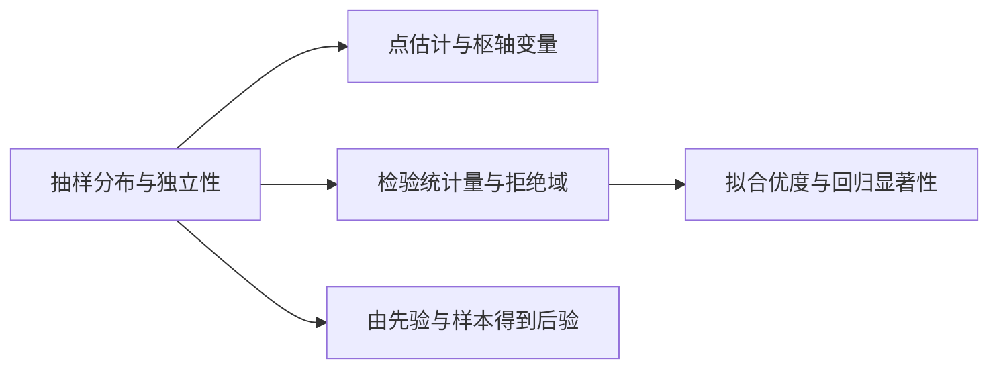

# 2026-11-24 第23节 数理统计｜期末复习与典型题

本节回顾第 6–10 章，重点是由题设选统计量、说明分布成立的条件，再做数值计算。公式记号沿用课件，$S^2$ 是分母为 $n$ 的样本方差，$S_*^2$ 是分母为 $n-1$ 的修正样本方差。

## 一、课堂安排与试卷回顾（07:23–16:54）

- **期末自带计算器。** 教师提醒区间估计、检验、回归均可能需要数值计算，答卷保留统计量、分布与计算步骤。
- 智慧树上关于“情书是人类还是 AI”的简短数据收集任务，课堂给出的时间是 **11 月 25 日 21:00 前**，具体入口以课程 APP 为准。
- 期中订正重点包括结构定理漏写独立性、矩估计和无偏性中的积分运算、最小次序统计量的密度、均值与方差的点估计记号，以及用样本方差替代样本标准差的错误。要求报估计量时，写 $\widehat\mu=\bar X$ 及所选方差估计量，取得样本后再代数值。
- 教师明确说**最佳检验不考**，并将最小方差无偏估计等作为可能的较难题讨论。题量与难度是复习课的口头预估。录音未提供可核实的具体考试日期。

## 二、抽样分布与三项课堂练习（16:54–18:46、37:00–50:21）

经典统计视参数为未知常数。简单随机样本独立同分布，用样本的函数作为统计量。正态总体下，$\sqrt n(\bar X-\mu)/\sigma\sim N(0,1)$，$(n-1)S_*^2/\sigma^2\sim\chi^2_{n-1}$，且 $\bar X$ 与 $S_*^2$ 独立。从独立的标准正态和卡方拼 $t$，从两个独立卡方分别除以自由度后的比值拼 $F$。课件 §6.3 汇总了单、双正态总体的抽样分布及条件。

**新观测与样本均值之差。** 若 $X_{n+1}$ 是同一正态总体的独立新观测，$X_{n+1}-\bar X$ 的均值为零、方差为 $\sigma^2(1+1/n)$。$X_{n+1}$ 与 $(\bar X,S_*^2)$ 独立，样本内 $\bar X$ 又与 $S_*^2$ 独立，所以分子与分母独立：

$$
\frac{X_{n+1}-\bar X}{S_*\sqrt{1+1/n}}\sim t_{n-1}.
$$

**两个指数观测的次序统计量。** 对独立的 $\operatorname{Exp}(\lambda)$ 样本，最小值 $U$、最大值 $V$ 的联合密度为 $2\lambda^2 e^{-\lambda(u+v)}$（$0<u<v$），其余为零。因子 2 来自两种排序。课堂把比值条件改写成平面区域再积分。若条件为 $U/V\le c$ 且 $0\le c\le1$，则可按 $v>0,\ 0<u\le cv$ 积分，得到 $2c/(1+c)$，这是按录音方法补出的计算，板书范围以原题为准。

**相邻差的平方和。** 对独立同分布且方差为 $\sigma^2$ 的样本，$E[(X_{i+1}-X_i)^2]=2\sigma^2$，所以 $\sum_{i=1}^{n-1}(X_{i+1}-X_i)^2/[2(n-1)]$ 无偏。相邻差共享一个观测，其协方差为 $-\sigma^2$，即使总体正态，也不能直接把这些平方项视作独立卡方相加。计算期望只需线性性。课堂还回顾了等方差正态样本中 $X_1+X_2$ 与 $X_1-X_2$ 可由联合正态及零协方差推出独立。

## 三、点估计、无偏性与区间（18:46–26:36、50:21–53:00、01:03:06–01:06:49）

- **矩估计**把样本矩与相应总体矩配对。一个未知参数常用一阶矩，两个未知参数常用前两阶原点矩组成方程组。**极大似然**用 $L(\theta)=\prod_i f_\theta(x_i)$。可微的内部极值可从对数似然的得分方程找候选点。遇到支持集随参数变化时，要检查可行域和端点，例如 $U(0,\theta)$ 的 $\widehat\theta_{\rm ML}=X_{(n)}$。
- **无偏、有效、相合**分别看期望、无偏类中的方差、样本量增大时的概率收敛。$U(0,\theta)$ 中，$2\bar X$ 无偏，$X_{(n)}$ 有偏。比较偏差与方差时可用均方误差。找最小方差无偏估计时，达到 Cramér–Rao 下界是一条可行路径，前提是满足相应正则条件。另一条路径是找完全充分统计量 $T$，把任一无偏估计 $U$ 条件化为 $E(U\mid T)$。只验证完全充分性还要检验估计量的无偏性。
- **参数函数估计**。求 $g(\theta)$ 的极大似然估计，用 $g(\widehat\theta_{\rm ML})$。例如正态总体 $P(X>1)=1-\Phi((1-\mu)/\sigma)$，要用 $\mu,\sigma$ 的同一估计法所得结果分别代入。若要求极大似然，方差使用高斯似然的分母 $n$。若取修正方差作代入估计，应先开平方；这种代入一般不保证无偏。例 $\bar X$ 无偏估计 $\mu$，但 $E(\bar X^2)=\mu^2+\sigma^2/n$。
- **区间估计**先固定枢轴分布再解关于参数的不等式。正态方差未知时，$(\bar X-\mu)/(S_*/\sqrt n)=(\bar X-\mu)/(S/\sqrt{n-1})$，两个分母配对使用。双侧区间通常在两端各留 $\alpha/2$；下置信限写成 $[L,\infty)$，概率事件要解成 $\mu\ge L$。正态方差已知时，双侧均值区间长度是 $2z_{1-\alpha/2}\sigma/\sqrt n$，若上限为 $\ell$ 则要求 $n\ge(2z_{1-\alpha/2}\sigma/\ell)^2$，向上取整。课堂口述样本量题未保留完整条件，此式对应已知方差的情形。

## 四、假设检验与两类错误（26:36–31:49、53:00–01:02:08）

先写 $H_0,H_1$，再写**在 $H_0$ 成立时**统计量的分布。备择的方向决定哪一端进入拒绝域。对本课程的单调单侧模型，复合零假设在边界值校准，前提是这里的拒绝概率最大；不能将这个步骤推广到任意复合假设。最后代数值并作结论。第 22 节以似然比严格推出正态均值的双侧拒绝域。

- **安眠药例题。** 旧药均值 20.8、标准差 1.6，新药声称平均增加 3。课堂把主张理解为精确增加量，于是 $H_0:\mu=23.8$、$H_1:\mu\ne23.8$。在新药正态样本且方差未知的模型下，$T=(\bar X-23.8)/(S_*/\sqrt n)$ 在 $H_0$ 下服从 $t_{n-1}$，按双侧拒绝域判断。旧药的标准差不能用作新药的 $\sigma$。录音未保留完整新药数据，保留到统计量与拒绝域。
- **拟合优度。** 对预先分好的 $k$ 组，统计量为 $\sum_i(O_i-E_i)^2/E_i$，$E_i=np_i$。通常在正则条件下，若用样本拟合了 $r$ 个独立参数，自由度按 $k-1-r$；指定均匀分布时 $r=0$。课堂还举了反求未知频数的题型：把频数保留为符号，解统计量落入不拒绝域的不等式，再按非负整数及总频数筛选。
- **独立性检验。** 行列联表期望频数为 $\text{行合计}\times\text{列合计}/n$，自由度为 $(a-1)(b-1)$。$2\times2$ 时为 1，须满足卡方近似的频数条件。
- **第二类错误。** 在具体备择参数下求统计量落入不拒绝域的概率。课堂举 $\mu_0=5,\ \mu_1=6$，已知 $\sigma$ 时，在 $\mu=6$ 下把 $\bar X-5$ 改写为 $(\bar X-6)+1$。相应 $Z_0$ 是标准正态加 $\sqrt n/\sigma$。若右尾拒绝域为 $Z_0>z_{1-\alpha}$，则 $\beta(6)=\Phi(z_{1-\alpha}-\sqrt n/\sigma)$，固定差异下随 $n$ 增加趋于零。

## 五、回归与贝叶斯统计（31:07–35:43、01:02:08）

**一元线性回归。** 令 $L_{xx}=\sum_i(x_i-\bar x)^2$、$L_{xy}=\sum_i(x_i-\bar x)(y_i-\bar y)$，$L_{yy}$ 同理。课堂要求会算 $R=L_{xy}/\sqrt{L_{xx}L_{yy}}$ 并与相应双侧临界值比较。在标准正态线性回归模型的零斜率假设下，也可用 $R\sqrt{(n-2)/(1-R^2)}\sim t_{n-2}$。斜率 $\widehat b=L_{xy}/L_{xx}$，截距 $\widehat a=\bar y-\widehat b\,\bar x$。独立同方差误差模型下，残差平方和除以 $n-2$ 给误差方差的无偏估计。若题式对 $1/x$ 线性，先令 $z=1/x$ 并检查 $x\ne0$。

**贝叶斯统计。** 用先验表达参数未知程度，后验密度正比于似然乘先验，归一化后才是条件分布。平方损失下取后验均值。课堂点名回看好评率和正态均值配正态先验两个例子。贝叶斯区间取后验质量为 $1-\alpha$ 的集合；在等误判损失的二择一问题中，可比较两参数区域的后验概率。第 19 节保留了后验均值结论的详细证明。

## 六、自测（新编）与资料

若 $n=6$、$\bar x=25$、修正样本方差 $s_*^2=4$，上述双侧均值检验的统计量和自由度是多少？

> [!hint]- 提示
> 分母先将方差开方，再除以样本量的平方根。

> [!solution]- 解析
> $t=(25-23.8)/(2/\sqrt6)\approx1.470$，自由度为 5。这是练习数据，原课堂例题的观测表仍待核。

- [[03_Sources/Courses/数理统计/课堂笔记/raw/2026-11-24-数理统计期末复习课程-379648-逐字稿|逐字稿]]及[[03_Sources/Courses/数理统计/课堂笔记/raw/2026-11-24-数理统计期末复习课程-379648-纪要|纪要]]保留原始讲解。01:10–01:13 的答疑提到群内习题集有参考答案且部分超纲，电梯停靠次数期望可尝试递推，录音未保留完整题面。试卷有订正疑问可按课堂安排向教师或助教反馈。
- [[03_Sources/Courses/数理统计/课本/概率论与数理统计/概率论与数理统计|教材第 6–10 章]]及[[03_Sources/Courses/数理统计/课件/C6_3/C6_3|§6.3 抽样分布]]、[[03_Sources/Courses/数理统计/课件/C7_4(1)/C7_4(1)|§7.4 区间估计]]、[[03_Sources/Courses/数理统计/课件/C8_2(1)(1)/C8_2(1)(1)|§8.2 参数假设检验]]、[[03_Sources/Courses/数理统计/课件/C8_3(1)/C8_3(1)|§8.3 分布假设检验]]、[[03_Sources/Courses/数理统计/课件/C9_2(1)(1)/C9_2(1)(1)|§9.2 一元回归]]用于核对公式和适用条件。
- [[03_Sources/Courses/数理统计/课堂笔记/2026-11-19-第22节-假设检验与参数估计讲座|似然比与估计量评价]]、[[03_Sources/Courses/数理统计/课堂笔记/2026-11-10-第19节-贝叶斯统计理论授课|先验、后验与贝叶斯估计]]用于回看证明。

